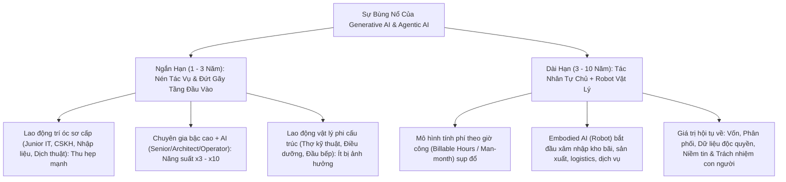
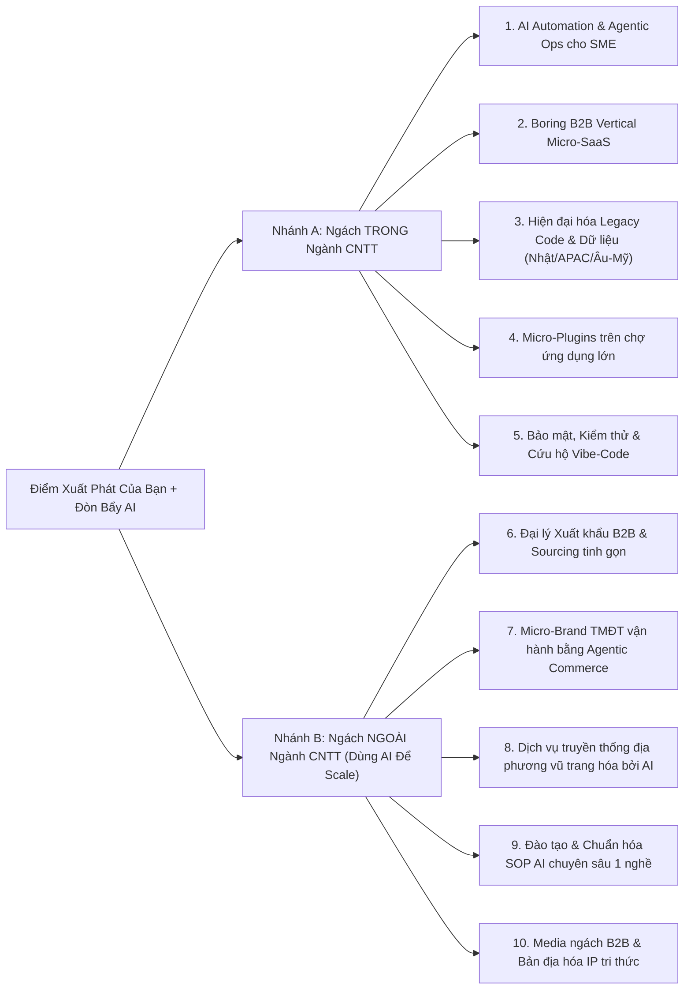

# Báo Cáo Chiến Lược: Tác Động Của AI Tới Việc Làm Toàn Cầu – Khu Vực – Việt Nam & Bản Đồ Các Ngách Kiếm Lời Thực Chiến

> [!IMPORTANT]
> **Luận điểm cốt lõi (2026+):** Trí tuệ nhân tạo không gây ra sự "xóa sổ việc làm đồng loạt trong một đêm", mà tạo ra **sự nén tác vụ (Task Compression)** và **tái phân bổ biên lợi nhuận khốc liệt**. Tiền và việc làm không biến mất — chúng chảy từ nhóm **"bán giờ công thực thi quy trình chuẩn"** sang nhóm **"sở hữu bài toán, kênh phân phối, dữ liệu ngách, trách nhiệm pháp lý và khả năng điều phối hệ thống AI"**.

---

## Phần 1: Tác Động Quy Mô Toàn Cầu — Mọi Công Việc, Ngành Dịch Vụ & Ngành CNTT

Theo chu kỳ dự báo **2025–2030 của Diễn đàn Kinh tế Thế giới (WEF)**, AI và tự động hóa dự kiến thay thế khoảng **92 triệu việc làm** nhưng đồng thời tạo ra **170 triệu vai trò mới** (tăng ròng **78 triệu việc làm**). Tuy nhiên, con số dương này ẩn chứa một cái bẫy cấu trúc: **59% lực lượng lao động toàn cầu buộc phải đào tạo lại (reskilling)**, bởi người mất việc ở tầng thực thi cơ bản không tự động đủ năng lực bước sang các vị trí mới được tạo ra.

### 1.1. Với Mọi Công Việc Trên Quy Mô Toàn Cầu

| Chiều phân tích | Xu hướng Ngắn hạn (1 – 3 năm: 2026 – 2028) | Xu hướng Dài hạn (3 – 10 năm: 2029 – 2035+) |
| :--- | :--- | :--- |
| **Cơ chế tác động chính** | **Thay thế tác vụ (Task Automation), chưa xóa sổ toàn bộ chức danh.** Một nhân sự giỏi dùng AI gánh khối lượng việc của 3–5 người, khiến doanh nghiệp **ngừng tuyển mới (Hiring Freeze)** thay vì sa thải hết người cũ. | **Tái thiết kế tổ chức quanh AI Agents & Robotics.** Doanh nghiệp được xây dựng theo cấu trúc "AI-first": hệ thống đa tác nhân tự vận hành luồng việc, con người chỉ giữ vai trò giám sát ngoại lệ, chiến lược và đối ngoại. |
| **Hiện tượng thị trường lao động** | **Phân hóa chữ K & Nghịch lý Moravec:** Các việc làm bàn giấy (white-collar) mức trung bình – thấp chịu cú sốc đầu tiên. Ngược lại, lao động kỹ thuật tay nghề vật lý (điện lạnh, cơ khí, chăm sóc y tế trực tiếp, sửa chữa hiện trường) vẫn khan hiếm và tăng lương do robot chưa đủ rẻ và khéo léo. | **Hội tụ AI + Phần cứng (Embodied AI):** Khi chi phí suy luận tiến về 0 và robot hình người/tự hành giảm giá dưới ngưỡng lương công nhân, làn sóng tự động hóa thứ hai sẽ tràn sang vận tải, kho vận, chế tạo, nông nghiệp và bán lẻ vật lý. |
| **Khủng hoảng lớn nhất** | **Đứt gãy "nấc thang đầu tiên" (Broken Bottom Rung):** Các việc vốn dùng để rèn luyện sinh viên mới ra trường (soạn tài liệu, tìm kiếm dữ liệu, code module nhỏ, trực chat) bị AI nuốt trọn, làm hẹp cánh cửa gia nhập thị trường của người trẻ. | **Khủng hoảng phân phối thu nhập & Chuyển dịch sang nền kinh tế siêu vi mô:** Số lượng công ty tỷ đô có dưới 50 nhân sự xuất hiện ngày càng nhiều; lao động phổ thông dịch chuyển sang kinh tế sáng tạo, chăm sóc con người, hoặc vận hành doanh nghiệp siêu nhỏ (Micro-business). |

---

### 1.2. Với Ngành Dịch Vụ Toàn Cầu (Service Sector)

Ngành dịch vụ chiếm trên 65% GDP toàn cầu, bao trùm từ **dịch vụ tri thức** (tài chính, luật, kế toán, tư vấn, marketing, BPO) đến **dịch vụ trực tiếp** (bán lẻ, du lịch, khách sạn, F&B, y tế, giáo dục).

* **Ngắn hạn (1 – 3 năm):**
  * **Sự xói mòn của mô hình "Tính tiền theo giờ" (Billable Hours):** Trong ngành luật, kế toán, kiểm toán, dịch thuật và agency quảng cáo, khách hàng không còn chấp nhận trả hàng ngàn USD cho hàng chục giờ "nghiên cứu sơ bộ" hay "viết bản nháp". Các công ty dịch vụ buộc phải chuyển sang **định giá trọn gói theo kết quả (Outcome-based pricing)**.
  * **Tự động hóa tầng giao tiếp đầu tiên (Tier-1 Frontline):** Voice AI độ trễ thấp (dưới 500ms) và Agentic Chat xử lý thành công 60%–80% yêu cầu CSKH tiêu chuẩn, đặt lịch, tra cứu đơn hàng và nhắc nợ.
  * **Nâng biên lợi nhuận cho dịch vụ vật lý:** Các nhà hàng, khách sạn, phòng khám chưa thể dùng AI để cắt tóc hay nấu ăn, nhưng dùng AI để tối ưu tồn kho, định giá linh hoạt (dynamic pricing), chạy quảng cáo siêu địa phương và chăm sóc khách cũ tự động.

* **Dài hạn (3 – 10 năm):**
  * **Sự trỗi dậy của "Service-as-Software" (Phần mềm bán kết quả dịch vụ):** Thay vì bán phần mềm kế toán để doanh nghiệp thuê kế toán viên ngồi nhập (SaaS cũ), các nền tảng AI trực tiếp **đóng vai phòng kế toán** và xuất ra báo cáo thuế hoàn chỉnh. Quy mô thị trường mà phần mềm nhắm tới không còn là ngân sách IT, mà là **ngân sách lương nhân sự dịch vụ**.
  * **Phân cực thành 2 thái cực giá trị:**
    1. *Dịch vụ đại chúng chạy bằng AI (Mass AI Services):* Rẻ gần như miễn phí, phục vụ 24/7 (gia sư AI cá nhân hóa, bác sĩ sàng lọc ban đầu, cố vấn tài chính tự động).
    2. *Dịch vụ xa xỉ gắn với "Con người thật & Trách nhiệm pháp lý" (Human-Premium & Liability Services):* Khách hàng sẵn sàng trả giá rất cao để được phục vụ bởi con người thật (ẩm thực thủ công, trị liệu tâm lý trực tiếp, du lịch trải nghiệm bản địa, luật sư/kiểm toán viên đứng tên chịu trách nhiệm trước pháp luật).

---

### 1.3. Với Ngành Công Nghệ Thông Tin Toàn Cầu (IT Sector)

> [!WARNING]
> **Hiểu lầm nguy hiểm nhất trong ngành IT:** Nghĩ rằng "AI viết code giỏi thì nhu cầu phần mềm của thế giới vẫn đứng yên nên lập trình viên sẽ hết việc". Thực tế đang vận hành theo **Nghịch lý Jevons (Jevons Paradox)**: Khi chi phí sản xuất phần mềm giảm 5–10 lần, tổng lượng phần mềm thế giới tiêu thụ sẽ tăng bùng nổ, nhưng **cấu trúc người kiếm được tiền trong ngành IT thay đổi hoàn toàn**.

* **Ngắn hạn (1 – 3 năm):**
  * **Cú sốc năng suất "Agentic Coding":** Viết mã lặp lại (boilerplate), viết unit test cơ bản, chuyển đổi ngôn ngữ và dựng giao diện CRUD đã được AI tự động hóa 70%–90%. Một kỹ sư dày dạn kinh nghiệm điều phối nhiều AI coding agents đạt sản lượng tương đương một nhóm 4–6 người trước kia.
  * **Đóng băng vị trí "Thợ Code" (Code Monkey), khát nhân sự "Kiến trúc & Bảo mật":** Tuyển dụng Junior/Fresher thuần code sụt giảm sâu. Ngược lại, nhu cầu tăng vọt ở 4 mảng: **Cybersecurity** (mã do AI sinh ra ồ ạt tạo ra núi lỗ hổng bảo mật chưa từng có), **Data Engineering & Governance** (AI vô dụng nếu dữ liệu doanh nghiệp rác và phân mảnh), **System Architecture / Integration**, và **AI Evaluation / FinOps** (kiểm soát độ chính xác và chi phí vận hành AI).
  * **Bình dân hóa phát triển phần mềm:** Hàng triệu chuyên gia nghiệp vụ (kế toán, bác sĩ, chủ xưởng, marketer) bắt đầu tự dựng công cụ nội bộ mà không cần qua phòng IT.

* **Dài hạn (3 – 10 năm):**
  * **Cái chết của SaaS dạng "Biểu mẫu nhập liệu" (CRUD SaaS):** Nhiều phần mềm quản lý truyền thống bản chất chỉ là giao diện web bọc ngoài một cơ sở dữ liệu (SQL wrapper). Trong dài hạn, người dùng không bấm qua 20 màn hình menu nữa — họ giao việc cho AI Agent tương tác thẳng vào lớp dữ liệu và API nghiệp vụ (Headless Systems).
  * **Xóa nhòa ranh giới chức danh:** Ranh giới giữa Product Manager, Business Analyst và Software Engineer nhập làm một vai trò mới: **Product Builder / AI Systems Architect** — người hiểu sâu nỗi đau kinh doanh, thiết kế kiến trúc dữ liệu, đặt ràng buộc an toàn và chỉ huy AI thi công.
  * **Lợi thế cạnh tranh (Moat) dịch chuyển:** Code không còn là tài sản khó sao chép (vì đối thủ có thể dùng AI dựng lại tính năng tương tự trong vài ngày). Hào lũy bảo vệ duy nhất còn lại là **dữ liệu độc quyền, tích hợp sâu vào quy trình vận hành thực tế, hiệu ứng mạng lưới, tuân thủ pháp lý và thương hiệu/kênh phân phối**.

---

## Phần 2: Tác Động Theo Tọa Độ Địa Lý — Châu Á, Đông Nam Á, Việt Nam & Chính Bạn

### 2.1. Châu Á: Sự Kết Thúc Của Kỷ Nguyên "Ăn Chênh Lệch Nhân Công Giá Rẻ"

Châu Á đang chia thành **hai nửa đối lập về nhân khẩu học**, tạo ra một dòng chảy thương mại AI khổng lồ ngay trong nội khối:

1. **Đông Bắc Á (Nhật Bản, Hàn Quốc, Đài Loan, một phần Trung Quốc đại lục):** Già hóa dân số nghiêm trọng, thiếu hụt lao động trầm trọng trong cả IT lẫn dịch vụ (bán lẻ, điều dưỡng, hành chính, xây dựng). Với họ, AI không phải mối đe dọa cướp việc mà là **phao cứu sinh bắt buộc** để duy trì nền kinh tế. Tuy nhiên, hệ thống CNTT của các doanh nghiệp vừa và nhỏ tại Nhật/Hàn lại rất cũ kỹ (legacy systems) và thiếu kỹ sư nội địa để hiện đại hóa.
2. **Nam Á (Ấn Độ):** Thủ phủ IT Outsourcing của thế giới đang trải qua cuộc đại phẫu. Mô hình truyền thống của các tập đoàn gia công Ấn Độ — bán hàng ngàn nhân sự tính phí theo đầu người (*Headcount / Man-month billing*) cho mảng bảo trì code, QA thủ công và hỗ trợ IT cấp 1 — bị ép giá dữ dội. Ấn Độ buộc phải dồn lực lên chuỗi giá trị cao hơn: xây dựng các Trung tâm Năng lực Toàn cầu (GCCs), tinh chỉnh mô hình AI doanh nghiệp và quản trị đám mây quy mô lớn.

### 2.2. Đông Nam Á: Nền Kinh Tế Số 300+ Tỷ USD Và Cuộc Tái Cấu Trúc BPO

Theo báo cáo **e-Conomy SEA** (Google, Temasek, Bain & Company), nền kinh tế số Đông Nam Á đã vượt mốc **300 tỷ USD GMV** với tốc độ tăng trưởng ổn định ~15%/năm, trong đó Thương mại điện tử (đặc biệt là **Video Commerce** chiếm tới ~25% tổng GMV) là đầu tàu.

* **Ngành Dịch vụ & BPO (Tâm điểm Philippines, Malaysia, Indonesia):** Philippines — nơi ngành Call Center/BPO đóng góp hàng chục tỷ USD và nuôi sống tầng lớp trung lưu đô thị — chịu áp lực trực diện nhất từ Conversational Voice AI (có khả năng nói tiếng Anh giọng Mỹ tự nhiên, khử giọng địa phương và tra cứu tức thì). Tuy nhiên, ngành này không sụp đổ đột ngột mà chuyển thành **"AI-Augmented BPO"**: cắt giảm mạnh nhân sự trực kịch bản đơn giản, giữ lại nhân sự xử lý khiếu nại cảm xúc cao, hồ sơ y tế/bảo hiểm phức tạp và giám sát chất lượng AI.
* **Ngành CNTT (Tâm điểm Singapore, Việt Nam, Indonesia):** Singapore củng cố vai trò trung tâm vốn đầu tư, pháp lý dữ liệu và trụ sở R&D AI của khu vực; nhưng chi phí kỹ sư quá đắt đỏ tại Singapore lại đẩy nhu cầu xây dựng đội ngũ kỹ thuật thực chiến sang **Việt Nam**.

---

### 2.3. Việt Nam: Điểm Giao Thoa Độc Nhất Giữa Rủi Ro Gia Công & Cơ Hội Bứt Phá

Dữ liệu thị trường giai đoạn 2025–2026 cho thấy Việt Nam sở hữu hai đặc điểm cực kỳ đặc biệt:
1. Kinh tế số Việt Nam đạt quy mô trên **39 tỷ USD** (tăng trưởng **~17%/năm** — nhanh thứ 2 Đông Nam Á).
2. **Việt Nam đứng số 1 Đông Nam Á về độ mở và tốc độ tiếp nhận AI của người dùng:** **81%** người dùng số tương tác với công cụ AI hàng ngày, **83%** chủ động học kỹ năng liên quan đến AI, và hơn **60%** người tiêu dùng có thói quen mua sắm qua tin nhắn trực tiếp với doanh nghiệp mỗi ngày.

#### A. Tác động tới Ngành CNTT Việt Nam

| Giai đoạn | Bức tranh thực tế tại Việt Nam | Hệ quả cho doanh nghiệp & nhân sự IT Việt |
| :--- | :--- | :--- |
| **Ngắn hạn (1 – 3 năm)** | **Thanh lọc chất lượng thay vì sa thải ồ ạt (theo báo cáo TopDev & Navigos):** Các công ty IT Outsourcing Việt Nam làm cho khách Nhật, Mỹ, Âu, APAC bị khách hàng yêu cầu *"dùng AI để giao dự án nhanh hơn 30%–50% với ngân sách thấp hơn"*. Đầu vào cho **Fresher/Junior code thuần, Manual Tester, PSD-to-HTML** cực kỳ chật vật. | Các studio/công ty gia công nhỏ nhưng nhanh nhạy với AI tại Việt Nam lại **tăng sức cạnh tranh quốc tế**: trước đây cần 30 người mới nhận được dự án chuyển đổi số cho khách Nhật/Úc, nay một nhóm 6 kỹ sư giỏi dùng AI có thể thầu trọn gói với tốc độ vượt trội và biên lợi nhuận cao hơn. |
| **Dài hạn (3 – 10 năm)** | **Cạn kiệt dư địa "Gia công giá rẻ":** Khi lương kỹ sư Việt Nam tăng dần còn chi phí AI Agent giảm sâu, lợi thế *"kỹ sư Việt Nam rẻ hơn kỹ sư Mỹ/Nhật"* sẽ không còn ý nghĩa nếu chỉ bán giờ gõ code. | Ngành IT Việt Nam buộc phải tách làm 2 nhánh sống sót: **(1) Đối tác hiện đại hóa hệ thống & triển khai AI chuyên sâu** (bán giải pháp cho thị trường già hóa như Nhật/Hàn/Âu), và **(2) Các studio làm sản phẩm IP riêng (Global Micro-SaaS / App / Game)** bán thẳng ra toàn cầu. |

#### B. Tác động tới Ngành Dịch Vụ Việt Nam

* **Ngắn hạn (1 – 3 năm):**
  * **Bùng nổ "Agentic Social Commerce" (Thương mại hội thoại tự chủ):** Khác với phương Tây mua hàng qua giỏ hàng website tĩnh, người Việt mua qua **Zalo, Facebook Messenger, TikTok Shop & Livestream**. Hàng trăm ngàn SME và hộ kinh doanh tại Việt Nam đang chuyển từ thuê 5–10 nhân viên trực page chia ca sang dùng **AI Sales Agents** hiểu tiếng Việt tự nhiên (kể cả viết tắt, tiếng lóng), tư vấn chéo sản phẩm, chốt đơn 24/7 và đẩy thẳng vào phần mềm kho/vận chuyển.
  * **Áp lực tuân thủ & chuẩn hóa vận hành SME:** Cùng với việc cơ quan quản lý tại Việt Nam chuẩn hóa mạnh mẽ định danh điện tử, hóa đơn điện tử khởi tạo từ máy tính tiền và minh bạch thuế hộ kinh doanh/TMĐT, nhu cầu dùng phần mềm & AI để tự động hóa sổ sách, đối soát phí sàn, kiểm soát dòng tiền tăng đột biến.
  * **Tái định hình ngành Agency & Sáng tạo:** Các dịch vụ viết bài chuẩn SEO giá rẻ, dịch thuật phổ thông, thiết kế banner cơ bản, chỉnh ảnh sản phẩm thủ công tại Việt Nam bị ép giá sát đáy.

* **Dài hạn (3 – 10 năm):**
  * **Xóa sổ tầng trung gian thông tin đơn thuần:** Các mô hình môi giới chỉ sống nhờ "giữ kín thông tin" (cò giấy tờ đơn giản, đại lý du lịch đặt vé truyền thống, trung gian tuyển dụng sơ cấp) sẽ bị thay thế bởi các nền tảng AI minh bạch.
  * **Cất cánh nhóm dịch vụ thực địa & xuất khẩu dịch vụ:** Du lịch Inbound trải nghiệm bản địa, y tế – nha khoa – thẩm mỹ cho khách quốc tế/Việt kiều, chăm sóc sức khỏe người cao tuổi, ẩm thực thương hiệu và logistics xuyên biên giới tại Việt Nam sẽ mở rộng quy mô mạnh mẽ nhờ AI gỡ bỏ hoàn toàn rào cản ngôn ngữ và chi phí quản trị vận hành.

---

### 2.4. Tác Động Tới "Chính Bạn" — Bảng Định Vị Sinh Tồn & Đòn Bẩy Cá Nhân

Đặt bạn vào tọa độ **một cá nhân đang sống tại Việt Nam giai đoạn từ 2026 trở đi**, AI tác động lên bạn theo hai chiều đối nghịch hoàn toàn tùy thuộc vào vị trí bạn chọn đứng:

> [!TIP]
> **Lợi thế địa kinh tế (Geo-Arbitrage 2.0) của riêng bạn tại Việt Nam:** Bạn đang ngồi ở một quốc gia có **chi phí sinh hoạt rất hợp lý**, hạ tầng Internet/thanh toán số nhanh, môi trường SME nội địa khát tự động hóa thực dụng, đồng thời bạn có quyền truy cập vào **cùng những mô hình AI mạnh nhất thế giới** y hệt một kỹ sư hay doanh nhân ở Thung lũng Silicon. Trước đây muốn mở công ty phục vụ khách quốc tế hoặc vận hành chuỗi dịch vụ cần 15–20 nhân sự và vốn lớn; nay **1 cá nhân + bộ công cụ AI đúng ngách** có thể vận hành toàn bộ cỗ máy đó.

1. **Rủi ro trực diện với bạn (Nếu đứng ở phía bị động):**
   * Nếu thu nhập chính của bạn đến từ việc **nhận đầu vào có sẵn → xử lý trên máy tính theo quy tắc cố định → trả đầu ra** (dù là lập trình viên làm task Jira có sẵn, kế toán nhập chứng từ, nhân viên content/marketing, dịch thuật, hay CSKH), mức lương trần của bạn sẽ bị ghìm xuống và sự an toàn công việc ("ổn định một chỗ") không còn tồn tại.
2. **Đòn bẩy đột phá cho bạn (Nếu đứng ở phía chủ động):**
   * **Ngắn hạn (1–3 năm):** AI biến bạn thành một **"Full-stack Operator"** — nếu bạn giỏi kỹ thuật, AI bù đắp điểm yếu về marketing, bán hàng, ngoại ngữ và thiết kế cho bạn; nếu bạn không biết lập trình nhưng hiểu đời sống/kinh doanh, AI bù đắp tới 80% rào cản kỹ thuật để bạn tự dựng website, công cụ tự động hóa và hệ thống nội dung mà không phải thuê đội dev đắt đỏ.
   * **Dài hạn (3–10 năm):** Tài sản quý nhất bảo vệ bạn không phải "kỹ năng dùng một công cụ AI cụ thể" (vì công cụ đổi mới mỗi 6 tháng), mà là: **(1) Hiểu biết sâu một ngành dọc thực tế (Domain Expertise)**, **(2) Tệp khách hàng & kênh phân phối riêng**, **(3) Uy tín cá nhân/thương hiệu thật**, và **(4) Quy trình hệ thống hóa tạo dòng tiền**.

---

## Phần 3: Bản Đồ Các Ngách (Niches) Kiếm Lời Thực Chiến (Trong CNTT & Ngoài CNTT)

Để kiếm tiền bền vững giai đoạn 2026–2030, hãy **tránh xa 3 cái bẫy đã bão hòa**: *(1) Làm chatbot/công cụ viết văn bản AI chung chung (Generic AI wrappers) cạnh tranh trực diện với ChatGPT/Gemini/Claude; (2) Làm kênh YouTube/TikTok rác sản xuất hàng loạt bằng AI không có giá trị thật (đang bị các nền tảng tắt kiếm tiền mạnh tay); (3) Bán khóa học "cách gõ prompt cơ bản"*.

Tiền thật nằm ở những ngách **"Nhàm chán – Cụ thể – Gắn liền với doanh thu hoặc cắt giảm chi phí nhân sự cho doanh nghiệp"**.

---

### Nhóm A: 5 Ngách Kiếm Lời TRONG Ngành Công Nghệ Thông Tin
*(Phù hợp nếu bạn có nền tảng IT, hoặc sẵn sàng học Low-code / AI Coding như Cursor, Antigravity, n8n, Make, Supabase để xây giải pháp)*

#### Ngách 1: Đối tác Triển khai Hệ thống Vận hành Tự động bằng AI theo Ngành dọc (Vertical AI Automation & Agentic Ops)
* **Bài toán đau đớn:** Các phòng khám nha khoa, thẩm mỹ viện, trung tâm ngoại ngữ, chuỗi F&B, công ty nội thất tại Việt Nam (hoặc các doanh nghiệp dịch vụ địa phương như sửa chữa nhà cửa, HVAC, luật tại Mỹ/Úc/Sing) mất 30%–40% khách tiềm năng vì trả lời tin nhắn/cuộc gọi chậm ngoài giờ hành chính, quên chăm sóc khách cũ và tốn hàng chục triệu tiền lương nhân sự trực lễ tân/nhập CRM.
* **Giải pháp bạn bán:** Không bán "công nghệ AI", mà bán **"Hệ thống lễ tân & chốt lịch 24/7 chuyên biệt cho Nha khoa/Spa/Nội thất"**. Tích hợp Zalo OA + Messenger + Website/Voice AI → tự động tư vấn theo bảng giá thật → chốt lịch vào Google Calendar/CRM → tự động nhắn Zalo nhắc lịch hẹn và xin đánh giá 5 sao trên Google Maps sau khi khám.
* **Mô hình kiếm tiền:** Phí thiết lập ban đầu (**15 – 40 triệu VNĐ** nội địa, hoặc **1.500 – 4.000 USD** quốc tế) + Phí bảo trì & tối ưu hàng tháng (**3 – 8 triệu VNĐ/tháng** hoặc **400 – 1.200 USD/tháng**). Chỉ cần giữ 15–20 khách hàng ổn định là tạo dòng tiền đều đặn rất lớn, và sau khách thứ 10 trong cùng 1 ngành, bạn chỉ mất 1 ngày để nhân bản hệ thống cho khách thứ 11.

#### Ngách 2: "Boring" B2B Vertical Micro-SaaS (Phần mềm siêu ngách cho các ngành truyền thống ít ai để ý)
* **Bài toán đau đớn:** Các ngành truyền thống (xưởng gia công cơ khí/gỗ, nhà thầu xây dựng nhỏ, công ty logistics giao nhận, đại lý thuế/hải quan, quản lý trọ/căn hộ dịch vụ) vẫn làm việc trên giấy, tin nhắn Zalo rời rạc và file Excel lỗi công thức.
* **Ý tưởng cụ thể có tỷ lệ trả tiền cao:**
  * *AI Báo giá hiện trường (Quote Estimator):* Thợ thi công nội thất/nhôm kính/điện mặt trời chỉ cần chụp ảnh mặt bằng + đọc ghi âm kích thước vào điện thoại → AI tự động tính vật tư và xuất file PDF báo giá chuyên nghiệp gửi khách ngay tại chỗ trong 60 giây.
  * *AI Bóc tách chứng từ Xuất nhập khẩu & Kế toán:* Tự động đọc ảnh chụp hóa đơn viết tay, phiếu giao hàng, Packing List, Bill of Lading lộn xộn nhiều định dạng → đối chiếu sai lệch và xuất chuẩn file import vào MISA / Bravo / SAP.
* **Tại sao Solo Founder thắng:** Các tập đoàn phần mềm lớn chê thị trường ngách vài triệu USD vì quá nhỏ, trong khi khách hàng B2B sẵn sàng trả **1 – 3 triệu VNĐ/tháng** (hoặc **99 – 299 USD/tháng** ở thị trường quốc tế) vì công cụ giúp họ chốt đơn nhanh hơn và giảm hẳn 1 nhân sự nhập liệu.

#### Ngách 3: Hiện đại hóa Hệ thống Cũ & Chuẩn hóa Dữ liệu (Legacy Modernization & Data Plumbing cho SME Nhật/APAC/Âu-Mỹ)
* **Bài toán đau đớn:** Hàng vạn doanh nghiệp vừa và nhỏ tại Nhật Bản, Úc, Singapore, châu Âu muốn áp dụng AI nội bộ (tra cứu quy trình kỹ thuật, lịch sử bảo hành, tài liệu nhà máy) nhưng dữ liệu của họ nằm rải rác trong các phần mềm PHP/Java/.NET/Access viết từ 15 năm trước và hàng ngàn file PDF scan, Excel đặc thù.
* **Đòn bẩy kiếm lời:** Bạn dùng chính AI Coding Agents để phân tích mã nguồn cũ nhanh gấp 5 lần truyền thống, chuyển đổi lên kiến trúc hiện đại và xây dựng hệ thống tìm kiếm tri thức nội bộ bảo mật (Private RAG / Local LLM cho khách nhạy cảm dữ liệu).
* **Bí quyết định giá:** Tuyệt đối **không báo giá theo giờ công (man-hour)** — hãy báo giá **trọn gói theo hạng mục bàn giao (Fixed-price milestone)** để giữ trọn phần thặng dư năng suất mà AI mang lại cho bạn.

#### Ngách 4: Micro-Plugins & Tiện ích mở rộng trên Hệ sinh thái lớn (Built-in Distribution)
* **Bài toán đau đớn:** Khó khăn lớn nhất của dân IT làm sản phẩm là không biết tìm khách hàng ở đâu.
* **Giải pháp:** Xây dựng các ứng dụng nhỏ giải quyết **đúng 1 tính năng còn thiếu** ngay trên các chợ ứng dụng đã có sẵn triệu người mua mang thẻ tín dụng: **Shopify App Store** (ví dụ: tự động bản địa hóa SEO & quy đổi kích cỡ/thuế quan theo từng vùng, xử lý tranh chấp hoàn tiền tự động bằng AI), **Lark/Feishu Ecosystem** (đang rất phổ biến trong các SME Việt Nam & châu Á), **Zalo Mini App** cho chuỗi bán lẻ nội địa, hoặc **Atlassian / HubSpot Marketplace**.
* **Mô hình kiếm tiền:** Thuê bao tự động **9 – 49 USD/tháng/cửa hàng**, chi phí vận hành server cực thấp, tỷ lệ biên lợi nhuận ròng 80%–90%.

#### Ngách 5: Dịch vụ Bảo mật, Tối ưu Hiệu năng & "Cứu hộ Vibe-Code" (Production Readiness & AI Code Audit)
* **Bài toán đau đớn (Mới bùng nổ mạnh từ 2025–2026):** Hàng trăm ngàn nhà sáng lập không chuyên (non-tech founders) trên thế giới dùng các công cụ AI tự viết code (Lovable, Bolt, Replit, Cursor) tạo ra bản chạy thử (MVP) rất nhanh và bắt đầu có khách trả tiền — rồi bất ngờ sập hệ thống, rò rỉ dữ liệu khách hàng do cấu hình sai phân quyền (như Supabase RLS), lộ API key, hoặc hóa đơn cloud/token tăng vọt bất thường.
* **Giải pháp bạn bán:** Gói dịch vụ cố định **"Đưa ứng dụng Vibe-Code của bạn lên chuẩn Production an toàn trong 5 ngày"** (Kiểm tra lỗ hổng bảo mật, tối ưu database, cài đặt rate-limit chống đốt tiền API, thiết lập CI/CD & backup). Nhu cầu này trên Upwork, X (Twitter), LinkedIn và các cộng đồng Indie Hackers đang vượt xa nguồn cung kỹ sư thực thụ.

---

### Nhóm B: 5 Ngách KHÔNG Liên Quan Tới CNTT Nhưng Ứng Dụng AI Để Scale Đột Phá
*(Phù hợp nếu bạn không thích lập trình hoặc xuất phát từ kinh doanh, thương mại, ngoại ngữ, vận hành, dịch vụ — dùng AI làm "đội ngũ nhân sự ảo")*

#### Ngách 6: Đại lý Môi giới Xuất khẩu B2B & Sourcing Tinh gọn (AI-Powered Vietnam B2B Export Agency)
* **Cơ hội cấu trúc của Việt Nam:** Chuỗi cung ứng toàn cầu tiếp tục đa dạng hóa sang Việt Nam. Hàng ngàn nhà xưởng sản xuất thực thụ tại Việt Nam (đồ gỗ nội ngoại thất, mây tre đan/thủ công cao cấp, bao bì thân thiện môi trường, nông sản sấy/gia vị, may mặc số lượng vừa, phụ kiện thú cưng, cơ khí chính xác) có năng lực làm hàng rất tốt nhưng **cực kỳ yếu khâu tìm khách B2B quốc tế, viết hồ sơ năng lực tiếng Anh/Nhật/Đức/Ả Rập và phản hồi báo giá quá chậm**.
* **Cách AI giúp 1 người vận hành như một công ty xuất nhập khẩu:**
  * Dùng AI nghiên cứu mã HS Code, phân tích xu hướng nhập khẩu và lọc danh sách nhà phân phối/nhập khẩu cỡ vừa tại Mỹ, EU, Úc, Trung Đông, Nhật.
  * Dùng AI dựng website B2B chuẩn quốc tế, biến ảnh chụp thô tại xưởng thành bộ Catalog & Video giới thiệu chuyên nghiệp đa ngôn ngữ.
  * Dùng AI cá nhân hóa chuỗi email/LinkedIn tiếp cận từng nhà mua hàng, hỗ trợ dịch thuật đàm phán tức thì và kiểm tra sơ bộ điều khoản Incoterms/LC.
* **Mô hình kiếm tiền:** Không cần vốn xây nhà xưởng — ký hợp đồng đại diện thương mại độc quyền kênh quốc tế với 2–3 xưởng uy tín, hưởng **hoa hồng 3% – 10% trên tổng giá trị đơn hàng B2B** (và cả các đơn đặt lại hàng năm).

#### Ngách 7: Xây dựng Micro-Brand Thương mại Điện tử Ngách với "Agentic Social Commerce"
* **Bản chất:** Không bán hàng đại trà đọ giá rẻ với hàng xưởng Trung Quốc, mà xây dựng **thương hiệu ngách nhỏ có câu chuyện, giải quyết vấn đề chuyên biệt và biên lợi nhuận gộp >50%** (ví dụ: thực phẩm dinh dưỡng chuyên biệt theo chế độ ăn, sản phẩm chăm sóc giấc ngủ/công thái học dân văn phòng, đồ chăm sóc thú cưng lớn tuổi, quà tặng doanh nghiệp cá nhân hóa nhanh).
* **Cách AI giúp bạn scale với đội ngũ 1–2 người:**
  * *R&D sản phẩm:* Cho AI đọc 5.000 bình luận 1–3 sao của các sản phẩm bán chạy nhất trên Shopee/TikTok/Amazon để tìm chính xác điều khách hàng đang ghét ở sản phẩm hiện tại → đặt xưởng cải tiến đúng điểm đó.
  * *Marketing đa kênh:* AI tạo hàng chục kịch bản video ngắn thử nghiệm các góc đánh tâm lý (hooks) khác nhau, dựng ảnh bối cảnh sản phẩm, lồng tiếng và tối ưu quảng cáo.
  * *Bán hàng & Giữ chân khách:* Hệ thống AI Agent trực tin nhắn chốt đơn đêm khuya, tự động tính ngày khách sắp dùng hết sản phẩm (ví dụ sau 25 ngày) để nhắn Zalo hỏi thăm và tặng mã mua lại — biến khách mua 1 lần thành dòng tiền lặp lại.

#### Ngách 8: "Vũ trang hóa bằng AI" cho một Ngành Dịch vụ Truyền thống Địa phương (AI-Enabled Traditional Service Business)
* **Bản chất:** Những ngành dịch vụ ngoài đời thực như **Du lịch Inbound thiết kế riêng cho khách nước ngoài đến Việt Nam (Boutique/Specialty Travel), Môi giới & Quản lý căn hộ cho người nước ngoài thuê, Dịch vụ cải tạo căn hộ/văn phòng trọn gói, Vệ sinh công nghiệp chuyên sâu, hoặc Dịch vụ kế toán – thuế hộ kinh doanh** hoàn toàn miễn nhiễm với nguy cơ bị phần mềm thay thế khâu thực địa.
* **Cách bạn đè bẹp đối thủ truyền thống nhờ AI:**
  * Ví dụ với *Boutique Inbound Travel* (đón khách ngách cao cấp: du lịch nhiếp ảnh, ẩm thực địa phương, golf, nghỉ dưỡng y tế/nha khoa tại Việt Nam): Trong khi công ty lữ hành truyền thống mất 24–48 giờ mới gửi được 1 lịch trình mẫu nhàm chán bằng tiếng Anh bồi, bạn dùng AI tạo kênh nội dung SEO/Video đa ngôn ngữ (Anh, Pháp, Đức, Hàn, Tây Ban Nha) hút khách trực tiếp không qua OTA mất 20% phí; khi khách nhắn hỏi trên WhatsApp lúc 2 giờ sáng, hệ thống hỗ trợ bạn xuất lịch trình may đo chi tiết kèm dự toán và link đặt cọc chỉ trong **5 phút**.
  * Tốc độ phản hồi + trải nghiệm cá nhân hóa giúp tỷ lệ chốt khách tăng gấp 2–3 lần với chi phí nhân sự văn phòng giảm 70%.

#### Ngách 9: Đào tạo Thực chiến & Chuẩn hóa Quy trình (SOP) Ứng dụng AI cho Đúng 1 Nghề Cụ Thể
* **Bài toán đau đớn:** Như khảo sát tại Việt Nam cho thấy, hơn 80% nhân sự và chủ SME biết AI quan trọng nhưng **bối rối không biết áp dụng vào quy trình công việc hàng ngày của ngành mình như thế nào để ra kết quả thật và không lộ dữ liệu mật**. Họ đã chán ngấy các buổi hội thảo nói lý thuyết viển vông.
* **Giải pháp:** Trở thành chuyên gia số 1 về **"Thiết lập quy trình làm việc bằng AI cho [Một Ngành Duy Nhất]"** — ví dụ: *AI thực chiến riêng cho Phòng Tuyển dụng & Nhân sự*, *AI riêng cho Đội Kinh doanh Bất động sản*, *AI riêng cho Giáo viên & Trung tâm Luyện thi*, hoặc *AI cho Phòng Mua hàng & Quản lý Chuỗi cung ứng*.
* **Mô hình kiếm tiền:** Xây kênh nội dung chia sẻ case study thật (AI giúp bạn nghiên cứu và biên tập nội dung nhanh gấp 5 lần) → Bán **Gói đào tạo nội bộ doanh nghiệp (In-house Workshop 15 – 50 triệu VNĐ/buổi)** → Bán tiếp **Gói tư vấn viết bộ Quy trình chuẩn (Prompt Library + Automation SOPs) cho công ty đó**.

#### Ngách 10: Xây dựng Tài sản Truyền thông B2B / Tri thức Chuyên sâu Đa Ngôn Ngữ (Niche B2B Media & IP Arbitrage)
* **Bản chất:** Trong kỷ nguyên nhiễu loạn nội dung rác do AI sinh ra, **những bản tin (Newsletter), kênh phân tích chuyên sâu, báo cáo dữ liệu ngành có kiểm chứng bởi con người** trong một lĩnh vực hẹp (ví dụ: chuỗi cung ứng sản xuất tại Việt Nam cho nhà đầu tư ngoại, thị trường F&B nhượng quyền, pháp lý & thuế cho hộ kinh doanh số, nông nghiệp công nghệ cao) lại tăng giá trị vọt lên.
* **Cách AI trợ lực:** AI đóng vai "phòng nghiên cứu 5 người" giúp bạn quét tin tức toàn cầu từ tiếng Anh, tiếng Trung, tiếng Nhật, bóc tách số liệu báo cáo tài chính/hải quan, tóm tắt văn bản pháp luật mới mỗi sáng; bạn dùng tư duy phản biện, trải nghiệm thực địa để bình luận sắc bén và xuất bản ra nhiều định dạng (Bản tin email, Podcast, Video ngắn, Báo cáo PDF).
* **Mô hình kiếm tiền:** Tài trợ từ các doanh nghiệp B2B muốn tiếp cận đúng tệp độc giả chất lượng cao (B2B Sponsorship), phí thành viên đọc báo cáo chuyên sâu, hoặc dùng chính kênh truyền thông này làm **phễu khách hàng 0 đồng** cho bất kỳ doanh nghiệp dịch vụ/tư vấn nào của bạn ở các ngách trên.

---

### Bảng So Sánh Nhanh 10 Ngách Để Bạn Chọn Điểm Rơi

| Ngách (Niche) | Yêu cầu kỹ năng IT | Vốn khởi điểm | Tốc độ ra tiền mặt | Khả năng Scale dài hạn | Thị trường mục tiêu tốt nhất |
| :--- | :---: | :---: | :---: | :---: | :--- |
| **1. Vertical AI Automation Ops** | Trung bình (Low-code/API) | Rất thấp | Nhanh (2–4 tuần) | Cao (Chuyển dần sang SaaS) | SME Việt Nam & Local Business Mỹ/Úc |
| **2. Boring B2B Micro-SaaS** | Trung bình – Cao (AI Coding) | Thấp | Trung bình (2–4 tháng) | Rất cao (MRR biên >85%) | Toàn cầu hoặc B2B nội địa ngách hẹp |
| **3. Legacy Modernization & Data** | Cao (Kiến trúc & Bảo mật) | Rất thấp | Nhanh (1–2 tháng) | Trung bình – Cao | Doanh nghiệp Nhật Bản, APAC, Âu-Mỹ |
| **4. Ecosystem Micro-Plugins** | Trung bình – Cao | Thấp | Trung bình (1–3 tháng) | Rất cao (Thụ động cao) | Quốc tế (Shopify, HubSpot, Atlassian) |
| **5. Vibe-Code Rescue & Security** | Cao (Engineering thật) | Rất thấp | Rất nhanh (1–2 tuần) | Trung bình (Dịch vụ giá cao) | Quốc tế (Upwork, X, Indie Founders) |
| **6. AI-Powered B2B Export Agency** | Không cần code | Thấp | Trung bình (1–3 tháng) | Cao (Hoa hồng đơn sỉ lặp lại) | Xưởng Việt Nam xuất đi Mỹ, EU, Trung Đông |
| **7. Agentic Micro-Brand TMĐT** | Không cần code | Trung bình (Vốn hàng) | Nhanh (1 tháng) | Rất cao (Tài sản thương hiệu) | Người tiêu dùng Việt Nam / ĐNÁ |
| **8. Dịch vụ truyền thống + AI** | Không cần code | Thấp – Trung bình | Nhanh (2–4 tuần) | Cao (Chuỗi/Nhượng quyền) | Khách Inbound quốc tế & Đô thị VN |
| **9. Đào tạo & SOP AI 1 ngành dọc** | Không cần code | Rất thấp | Rất nhanh (2–4 tuần) | Trung bình – Cao | Doanh nghiệp SME tại Việt Nam |
| **10. Niche B2B Media & IP** | Không cần code | Rất thấp | Chậm hơn (3–6 tháng) | Rất cao (Sở hữu kênh phân phối) | B2B nội địa hoặc Nhà đầu tư ngoại vào VN |

---

## Phần 4: Công Thức 4 Bộ Lọc Bảo Vệ Bạn Khỏi Bị Big Tech Đè Bẹp

Trước khi đổ thời gian vào bất kỳ ngách nào ở trên, hãy chấm điểm ý tưởng của bạn qua **4 câu hỏi sinh tử** sau:

1. **Bộ lọc "Quá nhỏ với Big Tech, Quá lớn với cá nhân" (Sub-Scale for Giants):** Ngách này có quy mô thị trường toàn cầu dưới 50–100 triệu USD hoặc gắn chặt với quy định/ngôn ngữ/thói quen địa phương khiến OpenAI, Google, Microsoft không bao giờ bỏ công xây đội bán hàng riêng không? *(Nếu Có → An toàn).*
2. **Bộ lọc "Độ lộn xộn của thế giới thực" (Real-World Messiness):** Giải pháp có chạm vào thế giới vật lý, giấy tờ không chuẩn hóa, quy trình con người phức tạp (như Zalo, xưởng sản xuất, thuế địa phương, thi công hiện trường) không? *(Càng lộn xộn với bên ngoài, người hiểu nghiệp vụ đứng ra chuẩn hóa càng kiếm nhiều tiền).*
3. **Bộ lọc "Gắn trực tiếp với Tiền" (Close to Revenue/Cost):** Sản phẩm/dịch vụ của bạn giúp khách hàng **chốt thêm đơn hàng mới** hoặc **cắt giảm ngay chi phí lương/vận hành đo đếm được bằng tiền mặt** trong vòng 30 ngày không? *(Tránh bán thứ chỉ "làm cho vui hoặc đẹp hơn một chút").*
4. **Bộ lọc "Tích lũy Hào lũy" (Compounding Moat):** Sau 1 năm làm, bạn có tích lũy được thứ mà AI không thể copy trong 5 phút không — chẳng hạn như **mối quan hệ trực tiếp với 50 xưởng/doanh nghiệp, thương hiệu uy tín, dữ liệu giá thực tế của ngành, hoặc đánh giá 5 sao trên chợ ứng dụng**?

> [!NOTE]
> **Chiến lược khởi động thông minh nhất (Cashflow-to-Asset Flywheel):** Đừng đóng cửa 6 tháng tự đoán mò xây phần mềm hay ôm hàng lớn. Hãy bắt đầu bằng **bán dịch vụ giải quyết vấn đề cho 3–5 khách hàng đầu tiên** (dùng sức mình + công cụ AI có sẵn để tạo dòng tiền ngay và hiểu tận gốc nỗi đau của họ), sau đó mới tự động hóa quy trình đó thành **sản phẩm / hệ thống mở rộng quy mô (Scale)**.
