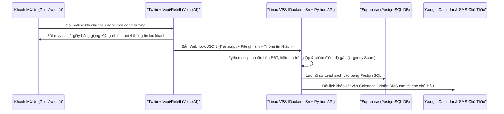
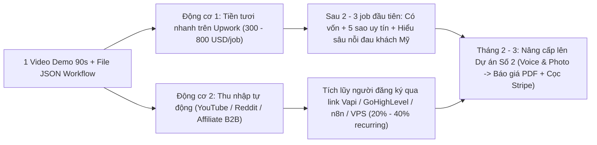

# Bản Đồ Tác Chiến Cá Nhân: Từ Sinh Viên IT ĐH Xây Dựng (GPA 2.06) Tới Kỹ Sư Hệ Thống AI & Cỗ Máy Kiếm USD Trước Khi Ra Trường

> [!IMPORTANT]
> **Chẩn đoán thẳng thắn về vị thế của "Chính Bạn" năm 2026–2028:**
> * **Nếu đi đường truyền thống (Cửa tử 95%):** Rải CV xin thực tập/Fresher lập trình viên tại Việt Nam với bằng IT trường không chuyên (ĐH Xây dựng) và GPA `2.06`. Trong bối cảnh AI đã nuốt trọn việc code cơ bản của Junior, hệ thống lọc hồ sơ nhân sự sẽ loại bạn ngay vòng đầu, hoặc đẩy bạn vào các vị trí thực tập không lương cực kỳ bấp bênh.
> * **Nếu đi đường vòng bất đối xứng (Cửa thắng cực rộng):** Trên thị trường quốc tế (Upwork, B2B SMBs tại Mỹ/Úc/Anh) và trong mô hình Affiliate/Micro-Product tự vận hành, **không một ai hỏi bảng điểm đại học của bạn**. Thứ duy nhất họ mua là **hệ thống chạy thật + khả năng giao tiếp tiếng Anh rõ ràng + sự thấu hiểu ngành của họ**. Bạn đang nắm trong tay 3 lá bài tẩy mà 90% sinh viên IT GPA 3.5+ ở Việt Nam thiếu: **(1) Tiếng Anh giao tiếp/call được**, **(2) Mác sinh viên trường Đại học Xây dựng (Civil Engineering University)** tạo uy tín tức thì với các chủ thầu Âu–Mỹ, và **(3) Còn 1–2 năm đường băng an toàn trước khi tốt nghiệp**.

---

## Phần 1: Tác Động Ngắn Hạn & Dài Hạn Của AI Tới Riêng Cuộc Đời Và Nghề Nghiệp Của Bạn

| Khung thời gian | Tác động tiêu cực nếu đứng yên | Đòn bẩy bứt phá khi đi theo lộ trình này |
| :--- | :--- | :--- |
| **Ngắn hạn (1 – 2 năm tới: Khi bạn còn ngồi trên ghế ĐH Xây dựng)** | Các môn lý thuyết khô khan trên trường tiếp tục làm bạn chán nản; ra trường đúng lúc chuẩn đầu vào Junior Dev tại Việt Nam đòi hỏi kinh nghiệm tương đương Middle Dev cũ. | AI đóng vai **"Gia sư 1-kèm-1 & Đội thợ phụ"** giúp bạn bỏ qua giai đoạn học vẹt cú pháp, nhảy thẳng vào lắp ráp **Linux Server + Docker + API + SQL + Voice AI**. Chỉ cần 3–4 đơn hàng ngắn (300–600 USD/đơn) mỗi tháng là bạn kiếm **25 – 45 triệu VNĐ/tháng** ngay khi còn là sinh viên. |
| **Dài hạn (3 – 10 năm tới: Sau khi tốt nghiệp)** | Làm "thợ gõ code theo spec" hoặc nhân viên vận hành thuần túy sẽ bị các hệ thống Multi-Agent ép giảm lương và đào thải liên tục. | Bạn tốt nghiệp với **hồ sơ hàng chục hệ thống Production chạy thật cho khách Âu–Mỹ** + **dòng tiền thụ động từ B2B Affiliate & Micro-SaaS**. Lúc đó bạn hoàn toàn tự chủ: hoặc mở rộng công ty sản phẩm/hệ thống riêng (1 người + AI), hoặc ứng tuyển thẳng vị trí **AI Systems / Solutions Engineer** lương ngoại tệ mà không nhà tuyển dụng nào bận tâm tới con số GPA 2.06 cũ. |

---

## Phần 2: Giải Quyết Nỗi Ngại Thủ Tục — Checklist Mở Hạ Tầng Kiếm USD Tại Việt Nam (Xong Trong 1 Buổi Chiều)

Bạn không cần mở công ty, không cần giấy tờ phức tạp, chỉ cần **CCCD gắn chip + Điện thoại**:

1. **Thẻ Thanh toán Quốc tế (Để thuê VPS & mua tool không bao giờ bị từ chối thẻ):**
   * Mở online ngay trên app ngân hàng một thẻ **Visa/Mastercard Debit phi vật lý hoặc vật lý** của **ACB (ACB Visa Debit), Techcombank, hoặc Vietcombank** (nạp sẵn đúng khoản ngân sách mồi `1.000.000 VNĐ` vào thẻ này để kiểm soát chi tiêu tuyệt đối, không lo bị trừ tiền oan).
2. **Đường nhận USD từ Quốc tế về tài khoản Ngân hàng Việt Nam:**
   * **Trên Upwork:** Bạn chưa cần Payoneer ngay ngày đầu! Upwork cho phép chọn phương thức **"Direct to Local Bank (VND)"** — điền thẳng số tài khoản ngân hàng Việt Nam của bạn + khai form thuế online **W-8BEN** ngay trên web Upwork trong 2 phút (xác nhận bạn không phải công dân Mỹ, chỉ cần nhập Mã số thuế cá nhân Việt Nam tra bằng số CCCD trên app eTax Mobile).
   * **Cho tiền Affiliate B2B (GoHighLevel, Vapi, PartnerStack, LemonSqueezy):** Đăng ký 1 tài khoản **Payoneer** miễn phí bằng CCCD và sao kê PDF tài khoản ngân hàng tải từ app ngân hàng xuống → Liên kết về ngân hàng Việt Nam để rút USD từ các chương trình Affiliate.
3. **Phân bổ Ngân sách Vốn Mồi hàng tháng (`~850.000 – 1.200.000 VNĐ/tháng`):**
   * **Linux VPS (Ubuntu 24.04, 2 vCPU / 4GB RAM):** Thuê trên **Hetzner Cloud** hoặc **DigitalOcean / Vultr** (`~5 – 6 USD/tháng` ≈ `140.000 VNĐ`). Cài `Docker` + `n8n` bản tự host miễn phí hoàn toàn (tiết kiệm được `24 USD/tháng` phí n8n Cloud!).
   * **Số điện thoại Mỹ test Voice/SMS (Twilio) + Credit gọi thử Vapi / Retell AI:** Vapi và Retell đều tặng sẵn `10 USD` credit miễn phí khi đăng ký; số điện thoại Mỹ trên Twilio chỉ tốn `1.15 USD/tháng` (`~30.000 VNĐ`) + vài USD cước gọi thử (`~100.000 VNĐ`).
   * **Database & Web Hosting:** **Supabase** (Gói Free có sẵn PostgreSQL 500MB + Auth) và **Vercel / Cloudflare Pages** (Free `0 VNĐ`).
   * **Upwork Connects (Phí nộp hồ sơ thầu job):** Dành `15 – 20 USD/tháng` (`~400.000 – 500.000 VNĐ`) để gửi khoảng 12–15 hồ sơ chất lượng cao có đính kèm video demo mỗi tháng (tuyệt đối không rải rác bừa bãi).

---

## Phần 3: Kiến Trúc Kỹ Thuật Của "Vũ Khí Số 1" — AI Lễ Tân Cứu Cuộc Gọi Nhỡ 24/7 Cho Thầu Xây Dựng Âu–Mỹ

Dự án này trông rất gọn nhưng ép bạn thực hành đúng những kỹ năng cốt lõi nhất của một **Backend / Systems Engineer hiện đại**:

* **Tại sao dự án này giúp bạn học IT bài bản hơn cả 3 học kỳ trên giảng đường?**
  1. **Quản trị Hệ thống & Mạng (SysAdmin / DevOps):** Tự tay SSH vào server Ubuntu, trỏ Domain DNS, cấu hình tường lửa (UFW), dựng Docker Compose và Reverse Proxy có chứng chỉ bảo mật HTTPS/SSL (bắt buộc phải có HTTPS chuẩn thì Webhook quốc tế mới bắn dữ liệu về server của bạn được).
  2. **Kiến trúc Hướng sự kiện (Event-Driven Backend):** Hiểu tận gốc cơ chế REST API, Webhook Payload, xác thực chữ ký bảo mật (Webhook Signature Verification bằng Python để chống hacker giả mạo request), và xử lý lỗi bất đồng bộ (Retry/Error Queue).
  3. **Cơ sở dữ liệu Quan hệ (SQL):** Thiết kế bảng `contractors`, `call_logs`, `leads`, `appointments` trên PostgreSQL (Supabase) có khóa ngoại (Foreign Keys) và phân quyền bảo mật.

---

## Phần 4: Lịch Trình 14 Buổi Tối "Chống Ngợp – Chống Tụt Mood" (Mỗi Tối Đúng 60–90 Phút)

> [!WARNING]
> **Bộ 3 Quy Tắc Khóa Chặt Thói Quen Dễ Nản Của Bạn:**
> 1. **Quy tắc "15 Phút Kẹt Bug":** Khi gặp lỗi server/code, tự đọc log 5 phút → nếu chưa ra, copy nguyên toàn bộ dòng lỗi + file cấu hình ném vào AI Coding Assistant (Antigravity / Cursor / Claude) nhờ giải thích tận gốc và sửa trong 10 phút. **Cấm ngồi vò đầu bứt tai một mình quá 15 phút!**
> 2. **Quy tắc "Kết Thúc Phải Chạy Được":** Mỗi buổi tối chỉ làm **đúng 1 mắt xích nhỏ** bên dưới. Khi thấy mắt xích đó báo xanh (thành công), được phép nghỉ ngay đi chơi game thoải mái không áy náy!
> 3. **Quy tắc "Đóng Cổng Giải Trí 90 Phút":** Cất điện thoại sang phòng khác hoặc bật chế độ máy bay đúng 90 phút từ 20h00 – 21h30 mỗi tối.

### Tuần 1: Dựng Xong Hệ Thống Chạy Thật (7 Buổi Tối x 90 Phút)

* **Tối 1 (Hạ tầng & Mở server đầu đời):** Mở thẻ Visa Debit online → Thuê 1 Linux VPS Ubuntu 5 USD → Mở Terminal trên máy tính gõ lệnh SSH đăng nhập vào server ở Mỹ/Âu thành công. *(Cảm giác làm chủ 1 con server thật trên mây chỉ mất 60 phút!).*
* **Tối 2 (Đưa `n8n` + HTTPS lên VPS bằng Docker):** Dùng **Coolify** hoặc file `docker-compose` dựng sẵn cài `n8n` lên VPS và trỏ 1 tên miền giá rẻ (1–2 USD năm đầu hoặc subdomain miễn phí) có ổ khóa HTTPS xanh lét. Mở trình duyệt thấy giao diện `n8n` của riêng mình chạy trên server riêng → **Xong Tối 2!**
* **Tối 3 (Thiết kế Database SQL trên Supabase):** Tạo project Supabase miễn phí → Viết lệnh SQL tạo 2 bảng `leads` (tên khách, SĐT, địa chỉ, hạng mục sửa chữa, mức độ khẩn cấp, link ghi âm) và `appointments` → Dùng `n8n` bắn thử 1 dòng dữ liệu giả vào Supabase thấy hiện lên bảng ngay lập tức → **Xong Tối 3!**
* **Tối 4 (Tạo não bộ cho Lễ tân AI ngành Xây dựng):** Đăng ký tài khoản Vapi.ai hoặc Retell AI (dùng 10 USD tặng sẵn) → Viết System Prompt tiếng Anh cho cô lễ tân công ty sửa mái nhà *"Apex Roofing & Remodeling"* (hỏi tên, địa chỉ, tình trạng dột mái, khung giờ rảnh) → Bấm nút **"Test Call"** ngay trên trình duyệt, dùng tai nghe nói chuyện tiếng Anh trực tiếp với con AI của mình trong 2 phút → **Dopamine cực mạnh, xong Tối 4!**
* **Tối 5 (Nối Webhook + Code Python kiểm duyệt dữ liệu):** Cấu hình để ngay khi cúp máy trên Vapi/Retell, toàn bộ nội dung cuộc gọi tự bắn về Webhook `n8n` trên VPS của bạn → Viết 1 đoạn Python ngắn (30 dòng) chuẩn hóa số điện thoại, lọc cuộc gọi rác dưới 10 giây, tính điểm `urgency_score` (ví dụ có chữ *"leak"*, *"emergency"*, *"flooded"* thì đánh dấu Khẩn cấp) và lưu vào Supabase → **Xong Tối 5!**
* **Tối 6 (Tự động đặt lịch Calendar & Bắn thông báo):** Nối bước cuối từ `n8n` sang **Google Calendar API** (tự tạo lịch hẹn khảo sát) và bắn 1 tin nhắn cảnh báo cực đẹp sang Telegram/Slack/SMS giả lập máy điện thoại chủ thầu kèm link nghe lại ghi âm cuộc gọi → **Hệ thống chạy thông từ A đến Z, xong Tối 6!**
* **Tối 7 (Đóng gói & Ghi hình Vũ khí 90 Giây):** Mở phần mềm quay màn hình miễn phí (OBS hoặc Loom, bật khung webcam nhỏ ở góc màn hình). Quay đúng **1 video 90 giây nói tiếng Anh tự nhiên**:
  * *0–15s:* "Hey, I'm an IT student at the University of Civil Engineering, and I noticed most contractors lose thousands of dollars missing calls while on a jobsite. Watch what happens when a homeowner calls this roofing number right now..."
  * *15–60s:* Cầm điện thoại gọi trực tiếp bật loa ngoài nói chuyện 30 giây với AI → Cúp máy → Trên màn hình máy tính, dòng dữ liệu nhảy vào Database, lịch nhảy lên Google Calendar và tin nhắn báo về điện thoại trong 2 giây!
  * *60–90s:* "I host this on a private server so your monthly cost is pennies instead of expensive agency retainers. Let me know if you want this plugged into your phone line in 48 hours."

---

### Tuần 2: Kích Hoạt Cùng Lúc 2 Động Cơ Kiếm USD (Freelance Ngắn Hạn + B2B Affiliate Tự Động)

* **Tối 8 & Tối 9 (Mở cửa hàng trên Upwork với định vị sát thủ):**
  * Tạo hồ sơ Upwork, khai W-8BEN & tài khoản ngân hàng VN.
  * **Tuyệt đối không đặt tiêu đề chung chung** kiểu *"Python & Web Developer"*. Hãy đặt: **`AI Voice Receptionist & n8n Backend Automation for Contractors & Home Services`**.
  * Trong phần giới thiệu, nhấn mạnh câu chuyện thật 100%: *Sinh viên CNTT tại Đại học Xây dựng Hà Nội — hiểu ngôn ngữ của ngành thầu xây dựng, sửa chữa nhà cửa, bất động sản và chuyên dựng hệ thống AI tự host tiết kiệm chi phí*. Đưa thẳng video demo 90 giây lên mục Portfolio số 1.
* **Tối 10 & Tối 11 (Bật Động cơ Tự vận hành — B2B Affiliate không cần chiều khách):**
  * Đăng ký link Affiliate của các công cụ có trong luồng của bạn (**Vapi/Retell, n8n/Make, Hetzner/Hostinger VPS, GoHighLevel**).
  * Quay thêm 1 bản video 4–5 phút hướng dẫn cách hệ thống hoạt động đăng lên **YouTube** (tiêu đề tiếng Anh kiểu: *"How I Built a 24/7 AI Receptionist for Roofing Contractors (n8n + Voice AI + Supabase)"*).
  * Dưới phần mô tả YouTube: Tặng miễn phí file cấu hình `n8n JSON template` + System Prompt để kéo lượt tải, bên dưới đặt toàn bộ link Affiliate công cụ. Đăng bài chia sẻ ngắn gọn kinh nghiệm kỹ thuật lên `r/n8n`, `r/VoiceAI`, `r/smallbusiness` hoặc X.
* **Tối 12, 13 & 14 (Săn 15 Job Ngắn Hạn Đúng Tâm Điểm — Mỗi Tối Gửi Đúng 2 Hồ Sơ):**
  * Lọc trên Upwork các job mới đăng dưới 24h có từ khóa: `Vapi`, `Retell`, `AI receptionist`, `AI voice agent`, `Twilio n8n`, `contractor automation`, `missed call text back`, `Supabase webhook`.
  * **Công thức viết Proposal 4 dòng chốt hạ (Không dùng văn mẫu dài dòng của ChatGPT):**
    > *"Hi [Tên khách], I just read your post about setting up an AI phone agent to qualify [ngành của khách] leads and book them into your calendar.*
    > *I actually built this exact live pipeline on a private n8n + Supabase server for roofing contractors — here is a 90-second video of me calling it live and watching the lead + appointment pop up instantly: [Link Loom].*
    > *For your setup, the main tricky part is handling [nêu 1 chi tiết kỹ thuật nhỏ trong bài đăng của họ] cleanly via webhooks so appointments never double-book. I can get a working test number ready for you to call within 48 hours. Happy to hop on a quick 10-minute call today!"*

---

## Phần 5: Lộ Trình Nâng Cấp Sau Đồng USD Đầu Tiên (Tháng 2 – Tháng 12)

> [!TIP]
> **Khi nào mới chuyển sang Dự án Số 2 ("Voice & Photo → Báo giá PDF + Cọc Stripe")?**
> Chỉ khi bạn đã **nhận được đồng USD đầu tiên** từ hệ thống Số 1 (hoặc đạt 1.000 lượt xem + lượt click Affiliate đầu tiên trên kênh tiếng Anh). Đừng nhảy cóc khi chưa hái quả ngọt đầu tiên!

1. **Tháng 2 – Tháng 3:** Nâng cấp sang **Dự án Số 2 (Web Next.js + Supabase Auth/RLS + Xuất PDF Báo giá công trình + Thanh toán Stripe)**. Lúc này bạn đã quen tay với Linux VPS, Supabase và Webhook nên việc ghép thêm giao diện Web và Stripe trở nên cực kỳ nhẹ nhàng. Bạn mở khóa thêm toàn bộ nguồn job **"Vibe-Code Finisher"** (cứu hộ web/app cho các founder quốc tế).
2. **Tháng 4 – Tháng 12 (Trước khi ra trường):** Lúc này bạn đã nhìn thấy rõ công cụ nào các chủ thầu/khách quốc tế hỏi mua lặp đi lặp lại nhiều nhất → Biến chính bộ code đó thành một **Micro-SaaS hoặc Bộ Boilerplate thu phí định kỳ `19 – 49 USD/tháng`** được nuôi lớn tự động nhờ kênh YouTube demo kỹ thuật tiếng Anh bạn xây từ Tuần 2.

---

### Bước Tiếp Theo Ngay Bây Giờ
Nếu bạn đồng ý với bản thiết kế này, chúng ta có thể **bắt tay làm ngay phần khung code & cấu trúc dự án cho Tối 3 – Tối 5 ngay tại đây**: Tôi có thể khởi tạo sẵn thư mục dự án mẫu gồm **file SQL tạo bảng Supabase, script Python xử lý & chấm điểm Webhook cuộc gọi, bộ System Prompt tiếng Anh chuẩn cho Lễ tân Thầu xây dựng Mỹ và file `docker-compose.yml` chuẩn bảo mật để chạy `n8n` trên VPS** giúp bạn tiết kiệm một nửa thời gian mày mò!
