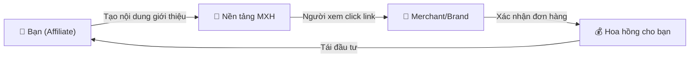
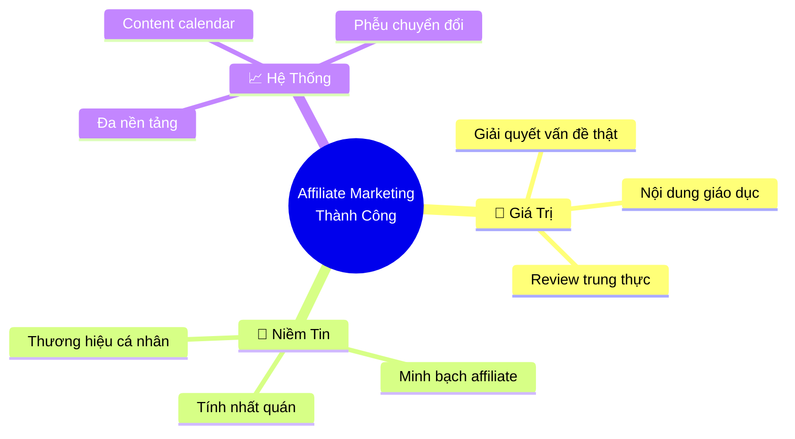
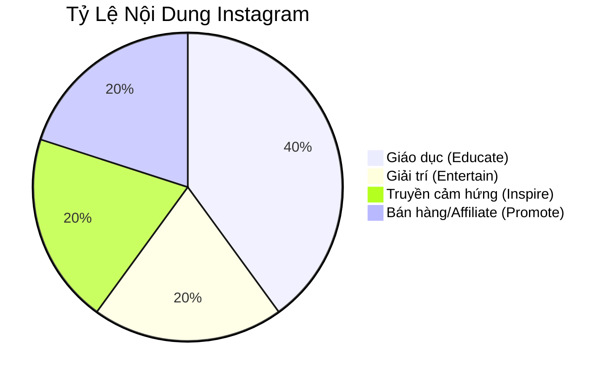
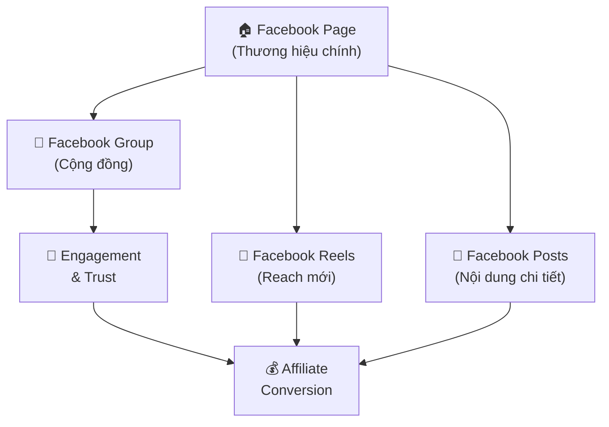
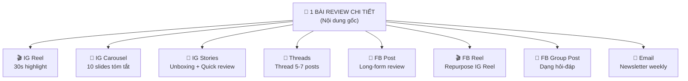
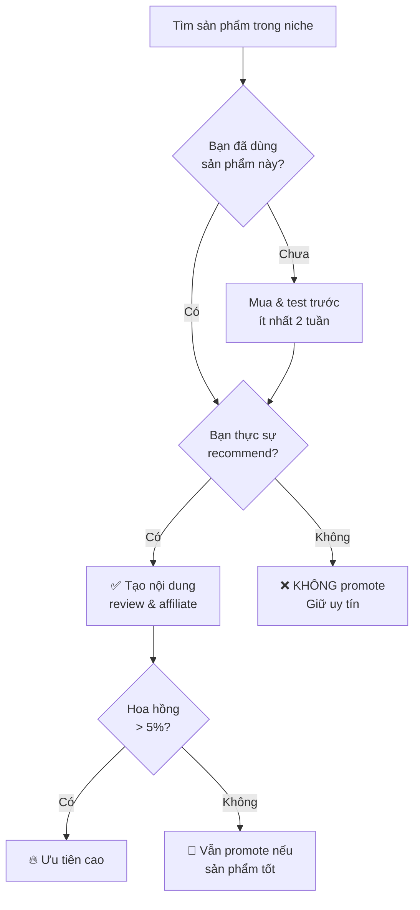
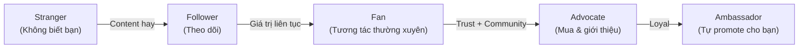
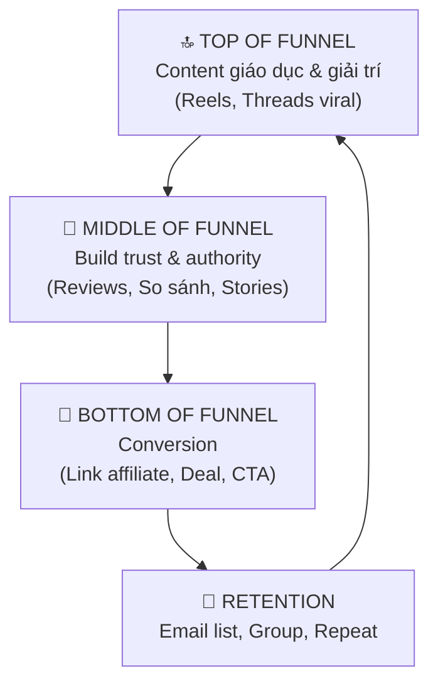

# 🚀 HƯỚNG DẪN TOÀN DIỆN: Xây Kênh Instagram, Threads & Facebook Cho Affiliate Marketing Từ Scratch

> **Tác giả**: Nhà sáng tạo nội dung & Phát triển truyền thông chuyên nghiệp
> **Cập nhật**: Tháng 8/2026
> **Đối tượng**: Người mới bắt đầu → Trung cấp

---

## Mục Lục

1. [Tổng Quan & Tư Duy Nền Tảng](#1-tổng-quan--tư-duy-nền-tảng)
2. [Chọn Niche & Nghiên Cứu Thị Trường](#2-chọn-niche--nghiên-cứu-thị-trường)
3. [Xây Dựng Thương Hiệu Cá Nhân](#3-xây-dựng-thương-hiệu-cá-nhân)
4. [Setup Instagram Chuyên Nghiệp](#4-setup-instagram-chuyên-nghiệp)
5. [Setup Threads Hiệu Quả](#5-setup-threads-hiệu-quả)
6. [Setup Facebook & Fanpage](#6-setup-facebook--fanpage)
7. [Chiến Lược Nội Dung Đa Nền Tảng](#7-chiến-lược-nội-dung-đa-nền-tảng)
8. [Affiliate Marketing: Cơ Chế & Nền Tảng](#8-affiliate-marketing-cơ-chế--nền-tảng)
9. [Content Calendar & Workflow](#9-content-calendar--workflow)
10. [Tăng Trưởng & Engagement](#10-tăng-trưởng--engagement)
11. [Monetization & Tối Ưu Chuyển Đổi](#11-monetization--tối-ưu-chuyển-đổi)
12. [Công Cụ & Tech Stack](#12-công-cụ--tech-stack)
13. [Roadmap 90 Ngày Chi Tiết](#13-roadmap-90-ngày-chi-tiết)
14. [Sai Lầm Cần Tránh & Best Practices](#14-sai-lầm-cần-tránh--best-practices)

---

## 1. Tổng Quan & Tư Duy Nền Tảng

### Affiliate Marketing là gì?

Affiliate Marketing (tiếp thị liên kết) là mô hình bạn **giới thiệu sản phẩm/dịch vụ** của người khác và nhận **hoa hồng** khi có người mua qua link giới thiệu của bạn.



### Tại sao Instagram + Threads + Facebook?

| Nền tảng | Thế mạnh | Loại nội dung chính | Phù hợp cho |
|----------|----------|---------------------|-------------|
| **Instagram** | Visual storytelling, Reels viral | Ảnh, Reels, Stories, Carousels | Review sản phẩm, lifestyle |
| **Threads** | Text-based, conversation | Văn bản, tips nhanh, thread dài | Chia sẻ kiến thức, build trust |
| **Facebook** | Community building, Groups | Bài viết dài, video, Groups | Tạo cộng đồng, retargeting |

### 3 Trụ Cột Thành Công



> [!IMPORTANT]
> **Tư duy cốt lõi**: Bạn KHÔNG phải là người bán hàng. Bạn là **người chia sẻ giải pháp**. Khi audience tin tưởng bạn, họ tự nguyện mua qua link của bạn. Giá trị trước, tiền sau.

---

## 2. Chọn Niche & Nghiên Cứu Thị Trường

### 2.1. Framework Chọn Niche "3P"

```
Passion (Đam mê) ∩ Proficiency (Năng lực) ∩ Profit (Lợi nhuận) = NICHE LÝ TƯỞNG
```

**Bước 1: Liệt kê Passion**
- Bạn có thể nói về chủ đề gì cả ngày không chán?
- Bạn thường xuyên nghiên cứu gì trong thời gian rảnh?
- Bạn hay được bạn bè hỏi tư vấn về lĩnh vực gì?

**Bước 2: Đánh giá Proficiency**
- Bạn có kinh nghiệm thực tế hoặc kiến thức chuyên sâu không?
- Bạn có thể tạo nội dung liên tục 6+ tháng về chủ đề này không?
- Bạn có lợi thế gì so với người khác trong niche này?

**Bước 3: Xác minh Profit**
- Có sản phẩm affiliate với hoa hồng tốt không? (>10%)
- Người trong niche này có thói quen mua online không?
- Thị trường đủ lớn nhưng chưa quá bão hòa?

### 2.2. Top Niche Affiliate Tại Việt Nam (2026)

| Niche | Hoa hồng TB | Độ cạnh tranh | Tiềm năng |
|-------|-------------|---------------|-----------|
| 🏋️ Sức khỏe & Fitness | 10-30% | ⭐⭐⭐ | Rất cao |
| 💄 Làm đẹp & Skincare | 8-25% | ⭐⭐⭐⭐ | Cao |
| 💻 Công nghệ & Gadgets | 3-12% | ⭐⭐⭐ | Cao |
| 📚 Học tập & Phát triển bản thân | 15-50% | ⭐⭐ | Rất cao |
| 🏠 Nội thất & Lifestyle | 5-15% | ⭐⭐ | Trung bình |
| 👶 Mẹ & Bé | 8-20% | ⭐⭐⭐ | Cao |
| 🐕 Thú cưng | 10-20% | ⭐ | Đang tăng |
| 💰 Tài chính cá nhân | 20-50% | ⭐⭐⭐ | Rất cao |
| 🎮 Gaming & Streaming | 5-15% | ⭐⭐ | Cao |
| 🍳 Ẩm thực & Nấu ăn | 5-15% | ⭐⭐ | Trung bình |

### 2.3. Nghiên Cứu Đối Thủ

**Checklist phân tích 5 đối thủ trong niche:**

- [ ] Họ đăng bao nhiêu bài/tuần?
- [ ] Loại nội dung nào có engagement cao nhất?
- [ ] Họ promote sản phẩm gì? Qua cách nào?
- [ ] Tone of voice của họ như thế nào?
- [ ] Họ có bao nhiêu follower và tốc độ tăng trưởng?
- [ ] Điểm yếu của họ là gì? (Content gap mà bạn có thể khai thác)

> [!TIP]
> **Mẹo Pro**: Đừng chọn niche quá rộng (vd: "sức khỏe") hay quá hẹp (vd: "bổ sung kẽm cho nam giới 40-45 tuổi"). Chọn **sub-niche** vừa đủ: "fitness tại nhà cho dân văn phòng", "skincare cho da dầu mụn", "đồ công nghệ dưới 2 triệu".

---

## 3. Xây Dựng Thương Hiệu Cá Nhân

### 3.1. Brand Identity Canvas

```
┌─────────────────────────────────────────────────────────┐
│                  BRAND IDENTITY CANVAS                   │
├─────────────────────────────────────────────────────────┤
│                                                          │
│  TÊN THƯƠNG HIỆU: ____________________                 │
│  (Dễ nhớ, dễ tìm, thống nhất trên mọi nền tảng)        │
│                                                          │
│  TAGLINE: ____________________                           │
│  (1 câu mô tả giá trị bạn mang lại)                    │
│                                                          │
│  MISSION: ____________________                           │
│  (Tại sao bạn làm điều này?)                            │
│                                                          │
│  TARGET AUDIENCE:                                        │
│  - Độ tuổi: ____                                        │
│  - Giới tính: ____                                      │
│  - Thu nhập: ____                                       │
│  - Vấn đề lớn nhất: ____                               │
│  - Nơi họ online: ____                                  │
│                                                          │
│  BRAND PERSONALITY (chọn 3-5):                           │
│  □ Chuyên gia  □ Thân thiện  □ Hài hước                 │
│  □ Truyền cảm hứng  □ Thực tế  □ Sang trọng            │
│  □ Năng động  □ Tinh tế  □ Bold                         │
│                                                          │
│  BRAND COLORS:                                           │
│  Primary: #______  Secondary: #______  Accent: #______   │
│                                                          │
│  BRAND FONTS:                                            │
│  Heading: ____________  Body: ____________               │
│                                                          │
└─────────────────────────────────────────────────────────┘
```

### 3.2. Quy Tắc Đặt Tên (Username)

| Tiêu chí | ✅ Tốt | ❌ Tránh |
|-----------|--------|---------|
| Ngắn gọn | @minhtechreview | @nguyenvietminhreviewcongnghe2026 |
| Dễ nhớ | @fitwithlien | @xXx_fitness_girl_xXx |
| Có keyword | @skincareviet | @beautygirl93 |
| Thống nhất | Cùng tên trên mọi nền tảng | Mỗi nền tảng một tên khác |
| Dễ tìm kiếm | @bookshelfvn | @b00k_sh3lf |

### 3.3. Tạo Avatar & Visual Identity

**Checklist Visual Branding:**

- [ ] **Avatar**: Ảnh chân dung rõ mặt HOẶC logo chuyên nghiệp (khuyến nghị ảnh thật)
- [ ] **Bảng màu**: 3-4 màu chủ đạo xuyên suốt mọi nội dung
- [ ] **Font chữ**: 2 font (heading + body) dùng trong mọi thiết kế
- [ ] **Template Canva**: 3-5 template cho các loại bài đăng khác nhau
- [ ] **Highlight covers** (Instagram): Thiết kế đồng bộ

---

## 4. Setup Instagram Chuyên Nghiệp

### 4.1. Chuyển Sang Tài Khoản Creator/Business

```
Settings → Account → Switch to Professional Account → Creator
```

**Tại sao Creator mà không phải Business?**
- Truy cập đầy đủ **Instagram Insights**
- Hiển thị **category** dưới tên
- Truy cập **Creator Studio** để lên lịch
- **Nhạc thư viện đầy đủ** cho Reels (Business bị hạn chế)

### 4.2. Tối Ưu Bio Instagram

```
┌──────────────────────────────────────┐
│ 📸 [Avatar chuyên nghiệp]           │
│                                      │
│ Tên Hiển Thị (có keyword)           │
│ @username                            │
│                                      │
│ 🎯 Dòng 1: Bạn là ai / làm gì      │
│ 💡 Dòng 2: Giá trị bạn mang lại     │
│ ⬇️ Dòng 3: CTA (Call to Action)     │
│                                      │
│ 🔗 Link in bio (dùng Linktree/Beacons)│
└──────────────────────────────────────┘
```

**Ví dụ Bio cho niche Skincare:**
```
Liên | Skincare Coach 🧴
✨ Giúp bạn có da đẹp không cần tiền triệu
🔬 Review sản phẩm trung thực & khoa học
⬇️ Nhận Skincare Routine MIỄN PHÍ tại đây
🔗 linktr.ee/skincarewithlien
```

**Ví dụ Bio cho niche Công nghệ:**
```
Minh | Tech Made Simple 📱
🔥 Review đồ tech hay dưới 2 triệu
💡 Tips tối ưu smartphone & laptop
📩 Hợp tác: DM hoặc email
🔗 beacons.ai/minhtechvn
```

### 4.3. Thiết Lập Link In Bio

> [!IMPORTANT]
> Instagram chỉ cho **1 link trong bio**. Dùng công cụ link-in-bio để tối đa hóa:

**Các công cụ khuyên dùng (xếp theo ưu tiên):**

1. **Beacons.ai** (Miễn phí, có tích hợp affiliate)
2. **Linktree** (Phổ biến, dễ dùng)
3. **Stan Store** (Nếu muốn bán digital products kèm)
4. **Bio.link** (Giao diện đẹp)
5. **Tự build landing page** (Nâng cao, kiểm soát hoàn toàn)

**Cấu trúc Link-in-Bio tối ưu:**

```
1. 🎁 Lead magnet miễn phí (thu email)
2. 🔥 Sản phẩm affiliate hot nhất hiện tại
3. 📱 Kênh Threads/Facebook
4. 📧 Đăng ký newsletter
5. 💬 Liên hệ hợp tác
```

### 4.4. Highlights Strategy

Tạo **5-7 Highlight** với cover đồng bộ:

| Highlight | Nội dung | Mục đích |
|-----------|----------|----------|
| **Về Tôi** | Giới thiệu bản thân, story | Build trust |
| **Best Picks** | Top sản phẩm recommend | Affiliate chính |
| **Reviews** | Video/ảnh review chi tiết | Social proof |
| **Tips** | Mẹo nhanh trong niche | Giá trị miễn phí |
| **Deals** | Mã giảm giá, flash sale | Urgency |
| **FAQ** | Câu hỏi thường gặp | Giảm rào cản |
| **Behind** | Hậu trường, quá trình | Authenticity |

### 4.5. Chiến Lược Content Instagram

#### 4 Trụ Cột Nội Dung (Content Pillars)



#### Các Định Dạng Nội Dung

**🎬 REELS (Ưu tiên số 1 — Reach cao nhất)**

| Loại Reel | Thời lượng | Ví dụ |
|-----------|------------|-------|
| Hook → Value → CTA | 15-30s | "3 sản phẩm skincare dưới 200k mà da bạn sẽ cảm ơn" |
| Before/After | 7-15s | Unboxing → sử dụng → kết quả |
| POV/Trending | 7-15s | Theo trend âm thanh + niche twist |
| Tutorial | 30-60s | Hướng dẫn step-by-step |
| Stitched Review | 30-90s | Review chân thực, ưu nhược điểm |

**📸 CAROUSEL (Saves cao — Thuật toán yêu thích)**

```
Slide 1: Hook mạnh (câu hỏi / số liệu gây shock)
Slide 2-8: Nội dung giá trị (mỗi slide = 1 ý chính)
Slide 9: Tổng kết / So sánh
Slide 10: CTA ("Save lại để dùng khi cần" / "Link trong bio")
```

**📷 SINGLE IMAGE POST**
- Quote cards (câu nói truyền cảm hứng trong niche)
- Infographic đơn giản
- Product photography chuyên nghiệp

**📱 STORIES (Engagement + Affiliate trực tiếp)**
- Dùng **sticker link** để dẫn affiliate link
- Poll/Quiz để tăng tương tác
- Behind-the-scenes hàng ngày
- "Ngày hôm nay tôi dùng..." (sản phẩm affiliate tự nhiên)

### 4.6. Hashtag Strategy

```
Công thức Hashtag: 5 nhỏ + 10 trung bình + 5 lớn + 5 branded/niche

Nhỏ (<10K bài): #skincaredầumụn #reviewmỹphẩmvn
Trung bình (10K-500K): #skincaretips #lamdeptuinhien
Lớn (500K+): #skincare #beauty #selfcare
Branded: #[tênbạn]reviews #[tênbạn]picks
```

> [!TIP]
> Tạo **3-4 bộ hashtag sẵn** cho các loại bài đăng khác nhau. Xoay vòng để tránh bị shadowban. Lưu trong Notes trên điện thoại để copy-paste nhanh.

---

## 5. Setup Threads Hiệu Quả

### 5.1. Tại Sao Threads Quan Trọng?

- **Liên kết trực tiếp với Instagram** — tăng authority chéo
- **Thuật toán đang ưu tiên nội dung** — dễ viral hơn (2026 vẫn trong giai đoạn tăng trưởng)
- **Text-based** — phù hợp chia sẻ kiến thức sâu, build expertise
- **Ít cạnh tranh hơn** — nhiều creator chưa tận dụng tốt

### 5.2. Tối Ưu Profile Threads

```
✅ Dùng CÙNG username và avatar với Instagram
✅ Bio ngắn gọn, khác IG (tập trung vào text content)
✅ Bật liên kết 2 chiều IG ↔ Threads
```

**Ví dụ Bio Threads:**
```
Chia sẻ tips skincare hàng ngày 🧴
Review sản phẩm bằng tiền túi, không PR
Thread dài mỗi T2 & T5
```

### 5.3. Chiến Lược Nội Dung Threads

#### Các Loại Thread Hiệu Quả

**1. Thread Listicle (Danh sách)**
```
🧵 5 sản phẩm skincare tôi mua đi mua lại 2026:

1/ Sữa rửa mặt [Tên SP] — ₫189K
Tại sao: [Lý do cụ thể]
Phù hợp: Da dầu, da hỗn hợp
⭐ 9/10

[Tiếp tục cho mỗi sản phẩm...]

Tất cả link mua ở bio IG 👆
```

**2. Thread Storytelling**
```
Kể lại hành trình bạn giải quyết vấn đề
→ Thử các giải pháp
→ Tìm được sản phẩm/phương pháp hiệu quả
→ Kết quả đạt được
→ Recommend (kèm link)
```

**3. Thread Kiến Thức (Evergreen)**
```
Hướng dẫn step-by-step
Tips & Tricks
Sai lầm phổ biến cần tránh
So sánh A vs B
```

**4. Thread Tương Tác**
```
Đặt câu hỏi mở
"Hot take" (quan điểm gây tranh luận nhẹ)
"Đúng hay sai?" (test kiến thức)
Poll dạng text
```

#### Lịch Đăng Threads

| Thứ | Loại nội dung | Thời gian | Mục đích |
|-----|---------------|-----------|----------|
| T2 | Thread dài (5-10 posts) | 8:00 AM | Giáo dục |
| T3 | Quick tip + visual | 12:00 PM | Engagement |
| T4 | Reply/engage cộng đồng | Cả ngày | Community |
| T5 | Thread dài (review/so sánh) | 8:00 PM | Affiliate |
| T6 | Hot take / Câu hỏi | 7:00 PM | Viral potential |
| T7 | Behind-the-scenes | 10:00 AM | Trust building |
| CN | Recap tuần + CTA | 6:00 PM | Conversion |

> [!TIP]
> **Threads Pro Tip**: Reply vào các thread phổ biến trong niche của bạn. Comment có giá trị → người ta click vào profile → follow. Đây là chiến lược tăng trưởng nhanh nhất trên Threads.

---

## 6. Setup Facebook & Fanpage

### 6.1. Cấu Trúc Hiện Diện Facebook



### 6.2. Tạo Facebook Page Chuyên Nghiệp

**Checklist Setup Page:**

- [ ] **Tên Page**: Trùng với username trên IG & Threads
- [ ] **Category**: Chọn đúng (Creator, Blog, etc.)
- [ ] **Ảnh đại diện**: Trùng avatar trên mọi nền tảng
- [ ] **Ảnh bìa**: Banner chuyên nghiệp với tagline + CTA
- [ ] **About**: Mô tả chi tiết + keywords
- [ ] **CTA Button**: "Tìm hiểu thêm" → Link to affiliate hub
- [ ] **Thêm tất cả thông tin**: Website, email, giờ hoạt động
- [ ] **Tạo template bài đăng**: Cho từng loại nội dung

**Ví dụ About Page:**
```
🎯 [Tên] — Kênh review [niche] trung thực #1 Việt Nam

Chúng tôi giúp bạn:
✅ Chọn đúng sản phẩm phù hợp, không phí tiền
✅ Học kiến thức [niche] từ cơ bản đến nâng cao
✅ Cập nhật deal, mã giảm giá mới nhất

📩 Hợp tác: [email]
🔗 Website: [link]
```

### 6.3. Tạo Facebook Group (Bí Mật Tăng Trưởng)

> [!IMPORTANT]
> Facebook Group là **vũ khí bí mật** cho affiliate marketing. Group tạo ra cộng đồng, và cộng đồng tạo ra niềm tin. Niềm tin = Chuyển đổi cao.

**Setup Group:**

| Cài đặt | Khuyến nghị |
|---------|-------------|
| Tên Group | "[Niche] Việt Nam" hoặc "Hội [Niche] với [Tên bạn]" |
| Privacy | Private (tạo cảm giác exclusive) |
| Membership Questions | 3 câu: vấn đề lớn nhất, email, đồng ý rules |
| Rules | 5-7 rules rõ ràng |
| Description | Giá trị của group + ai nên tham gia |
| Cover Photo | Thể hiện rõ chủ đề + lợi ích |

**Chiến Lược Nội Dung Group:**

```
T2: Bài Welcome (chào thành viên mới, giới thiệu group)
T3: Câu hỏi thảo luận (tăng engagement)
T4: Chia sẻ kiến thức / Tutorial
T5: Review sản phẩm (affiliate) — dạng "Tôi vừa thử..."
T6: Member spotlight / Success story
T7: Free Resource / Checklist / Template
CN: Recap tuần + upcoming content
```

### 6.4. Chiến Lược Content Facebook

#### Các Loại Bài Đăng Hiệu Quả

**📝 Long-form Post (Review chi tiết)**
```
HOOK: Câu mở đầu gây tò mò (2 dòng đầu quyết định)

BODY:
- Bối cảnh: Tại sao bạn thử sản phẩm này
- Trải nghiệm: Mô tả chi tiết (thời gian, cảm nhận)
- Ưu điểm: 3-5 điểm
- Nhược điểm: 1-2 điểm (QUAN TRỌNG — tạo độ tin cậy)
- So sánh: Với sản phẩm tương tự

CTA: "Link mua với giảm giá ở comment đầu tiên 👇"

[3-5 ảnh thật, không filter quá đà]
```

**🎬 Facebook Reels (Cross-post từ IG)**
- Repurpose Reels từ Instagram
- Thêm text overlay phù hợp Facebook audience
- Thời lượng tối ưu: 30-60 giây

**📊 Post So Sánh**
```
[Sản phẩm A] vs [Sản phẩm B] — Cái nào đáng mua hơn?

Tôi đã dùng cả 2 trong 30 ngày. Đây là kết luận:

📌 Giá: A (₫X) vs B (₫Y)
📌 Chất lượng: ...
📌 Độ bền: ...
📌 Phù hợp cho: ...

🏆 Người thắng: [Sản phẩm] vì [lý do]

Link mua cả 2 (có deal) ở comment 👇
```

---

## 7. Chiến Lược Nội Dung Đa Nền Tảng

### 7.1. Content Repurposing System

> [!TIP]
> **Nguyên tắc vàng**: Tạo **1 nội dung gốc (Pillar Content)**, repurpose thành **7-10 nội dung** cho các nền tảng khác nhau. Làm việc THÔNG MINH, không CHĂM CHỈ.



### 7.2. Bảng Phân Bổ Nội Dung Theo Nền Tảng

| Nội dung gốc | Instagram | Threads | Facebook |
|---------------|-----------|---------|----------|
| Review sản phẩm | Reel 30s + Carousel | Thread 5-7 posts chi tiết | Long-form post + ảnh |
| So sánh A vs B | Carousel 10 slides | Thread debate | Post bảng so sánh |
| Tips/Tricks | Reel tutorial | Quick thread 3 posts | Post dạng list |
| Unboxing | Reel + Story series | Live text reaction | Reel + Post |
| Kiến thức niche | Carousel giáo dục | Thread dài evergreen | Post + Group thảo luận |
| Deal/Flash sale | Story + Post nhanh | Post nhanh + CTA | Post + Group thông báo |

### 7.3. Cross-Promotion Strategy

```
Instagram → "Xem thread chi tiết trên Threads" (trong caption)
Threads → "Video review đầy đủ trên IG" (trong thread)
Facebook → "Follow IG để cập nhật deals hàng ngày" (trong post)
FB Group → Share bài từ Page + nội dung exclusive
```

---

## 8. Affiliate Marketing: Cơ Chế & Nền Tảng

### 8.1. Các Nền Tảng Affiliate Tại Việt Nam

#### Tier 1: Nền Tảng Lớn

| Nền tảng | Hoa hồng | Niche phù hợp | Cookie | Thanh toán |
|----------|----------|----------------|--------|------------|
| **Shopee Affiliate** | 2-10% | Mọi niche | 7 ngày | Ví Shopee |
| **Lazada Affiliate** | 3-12% | Mọi niche | 7 ngày | Chuyển khoản |
| **TikTok Shop Affiliate** | 5-20% | Mọi niche | 14 ngày | Ví TikTok |
| **Tiki Affiliate** | 2-8% | Sách, điện tử | 30 ngày | Chuyển khoản |
| **AccessTrade** | 3-50% | Đa dạng (tài chính, bảo hiểm...) | 30+ ngày | Chuyển khoản |

#### Tier 2: Nền Tảng Chuyên Biệt

| Nền tảng | Hoa hồng | Niche phù hợp |
|----------|----------|----------------|
| **Masoffer** | 5-30% | Digital, app installs |
| **Involve Asia** | Đa dạng | Fashion, travel, finance |
| **Amazon Associates** | 1-10% | Tech, sách (quốc tế) |
| **ClickBank** | 30-75% | Digital products |
| **Impact** | Đa dạng | SaaS, brands quốc tế |

### 8.2. Cách Đăng Ký & Bắt Đầu

**Shopee Affiliate (Khuyến nghị bắt đầu):**
```
1. Vào Shopee App → Shopee Affiliate Program
2. Đăng ký với thông tin social media
3. Chờ duyệt (thường 1-3 ngày)
4. Bắt đầu tạo link affiliate cho sản phẩm
5. Chia sẻ link trên social media
6. Theo dõi commission trên dashboard
```

**AccessTrade (Hoa hồng cao hơn):**
```
1. Đăng ký tại accesstrade.vn
2. Điền thông tin kênh & niche
3. Browse campaigns phù hợp
4. Apply vào các campaign
5. Lấy link tracking
6. Tạo nội dung & chia sẻ link
```

### 8.3. Chiến Lược Chọn Sản Phẩm Affiliate



> [!CAUTION]
> **KHÔNG BAO GIỜ** promote sản phẩm bạn chưa dùng hoặc không tin tưởng. Một lần mất niềm tin = mất toàn bộ audience. Uy tín là tài sản quý nhất của affiliate marketer.

### 8.4. Cách Đặt Link Affiliate Trên Từng Nền Tảng

| Nền tảng | Cách đặt link | Best Practice |
|----------|---------------|---------------|
| **IG Bio** | Link-in-bio tool | Update thường xuyên theo bài mới |
| **IG Stories** | Sticker Link | Thêm text CTA rõ ràng |
| **IG Caption** | Không click được → dẫn về bio | "Link trong bio" + emoji chỉ |
| **Threads** | Paste link trực tiếp | Dùng trong thread cuối |
| **FB Page** | Comment đầu tiên hoặc trong bài | Đừng đặt nhiều link 1 bài |
| **FB Group** | Pinned post / Resource section | Tự nhiên, không spam |

---

## 9. Content Calendar & Workflow

### 9.1. Content Calendar Mẫu (1 Tuần)

| Ngày | Instagram | Threads | Facebook | Mục tiêu |
|------|-----------|---------|----------|-----------|
| **T2** | 🎬 Reel tutorial | 🧵 Thread kiến thức dài | 📝 Share Reel + bài blog | Educate |
| **T3** | 📸 Carousel tips | 💬 Quick tip 2-3 posts | 👥 Group: Câu hỏi thảo luận | Engage |
| **T4** | 📱 Stories Q&A | 🔄 Reply & engage | 📝 Post so sánh | Community |
| **T5** | 🎬 Reel review SP | 🧵 Thread review chi tiết | 📝 Long-form review + FB Reel | **Affiliate** |
| **T6** | 📸 Single post (quote) | 🔥 Hot take / debate | 👥 Group: Member spotlight | Brand |
| **T7** | 📱 Stories behind-scenes | 💬 Casual conversation | 📝 Deals & discounts | **Affiliate** |
| **CN** | 📸 Carousel recap tuần | 🧵 Recap + CTA links | 📝 Post recap + Group weekly | Convert |

### 9.2. Daily Workflow

```
⏰ SÁNG (30 phút)
├── Reply comments & DMs trên cả 3 nền tảng
├── Engage 10-15 posts trong niche (IG & Threads)
└── Check affiliate dashboard

⏰ TRƯA/CHIỀU (1-2 giờ)
├── Tạo nội dung chính cho ngày mai
├── Edit & design (Canva/CapCut)
└── Viết caption & thread

⏰ TỐI (30 phút)
├── Đăng nội dung theo lịch
├── Stories update (IG)
├── Casual engagement (Threads)
└── Schedule bài FB cho ngày mai
```

### 9.3. Monthly Content Planning

```
📅 Cuối mỗi tháng (dành 2-3 giờ):

1. REVIEW tháng vừa qua
   - Top 5 bài engagement cao nhất → Tại sao?
   - Top 5 bài engagement thấp nhất → Tại sao?
   - Affiliate revenue & top sản phẩm
   - Follower growth & demographics

2. PLAN tháng tiếp theo
   - Seasonal content (lễ, sale, events)
   - Product launches trong niche
   - 4 Pillar Content mới
   - Collaboration opportunities
   - Goals cụ thể (followers, engagement, revenue)

3. BATCH CREATE
   - Chụp/quay hàng loạt trong 1-2 ngày
   - Design templates mới nếu cần
   - Viết sẵn captions
```

---

## 10. Tăng Trưởng & Engagement

### 10.1. Chiến Lược Tăng Followers Organic

#### Instagram

| Chiến lược | Mô tả | Hiệu quả |
|------------|--------|-----------|
| **Reels Consistency** | Đăng 4-5 Reels/tuần, trend + niche | ⭐⭐⭐⭐⭐ |
| **Carousel SEO** | Dùng keywords trong alt text & caption | ⭐⭐⭐⭐ |
| **Collab Posts** | Đăng bài chung với creator cùng niche | ⭐⭐⭐⭐⭐ |
| **Engage First** | Comment giá trị trên các trang lớn | ⭐⭐⭐⭐ |
| **IG SEO** | Tối ưu tên, bio, hashtag cho search | ⭐⭐⭐⭐ |
| **Story Engagement** | Polls, quizzes, questions hàng ngày | ⭐⭐⭐ |

#### Threads

| Chiến lược | Mô tả | Hiệu quả |
|------------|--------|-----------|
| **Reply Game** | Comment chất lượng trên threads viral | ⭐⭐⭐⭐⭐ |
| **Thread Dài** | Thread 5-10 posts, giá trị sâu | ⭐⭐⭐⭐ |
| **Repost with Insight** | Quote thread người khác + thêm góc nhìn | ⭐⭐⭐⭐ |
| **Consistent Posting** | 1-2 threads/ngày | ⭐⭐⭐⭐ |
| **Cross-promote từ IG** | Story IG dẫn qua Threads | ⭐⭐⭐ |

#### Facebook

| Chiến lược | Mô tả | Hiệu quả |
|------------|--------|-----------|
| **Group Building** | Tạo & nuôi group niche | ⭐⭐⭐⭐⭐ |
| **Reels** | Cross-post IG Reels | ⭐⭐⭐⭐ |
| **Meaningful Engagement** | Bài đăng tạo thảo luận dài | ⭐⭐⭐⭐ |
| **Share to Groups** | Chia sẻ có giá trị vào groups liên quan | ⭐⭐⭐ |
| **FB Events/Lives** | Live Q&A, event cộng đồng | ⭐⭐⭐⭐ |

### 10.2. Tăng Engagement Rate

**Công thức tăng ER:**

```
1. HOOK mạnh (3 giây đầu cho video, 2 dòng đầu cho text)
2. Giá trị CỤ THỂ (không chung chung)
3. CTA rõ ràng (hỏi ý kiến, "save lại", "tag bạn bè")
4. Reply MỌI comment trong 1 giờ đầu
5. Đăng đúng THỜI ĐIỂM (check Insights)
```

**50 Hook Templates:**

```
[Số liệu gây shock]
"90% người dùng [niche] đang làm sai điều này..."

[Câu hỏi]
"Bạn có biết [sản phẩm] này thực ra chứa [thành phần]?"

[Thách thức]
"Thử [hành động] trong 7 ngày và xem kết quả..."

[Storytelling]
"Tôi đã tốn 5 triệu để mua [sản phẩm] sai. Đây là bài học..."

[FOMO]
"Sản phẩm này sắp hết hàng và tôi hiểu tại sao..."

[Controversial]
"Nói thật: [Sản phẩm nổi tiếng] không đáng tiền bạn bỏ ra. Đây là lý do..."

[How-to]
"Cách tôi [đạt kết quả] chỉ với [số tiền/thời gian ít]..."

[Listicle]
"5 sản phẩm dưới 200K mà bạn sẽ ước biết sớm hơn..."
```

### 10.3. Community Building



**Cách nuôi dưỡng community:**
- Reply **mọi** comment và DM (đặc biệt 1000 followers đầu)
- Tạo "inside jokes" và ngôn ngữ riêng của community
- Highlight thành viên (repost story, mention)
- Tạo content series (hẹn ngày, tạo thói quen cho audience)
- Hỏi ý kiến audience trước khi review sản phẩm mới

---

## 11. Monetization & Tối Ưu Chuyển Đổi

### 11.1. Phễu Chuyển Đổi Affiliate



### 11.2. Kỹ Thuật Soft-Sell (Bán Mà Không Có Cảm Giác Bán)

> [!IMPORTANT]
> **Quy tắc 80/20**: 80% nội dung = GIÁ TRỊ thuần túy. 20% nội dung = có element AFFILIATE. Ngay cả bài affiliate cũng phải chứa giá trị thật.

**❌ Hard-sell (TRÁNH):**
```
"Mua ngay sản phẩm X qua link này!!! Giảm giá sốc!!!"
```

**✅ Soft-sell (DÙNG):**
```
"Mình dùng [Sản phẩm X] được 3 tháng rồi. 
Thành thật thì ban đầu mình không kỳ vọng nhiều, 
nhưng [kết quả cụ thể] làm mình bất ngờ.

Nhược điểm duy nhất là [nhược điểm thật].

Nếu bạn cũng đang gặp vấn đề [vấn đề], thì đây 
có thể là option tốt. Link với mã giảm giá ở bio."
```

### 11.3. Các Mô Hình Thu Nhập Song Song

```
📊 Thu nhập đa dạng hóa:

Affiliate Commission    ████████████████░░░░ 40%
Sponsored Posts         ████████░░░░░░░░░░░░ 20%  
Digital Products        ██████░░░░░░░░░░░░░░ 15%
Coaching/Consulting     ██████░░░░░░░░░░░░░░ 15%
Ad Revenue (FB/IG)      ████░░░░░░░░░░░░░░░░ 10%
```

**Giai đoạn phát triển thu nhập:**

| Giai đoạn | Followers | Thu nhập chính | Thu nhập/tháng (est.) |
|-----------|-----------|----------------|----------------------|
| 0-6 tháng | 0 → 5K | Affiliate links | 1-5 triệu VNĐ |
| 6-12 tháng | 5K → 20K | Affiliate + Sponsored | 5-20 triệu VNĐ |
| 12-18 tháng | 20K → 50K | + Digital products | 20-50 triệu VNĐ |
| 18-24 tháng | 50K+ | Full monetization | 50+ triệu VNĐ |

> [!NOTE]
> Số liệu trên là **ước tính trung bình** dựa trên thị trường Việt Nam. Kết quả thực tế phụ thuộc vào niche, chất lượng nội dung, và mức độ đầu tư thời gian.

### 11.4. Tracking & Đo Lường

**KPIs cần theo dõi hàng tuần:**

| KPI | Công cụ | Benchmark |
|-----|---------|-----------|
| Follower Growth Rate | IG/FB Insights | >2%/tuần |
| Engagement Rate | IG Insights | >3% (micro) |
| Link Click-through | Bitly/Linktree Analytics | >2% |
| Conversion Rate | Affiliate Dashboard | >1-3% |
| Revenue per Post | Tự tính | Tăng dần |
| Save Rate (IG) | IG Insights | >2% |
| Thread Engagement | Threads Analytics | Tăng dần |

---

## 12. Công Cụ & Tech Stack

### 12.1. Bộ Công Cụ Thiết Yếu

#### 🎨 Design & Visual

| Công cụ | Dùng cho | Giá | Ghi chú |
|---------|----------|-----|---------|
| **Canva Pro** | Thiết kế mọi thứ | ~₫200K/tháng | **BẮT BUỘC** |
| **CapCut** | Edit video/Reels | Miễn phí | Đủ dùng cho 90% video |
| **Lightroom Mobile** | Edit ảnh | Miễn phí (basic) | Preset tạo phong cách riêng |
| **Remove.bg** | Xóa nền ảnh | Miễn phí (giới hạn) | Cho product shots |

#### 📅 Quản Lý & Lên Lịch

| Công cụ | Dùng cho | Giá |
|---------|----------|-----|
| **Meta Business Suite** | Lên lịch IG + FB | Miễn phí |
| **Later / Buffer** | Lên lịch + analytics | Miễn phí (basic) |
| **Notion** | Content calendar + ideas | Miễn phí |
| **Google Sheets** | Tracking affiliate revenue | Miễn phí |

#### 🔗 Link & Tracking

| Công cụ | Dùng cho | Giá |
|---------|----------|-----|
| **Linktree / Beacons** | Link-in-bio | Miễn phí (basic) |
| **Bitly** | Rút gọn & track link | Miễn phí (giới hạn) |
| **UTM Builder** | Track nguồn traffic | Miễn phí |

#### 📝 Content & Copy

| Công cụ | Dùng cho | Giá |
|---------|----------|-----|
| **ChatGPT / Gemini** | Brainstorm ideas, viết caption | Miễn phí / Pro |
| **Google Trends** | Nghiên cứu xu hướng | Miễn phí |
| **AnswerThePublic** | Tìm câu hỏi audience | Miễn phí (giới hạn) |

### 12.2. Tech Stack Tối Thiểu (Chi Phí 0đ)

```
Bắt đầu với ₫0:
✅ Canva (Free) — Design
✅ CapCut (Free) — Video editing
✅ Meta Business Suite (Free) — Scheduling
✅ Google Sheets (Free) — Tracking
✅ Bitly (Free) — Link shortening
✅ Beacons (Free) — Link-in-bio
✅ Shopee Affiliate (Free) — Affiliate network
✅ Smartphone + tự nhiên light — Content creation
```

---

## 13. Roadmap 90 Ngày Chi Tiết

### 🏗️ PHASE 1: Foundation (Ngày 1-30)

```
TUẦN 1: Setup & Research
├── ✅ Chọn niche (dùng framework 3P)
├── ✅ Nghiên cứu 10 đối thủ
├── ✅ Tạo Brand Identity Canvas
├── ✅ Setup IG Creator Account + tối ưu bio
├── ✅ Setup Threads (liên kết IG)
├── ✅ Setup Facebook Page + Group
├── ✅ Tạo Link-in-bio (Beacons/Linktree)
└── ✅ Đăng ký 2-3 affiliate networks

TUẦN 2: Content Foundation
├── ✅ Tạo 3-5 Canva templates
├── ✅ Tạo 3 bộ hashtag
├── ✅ Viết 10 caption sẵn
├── ✅ Quay 5 Reels đầu tiên (batch)
├── ✅ Đăng 1 bài/ngày trên mỗi nền tảng
├── ✅ Tạo 3-5 IG Highlights
└── ✅ Viết 3 threads dài đầu tiên

TUẦN 3: Consistency & Learning
├── ✅ Duy trì đăng 1 bài/ngày
├── ✅ Engage 30 phút/ngày trên mỗi nền tảng
├── ✅ Phân tích: Bài nào perform tốt? Tại sao?
├── ✅ Bắt đầu review sản phẩm affiliate đầu tiên
├── ✅ FB Group: Mời 50 người đầu tiên
└── ✅ Test các loại content khác nhau

TUẦN 4: Optimize & Scale
├── ✅ Review data 3 tuần → Điều chỉnh chiến lược
├── ✅ Double down vào loại content hiệu quả
├── ✅ Tạo content calendar tháng 2
├── ✅ Thiết lập email list (lead magnet đơn giản)
└── ✅ Mục tiêu: 500-1000 followers tổng cộng
```

### 📈 PHASE 2: Growth (Ngày 31-60)

```
TUẦN 5-6: Acceleration
├── ✅ Tăng lên 2 Reels/ngày (IG)
├── ✅ Threads: 2 threads/ngày (1 dài + 1 ngắn)
├── ✅ FB: 1 post/ngày + 1 Group post/ngày
├── ✅ Collab với 2-3 creators cùng niche
├── ✅ Bắt đầu series content (weekly)
├── ✅ FB Group: Active moderation, weekly themes
└── ✅ Push affiliate content tự nhiên hơn

TUẦN 7-8: Authority Building
├── ✅ Tạo pillar content đầu tiên (review toàn diện)
├── ✅ IG Carousel series (educational)
├── ✅ Threads: Trở thành "expert voice" trong niche
├── ✅ Guest post / Collab trên page/group lớn
├── ✅ A/B test CTA và affiliate placement
├── ✅ Tối ưu conversion rate
└── ✅ Mục tiêu: 2,000-5,000 followers tổng cộng
```

### 💰 PHASE 3: Monetization (Ngày 61-90)

```
TUẦN 9-10: Revenue Optimization
├── ✅ Phân tích top 3 sản phẩm affiliate → Focus
├── ✅ Tạo "Best Picks" highlight & pinned posts
├── ✅ Deal hunting: Tìm exclusive deals cho audience
├── ✅ A/B test link placement & CTA
├── ✅ Tạo digital product đầu tiên (checklist/guide miễn phí)
├── ✅ FB Group: Tạo resource section với affiliate links
└── ✅ Liên hệ brands cho sponsored opportunities

TUẦN 11-12: Systems & Scale
├── ✅ Systematize workflow (batch content 1-2 ngày/tuần)
├── ✅ Tạo SOP cho mỗi loại content
├── ✅ Review toàn bộ 90 ngày → Strategy Q2
├── ✅ Explore thêm affiliate networks
├── ✅ Cân nhắc đầu tư vào paid tools
├── ✅ Xây dựng email nurture sequence
└── ✅ Mục tiêu: 5,000-10,000 followers + thu nhập ổn định
```

### Milestone Targets

```mermaid
gantt
    title Roadmap 90 Ngày
    dateFormat  X
    axisFormat %s ngày
    
    section Phase 1
    Setup & Research       :a1, 0, 7
    Content Foundation     :a2, 7, 14
    Consistency            :a3, 14, 21
    Optimize               :a4, 21, 30
    
    section Phase 2
    Acceleration           :b1, 30, 44
    Authority Building     :b2, 44, 60
    
    section Phase 3
    Revenue Optimization   :c1, 60, 75
    Systems & Scale        :c2, 75, 90
```



| Milestone | Ngày | Target |
|-----------|------|--------|
| Bài đăng đầu tiên | Ngày 3 | ✅ |
| 100 followers (tổng) | Ngày 14 | ✅ |
| 500 followers | Ngày 30 | ✅ |
| Đơn affiliate đầu tiên | Ngày 21-45 | 💰 |
| 2,000 followers | Ngày 60 | ✅ |
| Thu nhập ổn định | Ngày 75-90 | 💰 |
| 5,000+ followers | Ngày 90 | ✅ |

---

## 14. Sai Lầm Cần Tránh & Best Practices

### ❌ Top 15 Sai Lầm Phổ Biến

| # | Sai lầm | Hậu quả | Giải pháp |
|---|---------|---------|-----------|
| 1 | Promote sản phẩm chưa dùng | Mất niềm tin | Chỉ review sản phẩm đã dùng thật |
| 2 | Spam link liên tục | Unfollow hàng loạt | 80% giá trị, 20% promote |
| 3 | Copy y hệt đối thủ | Không có USP | Tìm unique angle của riêng bạn |
| 4 | Bỏ cuộc sau 2 tuần | Không kết quả | Cam kết tối thiểu 90 ngày |
| 5 | Chạy theo mọi trend | Mất brand identity | Chỉ follow trend phù hợp niche |
| 6 | Mua followers | ER cực thấp, thuật toán phạt | Tăng trưởng organic only |
| 7 | Không reply comments | Mất engagement | Reply 100% trong 1 giờ đầu |
| 8 | Nội dung quá hoàn hảo | Chậm, không đều | Done > Perfect |
| 9 | Chỉ focus 1 nền tảng | Rủi ro thuật toán | Đa nền tảng, 1 nền tảng chính |
| 10 | Không tracking data | Không biết gì hiệu quả | Review KPIs hàng tuần |
| 11 | Không tiết lộ affiliate | Vi phạm luật & mất trust | Luôn ghi rõ "affiliate link" |
| 12 | Post & ghost | Thuật toán không đẩy | Engage 30 phút trước & sau post |
| 13 | Quá nhiều niche | Audience confused | Stick to 1 niche chính |
| 14 | Bỏ qua SEO trên social | Ít discoverability | Dùng keywords trong caption, alt text |
| 15 | Không build email list | Phụ thuộc 100% vào thuật toán | Thu email từ ngày đầu |

### ✅ Best Practices Checklist

**Hàng ngày:**
- [ ] Đăng ít nhất 1 nội dung (bất kỳ nền tảng nào)
- [ ] Engage 30 phút (reply + comment trên posts khác)
- [ ] 3-5 IG Stories
- [ ] 1 Threads post/reply

**Hàng tuần:**
- [ ] 4-5 IG Reels
- [ ] 2-3 IG Carousels
- [ ] 3-5 Threads dài
- [ ] 5-7 FB Posts/Reels
- [ ] 3-5 FB Group posts
- [ ] Review KPIs (30 phút)
- [ ] Brainstorm ideas tuần sau

**Hàng tháng:**
- [ ] Deep analysis (2-3 giờ)
- [ ] Content calendar tháng mới
- [ ] Batch create content (1-2 ngày)
- [ ] Explore sản phẩm affiliate mới
- [ ] Update link-in-bio
- [ ] Update Highlights
- [ ] Networking (collab opportunities)

### 💡 Nguyên Tắc Vàng

> [!IMPORTANT]
> ### 10 Nguyên Tắc Vàng Cho Affiliate Marketing Bền Vững
>
> 1. **Giá trị trước, tiền sau** — Luôn luôn.
> 2. **Trung thực tuyệt đối** — Review cả ưu VÀ nhược điểm.
> 3. **Nhất quán** — Đăng đều đặn, không cần hoàn hảo.
> 4. **Kiên nhẫn** — Kết quả thật đến sau 3-6 tháng.
> 5. **Data-driven** — Để số liệu guide quyết định.
> 6. **Community first** — Xây cộng đồng, không chỉ followers.
> 7. **Đa dạng thu nhập** — Đừng phụ thuộc 1 nguồn.
> 8. **Minh bạch** — Luôn tiết lộ quan hệ affiliate.
> 9. **Học liên tục** — Thuật toán thay đổi, bạn cũng phải.
> 10. **Enjoy the process** — Nếu không vui, sẽ không bền.

---

## Bonus: Template Caption Affiliate

### Template 1: Review Sản Phẩm (IG/FB)

```
[HOOK gây tò mò — 2 dòng]

Mình đã dùng [Sản phẩm] được [thời gian]. 
Đây là trải nghiệm THẬT:

✅ Ưu điểm:
• [Điểm 1]
• [Điểm 2]  
• [Điểm 3]

⚠️ Nhược điểm (phải nói thật):
• [Điểm 1]
• [Điểm 2]

💰 Giá: [Giá] — Worth it không?
[Đánh giá ngắn gọn]

⭐ Rating: X/10

👉 Link mua [ở bio / comment đầu tiên]
(Affiliate link — mình nhận % nhỏ, giá bạn không đổi)

Bạn đã thử [sản phẩm/loại SP] nào chưa? 
Comment chia sẻ nhé! 👇

#hashtag1 #hashtag2 ...
```

### Template 2: Thread Listicle (Threads)

```
🧵 [Số] [loại sản phẩm] tốt nhất [năm] mà mình đã TEST:

(Bookmark lại để khỏi quên)

---

1/ [Tên SP] — ₫[Giá]

[2-3 dòng trải nghiệm]
Phù hợp: [đối tượng]
⭐ [Rating]/10

---

[Tiếp tục cho mỗi sản phẩm]

---

Tóm tắt nhanh:
• Budget: [SP]
• Best overall: [SP]  
• Premium: [SP]

Link mua tất cả ở bio IG 👆
(Affiliate links — cảm ơn bạn ủng hộ ❤️)

Bạn đang dùng gì? Reply cho mình biết!
```

### Template 3: So Sánh (FB Group)

```
📊 [SP A] vs [SP B] — Mình đã test CẢ HAI

Mình biết nhiều bạn trong group đang phân vân 
giữa 2 sản phẩm này, nên mình mua cả 2 về test 
[thời gian] để so sánh giúp mọi người.

[Ảnh/Video so sánh]

🔹 [SP A]:
• Giá: ₫___
• Ưu: ___
• Nhược: ___
• Best for: ___

🔹 [SP B]:
• Giá: ₫___
• Ưu: ___
• Nhược: ___  
• Best for: ___

🏆 Kết luận:
[Phân tích tình huống nào chọn SP nào]

💰 Deal hiện tại:
• [SP A]: [Link] (đang giảm X%)
• [SP B]: [Link] (đang giảm Y%)

(Đây là affiliate links — giá bạn không đổi, 
mình nhận % nhỏ để duy trì group ❤️)

Ai đã dùng rồi thì share trải nghiệm nhé! 👇
```

---

> [!NOTE]
> **Lời cuối**: Affiliate marketing trên social media KHÔNG phải cách làm giàu nhanh. Đây là một **business thực sự** cần thời gian, công sức, và sự kiên nhẫn. Nhưng nếu bạn thực sự đam mê niche của mình, tạo giá trị thật cho audience, và kiên trì trong ít nhất 6 tháng — kết quả sẽ đến.
>
> Bắt đầu NGAY HÔM NAY. Không cần hoàn hảo. Bạn sẽ học và cải thiện dọc đường. 🚀

---

*Hướng dẫn này được tạo bởi một nhà sáng tạo nội dung & phát triển truyền thông chuyên nghiệp. Cập nhật tháng 8/2026.*
