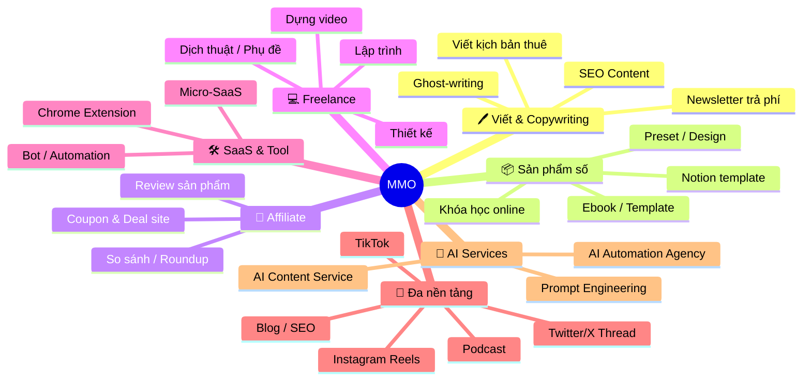
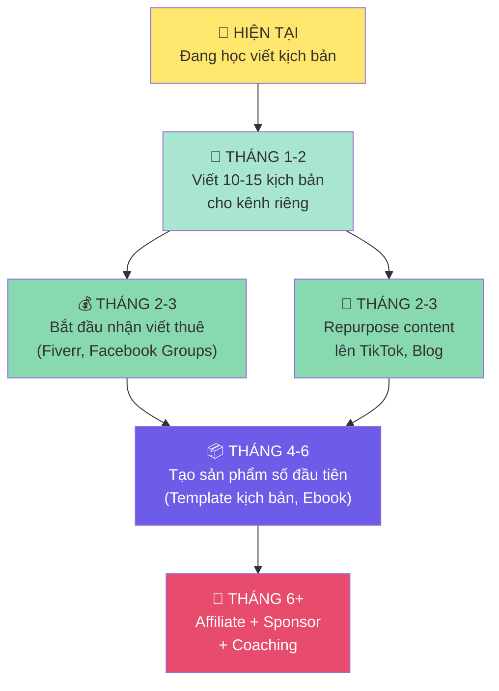

# Bản đồ MMO: Ngoài YouTube còn kiếm tiền online bằng cách nào?

---

## Bức tranh toàn cảnh

Hầu hết mọi người nghĩ MMO = làm YouTube hoặc bán hàng Shopee. Thực tế, có rất nhiều hướng, và **hướng hiệu quả nhất thường là kết hợp nhiều nguồn thu**, không chỉ phụ thuộc một kênh duy nhất.



---

## I. 7 HƯỚNG MMO CHI TIẾT

---

### 🖊️ Hướng 1: Viết — "Kỹ năng vạn năng"

> **Nếu bạn viết được kịch bản hay, bạn đang ngồi trên một mỏ vàng mà không biết.**

Viết không chỉ là "viết bài blog". Đây là các cách kiếm tiền từ kỹ năng viết:

| Dịch vụ | Mô tả | Thu nhập | Khó khăn |
|---------|--------|----------|----------|
| **Viết kịch bản thuê** | Viết script cho YouTuber/TikToker khác | 500K – 5M+/script | Cần portfolio, networking |
| **Ghostwriting** | Viết bài cho CEO, KOL, chuyên gia (họ đứng tên) | 2-20M/tháng | Cần viết được nhiều giọng văn |
| **Copywriting** | Viết quảng cáo, landing page, email marketing | 3-30M/dự án | Cần hiểu tâm lý bán hàng |
| **Newsletter trả phí** | Viết email chuyên sâu, độc giả trả tiền đọc | 5-100M+/tháng (scale lớn) | Cần xây dựng audience trước |
| **SEO Content** | Viết bài blog chuẩn SEO cho doanh nghiệp | 200K-1M/bài | Cạnh tranh cao, cần hiểu SEO |
| **UGC Scriptwriting** | Viết kịch bản cho quảng cáo UGC trên TikTok | 500K-3M/script | Thị trường đang bùng nổ |

> [!TIP]
> **Liên hệ trực tiếp với bạn:** Bạn đang học viết kịch bản → Đây là con đường ngắn nhất đến thu nhập. Rất nhiều YouTuber/TikToker có ý tưởng nhưng **không biết viết kịch bản.** Họ sẵn sàng trả tiền cho người viết giỏi.

**Nền tảng tìm việc:** Fiverr, Upwork, Facebook Groups ("Tuyển content creator"), liên hệ trực tiếp qua email/DM.

---

### 📦 Hướng 2: Sản phẩm số — "Làm 1 lần, bán mãi mãi"

> **Bạn bỏ ra 100 giờ tạo sản phẩm. Sản phẩm bán được 10,000 lần mà không tốn thêm giờ nào.**

| Sản phẩm | Ví dụ cụ thể | Thu nhập tiềm năng | Thời gian tạo |
|----------|-------------|-------------------|---------------|
| **Khóa học online** | "Viết kịch bản video từ A-Z" | 5-200M+/tháng | 2-8 tuần |
| **Ebook** | Sách hướng dẫn, checklist, framework | 1-20M/tháng | 1-4 tuần |
| **Template** | Notion template, Canva template, preset ảnh | 500K-50M/tháng | 1-2 tuần |
| **Prompt pack** | Bộ prompt AI cho nghề cụ thể | 200K-5M/tháng | 2-5 ngày |
| **Swipe file** | Bộ sưu tập quảng cáo/hook/CTA hay | 200K-3M/tháng | 1-2 tuần |

**Nền tảng bán:**

| Nền tảng | Phù hợp với | Phí |
|----------|-------------|-----|
| **Gumroad** | Ebook, template, prompt pack | 10% hoa hồng |
| **Udemy** | Khóa học (traffic sẵn) | 37-63% hoa hồng |
| **Teachable / Kajabi** | Khóa học (tự kiểm soát) | $39-149/tháng |
| **Notion Marketplace** | Notion template | Miễn phí đăng |
| **Etsy** | Template thiết kế, preset | Phí nhỏ/giao dịch |

> [!IMPORTANT]
> **Mô hình lý tưởng:** YouTube/TikTok = **thu hút người xem** → Sản phẩm số = **kiếm tiền thực sự.** Nhiều creator kiếm 80% thu nhập từ sản phẩm số, chỉ 20% từ quảng cáo YouTube.

---

### 🤝 Hướng 3: Affiliate Marketing — "Giới thiệu sản phẩm, nhận hoa hồng"

> **Bạn không cần tạo sản phẩm. Bạn chỉ cần giới thiệu sản phẩm của người khác và nhận %.**

| Mô hình | Cách hoạt động | Hoa hồng | Ví dụ |
|---------|----------------|----------|-------|
| **Review sản phẩm** | Viết/quay review chi tiết, gắn link affiliate | 3-50%/đơn | Review tai nghe, phần mềm |
| **So sánh (Roundup)** | "Top 5 mic tốt nhất cho YouTuber 2026" | 3-50%/đơn | Blog/video so sánh |
| **Coupon site** | Tổng hợp mã giảm giá, kiếm tiền từ click | CPC hoặc % | Trang tổng hợp deal |
| **Tool recommendation** | Giới thiệu tool/phần mềm bạn đang dùng | 20-50% recurring | "Tôi dùng Canva Pro, link đây" |

**Chương trình affiliate hoa hồng cao:**

| Chương trình | Hoa hồng | Loại sản phẩm |
|-------------|----------|---------------|
| **Canva Pro** | 20-80% (tùy khu vực) | Thiết kế |
| **Amazon Associates** | 1-10% | Mọi thứ trên Amazon |
| **Hostinger / Bluehost** | $50-100+/đơn | Hosting web |
| **ConvertKit** | 30% recurring hàng tháng | Email marketing |
| **Notion** | 50% năm đầu | Productivity |
| **Shopee / Lazada Affiliate** | 3-10% | E-commerce VN |
| **TikTok Shop Affiliate** | 5-20% | Sản phẩm trending |

> [!NOTE]
> **Affiliate hiệu quả nhất** khi bạn THỰC SỰ dùng sản phẩm đó. Review giả = mất uy tín nhanh chóng. Review thật + có audience tin tưởng = nguồn thu bền vững.

---

### 💻 Hướng 4: Freelance kỹ năng số

> **Bán thời gian + kỹ năng của bạn cho người cần.**

| Kỹ năng | Thu nhập/dự án | Thời gian học | Nhu cầu thị trường |
|---------|---------------|---------------|---------------------|
| **Dựng video** (CapCut, Premiere) | 500K-5M/video | 1-3 tháng | 🔥🔥🔥🔥🔥 |
| **Thiết kế đồ họa** (Canva, Figma) | 300K-3M/dự án | 1-2 tháng | 🔥🔥🔥🔥 |
| **Quản lý MXH** | 3-15M/tháng/client | 1 tháng | 🔥🔥🔥🔥 |
| **Chạy quảng cáo** (FB/Google Ads) | 3-20M/tháng/client | 2-4 tháng | 🔥🔥🔥🔥🔥 |
| **Dịch thuật / Phụ đề** | 200K-1M/video | Sẵn có | 🔥🔥🔥 |
| **Lập trình web/app** | 5-50M+/dự án | 3-12 tháng | 🔥🔥🔥🔥🔥 |
| **Voice-over** | 300K-2M/video | 1-2 tháng | 🔥🔥🔥 |
| **Xây dựng AI workflow** | 5-30M/dự án | 1-3 tháng | 🔥🔥🔥🔥🔥 (mới, ít cạnh tranh) |

**Nền tảng:**
- Quốc tế: Fiverr, Upwork, Toptal
- Việt Nam: Freelancer.vn, các group Facebook "Tuyển Freelancer", Fastwork

> [!TIP]
> **Combo mạnh:** Dựng video + viết kịch bản = bạn có thể offer dịch vụ "trọn gói" cho các doanh nghiệp nhỏ muốn làm content. Giá trị cao hơn nhiều so với chỉ bán 1 kỹ năng.

---

### 🛠️ Hướng 5: Xây dựng SaaS / Tool nhỏ

> **Tạo ra một công cụ giải quyết 1 vấn đề cụ thể, bán subscription hàng tháng.**

| Loại | Ví dụ | Thu nhập tiềm năng | Kỹ năng cần |
|------|-------|-------------------|-------------|
| **Micro-SaaS** | Tool tạo thumbnail AI, tool phân tích hashtag | 5-100M+/tháng | Lập trình (hoặc no-code) |
| **Chrome Extension** | Extension hỗ trợ viết content, SEO checker | 2-50M/tháng | JavaScript cơ bản |
| **Bot / Automation** | Bot Telegram quản lý đơn hàng, bot trả lời tự động | 3-30M/tháng | API + logic |
| **No-code Tool** | Trang web calculator, quiz builder | 1-20M/tháng | Bubble, Webflow, Framer |

> [!WARNING]
> **Hướng này cần kỹ năng kỹ thuật** (hoặc budget thuê dev). Không phù hợp nếu bạn muốn bắt đầu nhanh. Nhưng nếu bạn biết lập trình hoặc sẵn sàng học, đây là hướng có **thu nhập thụ động cao nhất.**

---

### 📱 Hướng 6: Đa nền tảng — "Không bỏ trứng vào 1 giỏ"

> **Cùng 1 nội dung, biến thành 5-7 format khác nhau cho 5-7 nền tảng.**

**Content Repurposing Machine:**

```
              ┌──→ TikTok (60s clip)
              ├──→ Instagram Reels (60s clip)
1 Kịch bản ──┼──→ YouTube (video dài)
              ├──→ YouTube Shorts (clip highlight)
              ├──→ Blog/SEO article (viết lại thành bài)
              ├──→ Twitter/X thread (chia thành từng bullet)
              ├──→ Podcast (audio version)
              └──→ Newsletter (email tóm tắt + insight thêm)
```

| Nền tảng | Cách kiếm tiền | Ngưỡng kiếm tiền |
|----------|---------------|-------------------|
| **TikTok** | Creator Fund, TikTok Shop, Sponsor | 10K followers |
| **Instagram** | Sponsor, Affiliate, bán sản phẩm | 5-10K followers |
| **Podcast** | Sponsor, Patreon, bán khóa học | 1K downloads/episode |
| **Blog/SEO** | Google AdSense, Affiliate, sponsor | 10K pageviews/tháng |
| **Twitter/X** | Gumroad link, sponsor, consulting | 5K followers |
| **Newsletter** | Trả phí (Substack), sponsor, affiliate | 1K subscribers |

> [!TIP]
> **Hiệu quả nhất:** Viết 1 kịch bản hay → Quay video dài cho YouTube → Cắt 3-5 shorts cho TikTok/Reels → Viết thành blog post → Tóm tắt thành Twitter thread → Gửi newsletter. **1 ý tưởng = 7+ nội dung.** Đây gọi là **Content Leverage.**

---

### 🤖 Hướng 7: AI-Powered Services — "Hướng mới nhất"

> **Dùng AI để cung cấp dịch vụ nhanh hơn, rẻ hơn, nhưng chất lượng tương đương.**

| Dịch vụ | Mô tả | Thu nhập | Công cụ AI |
|---------|--------|----------|------------|
| **AI Automation Agency (AAA)** | Xây workflow tự động cho doanh nghiệp | 10-100M+/tháng | Make, Zapier, n8n + ChatGPT API |
| **AI Content Service** | Viết nội dung + hình ảnh cho doanh nghiệp bằng AI | 5-30M/tháng | ChatGPT, Midjourney, Canva AI |
| **AI Video Production** | Làm video cho khách hàng bằng AI tools | 3-20M/video | Runway, Kling, ElevenLabs |
| **Chatbot Builder** | Xây chatbot AI cho shop/doanh nghiệp | 3-15M/project | Botpress, Voiceflow, ChatGPT API |
| **AI Consulting** | Tư vấn doanh nghiệp ứng dụng AI | 10-50M/dự án | Kiến thức + demo |

> [!IMPORTANT]
> **Tại sao hướng này hot?** 90% doanh nghiệp Việt Nam BIẾT AI quan trọng nhưng KHÔNG BIẾT bắt đầu từ đâu. Nếu bạn hiểu AI tools và biết cách áp dụng → bạn có giá trị cực lớn.

---

## II. MA TRẬN SO SÁNH

| Hướng | Vốn ban đầu | Thời gian đến $ đầu tiên | Thu nhập trần | Tính thụ động | Phù hợp người viết |
|-------|-------------|--------------------------|---------------|---------------|---------------------|
| Viết/Copywriting | 💰 | ⏱️ 2-4 tuần | 💵💵💵 | Thấp (đổi giờ lấy tiền) | ⭐⭐⭐⭐⭐ |
| Sản phẩm số | 💰 | ⏱️ 1-3 tháng | 💵💵💵💵💵 | **Rất cao** | ⭐⭐⭐⭐⭐ |
| Affiliate | 💰 | ⏱️ 2-6 tháng | 💵💵💵💵 | Cao | ⭐⭐⭐⭐ |
| Freelance | 💰 | ⏱️ 1-4 tuần | 💵💵💵 | Thấp | ⭐⭐⭐ |
| SaaS/Tool | 💰💰💰 | ⏱️ 3-12 tháng | 💵💵💵💵💵 | **Rất cao** | ⭐⭐ |
| Đa nền tảng | 💰 | ⏱️ 2-6 tháng | 💵💵💵💵 | Trung bình | ⭐⭐⭐⭐ |
| AI Services | 💰💰 | ⏱️ 1-2 tháng | 💵💵💵💵💵 | Trung bình | ⭐⭐⭐ |

---

## III. "CONTENT CREATOR STACK" — Mô hình tổng hợp

Thay vì chọn 1 hướng, **creator thông minh xây dựng một hệ thống nhiều tầng:**

```
┌─────────────────────────────────────────────────┐
│         💎 TẦNG 4: SẢN PHẨM CAO CẤP            │
│    Khóa học $2-5M · Coaching 1-1 · Consulting   │
│              (Ít khách, giá cao)                 │
├─────────────────────────────────────────────────┤
│         📦 TẦNG 3: SẢN PHẨM SỐ                  │
│   Ebook $100-500K · Template $50-200K · Preset  │
│          (Nhiều khách, giá vừa)                  │
├─────────────────────────────────────────────────┤
│         🤝 TẦNG 2: AFFILIATE + SPONSOR           │
│  Link giới thiệu · Sponsor video · Quảng cáo   │
│          (Thu nhập từ audience)                   │
├─────────────────────────────────────────────────┤
│       📱 TẦNG 1: NỘI DUNG MIỄN PHÍ (Traffic)    │
│  YouTube · TikTok · Blog · Newsletter · Twitter │
│       (Thu hút người xem, xây dựng trust)        │
└─────────────────────────────────────────────────┘
          ⬆️ Người xem đi từ dưới lên trên
```

**Cách hoạt động:**
1. **Tầng 1** thu hút hàng nghìn/triệu người → Miễn phí, mục đích xây audience
2. **Tầng 2** kiếm tiền từ audience đó → Affiliate + Sponsor (thu nhập vừa)
3. **Tầng 3** bán sản phẩm cho fan trung thành → Sản phẩm số (thu nhập tốt)
4. **Tầng 4** phục vụ nhóm nhỏ sẵn sàng trả giá cao → Coaching/Consulting (thu nhập cao nhất)

---

## IV. GỢI Ý CHO BẠN — Dựa trên việc bạn đang học viết kịch bản

### Lộ trình đề xuất:



### Thu nhập mục tiêu thực tế:

| Giai đoạn | Nguồn thu | Mục tiêu/tháng |
|-----------|-----------|-----------------|
| Tháng 1-2 | Chưa có (đang học + xây) | $0 — và hoàn toàn OK |
| Tháng 3-4 | Viết kịch bản thuê (2-3 client) | 3-10M |
| Tháng 5-8 | Viết thuê + sản phẩm số + affiliate | 10-25M |
| Tháng 9-12 | Tất cả trên + sponsor + coaching | 25-50M+ |

> [!NOTE]
> Đây là mục tiêu **thực tế** nếu bạn dành 3-4 giờ/ngày. Không phải "giàu nhanh" — nhưng là con đường **bền vững** và **tăng trưởng theo thời gian.**

---

## V. LỜI KHUYÊN CUỐI

### ❌ Đừng:
- Cố làm tất cả cùng lúc
- So sánh tháng 1 của mình với năm thứ 5 của người khác
- Bỏ tiền mua "khóa học MMO bí mật" hứa hẹn 100 triệu/tháng
- Chờ "hoàn hảo" mới bắt đầu

### ✅ Hãy:
- Chọn **1-2 hướng** phù hợp nhất, tập trung 3-6 tháng
- Xây **1 kỹ năng cốt lõi** thật giỏi (viết kịch bản = lựa chọn tuyệt vời)
- Bắt đầu **kiếm tiền từ kỹ năng** trong khi xây dựng kênh cá nhân
- Tái đầu tư thu nhập vào **nâng cấp công cụ và kỹ năng**
