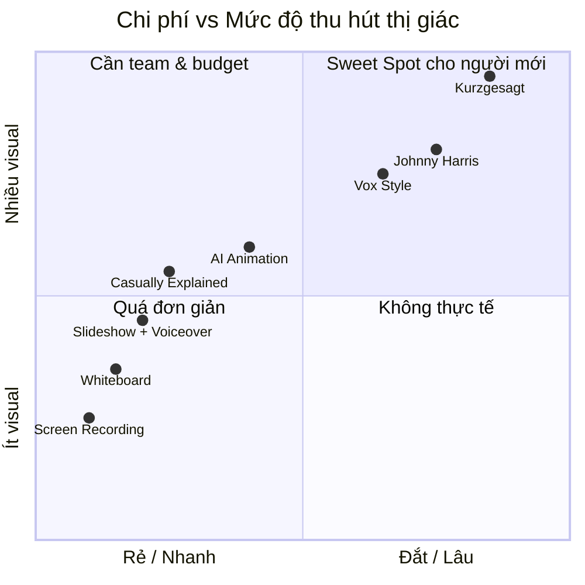
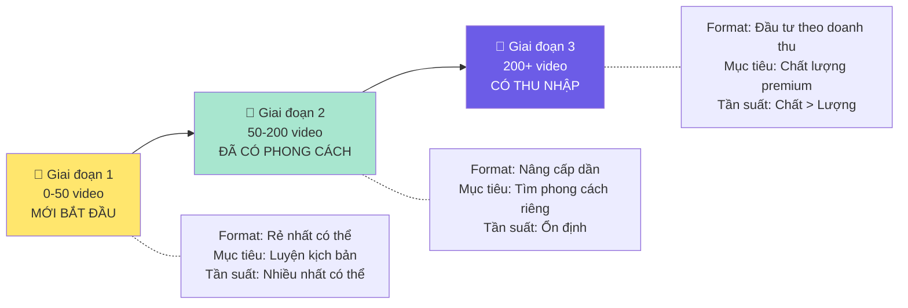

# Nên chọn Format Video nào? Johnny Harris vs Casually Explained vs...

## Câu hỏi cốt lõi

> **Kịch bản hay + hình ảnh tạm được > Kịch bản tạm + hình ảnh đẹp**
>
> Nhưng lý tưởng nhất: **Kịch bản hay + format phù hợp với năng lực hiện tại của bạn.**

---

## I. BẢN ĐỒ CÁC FORMAT VIDEO PHỔ BIẾN



---

## II. SO SÁNH 6 FORMAT CHÍNH

### Format 1: 🎬 Johnny Harris / Vox Style
**Đại diện:** Johnny Harris, Vox, Wendover Productions, Polymatter

| Tiêu chí | Chi tiết |
|-----------|----------|
| **Gồm những gì** | Quay thực tế + đồ họa chuyển động + bản đồ + dữ liệu + B-roll + âm nhạc |
| **Chi phí/video** | $2,000 – $20,000+ (hoặc 200-500 giờ công nếu tự làm) |
| **Thời gian sản xuất** | 2-8 tuần/video |
| **Kỹ năng cần** | Quay phim, dựng phim, motion graphics (After Effects), research, viết kịch bản, thu âm |
| **Thiết bị** | Camera, mic, đèn, máy tính mạnh, phần mềm Adobe |
| **Ưu điểm** | Premium feel, uy tín cao, sponsor trả giá cao |
| **Nhược điểm** | **Cực kỳ tốn thời gian và tiền.** Không bền vững nếu chưa có thu nhập từ kênh |

> [!CAUTION]
> **Thực tế phũ phàng:** Johnny Harris có team 5-10 người, budget hàng chục nghìn USD/video, và nhiều năm kinh nghiệm tại Vox. Cố bắt chước format này khi mới bắt đầu = cách nhanh nhất để **burn out và bỏ cuộc.**

---

### Format 2: 🎨 Casually Explained / Simple Animation
**Đại diện:** Casually Explained, Sam O'Nella, Oversimplified, Bill Wurtz

| Tiêu chí | Chi tiết |
|-----------|----------|
| **Gồm những gì** | Hình vẽ đơn giản (stick figure/sketch) + voiceover + text + nhạc nền |
| **Chi phí/video** | $0 – $200 (phần mềm miễn phí + mic cơ bản) |
| **Thời gian sản xuất** | 3-10 ngày/video |
| **Kỹ năng cần** | Viết kịch bản, vẽ cơ bản (hoặc dùng template), thu âm, dựng đơn giản |
| **Thiết bị** | Mic USB ($30-80), máy tính bất kỳ, phần mềm free |
| **Ưu điểm** | Rẻ, nhanh, tập trung vào kịch bản, dễ scale |
| **Nhược điểm** | Phong cách hài hước phải thật sự tốt, nếu không → trông "nghiệp dư" |

**Phần mềm:**
- Vẽ: Canva, Google Slides, Paint, Procreate (iPad)
- Dựng: CapCut (free), DaVinci Resolve (free)
- Thu âm: Audacity (free)

> [!TIP]
> **Tại sao format này hiệu quả?** Casually Explained có 6M+ subscribers với hình vẽ nhìn như "trẻ con vẽ". Bí quyết: **kịch bản cực kỳ hài hước và thông minh.** Hình ảnh đơn giản thực ra là **lợi thế** — não người xem tập trung 100% vào lời nói thay vì bị phân tán bởi hình ảnh.

---

### Format 3: 📊 Slideshow + Voiceover
**Đại diện:** Ali Abdaal (early), nhiều kênh giáo dục Việt Nam, Thomas Frank

| Tiêu chí | Chi tiết |
|-----------|----------|
| **Gồm những gì** | Slide đẹp (Canva/PowerPoint) + voiceover + stock footage/image |
| **Chi phí/video** | $0 – $100 |
| **Thời gian sản xuất** | 1-5 ngày/video |
| **Kỹ năng cần** | Thiết kế slide cơ bản, viết kịch bản, thu âm |
| **Thiết bị** | Mic USB, máy tính |
| **Ưu điểm** | **Nhanh nhất**, dễ nhất, ai cũng làm được ngay hôm nay |
| **Nhược điểm** | Khó tạo phong cách riêng, dễ bị coi là "generic" |

**Workflow:**
```
Viết kịch bản → Thiết kế slide trên Canva → Thu âm → Ghép trong CapCut → Xuất bản
```

---

### Format 4: ✏️ Whiteboard Animation
**Đại diện:** 3Blue1Brown, AsapSCIENCE, RSA Animate

| Tiêu chí | Chi tiết |
|-----------|----------|
| **Gồm những gì** | Vẽ trên nền trắng (hoặc đen) + voiceover, hiệu ứng "bàn tay đang vẽ" |
| **Chi phí/video** | $0 – $300 |
| **Thời gian sản xuất** | 3-7 ngày/video |
| **Kỹ năng cần** | Vẽ cơ bản, viết kịch bản, thu âm |
| **Thiết bị** | Bảng vẽ điện tử ($30-100) hoặc iPad, mic |
| **Ưu điểm** | Rất phù hợp giải thích khái niệm phức tạp, feel "giáo dục" |
| **Nhược điểm** | Hơi "cũ" nếu không làm mới phong cách |

**Phần mềm:** Excalidraw (free), Doodly, VideoScribe

---

### Format 5: 🤖 AI-Assisted Animation
**Đại diện:** Xu hướng mới 2025-2026, nhiều kênh đang thử nghiệm

| Tiêu chí | Chi tiết |
|-----------|----------|
| **Gồm những gì** | Hình ảnh AI + animation cơ bản + voiceover (có thể AI hoặc thật) |
| **Chi phí/video** | $20 – $500/tháng (subscription AI tools) |
| **Thời gian sản xuất** | 2-7 ngày/video |
| **Kỹ năng cần** | Prompt engineering, dựng video, viết kịch bản |
| **Thiết bị** | Máy tính, internet, mic |
| **Ưu điểm** | Hình ảnh đẹp bất ngờ với chi phí thấp, linh hoạt cao |
| **Nhược điểm** | Phong cách chưa ổn định, có thể bị "AI feel", bản quyền hình ảnh chưa rõ ràng |

**Công cụ:**
- Hình ảnh: Midjourney, DALL-E, Flux
- Video/Animation: Runway, Kling, Pika
- Voiceover (nếu cần): ElevenLabs, hoặc tự thu âm (được khuyến khích hơn)
- Dựng: CapCut, DaVinci Resolve

---

### Format 6: 🎙️ Faceless Voiceover + Stock/Archive
**Đại diện:** Nhiều kênh lịch sử, tài chính, true crime

| Tiêu chí | Chi tiết |
|-----------|----------|
| **Gồm những gì** | Voiceover + stock footage/ảnh lưu trữ + text overlay + nhạc nền |
| **Chi phí/video** | $0 – $100 (dùng stock miễn phí) |
| **Thời gian sản xuất** | 2-5 ngày/video |
| **Kỹ năng cần** | Viết kịch bản, thu âm, dựng video cơ bản |
| **Thiết bị** | Mic USB, máy tính |
| **Ưu điểm** | Không cần lộ mặt, không cần vẽ, stock footage miễn phí rất nhiều |
| **Nhược điểm** | Rất nhiều kênh làm kiểu này → khó nổi bật |

**Nguồn stock miễn phí:** Pexels, Pixabay, Unsplash, Wikimedia Commons, Archive.org

---

## III. BẢNG SO SÁNH TỔNG HỢP

| Format | Chi phí | Thời gian | Kỹ năng | Khả năng nổi bật | Tần suất đăng |
|--------|---------|-----------|---------|-------------------|---------------|
| Johnny Harris | 💰💰💰💰💰 | ⏱️⏱️⏱️⏱️⏱️ | 🎓🎓🎓🎓🎓 | ⭐⭐⭐⭐⭐ | 2-4 video/tháng |
| Casually Explained | 💰 | ⏱️⏱️⏱️ | 🎓🎓🎓 | ⭐⭐⭐⭐ | 2-4 video/tháng |
| Slideshow + Voiceover | 💰 | ⏱️⏱️ | 🎓🎓 | ⭐⭐ | 4-8 video/tháng |
| Whiteboard | 💰💰 | ⏱️⏱️⏱️ | 🎓🎓🎓 | ⭐⭐⭐ | 2-4 video/tháng |
| AI-Assisted | 💰💰 | ⏱️⏱️ | 🎓🎓🎓 | ⭐⭐⭐⭐ | 4-8 video/tháng |
| Faceless Voiceover | 💰 | ⏱️⏱️ | 🎓🎓 | ⭐⭐ | 4-8 video/tháng |

---

## IV. VẬY NÊN CHỌN FORMAT NÀO?

### Câu trả lời ngắn: **CÓ, nên chuyển sang format rẻ hơn** — nhưng không phải bất kỳ format rẻ nào.

### Câu trả lời dài: Phụ thuộc vào 3 yếu tố

#### Yếu tố 1: Bạn đang ở giai đoạn nào?



> [!IMPORTANT]
> **Nguyên tắc vàng:** Ở giai đoạn 1, **số lượng video quan trọng hơn chất lượng hình ảnh.** Bạn cần viết 50 kịch bản tệ trước khi viết được 1 kịch bản hay. Nếu mỗi video tốn 3 tuần để sản xuất, bạn cần 3 NĂM để đạt được 50 video. Nếu mỗi video tốn 3 ngày, bạn chỉ cần 5 THÁNG.

---

#### Yếu tố 2: Thế mạnh của bạn là gì?

| Nếu bạn giỏi... | Format phù hợp | Ví dụ |
|------------------|----------------|-------|
| **Hài hước, dí dỏm** | Casually Explained style | Hình đơn giản + script hài |
| **Giải thích, phân tích** | Whiteboard / Slideshow | Vẽ diagram + giảng giải |
| **Nghiên cứu, data** | AI-Assisted + Voiceover | Hình AI đẹp + data storytelling |
| **Kể chuyện, narrative** | Faceless Voiceover + Stock | Giọng kể + footage minh họa |
| **Đa kỹ năng, có team** | Johnny Harris style | Full production |

---

#### Yếu tố 3: Chủ đề của bạn là gì?

| Chủ đề | Format phù hợp nhất | Lý do |
|--------|---------------------|-------|
| Tài chính, kinh tế | Slideshow / AI-Assisted | Cần biểu đồ, số liệu |
| Lịch sử | Faceless + Archive footage | Có sẵn nguồn ảnh/video lịch sử |
| Khoa học, công nghệ | Whiteboard / Animation | Cần minh họa khái niệm |
| Đời sống, xã hội | Casually Explained style | Cần sự gần gũi, hài hước |
| Địa chính trị | Bản đồ + Voiceover | Cần bản đồ, infographic |

---

## V. LỘ TRÌNH ĐỀ XUẤT CHO NGƯỜI MỚI

### Phase 1: "Chỉ cần bắt đầu" (Tháng 1-3)

**Format:** Slideshow + Voiceover (hoặc Casually Explained style)

**Bộ công cụ tối thiểu — gần như miễn phí:**

| Công cụ | Mục đích | Giá |
|---------|----------|-----|
| **Canva** (Free) | Thiết kế slide/hình ảnh | $0 |
| **CapCut** (Free) | Dựng video | $0 |
| **Audacity** (Free) | Thu & chỉnh âm thanh | $0 |
| **Mic USB cơ bản** | Thu âm giọng nói | $30-50 |
| **Google Docs** | Viết kịch bản | $0 |

**Mục tiêu:** Xuất 8-12 video. Không quan tâm view. Chỉ quan tâm: *"Kịch bản video sau có tốt hơn video trước không?"*

**Workflow mỗi video:**
```
Ngày 1: Nghiên cứu + Viết Big Idea + Dàn ý
Ngày 2: Viết kịch bản chi tiết + Chỉnh sửa  
Ngày 3: Thiết kế slide trên Canva + Thu âm
Ngày 4: Dựng trên CapCut + Xuất bản
```

---

### Phase 2: "Tìm phong cách" (Tháng 4-9)

**Format:** Nâng cấp lên AI-Assisted hoặc animation đơn giản

**Thêm vào bộ công cụ:**

| Công cụ | Mục đích | Giá |
|---------|----------|-----|
| **Midjourney / Flux** | Tạo hình ảnh minh họa chất lượng cao | $10-30/tháng |
| **DaVinci Resolve** (Free) | Dựng video nâng cao, color grading | $0 |
| **Bảng vẽ điện tử** | Vẽ minh họa đơn giản | $30-80 (mua 1 lần) |

**Mục tiêu:** Tìm ra phong cách riêng. Bắt đầu có feedback từ khán giả. Thử nghiệm format nào retention cao nhất.

---

### Phase 3: "Nâng cấp theo doanh thu" (Tháng 10+)

Khi kênh bắt đầu có thu nhập (sponsor, YouTube ads, bán khóa học...), **tái đầu tư** vào nâng cấp:
- Mic tốt hơn ($100-300)
- Thuê freelancer motion graphics (nếu cần)
- Subscription công cụ AI cao cấp
- Dần dần tiến đến chất lượng Johnny Harris — nhưng **bằng tiền từ kênh, không phải tiền túi**

---

## VI. CASE STUDY: Các kênh thành công với format "rẻ"

| Kênh | Subscribers | Format | Chi phí ước tính/video |
|------|-------------|--------|----------------------|
| **Casually Explained** | 6.5M | Stick figure + voiceover | ~$50 |
| **Oversimplified** | 8M+ | Animation đơn giản + hài | ~$200-500 |
| **Sam O'Nella Academy** | 4M+ | Stick figure + hài đen | ~$30 |
| **3Blue1Brown** | 6M+ | Animation toán học (Manim) | ~$0 (tự code) |
| **Exurb1a** | 3M+ | Stock footage + voiceover triết học | ~$50-100 |
| **Lemmino** | 5M+ | Stock + archive + voiceover | ~$100-300 |

> [!NOTE]
> **Điểm chung:** Tất cả các kênh trên đều có **kịch bản cực kỳ tốt.** Hình ảnh chỉ là phương tiện truyền tải — kịch bản mới là sản phẩm thực sự.

---

## VII. KẾT LUẬN

### Công thức quyết định:

```
┌─────────────────────────────────────────────────────────────┐
│                                                             │
│  Budget thấp + Mới bắt đầu                                 │
│  → Slideshow/Casually Explained style                       │
│  → Tập trung 90% vào KỊCH BẢN                              │
│                                                             │
│  Budget vừa + Đã có kinh nghiệm                            │
│  → AI-Assisted Animation                                    │
│  → Tập trung 70% kịch bản, 30% hình ảnh                    │
│                                                             │
│  Budget cao + Có team/thu nhập                              │
│  → Johnny Harris / Kurzgesagt style                         │
│  → Tập trung 50% kịch bản, 50% production                  │
│                                                             │
│  ⚠️ Ở MỌI mức budget:                                      │
│  KỊCH BẢN LUÔN CHIẾM TỶ TRỌNG LỚN NHẤT                    │
│                                                             │
└─────────────────────────────────────────────────────────────┘
```

> [!TIP]
> **Lời khuyên cuối cùng:** Đừng để "chưa có hình ảnh đẹp" trở thành lý do để không bắt đầu. **Một video với kịch bản hay và hình ảnh Canva đơn giản vẫn tốt hơn vô cùng so với một video không bao giờ được làm** vì bạn đang chờ đủ tiền mua camera.
>
> Bắt đầu rẻ. Bắt đầu nhanh. Bắt đầu hôm nay. Nâng cấp sau.
