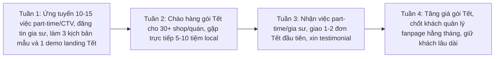

# Đánh giá độ thực tế của 6 cách MMO, bản cải tiến và hướng đi mới

> [!IMPORTANT]
> **Kết luận ngắn:** Trong 6 cách trước, chỉ có **2 cách dùng được ngay** (Landing page và Kịch bản ngắn), với điều kiện phải sửa lại. 4 cách còn lại hoặc chậm, hoặc phụ thuộc may rủi, hoặc thị trường đã bão hòa. Muốn có tiền **chắc chắn** trong 30 ngày, kênh thực tế nhất với sinh viên là **việc part-time hoặc CTV có lương** và **gia sư tin học**, kết hợp thêm **dịch vụ mùa vụ Tết 2027**.

---

## 1. Chấm điểm lại 6 cách cũ

Thang điểm: khả năng có tiền thật trong 30 ngày, với người chưa có portfolio, vốn 0đ.

| # | Cách | Điểm | Vấn đề thực tế | Quyết định |
|---|---|---|---|---|
| 1 | Kịch bản Micro-drama + Storyboard | **6/10** | Nhắn tin lạnh cho shop TikTok có tỷ lệ phản hồi rất thấp. Shop nhỏ thường tự quay bằng điện thoại, ít khi trả tiền riêng cho kịch bản, càng ít trả cho storyboard vẽ tay. | **Giữ, đổi khách hàng** |
| 2 | Landing page kể chuyện + Mini-quiz | **7/10** | Nhu cầu có thật. Câu "tăng tỷ lệ chuyển đổi gấp 2–3 lần" là **không có nguồn**, không nên dùng khi chào hàng. Quiz làm tăng thời gian làm mà khách nhỏ chưa chắc trả thêm. | **Giữ, đơn giản hóa** |
| 3 | Truyện tranh 4 khung cho brand | **4/10** | Brand muốn nét vẽ ổn định, có phong cách. Vẽ sơ cấp và chưa có page chứng minh thì rất khó bán. Nhu cầu ít. | **Chuyển thành portfolio** |
| 4 | Google Sheet / Tool AI viết kịch bản | **3.5/10** | Thị trường ngập GPTs và prompt miễn phí. Khách trong group MMO rất nhạy giá. Bạn phải tự lo chi phí API, quản lý key và hỗ trợ sau bán. | **Chỉ dùng nội bộ** |
| 5 | Story-selling trên Threads/Group + Shopee Affiliate | **4/10** | Nhiều group Facebook cấm link affiliate. Hoa hồng Shopee thường chỉ vài % mỗi đơn, có trần. Câu "vài triệu sau 2–3 ngày" là phóng đại. | **Làm phụ, kỳ vọng thấp** |
| 6 | Kênh Doodle + Affiliate | **3/10** (cho mục tiêu "nhanh") | Làm animation, dù đơn giản, vẫn tốn nhiều giờ mỗi video. Gắn giỏ hàng TikTok Shop có điều kiện về follower và tài khoản (**cần kiểm tra quy định hiện hành**). | **Hoãn** |

### Những phát ngôn cũ cần rút lại
- "Tăng chuyển đổi 2–3 lần", "mất 3 giây là người xem lướt": đây là số liệu minh họa, không có nguồn kiểm chứng.
- "Shopee Affiliate duyệt rất nhanh, không cần follow": điều kiện có thể thay đổi, cần tự kiểm tra.
- Mốc "7–10 ngày ra tiền" ở hầu hết các cách là lạc quan. Với người chưa có portfolio, mốc thực tế là **2–5 tuần**.

---

## 2. Bản cải tiến cho 2 cách dùng được

### 2.1. Kịch bản video ngắn: đổi khách hàng và cách bán

| Cũ | Cải tiến |
|---|---|
| Nhắn tin lạnh cho shop TikTok | Nhắm vào **KOC/affiliate creator** (người cần nhiều ý tưởng mỗi ngày), **agency nhỏ và team quay dựng** (cần người viết thuê theo đơn), **shop mà bạn hoặc người quen đang mua hàng** |
| Storyboard vẽ tay 6 khung | **Kịch bản + shot list dạng chữ** (cảnh, góc máy, thoại, chữ trên màn hình). Chỉ vẽ phác khi khách cần, coi như dịch vụ bán thêm |
| Combo 5 kịch bản giá 500k–1,2tr | Bắt đầu với **gói thử 3 kịch bản giá 150–300k**, sau đó chuyển sang **gói tháng 15–20 kịch bản** để có thu nhập đều |

**Cách tìm khách thực tế:**
1. Đăng bài trong các group tuyển content/editor/KOC (đọc nội quy group trước).
2. Đọc các bài tuyển "CTV viết kịch bản TikTok" trên TopCV, group Facebook và ứng tuyển trực tiếp. Agency **luôn** cần người viết theo đơn.
3. Gửi kèm **3 kịch bản mẫu cho 3 ngành khác nhau** trong một file PDF gọn.

### 2.2. Landing page: đơn giản hóa, bán theo ngách

- **Bỏ quiz khỏi gói cơ bản.** Đưa quiz vào gói nâng cao, chỉ dành cho khách đang chạy quảng cáo.
- **Chọn 1–2 ngách có chạy ads và giá trị khách cao:** spa, nha khoa, trung tâm tiếng Anh, gia sư, khóa học online, dịch vụ cưới.
- **Chào hàng bằng bản demo theo ngành**, không bằng lời hứa về con số.
- **Giá tham khảo:** 1–1,5tr (gói cơ bản) → 2–3tr (có copywriting và hình minh họa). Thu cọc 30–50%.

---

## 3. Hướng đi mới thực tế hơn

Xếp theo **xác suất ra tiền trong 30 ngày**, từ cao xuống thấp.

### A. Part-time / CTV có lương tại agency hoặc startup (cao nhất)
- **Vị trí phù hợp:** CTV content, CTV viết kịch bản video, thực tập sinh marketing-tech, hỗ trợ web/WordPress, nhập liệu và vận hành TMĐT.
- **Lý do thực tế:** Có thu nhập cố định, có người hướng dẫn, có portfolio thật. Bạn không phải tự đi tìm khách.
- **Nơi tìm:** TopCV, ITviec, LinkedIn, group "Tuyển CTV content/marketing", trang tuyển dụng của trường.
- **Thu nhập tham khảo:** khoảng 2–6tr/tháng cho part-time (tùy thành phố và số giờ).

### B. Gia sư tin học / lập trình (cao)
- **Đối tượng:** học sinh học Scratch/Python, ôn thi tin học, tin học văn phòng cho người đi làm, hoặc trợ giảng tại trung tâm STEM/coding cho trẻ em.
- **Lý do thực tế:** Phụ huynh có nhu cầu đều đặn. Bạn có thể nhận qua người quen hoặc trung tâm gia sư, không cần portfolio phức tạp.
- **Thu nhập tham khảo:** khoảng 100–250k/buổi tùy cấp độ và khu vực.

> [!WARNING]
> **Tránh nhận "làm đồ án/bài tập thuê".** Có nhu cầu nhưng vi phạm quy chế học thuật, và bạn có thể gặp rủi ro nếu bị phát hiện. Nếu muốn làm, hãy chuyển thành **kèm hướng dẫn** (người học tự làm, bạn giảng giải).

### C. Dịch vụ mùa vụ Tết 2027 (cao, có hạn chót)
Tết Nguyên Đán 2027 rơi vào khoảng **đầu tháng 2/2027**. Từ **giữa tháng 11 đến giữa tháng 1** là thời điểm shop và doanh nghiệp nhỏ cần gấp nội dung Tết. Sale 12.12 cũng nằm trong khoảng này.

| Sản phẩm | Kỹ năng dùng | Khách hàng |
|---|---|---|
| Kịch bản video Tết (gói 5–10 kịch bản) | Kịch bản + Content | Shop online, KOC |
| Landing page "Combo quà Tết" / đặt hàng Tết | IT + Copywriting | Shop bánh mứt, quà biếu, trà, đặc sản |
| Thiết kế bao lì xì, thiệp Tết, banner với nét vẽ tay | Vẽ sơ cấp + Canva/Figma | Doanh nghiệp nhỏ, quán, cá nhân |
| Bài đăng + ảnh menu Tết | Content + thiết kế | Quán ăn, cà phê |

**Lý do thực tế:** Có hạn chót rõ ràng nên khách chốt nhanh hơn ngày thường. Phải bắt đầu chào hàng **ngay trong tháng 11**.

### D. Gói "Số hóa tiệm local" (trung bình–cao)
- **Nội dung gói:** tạo hoặc tối ưu Google Business Profile (Google Maps), menu QR, Zalo OA cơ bản, fanpage và ảnh bìa, 5–10 bài đăng mẫu.
- **Lý do thực tế:** Dịch vụ cụ thể, giá thấp, dễ hiểu. Bạn có thể **đi gặp trực tiếp** các quán quanh trường hoặc khu trọ, cách này chốt khách tốt hơn nhắn tin online.
- **Giá tham khảo:** 300k–1tr/gói, bán thêm quản lý fanpage hằng tháng.

### E. Quản lý fanpage / trực livestream part-time cho shop (trung bình)
- **Công việc:** trả lời inbox, lên lịch đăng bài, viết caption, hỗ trợ (mod) livestream, nhập đơn.
- **Lý do thực tế:** Shop TMĐT thiếu người vận hành. Việc lặp lại nhưng lương đều.
- **Thu nhập tham khảo:** khoảng 1,5–4tr/tháng tùy số giờ.

### F. Hỗ trợ kỹ thuật tại chỗ (trung bình, kiếm tiền ngay)
- **Dịch vụ:** cài Windows/phần mềm, vệ sinh laptop, cứu dữ liệu cơ bản, setup máy cho sinh viên năm nhất.
- **Lý do thực tế:** Không cần portfolio, tìm khách qua group trường và ký túc xá. Thu nhập nhỏ nhưng có ngay.

---

## 4. Bảng tổng hợp xếp hạng mới

| Hạng | Hướng | Thời gian ra tiền (thực tế) | Độ chắc chắn | Ghi chú |
|---|---|---|---|---|
| 1 | A. Part-time / CTV có lương | 1–3 tuần (sau phỏng vấn) | **Cao** | Thu nhập đều, có portfolio thật |
| 2 | B. Gia sư tin học | 1–3 tuần | **Cao** | Dựa nhiều vào người quen |
| 3 | C. Dịch vụ mùa Tết | 1–4 tuần | Trung bình–cao | **Hết hạn sau giữa tháng 1** |
| 4 | D. Số hóa tiệm local | 1–3 tuần | Trung bình–cao | Gặp trực tiếp |
| 5 | Landing page (bản cải tiến) | 2–5 tuần | Trung bình | Giá trị đơn cao nhất |
| 6 | Kịch bản ngắn (bản cải tiến) | 2–4 tuần | Trung bình | Nên đi qua agency |
| 7 | E. Quản lý fanpage / livestream | 1–3 tuần | Trung bình | |
| 8 | F. Hỗ trợ kỹ thuật | Vài ngày | Trung bình | Thu nhập nhỏ |
| — | Affiliate, Kênh doodle, Truyện 4 khung, Tool AI | > 1–3 tháng | Thấp | Chỉ làm khi đã có nguồn thu chính |

---

## 5. Kế hoạch kết hợp đề xuất (30 ngày, khoảng 15 giờ/tuần)

**Phân bổ thời gian:**
- **Khoảng 50%:** nguồn thu ổn định (part-time/CTV hoặc gia sư).
- **Khoảng 40%:** dịch vụ ngắn hạn có giá trị cao (gói Tết, landing page, số hóa tiệm local).
- **Khoảng 10%:** thử nghiệm dài hạn (page truyện 4 khung hoặc affiliate), chỉ để làm portfolio.

**Mục tiêu thực tế sau 30 ngày:** có 1 nguồn thu đều, hoàn thành 2–4 đơn dịch vụ, có 2 testimonial. Thu nhập có thể dao động **khoảng 2–8 triệu**, tùy số giờ bạn bỏ ra và khu vực sinh sống. Đây là ước lượng, không phải cam kết.

> [!NOTE]
> Các mức giá và thu nhập trong tài liệu là ước lượng tham khảo theo thị trường chung, chưa được khảo sát cụ thể theo khu vực của bạn. Trước khi báo giá, nên xem 10–20 tin đăng tương tự trong group hoặc trên các nền tảng tuyển dụng để điều chỉnh.
