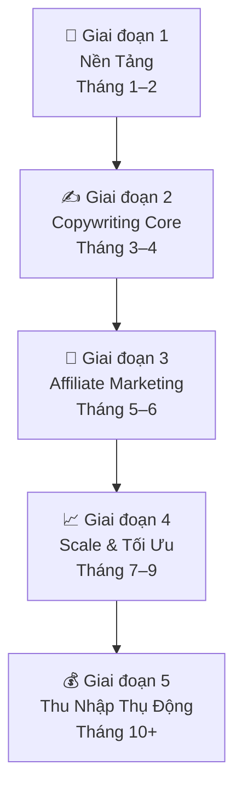

# 🚀 Lộ Trình Học Copywriting & Affiliate Marketing Từ A–Z

> **Mục tiêu**: Từ người mới bắt đầu → viết được copy bán hàng hiệu quả → kiếm thu nhập thụ động qua Affiliate Marketing.

---

## 🗺️ TỔNG QUAN ROADMAP



---

## 📅 ROADMAP CHI TIẾT THEO THÁNG

| Tháng | Giai đoạn | Nội dung chính | Mục tiêu đầu ra |
|-------|-----------|----------------|-----------------|
| 1–2 | Nền Tảng | Tâm lý học hành vi, marketing cơ bản, nghiên cứu thị trường | Hiểu buyer persona, market research |
| 3–4 | Copywriting Core | Các framework copy, viết headline, CTA, email | Viết được sales page hoàn chỉnh |
| 5–6 | Affiliate Setup | Chọn niche, đăng ký network, tạo kênh traffic | Có kênh traffic đầu tiên |
| 7–9 | Scale & Optimize | SEO, Paid Ads, A/B testing, phễu bán hàng | Thu nhập $100–$500/tháng |
| 10+ | Passive Income | Tự động hóa, outsource, mở rộng | Thu nhập thụ động ổn định |

---

## 📚 GIAI ĐOẠN 1: NỀN TẢNG (Tháng 1–2)

### 🧠 Module 1.1 — Tư Duy & Tâm Lý Học Bán Hàng (2 tuần)

**Lý thuyết cần nắm:**
- Tâm lý học hành vi người mua (Behavioral Psychology)
- Các thiên kiến nhận thức: FOMO, Social Proof, Anchoring, Scarcity
- Mô hình AIDA: Attention → Interest → Desire → Action
- Customer Journey: nhận thức → cân nhắc → quyết định

**Sách nên đọc:**
- 📖 *Influence* – Robert Cialdini (bản dịch: *Những Đòn Tâm Lý Trong Thuyết Phục*)
- 📖 *Thinking, Fast and Slow* – Daniel Kahneman
- 📖 *Made to Stick* – Chip & Dan Heath

**Bài tập thực hành:**
- [ ] Phân tích 5 quảng cáo bạn thấy trên Facebook/Tiktok và xác định đòn tâm lý được dùng
- [ ] Viết lại 1 quảng cáo bạn thấy yếu, áp dụng AIDA

---

### 📊 Module 1.2 — Nghiên Cứu Thị Trường & Buyer Persona (2 tuần)

**Nội dung:**
- Cách xác định thị trường ngách (niche)
- Xây dựng Buyer Persona chi tiết
- Nghiên cứu đối thủ cạnh tranh
- Tìm hiểu pain point & desire của khách hàng

**Công cụ học:**
- Google Trends — phân tích xu hướng
- AnswerThePublic — tìm câu hỏi của khách hàng
- Facebook Audience Insights — phân tích đối tượng
- Reddit & Forum — nghe khách hàng nói chuyện thật

**Bài tập thực hành:**
- [ ] Tạo Buyer Persona hoàn chỉnh cho 1 sản phẩm affiliate bạn muốn quảng bá
- [ ] List 20 pain points của khách hàng mục tiêu

---

## ✍️ GIAI ĐOẠN 2: COPYWRITING CORE (Tháng 3–4)

### 📝 Module 2.1 — Các Framework Copy Huyền Thoại (2 tuần)

**Framework cần master:**

| Framework | Mô tả | Dùng khi nào |
|-----------|--------|--------------|
| **AIDA** | Attention → Interest → Desire → Action | Email, quảng cáo ngắn |
| **PAS** | Problem → Agitate → Solution | Social post, landing page |
| **BAB** | Before → After → Bridge | Testimonial, case study |
| **4U** | Useful, Urgent, Unique, Ultra-specific | Headline |
| **PASTOR** | Problem, Amplify, Story, Testimony, Offer, Response | Long-form sales page |

**Bài tập:**
- [ ] Viết 1 đoạn copy cho cùng 1 sản phẩm bằng 3 framework khác nhau
- [ ] So sánh và chọn framework hiệu quả nhất

---

### 🎯 Module 2.2 — Nghệ Thuật Viết Headline (1 tuần)

**Nguyên tắc viết headline chuyển đổi cao:**
- Headline phải chứa lợi ích cụ thể (benefit, không phải feature)
- Dùng con số: *"7 cách...", "Tăng 300%..."*
- Kích thích tò mò mà không clickbait
- Headline cần trả lời: "Điều này có ý nghĩa gì với TÔI?"

**Công thức headline mạnh:**
```
[Con số] + [Tính từ mạnh] + [Lợi ích cụ thể] + [Trong thời gian X]
Ví dụ: "7 Bước Đơn Giản Để Kiếm $500 Đầu Tiên Từ Affiliate Trong 30 Ngày"
```

**Bài tập:**
- [ ] Viết 20 headline cho cùng 1 sản phẩm
- [ ] A/B test headline trên bài post mạng xã hội

---

### 📧 Module 2.3 — Email Copywriting (2 tuần)

**Cấu trúc email marketing hiệu quả:**
1. **Subject line** — quyết định tỷ lệ mở (open rate)
2. **Preheader** — 40-60 ký tự tiếp theo sau subject
3. **Hook đầu email** — 2-3 câu đầu quyết định tiếp tục đọc
4. **Body** — kể chuyện, cung cấp giá trị
5. **CTA** — 1 hành động duy nhất, rõ ràng

**Chuỗi email tự động (Autoresponder Sequence):**
```
Email 1 (Ngày 0): Welcome + Giao quà hứa hẹn
Email 2 (Ngày 1): Câu chuyện & vấn đề
Email 3 (Ngày 3): Giải pháp & giá trị
Email 4 (Ngày 5): Social proof & testimonial
Email 5 (Ngày 7): Soft pitch (offer lần 1)
Email 6 (Ngày 9): Giải đáp thắc mắc
Email 7 (Ngày 11): Hard pitch + deadline
```

**Công cụ:**
- MailerLite (miễn phí đến 1,000 subscriber)
- ConvertKit (dành cho creator)

---

### 🛒 Module 2.4 — Sales Page & Landing Page (1 tuần)

**Cấu trúc Sales Page chuẩn:**
1. **Hero Section**: Headline + Sub-headline + CTA
2. **Problem Section**: Khuấy động nỗi đau
3. **Solution**: Giới thiệu sản phẩm/dịch vụ
4. **Features → Benefits**: Chuyển đặc điểm thành lợi ích
5. **Social Proof**: Review, testimonial, số liệu
6. **FAQ**: Xử lý objection
7. **Price + Offer**: Neo giá, bonus, guarantee
8. **Final CTA**: Kêu gọi hành động mạnh

**Bài tập lớn:**
- [ ] Tạo 1 landing page hoàn chỉnh cho sản phẩm affiliate (dùng Carrd.co miễn phí)

---

## 🔗 GIAI ĐOẠN 3: AFFILIATE MARKETING (Tháng 5–6)

### 🏪 Module 3.1 — Chọn Niche & Sản Phẩm Affiliate (1 tuần)

**Tiêu chí chọn niche tốt:**
- ✅ Bạn có hiểu biết hoặc đam mê
- ✅ Thị trường có đủ người mua (demand)
- ✅ Có sản phẩm affiliate trả commission tốt
- ✅ Cạnh tranh không quá khốc liệt (với người mới)

**Top Niche tiềm năng cao:**

| Niche | Lý do tiềm năng | Commission trung bình |
|-------|-----------------|----------------------|
| Sức khỏe & Fitness | Nhu cầu vĩnh cửu | 20–50% |
| Tài chính cá nhân | High-ticket, evergreen | 30–50% |
| Công nghệ & SaaS | Recurring commission | 20–40%/tháng |
| Học trực tuyến | Boom sau COVID | 30–50% |
| Làm đẹp & Skincare | Mua lặp lại cao | 10–30% |

---

### 🌐 Module 3.2 — Affiliate Networks & Programs (1 tuần)

**Networks phổ biến:**

**Quốc tế:**
- **ClickBank** — digital products, commission 50–75%
- **ShareASale** — đa dạng ngành hàng
- **CJ Affiliate** — thương hiệu lớn
- **Impact** — SaaS & tech products
- **Amazon Associates** — vật lý, commission thấp hơn (1–10%)

**Việt Nam:**
- **Accesstrade** — đa dạng, nhiều nhãn hàng VN
- **Civi** — tập trung sản phẩm số
- **Lazada Affiliate** — e-commerce
- **Shopee Affiliate** — e-commerce
- **VNPT Pay, Momo** — fintech

**Quy trình đăng ký:**
1. Truy cập network → Đăng ký tài khoản
2. Điền thông tin kênh traffic của bạn
3. Chờ duyệt (1–7 ngày)
4. Chọn sản phẩm → Lấy affiliate link

---

### 📣 Module 3.3 — Xây Dựng Kênh Traffic (3 tuần)

> [!IMPORTANT]
> Chọn **1 kênh chính** và tập trung master trước khi mở rộng.

#### Option A: Content Blog (SEO)
**Phù hợp với:** Người thích viết, kiên nhẫn, muốn traffic bền vững

**Bước thực hiện:**
1. Mua domain + hosting (Hostinger ~$50/năm, hoặc dùng WordPress.com)
2. Cài WordPress + theme nhẹ (Astra, GeneratePress)
3. Nghiên cứu từ khóa (Ubersuggest miễn phí, Ahrefs trả phí)
4. Viết bài theo chuẩn SEO + chèn affiliate link
5. Build backlink dần dần

**Timeline:** 3–6 tháng để thấy traffic ổn định

---

#### Option B: YouTube Channel
**Phù hợp với:** Người thoải mái trước camera, nội dung "how-to"

**Bước thực hiện:**
1. Chọn niche → Tạo kênh YouTube
2. Nghiên cứu từ khóa YouTube (TubeBuddy)
3. Quay video review, tutorial, unboxing
4. Để affiliate link trong description
5. Dẫn về landing page/email list

---

#### Option C: TikTok / Reels
**Phù hợp với:** Người trẻ, muốn tăng trưởng nhanh

**Bước thực hiện:**
1. Content dạng ngắn: tip nhanh, review 60 giây
2. Link trong bio dẫn về Linktree → affiliate link
3. Đăng 1–2 video/ngày trong 30 ngày đầu
4. Tận dụng trending sound & hashtag

---

#### Option D: Email List (Recommended kết hợp)
**Phù hợp với:** Ai cũng nên làm — đây là tài sản thực sự

**Bước thực hiện:**
1. Tạo lead magnet (ebook, checklist, mini-course miễn phí)
2. Setup landing page thu thập email
3. Cài autoresponder sequence (7 email)
4. Gửi newsletter định kỳ với nội dung giá trị + affiliate offer

---

## 📈 GIAI ĐOẠN 4: SCALE & TỐI ƯU (Tháng 7–9)

### 🔬 Module 4.1 — Phân Tích & A/B Testing

**Chỉ số cần theo dõi:**

| Chỉ số | Ý nghĩa | Mục tiêu |
|--------|---------|----------|
| CTR (Click Through Rate) | Tỷ lệ click vào link | >2% (email), >1% (ads) |
| Conversion Rate | Tỷ lệ chuyển đổi | >1–3% |
| EPC (Earning Per Click) | Thu nhập mỗi click | Càng cao càng tốt |
| Open Rate | Tỷ lệ mở email | >20–30% |
| ROI | Lợi nhuận/Chi phí | >100% |

**Công cụ phân tích:**
- Google Analytics 4 (miễn phí)
- Microsoft Clarity (heatmap miễn phí)
- Pretty Links (theo dõi affiliate click)

---

### 💸 Module 4.2 — Paid Traffic (Quảng Cáo Trả Phí)

> [!WARNING]
> Chỉ chạy paid ads khi bạn đã có **organic traffic** và **biết conversion rate** của offer. Không thì sẽ đốt tiền.

**Facebook/Instagram Ads:**
- Bắt đầu với ngân sách nhỏ: $5–$10/ngày
- Test nhiều creative: ảnh vs video vs carousel
- Retargeting: remarketing cho người đã xem landing page

**Google Ads:**
- Search ads: target người đang tìm mua
- Display ads: brand awareness

---

### 🔄 Module 4.3 — Phễu Bán Hàng (Sales Funnel)

```
[Quảng cáo / Content]
        ↓
[Lead Magnet Page] — Thu email
        ↓
[Thank You Page] — Tripwire offer ($7–$27)
        ↓
[Email Sequence] — Nurture & Build trust
        ↓
[Main Offer] — Core affiliate product
        ↓
[Upsell / Cross-sell] — Tăng giá trị đơn hàng
```

---

## 💰 GIAI ĐOẠN 5: THU NHẬP THỤ ĐỘNG (Tháng 10+)

### 🤖 Module 5.1 — Tự Động Hóa Hệ Thống

- **Email sequences**: Tự động nuture → pitch → upsell
- **Content scheduling**: Buffer, Later để lên lịch post
- **AI tools**: Dùng AI hỗ trợ viết draft copy (không thay thế hoàn toàn)
- **Outsource**: Thuê VA viết content, edit video khi có thu nhập

### 📦 Module 5.2 — Đa Dạng Hóa Thu Nhập

- Kết hợp nhiều affiliate program
- Tạo sản phẩm số của riêng mình (ebook, course)
- Cung cấp dịch vụ copywriting freelance
- Xây dựng community (Facebook Group, Discord)

---

## 🛠️ BỘ CÔNG CỤ CẦN THIẾT

### Miễn Phí
| Công cụ | Mục đích |
|---------|----------|
| Google Docs | Viết copy |
| Canva | Thiết kế ảnh quảng cáo |
| MailerLite | Email marketing |
| Carrd.co | Landing page đơn giản |
| Ubersuggest | Nghiên cứu từ khóa cơ bản |
| Google Analytics | Phân tích traffic |
| Hemingway App | Kiểm tra độ dễ đọc |

### Trả Phí (khi có thu nhập)
| Công cụ | Mục đích | Chi phí |
|---------|----------|---------|
| Ahrefs/SEMrush | SEO nâng cao | $99–$129/tháng |
| ConvertKit | Email marketing nâng cao | $29+/tháng |
| ClickFunnels/Systeme.io | Sales funnel | $27+/tháng |
| Jasper/Copy.ai | AI copywriting hỗ trợ | $49+/tháng |

---

## 📖 TÀI NGUYÊN HỌC TẬP

### Sách Copywriting
1. 📗 *The Copywriter's Handbook* – Robert Bly
2. 📗 *Everybody Writes* – Ann Handley
3. 📗 *Ca$hvertising* – Drew Eric Whitman
4. 📗 *Breakthrough Advertising* – Eugene Schwartz (kinh điển)
5. 📗 *The Adweek Copywriting Handbook* – Joseph Sugarman

### Sách Affiliate & Marketing
1. 📘 *DotCom Secrets* – Russell Brunson (miễn phí)
2. 📘 *Traffic Secrets* – Russell Brunson (miễn phí)
3. 📘 *Expert Secrets* – Russell Brunson (miễn phí)
4. 📘 *Affiliate Marketing Mastery* – Stefan James

### Kênh YouTube Học Miễn Phí
- **Pat Flynn (Smart Passive Income)** — Affiliate marketing thực chiến
- **Miles Beckler** — SEO + affiliate từ đầu
- **Income School** — Blog & niche site
- **Alex Cattoni** — Copywriting hiện đại
- **Jon Benson** — Video sales letter

### Podcast
- *The Smart Passive Income Podcast*
- *Marketing School* – Neil Patel & Eric Siu
- *Copyblogger FM*

---

## 📋 CHECKLIST HÀNH ĐỘNG HÀNG TUẦN

### Tuần 1–4 (Tháng 1): Học Nền Tảng
- [ ] Đọc 1 chương sách copywriting/ngày
- [ ] Phân tích 3 quảng cáo/ngày
- [ ] Viết 1 đoạn copy/ngày (dù tệ cũng viết)
- [ ] Tham gia 2–3 group copywriting trên Facebook

### Tuần 5–8 (Tháng 2): Luyện Tập Chuyên Sâu
- [ ] Swipe file: Lưu 10 copy hay bạn thấy mỗi tuần
- [ ] Rewrite 1 sales page/tuần
- [ ] Nhận feedback từ community

### Tháng 3–4: Xây Dựng Portfolio
- [ ] Viết 3 sales page mẫu
- [ ] Viết 1 chuỗi email 7 bài
- [ ] Tạo landing page thực tế

### Tháng 5–6: Launch Affiliate
- [ ] Đăng ký 2–3 affiliate network
- [ ] Chọn 1 offer để promote
- [ ] Tạo kênh traffic chính
- [ ] Thu được click affiliate đầu tiên

### Tháng 7+: Tối Ưu & Scale
- [ ] Đạt $100 affiliate đầu tiên 🎉
- [ ] Tối ưu conversion rate
- [ ] Mở rộng sang offer thứ 2

---

## ⚠️ CÁC LỖI THƯỜNG GẶP CẦN TRÁNH

> [!CAUTION]
> **Lỗi #1: Học mà không viết** — Copywriting học bằng cách VIẾT, không phải đọc. Mỗi ngày phải có output.

> [!CAUTION]
> **Lỗi #2: Chọn quá nhiều niche** — Chọn 1, master 1. Đừng trải rộng quá sớm.

> [!CAUTION]
> **Lỗi #3: Spam affiliate link** — Xây dựng trust trước, bán hàng sau. 80% giá trị, 20% bán hàng.

> [!WARNING]
> **Lỗi #4: Bỏ cuộc trước 6 tháng** — Affiliate marketing là trò chơi dài hạn. Hầu hết người bỏ cuộc ngay trước khi thấy kết quả.

> [!WARNING]
> **Lỗi #5: Không build email list** — Kênh mạng xã hội có thể bị khóa bất cứ lúc nào. Email list là tài sản thật sự của bạn.

---

## 🎯 MỐC TIẾN ĐỘ & KỲ VỌNG THU NHẬP

| Mốc thời gian | Kỳ vọng thực tế |
|---------------|----------------|
| Tháng 1–2 | $0 — Đang học nền tảng |
| Tháng 3–4 | $0–$50 — Bắt đầu có click đầu tiên |
| Tháng 5–6 | $50–$200 — Kênh traffic đang grow |
| Tháng 7–9 | $200–$500 — Bắt đầu tối ưu |
| Tháng 10–12 | $500–$2,000 — Hệ thống ổn định |
| Năm 2+ | $2,000–$10,000+ | Scale và đa dạng hóa |

> [!NOTE]
> Con số trên là kỳ vọng **thực tế** nếu bạn học đúng cách và kiên trì. Ai hứa bạn kiếm $10,000 trong 30 ngày đều là lừa đảo.

---

*📅 Cập nhật lần cuối: Tháng 8/2026 | Được tạo bởi Antigravity AI*
