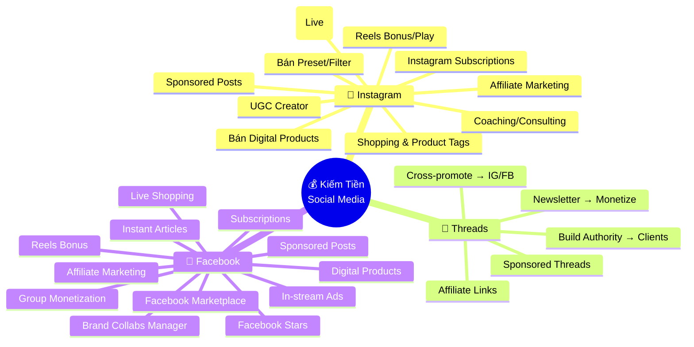
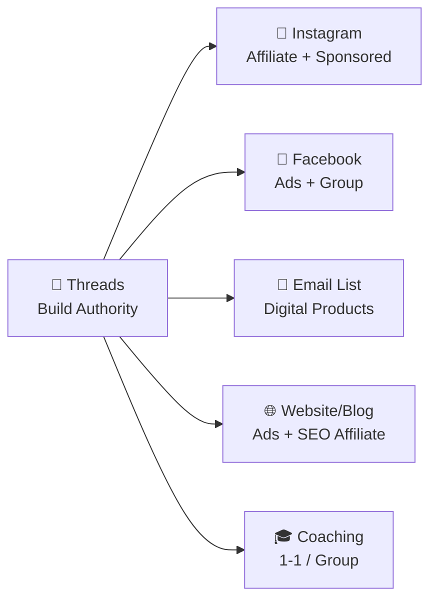
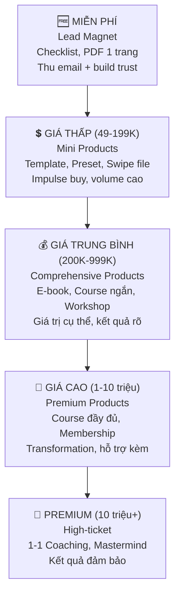
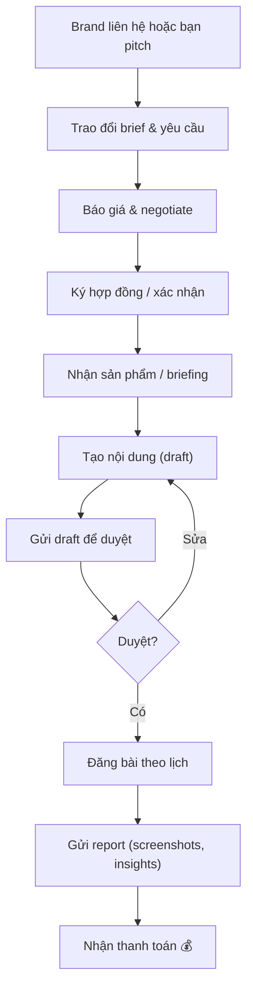
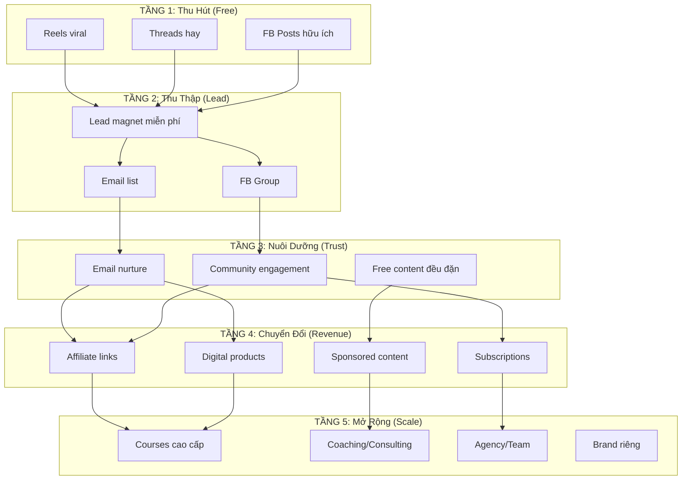
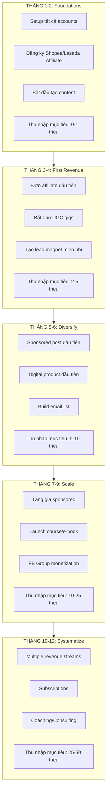

# 💰 HƯỚNG DẪN CHI TIẾT: Tất Cả Các Cách Kiếm Tiền Từ Instagram, Threads & Facebook

> **Bổ sung cho**: Hướng dẫn xây kênh Affiliate Marketing từ Scratch
> **Cập nhật**: Tháng 8/2026
> **Triết lý**: Đa dạng hóa thu nhập — Không bao giờ phụ thuộc 1 nguồn

---

## Mục Lục

1. [Tổng Quan Hệ Sinh Thái Kiếm Tiền](#1-tổng-quan-hệ-sinh-thái-kiếm-tiền)
2. [INSTAGRAM: 10 Cách Kiếm Tiền Chi Tiết](#2-instagram-10-cách-kiếm-tiền-chi-tiết)
3. [THREADS: Chiến Lược Monetization](#3-threads-chiến-lược-monetization)
4. [FACEBOOK: 12 Cách Kiếm Tiền Chi Tiết](#4-facebook-12-cách-kiếm-tiền-chi-tiết)
5. [Digital Products: Sản Phẩm Số Bạn Có Thể Bán](#5-digital-products-sản-phẩm-số-bạn-có-thể-bán)
6. [Sponsored Content & Brand Deals](#6-sponsored-content--brand-deals)
7. [Xây Dựng Phễu Thu Nhập Đa Tầng](#7-xây-dựng-phễu-thu-nhập-đa-tầng)
8. [Bảng Tính Thu Nhập & Mục Tiêu Tài Chính](#8-bảng-tính-thu-nhập--mục-tiêu-tài-chính)
9. [Pháp Lý & Thuế](#9-pháp-lý--thuế)
10. [Roadmap Kiếm Tiền Theo Giai Đoạn](#10-roadmap-kiếm-tiền-theo-giai-đoạn)

---

## 1. Tổng Quan Hệ Sinh Thái Kiếm Tiền

### Bản Đồ Thu Nhập Toàn Diện



### Thu Nhập Chủ Động vs Thụ Động

| Loại | Mô tả | Ví dụ | Khả năng scale |
|------|--------|-------|-----------------|
| **Chủ động** | Đổi thời gian lấy tiền | Sponsored posts, Coaching | Giới hạn |
| **Bán thụ động** | Tạo 1 lần, bán nhiều lần | Digital products, Courses | Cao |
| **Thụ động** | Tiền chảy tự động | Affiliate links, Ad revenue | Rất cao |

> [!IMPORTANT]
> **Mục tiêu cuối cùng**: Xây dựng hệ thống mà thu nhập THỤNG ĐỘNG chiếm >50% tổng thu nhập. Điều này giúp bạn có tự do thời gian và tài chính thực sự.

---

## 2. INSTAGRAM: 10 Cách Kiếm Tiền Chi Tiết

### 2.1. 🔗 Affiliate Marketing (Cách #1)

**Cơ chế**: Chia sẻ link sản phẩm → Người mua qua link → Nhận hoa hồng

**Cách triển khai trên Instagram:**

| Vị trí đặt link | Cách thực hiện | Hiệu quả |
|------------------|----------------|-----------|
| **Bio link** | Dùng Linktree/Beacons chứa nhiều link affiliate | ⭐⭐⭐⭐ |
| **Stories sticker** | Dùng Link Sticker dẫn thẳng tới SP | ⭐⭐⭐⭐⭐ |
| **Caption** | Ghi "Link ở bio" + emoji chỉ lên | ⭐⭐⭐ |
| **DM automation** | Comment keyword → tự gửi link qua DM | ⭐⭐⭐⭐⭐ |
| **Highlights** | Tạo highlight "Best Picks" chứa story links | ⭐⭐⭐⭐ |

**Thu nhập ước tính:**

```
Micro (1K-10K followers):     500K - 5 triệu VNĐ/tháng
Mid (10K-50K followers):      5 - 25 triệu VNĐ/tháng
Macro (50K-500K followers):   25 - 100+ triệu VNĐ/tháng
```

**Pro Tips Affiliate trên IG:**
- Dùng **ManyChat** hoặc **Chatfuel** để tự động gửi link qua DM khi comment keyword
- Tạo **story series** (3-5 stories): Hook → Review → Kết quả → CTA link
- Pin **comment chứa link** trên các bài Reel/Carousel
- Tạo **Guides** (IG Guides) để tổng hợp các sản phẩm recommend

---

### 2.2. 📸 Sponsored Posts / Brand Deals (Cách #2)

**Cơ chế**: Brand trả tiền để bạn tạo nội dung quảng cáo sản phẩm/dịch vụ của họ

**Bảng giá tham khảo (thị trường VN 2026):**

| Followers | Story (1 slide) | Story (3 slides) | Feed Post | Reel | Package |
|-----------|-----------------|-------------------|-----------|------|---------|
| 1K-5K | 200-500K | 500K-1tr | 500K-1.5tr | 1-2tr | 2-4tr |
| 5K-10K | 500K-1tr | 1-2tr | 1.5-3tr | 2-5tr | 4-8tr |
| 10K-30K | 1-2tr | 2-4tr | 3-7tr | 5-10tr | 8-20tr |
| 30K-100K | 2-5tr | 5-10tr | 7-15tr | 10-25tr | 20-50tr |
| 100K-500K | 5-15tr | 15-30tr | 15-40tr | 25-60tr | 50-120tr |
| 500K+ | 15tr+ | 30tr+ | 40tr+ | 60tr+ | 120tr+ |

> [!NOTE]
> Giá trên là **tham khảo trung bình**. Niche có giá trị cao (tài chính, công nghệ, làm đẹp) có thể cao hơn 2-3x. Engagement Rate quan trọng hơn follower count.

**Cách tìm Brand Deals:**

```
📋 GIAI ĐOẠN 1 (0-5K followers): Chủ động outreach
├── Liệt kê 20-30 brands trong niche
├── Tìm email marketing/PR trên website
├── Gửi Media Kit + Pitch email
└── Offer barter (đổi sản phẩm lấy review)

📋 GIAI ĐOẠN 2 (5K-20K): Inbound bắt đầu đến
├── Đăng ký Instagram Brand Collabs Manager
├── Tham gia các platform: 
│   ├── Hiip.asia (VN)
│   ├── Revu.net (VN)
│   ├── 7Saturday (VN)
│   └── Aspire / CreatorIQ (quốc tế)
├── Tối ưu profile để brands tìm thấy bạn
└── Bắt đầu negotiate giá

📋 GIAI ĐOẠN 3 (20K+): Brands tự tìm đến
├── Thuê manager hoặc join agency
├── Tăng giá và chọn lọc brands
├── Long-term partnerships (ambassador)
└── Revenue share deals
```

**Template Media Kit:**

```
┌─────────────────────────────────────────┐
│           [TÊN BẠN] MEDIA KIT          │
│              [Tagline]                   │
├─────────────────────────────────────────┤
│                                          │
│ 👤 ABOUT ME                             │
│ [2-3 câu giới thiệu bản thân & niche]   │
│                                          │
│ 📊 SOCIAL STATS                         │
│ IG: @___ — XX,XXX followers             │
│ Threads: @___ — XX,XXX followers        │
│ FB Page: XX,XXX followers               │
│ FB Group: XX,XXX members                │
│ Email List: XX,XXX subscribers          │
│                                          │
│ 📈 ENGAGEMENT                           │
│ IG Engagement Rate: X.X%                │
│ Avg. Reel Views: XX,XXX                 │
│ Avg. Story Views: X,XXX                 │
│ Avg. Saves/Post: XXX                    │
│                                          │
│ 👥 AUDIENCE DEMOGRAPHICS               │
│ Age: X% (18-24), X% (25-34)...         │
│ Gender: X% Female, X% Male             │
│ Location: X% VN, X% Other              │
│ Top Cities: HCM, HN, DN                │
│                                          │
│ 🏆 PAST COLLABORATIONS                 │
│ [Logo/tên brands đã hợp tác]            │
│ [Screenshot kết quả nổi bật]            │
│                                          │
│ 📦 PACKAGES & PRICING                  │
│ [Bảng giá các gói]                      │
│                                          │
│ 📩 CONTACT                              │
│ Email: ___                               │
│ Phone: ___                               │
└─────────────────────────────────────────┘
```

---

### 2.3. 💎 Instagram Subscriptions (Cách #3)

**Cơ chế**: Followers trả phí hàng tháng để truy cập nội dung exclusive

**Điều kiện**: Creator Account + 10,000+ followers (có thể thấp hơn tùy khu vực)

**Mức giá**: \$0.99 — \$99.99/tháng (bạn tự chọn)

**Nội dung exclusive cho subscribers:**

| Loại nội dung | Mô tả | Ví dụ |
|---------------|--------|-------|
| **Subscriber Stories** | Stories chỉ subscriber xem được | Behind-scenes, daily routine |
| **Subscriber Posts** | Bài đăng exclusive | Review sớm, deals riêng |
| **Subscriber Reels** | Reels premium | Tutorial chi tiết, advanced tips |
| **Subscriber Lives** | Live Q&A riêng | Tư vấn trực tiếp |
| **Subscriber Broadcast** | Channel chat riêng | Cập nhật, tips độc quyền |
| **Subscriber Badge** | Huy hiệu đặc biệt | Nhận diện fan trung thành |

**Chiến lược Subscription thành công:**

```
MIỄN PHÍ (Public):                    TRẢ PHÍ (Subscriber):
├── Tips cơ bản                        ├── Tips nâng cao & chi tiết
├── Review ngắn                        ├── Review full + so sánh
├── Reel 30 giây                       ├── Video dài 5-10 phút
├── Thông tin chung                    ├── Deal & mã giảm giá sớm
└── Q&A chung                          ├── Q&A riêng, ưu tiên reply
                                       ├── Resource downloads
                                       └── Community exclusive
```

**Thu nhập ước tính:**
```
100 subscribers × $4.99/tháng = ~$499/tháng (~12.5 triệu VNĐ)
500 subscribers × $4.99/tháng = ~$2,495/tháng (~62.5 triệu VNĐ)
1,000 subscribers × $4.99/tháng = ~$4,990/tháng (~125 triệu VNĐ)

(Instagram giữ lại ~30% phí)
```

---

### 2.4. ⭐ Badges trong Instagram Live (Cách #4)

**Cơ chế**: Viewers mua badges (tip) trong khi bạn livestream

**Điều kiện**: Creator/Business account + 10,000+ followers

**Mức giá badges**: \$0.99, \$1.99, \$4.99

**Chiến lược Live hiệu quả:**

```
📅 Live Schedule: 1-2 lần/tuần, cùng khung giờ
⏰ Thời lượng tối ưu: 30-60 phút
🎯 Format live hiệu quả:

1. "Hỏi gì đáp nấy" Q&A (phổ biến nhất)
2. Review sản phẩm LIVE (unboxing trực tiếp)
3. Tutorial/Workshop live
4. "Cùng mình [hoạt động]" (study with me, cook with me...)
5. Đặc biệt: Flash deal live (kết hợp affiliate)
```

**Tips tăng Badges:**
- Gọi tên người mua badge và cảm ơn công khai
- Tạo mục tiêu badge ("Nếu đạt 50 badges, mình sẽ...")
- Ưu tiên trả lời câu hỏi từ người có badge
- Tặng shoutout cho top badge buyers

---

### 2.5. 🎬 Instagram Reels Bonus / Reels Play (Cách #5)

**Cơ chế**: Instagram trả tiền dựa trên lượt xem Reels của bạn

**Điều kiện**: Được Instagram mời (invite-only, dựa trên hiệu suất)

**Cách tối ưu để được mời:**
- Đăng Reels NGUYÊN BẢN (không watermark TikTok)
- Tần suất cao: 4-7 Reels/tuần
- Nội dung tuân thủ guidelines 100%
- Engagement rate cao (comments > likes)
- Nội dung gốc, không repost

**Thu nhập**: Dao động lớn — từ vài trăm nghìn đến vài chục triệu/tháng tùy views

---

### 2.6. 🛍️ Instagram Shopping & Product Tags (Cách #6)

**Cơ chế**: Gắn tag sản phẩm vào ảnh/video, người xem click mua trực tiếp

**2 Hướng triển khai:**

```
HƯỚNG 1: Bán sản phẩm của chính bạn
├── Setup Instagram Shop
├── Kết nối catalog (Shopify, WooCommerce...)
├── Tag sản phẩm trong posts & stories
└── Checkout trên IG hoặc website

HƯỚNG 2: Affiliate Product Tags
├── Dùng affiliate partnerships
├── Tag sản phẩm từ brands đã liên kết
├── Nhận commission khi bán qua tag
└── Không cần inventory
```

---

### 2.7. 📱 Bán Digital Products Qua IG (Cách #7)

**Cơ chế**: Tạo sản phẩm số 1 lần, bán không giới hạn

**Sản phẩm phù hợp theo niche:**

| Niche | Sản phẩm số | Giá bán (VNĐ) |
|-------|-------------|----------------|
| Skincare | Skincare Routine Guide (PDF) | 99-299K |
| Fitness | Workout Plan 30 ngày | 199-499K |
| Công nghệ | Checklist mua laptop/điện thoại | 49-149K |
| Photography | Preset Lightroom pack | 99-299K |
| Tài chính | Template quản lý chi tiêu (Excel) | 99-199K |
| Marketing | Template Canva cho business | 199-499K |
| Học tập | Flashcards / Notion template | 49-199K |
| Nấu ăn | E-cookbook (PDF) | 99-299K |

**Nền tảng bán:**
- **Gumroad** (quốc tế, dễ dùng)
- **Stan Store** (tích hợp link-in-bio)
- **Shopee** (cho thị trường VN)
- **Google Forms + Chuyển khoản** (đơn giản nhất)

---

### 2.8. 🎓 Coaching & Consulting (Cách #8)

**Cơ chế**: Tư vấn 1-1 hoặc nhóm nhỏ về chuyên môn trong niche

**Các hình thức:**

| Hình thức | Thời gian | Giá (VNĐ) | Phù hợp khi |
|-----------|-----------|-----------|-------------|
| DM Consulting | 30 phút text | 200-500K | Mới bắt đầu |
| Video Call 1-1 | 30-60 phút | 500K-2tr | Có expertise |
| Group Coaching | 4-8 tuần | 1-5tr/người | Có hệ thống |
| Mentorship | 1-3 tháng | 3-15tr | Expert level |
| VIP Day | Cả ngày | 5-20tr | Chuyên gia |

**Cách bán coaching qua IG:**
```
1. Chia sẻ kiến thức miễn phí (content hàng ngày)
2. Show kết quả & case studies (social proof)
3. CTA nhẹ trong stories: "DM mình chữ 'TƯ VẤN' để biết thêm"
4. Consultation call miễn phí 15 phút
5. Upsell vào gói coaching
```

---

### 2.9. 📸 UGC Creator (Cách #9)

**Cơ chế**: Brands trả tiền để bạn tạo nội dung, KHÔNG CẦN đăng trên kênh của bạn

> [!TIP]
> **UGC (User-Generated Content) Creator** là cách kiếm tiền TUYỆT VỜI cho người mới — bạn không cần nhiều followers. Brands cần nội dung chất lượng để chạy ads, và bạn là người tạo ra nội dung đó.

**Thu nhập UGC:**

| Loại nội dung | Giá/video (VNĐ) | Thời gian làm |
|---------------|------------------|---------------|
| Unboxing video | 500K-2tr | 1-2 giờ |
| Testimonial/Review | 1-3tr | 2-3 giờ |
| Tutorial/How-to | 2-5tr | 3-5 giờ |
| Lifestyle B-roll | 500K-1.5tr | 1-2 giờ |
| Photo set (5-10 ảnh) | 1-3tr | 2-4 giờ |

**Cách bắt đầu làm UGC:**
```
1. Tạo UGC Portfolio (3-5 video mẫu, dùng sản phẩm tự mua)
2. Đăng portfolio trên IG (highlight "UGC Portfolio")
3. Pitch brands trực tiếp qua email/DM
4. Đăng ký trên: Billo, Collabstr, JoinBrands
5. Giao content → Nhận tiền → Build portfolio → Tăng giá
```

---

### 2.10. 🎨 Bán Presets, Filters & Templates (Cách #10)

**Cơ chế**: Tạo preset ảnh / filter / template thiết kế và bán cho audience

**Phù hợp nhất cho**: Photography, Lifestyle, Travel, Food bloggers

```
Preset Lightroom Pack (5-10 presets): 99-299K VNĐ
Instagram Story Templates (20 templates): 149-399K VNĐ  
Canva Template Bundle: 199-599K VNĐ
Video LUT Pack: 199-499K VNĐ
```

---

## 3. THREADS: Chiến Lược Monetization

### 3.1. Threads Bonus Program

**Cơ chế**: Meta trả tiền cho creators có nội dung engagement cao trên Threads

**Điều kiện** (tùy thời điểm, Meta thay đổi):
- Tài khoản creator đủ điều kiện
- Nội dung tuân thủ guidelines
- Engagement metrics đạt ngưỡng
- Được mời tham gia program

### 3.2. Threads Như Công Cụ Bán Hàng Gián Tiếp

> [!IMPORTANT]
> Threads hiện tại chưa có nhiều công cụ monetization trực tiếp như IG/FB. Nhưng Threads là **vũ khí build authority cực mạnh** → dẫn traffic về các kênh kiếm tiền khác.



### 3.3. Chiến Lược Monetization Trên Threads

**Cách 1: Affiliate Links Trực Tiếp**
```
Thread review sản phẩm chi tiết 5-10 posts
→ Post cuối: Link affiliate trực tiếp
→ Hoặc: "Link đầy đủ ở bio IG"

Hiệu quả: ⭐⭐⭐ (link click rate trên Threads khá tốt)
```

**Cách 2: Sponsored Threads**
```
Brands trả tiền để bạn viết thread về sản phẩm
Giá tham khảo:
- 5K-20K followers: 500K-2tr VNĐ/thread
- 20K-100K: 2-10tr VNĐ/thread
- 100K+: 10tr+ VNĐ/thread

Lưu ý: Luôn ghi rõ "Paid partnership" hoặc "Sponsored"
```

**Cách 3: Lead Generation**
```
Thread giá trị cao → CTA cuối thread:
"Mình có [PDF/Checklist/Guide] chi tiết hơn.
Comment 'GỬI' để mình DM link download."

→ Thu email → Email marketing → Bán products/services
```

**Cách 4: Build Expertise → Consulting**
```
Chia sẻ kiến thức chuyên sâu đều đặn
→ Trở thành "go-to expert" trong niche
→ DMs hỏi tư vấn bắt đầu đến
→ Chuyển thành dịch vụ có phí
```

**Cách 5: Newsletter Funnel**
```
Thread hay → "Theo dõi newsletter của mình để nhận 
nội dung dạng này hàng tuần"

Newsletter platforms: Substack (có paid tier), Beehiiv
→ Sponsored newsletter: 500K-5tr VNĐ/issue
→ Paid subscribers: $5-15/tháng
```

---

## 4. FACEBOOK: 12 Cách Kiếm Tiền Chi Tiết

### 4.1. 📺 In-Stream Ads (Cách #1)

**Cơ chế**: Facebook chèn quảng cáo vào video của bạn, bạn nhận phần chia doanh thu

**Điều kiện đủ điều kiện (2026):**
- 5,000+ followers trên Page
- 600,000 phút xem trong 60 ngày qua
- 5+ video active
- Video dài ≥ 1 phút (khuyến nghị 3+ phút)
- Tuân thủ Facebook Monetization Policies

**Các loại In-Stream Ads:**

| Loại | Mô tả | RPM ước tính |
|------|--------|-------------|
| **Pre-roll** | Quảng cáo trước video | \$1-5/1000 views |
| **Mid-roll** | Quảng cáo giữa video (≥3 phút) | \$2-8/1000 views |
| **Image ads** | Banner trong video | \$0.5-2/1000 views |
| **Post-loop** | Sau khi video chạy hết | \$0.5-3/1000 views |

**Thu nhập ước tính:**
```
100,000 views/tháng × $3 RPM = $300/tháng (~7.5 triệu VNĐ)
500,000 views/tháng × $3 RPM = $1,500/tháng (~37.5 triệu VNĐ)
1,000,000 views/tháng × $3 RPM = $3,000/tháng (~75 triệu VNĐ)
```

**Chiến lược tối ưu In-Stream Ads:**
```
1. Tạo video 3-10 phút (mid-roll = tiền nhiều hơn)
2. Hook mạnh 3 giây đầu (giữ người xem)
3. Retention rate > 1 phút (điều kiện chạy ads)
4. Upload native (KHÔNG share link YouTube)
5. Đặt ad break points hợp lý (không gây khó chịu)
6. Series content (người xem quay lại)
```

---

### 4.2. ⭐ Facebook Stars (Cách #2)

**Cơ chế**: Fans gửi Stars (virtual currency) trong Live, Reels, và bài viết. 1 Star = \$0.01

**Điều kiện**: 500+ followers (có thể thay đổi)

**Cách tối đa Stars:**

```
📱 LIVE STREAM
├── Live Q&A hàng tuần (cùng khung giờ)
├── Đặt mục tiêu Stars ("100 Stars = mình sẽ...")
├── Gọi tên + cảm ơn người gửi Stars
├── Challenges / games với audience
└── Live events đặc biệt (milestone celebration)

🎬 REELS
├── Tạo Reels chất lượng cao, original
├── CTA: "Gửi Stars nếu thấy hữu ích"
└── Reply comments có Stars

📝 POSTS
├── Bài viết giá trị cao
└── Stars button tự động hiển thị
```

**Thu nhập ước tính:**
```
100 Stars/ngày = $1/ngày = $30/tháng (~750K VNĐ)
500 Stars/ngày = $5/ngày = $150/tháng (~3.75 triệu VNĐ)
2,000 Stars/ngày = $20/ngày = $600/tháng (~15 triệu VNĐ)
```

---

### 4.3. 🔒 Facebook Subscriptions (Cách #3)

**Cơ chế**: Fans trả phí hàng tháng để truy cập nội dung exclusive trên Page

**Điều kiện**: 10,000+ followers HOẶC 250+ return viewers

**Mức giá**: \$0.99 — \$99.99/tháng

**Quyền lợi cho subscribers:**
- Badge đặc biệt bên cạnh tên
- Nội dung exclusive (posts, videos, Lives)
- Group riêng cho subscribers
- Ưu tiên reply
- Behind-the-scenes content
- Early access

---

### 4.4. 👥 Facebook Group Monetization (Cách #4)

> [!IMPORTANT]
> Facebook Group là **MỎ VÀNG** cho affiliate marketing. Group có engagement rate cao hơn Page 5-10x và tỷ lệ chuyển đổi affiliate cao hơn nhiều vì members đã có TRUST.

**4 Cách kiếm tiền từ Group:**

#### A. Paid Group (Group trả phí)
```
Tạo group Premium:
- Miễn phí: Group chung, tips cơ bản
- Trả phí: Group VIP, nội dung nâng cao

Giá: 99-499K VNĐ/tháng hoặc 999K-2tr/năm
Platform: Facebook Subscription hoặc thu qua bên ngoài

Ví dụ:
"Hội Skincare Pro" — Free group: 10,000 members
"Skincare Pro VIP" — Paid: 200 members × 199K = 39.8tr/tháng
```

#### B. Affiliate trong Group
```
Chiến lược "Trusted Recommender":

1. Tạo PINNED POST: "Sản phẩm tôi recommend" (cập nhật monthly)
2. Weekly deals: Curate deals tốt nhất + affiliate links
3. Review trong group: Chi tiết, trung thực, có ảnh/video thật
4. "Hỏi-Đáp" → Recommend sản phẩm tự nhiên
5. Resource Files: Upload file tổng hợp sản phẩm + links
```

#### C. Sponsored Posts trong Group
```
Brands trả tiền để bạn post trong group:
- 1K-5K members: 500K-2tr/bài
- 5K-20K members: 2-5tr/bài
- 20K-50K members: 5-15tr/bài
- 50K+ members: 15tr+/bài

Quy tắc: Tối đa 1-2 sponsored posts/tuần
Luôn ghi rõ: "Bài hợp tác với [Brand]"
```

#### D. Bán sản phẩm/dịch vụ cho members
```
Members đã trust bạn → Tỷ lệ mua cao
- Khóa học online
- Coaching packages
- Digital products
- Events/Workshops
```

---

### 4.5. 🎬 Facebook Reels Bonus (Cách #5)

**Cơ chế**: Facebook trả tiền dựa trên performance của Reels

**Điều kiện**: Được mời tham gia (invite-only)

**Cách tăng cơ hội được mời:**
- Đăng Reels đều đặn (5+/tuần)
- Nội dung original (không repost)
- Không watermark từ nền tảng khác
- High engagement & completion rate

---

### 4.6. 🛒 Facebook Marketplace (Cách #6)

**Cơ chế**: Bán sản phẩm vật lý hoặc secondhand trên Marketplace

**Phù hợp cho:**
- Bán sản phẩm handmade
- Dropshipping
- Bán đồ secondhand (mở rộng sau)
- Print-on-demand

---

### 4.7. 📺 Facebook Live Shopping (Cách #7)

**Cơ chế**: Livestream bán hàng trực tiếp, tag sản phẩm trong video

```
Chiến lược Live Shopping hiệu quả:

📅 Lịch live: 2-3 lần/tuần
⏰ Khung giờ: 20:00-22:00 (giờ vàng)
⏱️ Thời lượng: 60-120 phút

Cấu trúc 1 buổi Live Shopping:
├── 0-5 phút: Chào hỏi, chờ viewers
├── 5-15 phút: Giới thiệu sản phẩm #1
├── 15-25 phút: Demo/Review sản phẩm #1
├── 25-30 phút: Q&A + CTA mua
├── 30-60 phút: Lặp lại cho sản phẩm #2, #3...
├── Flash deals / Mã giảm giá trong live
└── Cuối: Recap + CTA final
```

---

### 4.8. 🔗 Affiliate Marketing trên FB (Cách #8)

**Triển khai chi tiết:**

```
📝 FACEBOOK PAGE
├── Review dài + ảnh thật (comment đầu = affiliate link)
├── Video review 3-5 phút (in-stream ads + affiliate)
├── Carousel post "Top X sản phẩm..."
├── Pinned post: "Sản phẩm tôi tin dùng" + links
└── About section: Link to affiliate hub

👥 FACEBOOK GROUP
├── Pinned resource post
├── Weekly deals thread
├── Member Q&A → Natural recommend
├── "Vừa thử..." casual review posts
└── Monthly "Best of" roundup

📱 FACEBOOK STORIES
├── Quick review + swipe up/link
├── "Day in my life" dùng sản phẩm
└── Flash deal alerts
```

---

### 4.9-4.12. Các Cách Kiếm Tiền Khác Trên Facebook

| # | Cách | Mô tả | Thu nhập |
|---|------|--------|----------|
| 9 | **Brand Collabs Manager** | Facebook kết nối bạn với brands | Tùy deal |
| 10 | **Instant Articles** | Viết bài trên FB, chèn ads | \$1-5/1000 views |
| 11 | **Facebook Events** (có phí) | Tổ chức sự kiện online/offline | 50K-500K/vé |
| 12 | **Fan Subscriptions** | Fans trả phí monthly | \$4.99-\$29.99/tháng |

---

## 5. Digital Products: Sản Phẩm Số Bạn Có Thể Bán

### 5.1. Pyramid Sản Phẩm Số



### 5.2. Top Digital Products Theo Niche

| Niche | Free (Lead Magnet) | Low (\$) | Mid (\$\$) | High (\$\$\$) |
|-------|-------------------|----------|-----------|--------------|
| **Skincare** | Checklist routine 7 bước | Preset ảnh "glass skin" | E-book "Da đẹp từ A-Z" | Course skincare 8 tuần |
| **Fitness** | PDF "7 bài tập cơ bản" | Meal plan 1 tuần | Workout program 12 tuần | Coaching 1-1 3 tháng |
| **Tech** | Checklist mua laptop | Wallpaper pack premium | Course "Tối ưu iPhone" | Tư vấn tech setup |
| **Tài chính** | Template chi tiêu Excel | E-book "Tiết kiệm 101" | Course đầu tư cơ bản | Mentoring tài chính |
| **Marketing** | 50 Caption templates | Canva template bundle | Course IG Growth | Coaching marketing |

### 5.3. Platforms Bán Digital Products

| Platform | Phí | Phù hợp cho | Payment |
|----------|-----|-------------|---------|
| **Gumroad** | 10% + processing | Mọi loại digital products | Quốc tế |
| **Stan Store** | \$29/tháng | Creator, link-in-bio | Quốc tế |
| **Teachable** | Từ \$0 (+ phí) | Courses | Quốc tế |
| **Ko-fi** | 0% (trên free tier) | Tips, downloads nhỏ | Quốc tế |
| **Shopee** | ~5% phí | Thị trường VN | VN |
| **Momo/ZaloPay** | Phí nhỏ | VN (manual delivery) | VN |
| **Google Forms + CK** | 0% | Bắt đầu đơn giản nhất | VN |

---

## 6. Sponsored Content & Brand Deals

### 6.1. Quy Trình Nhận Brand Deal



### 6.2. Công Thức Tính Giá Sponsored Post

```
CÔNG THỨC CƠ BẢN:
Giá = (Followers × 0.01-0.05) × Engagement Rate × Niche Multiplier

VÍ DỤ:
- 20,000 followers
- ER: 5%
- Niche: Skincare (multiplier 1.5x)
- Giá = 20,000 × 0.03 × 5 × 1.5 = 4,500,000 VNĐ/post

NICHE MULTIPLIER:
Tài chính:     2.0x
Công nghệ:     1.8x
Làm đẹp:       1.5x
Fitness:        1.3x
Lifestyle:      1.0x
Giải trí:       0.8x
```

### 6.3. Đàm Phán Brand Deals

**Những điều KHÔNG nên nhượng bộ:**
- ❌ Giảm giá quá 20% so với bảng giá
- ❌ Cho brand quyền sử dụng vĩnh viễn không phí thêm
- ❌ Viết script word-by-word theo brand (mất authentic)
- ❌ Không tiết lộ sponsored content

**Những điều NÊN negotiate:**
- ✅ Usage rights fee (brand dùng lại content cho ads)
- ✅ Exclusivity fee (không promote đối thủ X tháng)
- ✅ Performance bonus (thêm tiền nếu exceed KPIs)
- ✅ Affiliate commission kèm flat fee
- ✅ Long-term partnership (3-6 tháng, giá/bài thấp hơn nhưng tổng cao)

### 6.4. Template Pitch Email

```
Subject: Đề xuất hợp tác: [Tên bạn] × [Tên Brand]

Chào anh/chị [Tên],

Tôi là [Tên], content creator chuyên về [niche] 
với cộng đồng [X followers] trên Instagram/Facebook/Threads.

Tôi rất yêu thích [sản phẩm/thương hiệu] của [Brand] và 
đã sử dụng [sản phẩm cụ thể] được [thời gian].

Tôi muốn đề xuất hợp tác:

📌 Đề xuất:
• [Loại content] trên [nền tảng]
• Timeline: [thời gian]
• Deliverables: [chi tiết]

📊 Kênh của tôi:
• IG: @___ — XX,XXX followers (ER: X%)
• Threads: @___ — XX,XXX followers
• FB: XX,XXX followers
• Audience: [demographics ngắn gọn]

Đính kèm Media Kit để anh/chị tham khảo.

Mong được hợp tác!
[Tên]
[Email] | [Phone]
```

---

## 7. Xây Dựng Phễu Thu Nhập Đa Tầng

### 7.1. Hệ Thống Thu Nhập 5 Tầng



### 7.2. Thu Nhập Mẫu Ở Các Giai Đoạn

#### Giai Đoạn 1: Starter (0-6 tháng, 0-5K followers)

```
📊 THU NHẬP THÁNG (ước tính):

Affiliate (Shopee/Lazada)     ████░░░░░░ 2 triệu
UGC gigs (2 gigs/tháng)      ██████░░░░ 3 triệu
Barter deals (đổi SP)        ██░░░░░░░░ 1 triệu (giá trị SP)
─────────────────────────────────────────
TỔNG:                        ~5-6 triệu/tháng
```

#### Giai Đoạn 2: Growing (6-12 tháng, 5K-20K followers)

```
📊 THU NHẬP THÁNG (ước tính):

Affiliate marketing          ████████░░ 5 triệu
Sponsored posts (2-3/tháng)  ██████████ 8 triệu
Digital products              ████░░░░░░ 2 triệu
UGC gigs                     ████░░░░░░ 3 triệu
FB In-stream ads             ██░░░░░░░░ 1 triệu
─────────────────────────────────────────
TỔNG:                        ~18-20 triệu/tháng
```

#### Giai Đoạn 3: Established (12-24 tháng, 20K-100K followers)

```
📊 THU NHẬP THÁNG (ước tính):

Affiliate marketing          ██████████ 15 triệu
Sponsored posts (4-6/tháng)  ████████████████ 25 triệu
Digital products/Courses     ████████░░ 10 triệu
Subscriptions (IG + FB)      ██████░░░░ 5 triệu
Coaching/Consulting          ████████░░ 8 triệu
FB Ads revenue               ████░░░░░░ 2 triệu
─────────────────────────────────────────
TỔNG:                        ~60-65 triệu/tháng
```

#### Giai Đoạn 4: Authority (24+ tháng, 100K+ followers)

```
📊 THU NHẬP THÁNG (ước tính):

Affiliate marketing          ██████████████ 30 triệu
Brand partnerships           ████████████████████ 50 triệu
Digital products/Courses     ██████████████ 25 triệu
Subscriptions                ████████████ 15 triệu
Coaching/Mastermind          ██████████ 20 triệu
Ad revenue (FB/IG)           ██████░░░░ 5 triệu
Speaking/Events              ██████░░░░ 5 triệu
─────────────────────────────────────────
TỔNG:                        ~150 triệu/tháng
```

> [!WARNING]
> Các con số trên là **ước tính lạc quan** dựa trên creators thành công. Kết quả thực tế phụ thuộc rất lớn vào niche, chất lượng nội dung, tính nhất quán, và thị trường. Không phải ai cũng đạt được số này. Hãy đặt kỳ vọng thực tế.

---

## 8. Bảng Tính Thu Nhập & Mục Tiêu Tài Chính

### 8.1. Máy Tính Thu Nhập Affiliate

```
CÔNG THỨC:

Thu nhập Affiliate = Traffic × CTR × Conversion Rate × Avg. Commission

Ví dụ:
- IG Story views/ngày: 2,000
- Click-through rate (CTR): 3% = 60 clicks
- Conversion rate: 2% = 1.2 orders
- Avg. order value: 500,000 VNĐ
- Commission: 10% = 50,000 VNĐ/order

THU NHẬP/NGÀY: 1.2 × 50,000 = 60,000 VNĐ
THU NHẬP/THÁNG: 60,000 × 30 = 1,800,000 VNĐ

(Chỉ tính 1 kênh — nhân lên cho nhiều kênh & nhiều loại content)
```

### 8.2. KPIs Tài Chính Cần Theo Dõi

| KPI | Cách tính | Mục tiêu |
|-----|-----------|----------|
| **RPF** (Revenue Per Follower) | Tổng thu nhập / Followers | > 1,000 VNĐ/follower/tháng |
| **CPP** (Cost Per Post) | Thời gian × giá trị giờ | Giảm dần khi có workflow |
| **ROI Per Platform** | Thu nhập / Thời gian đầu tư | Tập trung vào platform ROI cao |
| **Affiliate CR** | Orders / Clicks | > 1% (tốt: >3%) |
| **ARPU** (Avg Revenue Per User) | Thu nhập / Active audience | Tăng dần |
| **MRR** (Monthly Recurring Revenue) | Subscriptions + recurring deals | Tăng đều |

### 8.3. Spreadsheet Tracking Template

```
┌─────────────────────────────────────────────────────────────────┐
│                    MONTHLY REVENUE TRACKER                       │
├──────────────────┬──────────┬──────────┬──────────┬─────────────┤
│ Nguồn thu        │ Tháng 1  │ Tháng 2  │ Tháng 3  │ Growth %    │
├──────────────────┼──────────┼──────────┼──────────┼─────────────┤
│ IG Affiliate     │          │          │          │             │
│ IG Sponsored     │          │          │          │             │
│ IG Subscriptions │          │          │          │             │
│ IG Badges/Live   │          │          │          │             │
│ Threads Sponsor  │          │          │          │             │
│ FB In-stream Ads │          │          │          │             │
│ FB Stars         │          │          │          │             │
│ FB Affiliate     │          │          │          │             │
│ FB Group Revenue │          │          │          │             │
│ Digital Products │          │          │          │             │
│ Coaching         │          │          │          │             │
│ UGC              │          │          │          │             │
│ Khác             │          │          │          │             │
├──────────────────┼──────────┼──────────┼──────────┼─────────────┤
│ TỔNG             │          │          │          │             │
│ Thời gian (giờ)  │          │          │          │             │
│ Thu nhập/giờ     │          │          │          │             │
└──────────────────┴──────────┴──────────┴──────────┴─────────────┘
```

---

## 9. Pháp Lý & Thuế

### 9.1. Quy Định Cần Biết

> [!CAUTION]
> Kiếm tiền từ social media là thu nhập chịu thuế tại Việt Nam. Không khai thuế có thể bị phạt. Hãy tìm hiểu và tuân thủ.

**Các quy định quan trọng:**

| Vấn đề | Quy định | Cách tuân thủ |
|--------|----------|---------------|
| **Tiết lộ affiliate** | Phải ghi rõ khi có quan hệ affiliate | Ghi "Affiliate link" hoặc "Có nhận hoa hồng" |
| **Sponsored content** | Phải ghi rõ là nội dung được tài trợ | Dùng tag "Paid Partnership" trên IG/FB |
| **Thuế thu nhập** | Thu nhập từ online phải khai thuế | Khai thuế TNCN nếu >100 triệu/năm |
| **Đăng ký kinh doanh** | Thu nhập ổn định → nên đăng ký | Hộ kinh doanh hoặc DNTN |
| **Quảng cáo** | Tuân thủ Luật Quảng cáo VN | Không quảng cáo sai sự thật |
| **Bản quyền** | Không dùng nhạc/ảnh vi phạm | Dùng royalty-free resources |

### 9.2. Hướng Dẫn Thuế Cơ Bản

```
THU NHẬP < 100 TRIỆU/NĂM:
→ Miễn thuế TNCN (với cá nhân kinh doanh)
→ Vẫn nên theo dõi thu nhập

THU NHẬP 100 TRIỆU - 1 TỶ/NĂM:
→ Đăng ký hộ kinh doanh
→ Thuế TNCN: 0.5-2% doanh thu (tùy ngành)
→ Nộp thuế hàng quý

THU NHẬP > 1 TỶ/NĂM:
→ Nên thành lập công ty (TNHH hoặc CP)
→ Thuê kế toán
→ Thuế TNDN: 20%
→ Tối ưu thuế hợp pháp
```

> [!TIP]
> **Mẹo**: Khi thu nhập bắt đầu ổn định (>10 triệu/tháng), hãy gặp kế toán hoặc tư vấn thuế. Chi phí tư vấn (~1-2 triệu) sẽ giúp bạn tiết kiệm nhiều hơn về lâu dài và tránh rủi ro pháp lý.

---

## 10. Roadmap Kiếm Tiền Theo Giai Đoạn

### 10.1. Lộ Trình Chi Tiết



### 10.2. Action Items Theo Từng Giai Đoạn

#### 🟢 Tháng 1-2: BẮT ĐẦU

| Tuần | Hành động kiếm tiền | Kết quả kỳ vọng |
|------|---------------------|------------------|
| 1-2 | Đăng ký tất cả affiliate networks | 3-5 networks sẵn sàng |
| 2-3 | Review 3-5 sản phẩm đầu tiên | Bài đăng có affiliate links |
| 3-4 | Chia sẻ affiliate links trong mọi content | Clicks bắt đầu đếm |
| 4-6 | Optimize dựa trên data | Biết sản phẩm nào convert |
| 6-8 | Tạo UGC portfolio | Sẵn sàng nhận gigs |

#### 🟡 Tháng 3-4: ĐƠN ĐẦU TIÊN

| Hành động | Chi tiết |
|-----------|----------|
| Tối ưu top 3 sản phẩm affiliate | Focus vào SP convert tốt nhất |
| Pitch 10 brands cho UGC | Mỗi tuần pitch 2-3 brands |
| Tạo lead magnet | PDF/checklist miễn phí → thu email |
| Bắt đầu email list | Mailchimp free tier |
| Tạo Media Kit | Chuẩn bị cho sponsored deals |

#### 🟠 Tháng 5-6: ĐA DẠNG HÓA

| Hành động | Chi tiết |
|-----------|----------|
| Pitch brands cho sponsored | Gửi 5-10 emails/tuần |
| Tạo digital product đầu tiên | Bắt đầu đơn giản: template, checklist |
| Thử Facebook In-stream Ads | Tạo video dài 3+ phút |
| Tối ưu link-in-bio | Cấu trúc phễu: free → paid |
| Bắt đầu coaching (nếu phù hợp) | 1-2 clients thử nghiệm |

#### 🔴 Tháng 7-12: SCALE

| Hành động | Chi tiết |
|-----------|----------|
| Tăng giá sponsored 20-30% | Khi ER và followers tăng |
| Launch course/e-book | Sản phẩm giá trung bình |
| FB Group monetization | Paid group hoặc affiliate focus |
| IG/FB Subscriptions | Nếu đủ điều kiện |
| Systematize | SOP cho mọi quy trình |
| Cân nhắc thuê VA | Delegate editing, scheduling |

---

## Bonus: Checklist "Đã Bật Hết Các Nguồn Thu Nhập Chưa?"

### Instagram ✅

- [ ] Affiliate links trong bio (Linktree/Beacons)
- [ ] Affiliate links trong Stories (Link Sticker)
- [ ] DM automation cho affiliate links
- [ ] Highlight "Best Picks" với affiliate
- [ ] Media Kit sẵn sàng cho sponsored
- [ ] Đăng ký Brand Collabs Manager
- [ ] Đăng ký nền tảng influencer (Hiip, Revu)
- [ ] Digital product trên Gumroad/Stan Store
- [ ] IG Subscriptions (khi đủ điều kiện)
- [ ] Live Badges (khi đủ điều kiện)
- [ ] UGC Portfolio trong Highlights
- [ ] Coaching CTA trong bio/stories

### Threads ✅

- [ ] Affiliate links trong threads review
- [ ] Cross-promote IG/FB trong mọi thread
- [ ] Newsletter signup CTA
- [ ] DM funnel cho lead generation
- [ ] Sponsored threads (khi có đủ following)

### Facebook ✅

- [ ] FB Page monetization đã bật (In-stream Ads)
- [ ] FB Stars đã kích hoạt
- [ ] FB Reels đang đăng đều
- [ ] FB Group đã tạo & đang phát triển
- [ ] Affiliate links trong Page posts
- [ ] Affiliate resource post pinned trong Group
- [ ] Sponsored posts trên Page & Group
- [ ] Facebook Subscriptions (khi đủ điều kiện)
- [ ] Live Shopping setup
- [ ] Brand Collabs Manager đã đăng ký
- [ ] Events (online workshops)
- [ ] Marketplace (nếu phù hợp)

### Cross-Platform ✅

- [ ] Email list đang thu thập
- [ ] Email nurture sequence hoạt động
- [ ] Digital products đã tạo (ít nhất 1)
- [ ] Revenue tracking spreadsheet cập nhật weekly
- [ ] Thuế & pháp lý đã tìm hiểu

---

> [!IMPORTANT]
> ### Lời Nhắc Cuối
> 
> **Đừng cố bật TẤT CẢ cùng lúc.** Hãy bắt đầu với **2-3 nguồn thu nhập** phù hợp nhất với giai đoạn của bạn, rồi thêm dần khi ổn định. Chất lượng nội dung và niềm tin của audience luôn là nền tảng quan trọng nhất cho MỌI nguồn thu nhập.
>
> **Công thức**: Trust × Traffic × Đa dạng nguồn thu = Thu nhập bền vững 💰

---

*Bổ sung cho Hướng Dẫn Xây Kênh Affiliate Marketing Từ Scratch — Tháng 8/2026*
