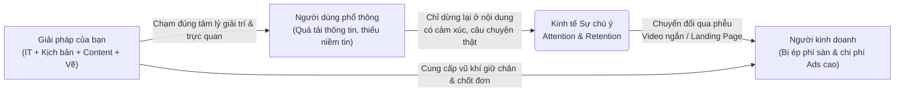

# Báo cáo Nghiên cứu Thị trường: Thương mại số & Nền kinh tế Sự chú ý (2025–2026)

> [!IMPORTANT]
> **Luận điểm cốt lõi:** Trong giai đoạn 2025–2026, ranh giới giữa **Thương mại số (Digital Commerce)** và **Nền kinh tế sự chú ý (Attention Economy)** đã xóa nhòa. **Sự chú ý (Attention)** và **Niềm tin (Trust)** trở thành hai tài sản khan hiếm nhất. Người kiếm được tiền nhanh nhất không phải là người tạo ra nhiều nội dung nhất bằng AI, mà là người **giúp doanh nghiệp chuyển hóa sự chú ý thành đơn hàng** với chi phí thấp nhất.

---

## 1. Bức tranh vĩ mô (Số liệu & Xu hướng dịch chuyển 2025–2026)

Dựa trên dữ liệu thị trường TMĐT & Social Commerce tại Việt Nam (Metric, YouNet ECI):
1. **Quy mô khổng lồ nhưng thanh lọc khốc liệt:** Tổng doanh số 4 sàn lớn vượt mốc **430.000 – 440.000 tỷ đồng/năm** (tăng trưởng ~35%), nhưng **số lượng nhà bán hàng phát sinh đơn lại giảm ~7,5%**. Các shop nhỏ lẻ làm nội dung hời hợt đang bị đào thải.
2. **Bão giá chi phí sàn & Quảng cáo (Ads):** Phí sàn (Shopee, TikTok Shop) và chi phí chạy Ads liên tục tăng, ăn mòn biên lợi nhuận của người bán ("doanh thu tiền tỷ nhưng lãi mỏng hoặc lỗ").
3. **Sự thống trị của Shoppertainment & Micro-Drama:** TikTok Shop bám sát nút Shopee về thị phần GMV. Ngay cả Shopee cũng phải tung ra *Shopee Video* và *Shopee Drama* (chuỗi phim/truyện ngắn vài chục giây cài cắm sản phẩm) để giữ chân người dùng.
4. **Bội thực "Rác AI" (AI Slop Fatigue):** Khi ai cũng dùng ChatGPT viết bài và dùng giọng đọc AI công nghiệp, khán giả hình thành cơ chế "mù quảng cáo" (Banner/AI Blindness) chỉ sau **1,5 – 3 giây đầu tiên**.

---

## 2. Nhu cầu & Tâm lý của Người dùng phổ thông (Khán giả / Người mua)

Người dùng ngày nay lướt mạng trong trạng thái **"Mệt mỏi nhận thức" (Cognitive Fatigue)**. Dưới đây là 4 nhu cầu ngầm định quyết định việc họ dừng lại xem và rút hầu bao:

| Hành vi / Tâm lý hiện tại | Nhu cầu thực sự (Ẩn dưới bề mặt) | Ý nghĩa đối với người làm Nội dung & Web |
|---|---|---|
| **Dị ứng quảng cáo lộ liễu & "Rác AI"** | Cần **tính con người (Human Touch)**, sự mộc mạc, hài hước đời thường hoặc nét vẽ/hình ảnh có cá tính riêng. | Nét vẽ tay sơ cấp (Doodle/Sketch) kết hợp câu chuyện thật lại **ăn đứt** ảnh AI bóng bẩy vô hồn vì tạo cảm giác gần gũi, không giống đang bị lừa mua hàng. |
| **Nghiện Dopamine ngắn hạn (Short-form Drama)** | Muốn được **giải trí hoặc giải tỏa cảm xúc** trong 30–60s (tò mò, bức xúc, đồng cảm, bất ngờ ở cú twist cuối). | Không ai muốn xem video "Giới thiệu tính năng sản phẩm A". Họ muốn xem *"Chuyện thằng bạn cùng phòng ngáy to và cách xử lý"* rồi mới click vào sản phẩm. |
| **Khủng hoảng niềm tin (Trust Deficit)** | Sợ hàng giả, sợ KOL khen lố. Cần **bằng chứng trực quan (Visual Proof)**, so sánh thật, và thông tin rõ ràng, minh bạch. | Khi bấm vào một đường link bán hàng (Landing Page), nếu giao diện cẩu thả hoặc toàn chữ sáo rỗng, họ thoát ngay trong 3 giây. |
| **Lười đọc, lười suy nghĩ (Cognitive Ease)** | Muốn hiểu vấn đề phức tạp qua **hình ảnh hóa (Infographic, Comic ngắn, Storyboard)** và thao tác mua/đăng ký tối giản. | Những trang web/bài viết biến kiến thức khô khan thành tranh vẽ minh họa + gạch đầu dòng sắc bén luôn có tỷ lệ chuyển đổi (CR) vượt trội. |

---

## 3. Nỗi đau & Nhu cầu của Người kinh doanh (SMEs, Chủ Shop, Creator)

Người kinh doanh không mua "code đẹp", "văn hay" hay "tranh vẽ". Họ chỉ chi tiền cho **3 thứ: Tăng doanh thu, Giảm chi phí, hoặc Tiết kiệm thời gian**.

### Nỗi đau 1: "Nô lệ" cho thuật toán sàn và chi phí Ads đắt đỏ
* **Thực trạng:** Phụ thuộc 100% vào sàn hoặc Facebook Ads khiến chủ shop bị động khi sàn tăng phí hoặc khóa tài khoản. Đặc biệt, các ngành dịch vụ (nha khoa, spa, khóa học, phần mềm, BĐS, tư vấn, local brand) không thể chỉ bán trên Shopee.
* **Nhu cầu cấp thiết:** 
  * Cần **Landing Page / Micro-site chuyển đổi cao** để tự chạy chiến dịch thu phễu khách hàng (Lead Generation) về Zalo/CRM riêng.
  * Cần người **làm trọn gói (Code + Viết lời chào hàng thuyết phục + Thiết kế hình ảnh minh họa)** vì thuê 3 người rời rạc vừa đắt vừa mất thời gian khớp việc.

### Nỗi đau 2: Khủng hoảng "3 giây đầu" và cạn ý tưởng kịch bản chuyển đổi
* **Thực trạng:** Chủ shop biết phải làm TikTok/Reels/Shorts nhưng quay lên chỉ lèo tèo vài trăm view, hoặc có view nhờ bắt trend nhảm nhưng **0 đơn hàng**.
* **Nhu cầu cấp thiết:**
  * Cần **Kịch bản ngắn (Micro-script) có cấu trúc bán hàng ngầm**: *Hook gây tò mò (0–3s) → Tình huống/Xung đột đời thường (3–20s) → Cao trào/Giải pháp lồng ghép sản phẩm (20–35s) → Kêu gọi hành động tự nhiên (CTA)*.
  * Cần **Storyboard (Bảng phân cảnh vẽ phác)** để đội quay dựng hoặc nhân viên của họ nhìn vào là biết phải đặt góc máy thế nào, diễn biểu cảm gì (chỉ đưa kịch bản chữ thì người quay rất dễ làm sai ý).

### Nỗi đau 3: Quá tải sản xuất nội dung đa kênh (Omnichannel Burnout)
* **Thực trạng:** Một chủ shop phải rải nội dung lên TikTok, Reels, YouTube Shorts, Facebook Page, Shopee Video, Threads... Làm thủ công thì kiệt sức, dùng tool spam đại trà thì bị bóp tương tác.
* **Nhu cầu cấp thiết:**
  * Cần các **Hệ thống bán tự động (Human-in-the-loop Automation)**: Dùng AI/Script để gom tin tức xu hướng, phân tích đối thủ, nháp sườn kịch bản theo công thức riêng của shop, sau đó người thật chỉ mất 15 phút chỉnh sửa thay vì 3 tiếng ngồi rặn chữ.

---

## 4. Điểm giao cắt: 3 "Mỏ nhu cầu" đúng với bộ kỹ năng của bạn

Từ sự giao thoa giữa **Tâm lý người dùng** và **Nỗi đau người bán**, bộ kỹ năng *(IT + Kịch bản ngắn + Content + Vẽ sơ cấp)* của bạn khớp hoàn hảo vào 3 khoảng trống thị trường sau:

| Khoảng trống thị trường (Market Gap) | Giải pháp bạn cung cấp | Tại sao khách sẵn sàng trả tiền ngay? |
|---|---|---|
| **1. "Story-driven Landing Page"** *(Landing Page bán hàng bằng câu chuyện & minh họa)* | Trang web 1 trang tải siêu nhanh (IT), dẫn dắt tâm lý người đọc như một câu chuyện ngắn (Kịch bản + Content), có các khung tranh/minh họa vẽ tay giải thích nỗi đau của khách (Vẽ sơ cấp). | Giải quyết chứng "lười đọc" và "mất niềm tin" của người dùng phổ thông → Tăng tỷ lệ chốt đơn cho các bên bán khóa học, dịch vụ, sản phẩm giá trị cao. |
| **2. Gói "Kịch bản + Visual Storyboard"** *(Dành cho Shop & KOC làm Video ngắn)* | Bản kịch bản 30–60s kèm 6–8 khung hình vẽ phác thảo góc quay, biểu cảm nhân vật và vị trí chèn sản phẩm khéo léo. | Giúp chủ shop/KOC tiết kiệm 70% thời gian nghĩ ý tưởng và quay dựng, tránh làm ra video "quảng cáo khô khan" bị người dùng lướt qua. |
| **3. "Micro-Comics / Doodle Marketing"** *(Truyện tranh 4 khung bán hàng trên mạng xã hội)* | Bộ tranh vui 4–6 khung (4-panel comic) kể chuyện hài hước ngành nghề, lồng ghép thương hiệu ở khung cuối (kiểu bài đăng viral trên Facebook/Instagram/Threads). | Tỷ lệ chia sẻ (Share) và bình luận (Comment) tự nhiên cực cao trên Facebook/Threads, giúp thương hiệu có lượng tiếp cận tự nhiên (Organic Reach) mà không tốn tiền chạy Ads. |

---

## 5. Kết luận chiến lược cho bước đi của bạn

1. **Đừng bán "kỹ năng rời rạc", hãy bán "Kết quả kinh doanh":**
   * Đừng rao: *"Em nhận code web, nhận viết bài, nhận vẽ thuê"*.
   * Hãy rao: *"Em giúp shop giữ chân khách trong 3 giây đầu bằng kịch bản có storyboard trực quan"* hoặc *"Em dựng Landing Page kể chuyện giúp tăng tỷ lệ khách để lại SĐT"*.
2. **Vũ khí cạnh tranh trước AI:** Nét vẽ tay phác thảo (dù sơ cấp) + tư duy dựng kịch bản có cú ngoặt (twist) là thứ AI tự động chưa làm tốt được. Còn kỹ năng IT giúp bạn đóng gói sản phẩm nhanh gấp 3 lần người làm sáng tạo thuần túy.
