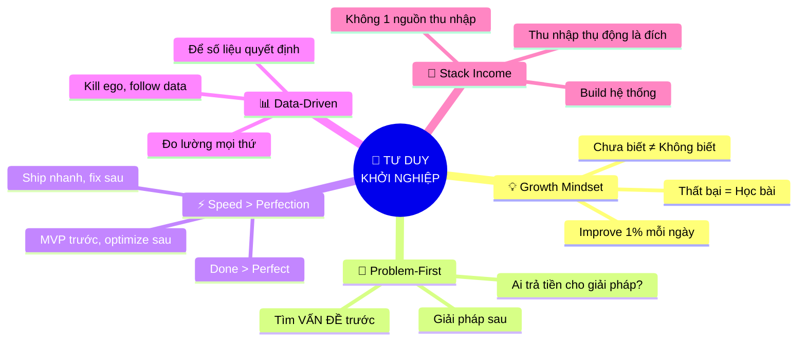
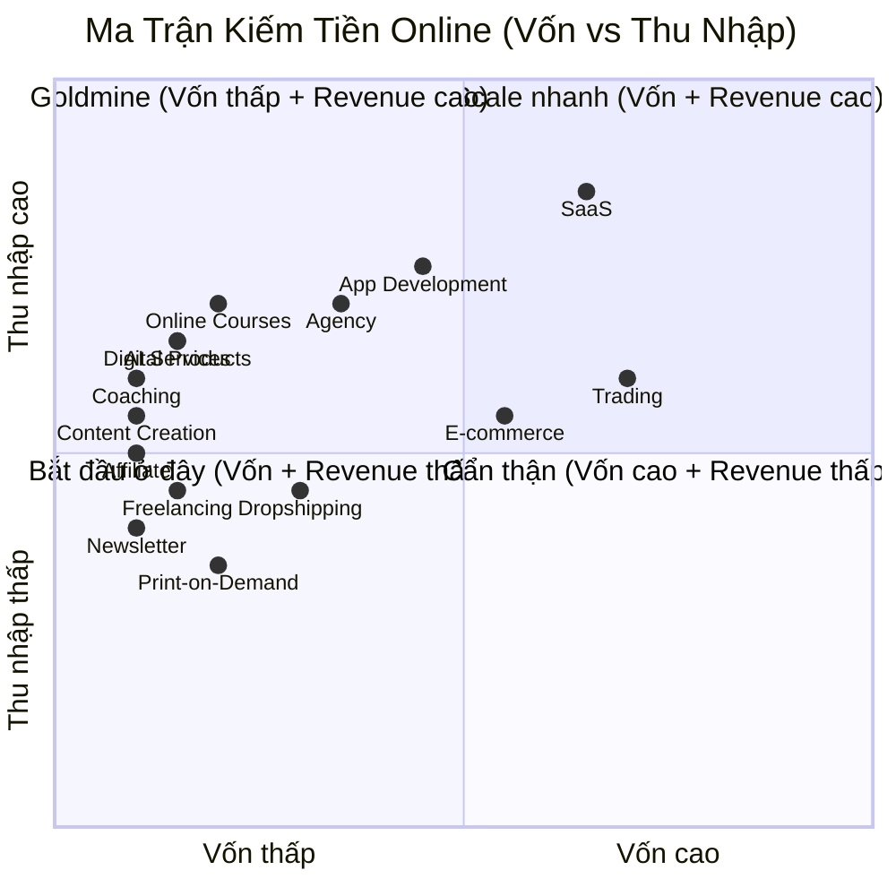
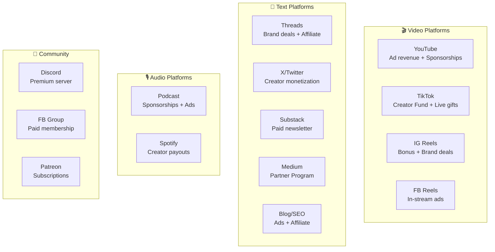
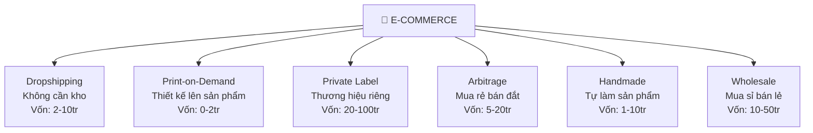
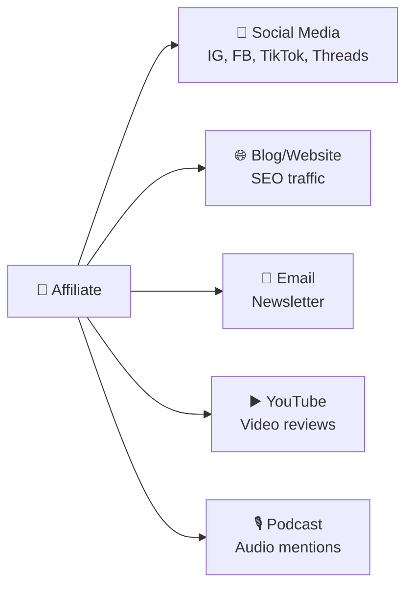
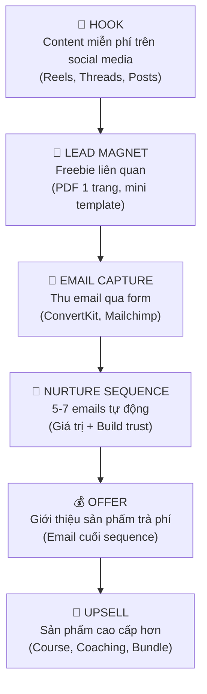
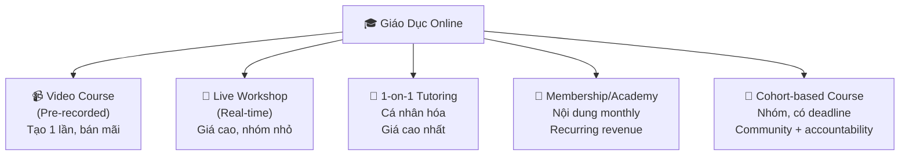
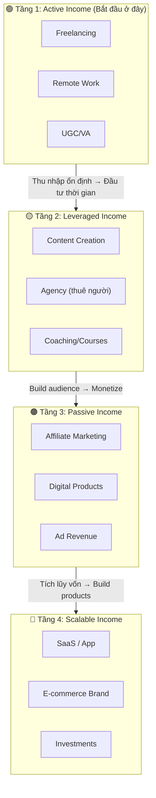

# 🚀 BLUEPRINT KIẾM TIỀN ONLINE: Hướng Dẫn Toàn Diện Cho Nhà Khởi Nghiệp Trẻ

> **Góc nhìn**: Nhà khởi nghiệp trẻ — từ 0 đồng vốn đến thu nhập đa nguồn
> **Cập nhật**: Tháng 8/2026
> **Triết lý**: Bắt đầu nhỏ → Học nhanh → Scale thông minh → Tự do tài chính

---

## Mục Lục

1. [Tư Duy Khởi Nghiệp Online](#1-tư-duy-khởi-nghiệp-online)
2. [Bản Đồ 25+ Nguồn Thu Nhập Online](#2-bản-đồ-25-nguồn-thu-nhập-online)
3. [FREELANCING: Bán Kỹ Năng](#3-freelancing-bán-kỹ-năng)
4. [CONTENT CREATION: Sáng Tạo Nội Dung](#4-content-creation-sáng-tạo-nội-dung)
5. [E-COMMERCE: Bán Hàng Online](#5-e-commerce-bán-hàng-online)
6. [AFFILIATE MARKETING: Tiếp Thị Liên Kết](#6-affiliate-marketing-tiếp-thị-liên-kết)
7. [DIGITAL PRODUCTS: Sản Phẩm Số](#7-digital-products-sản-phẩm-số)
8. [GIÁO DỤC ONLINE: Dạy & Đào Tạo](#8-giáo-dục-online-dạy--đào-tạo)
9. [AI-POWERED BUSINESS: Kinh Doanh Với AI](#9-ai-powered-business-kinh-doanh-với-ai)
10. [SAAS & TECH PRODUCTS: Xây Dựng Sản Phẩm](#10-saas--tech-products-xây-dựng-sản-phẩm)
11. [ĐẦU TƯ & TÀI CHÍNH ONLINE](#11-đầu-tư--tài-chính-online)
12. [REMOTE WORK: Làm Việc Từ Xa](#12-remote-work-làm-việc-từ-xa)
13. [CÁC MÔ HÌNH KHÁC](#13-các-mô-hình-khác)
14. [CHỌN MÔ HÌNH PHÙ HỢP VỚI BẠN](#14-chọn-mô-hình-phù-hợp-với-bạn)
15. [TECH STACK & CÔNG CỤ](#15-tech-stack--công-cụ)
16. [ROADMAP 12 THÁNG](#16-roadmap-12-tháng)
17. [SAI LẦM & BÀI HỌC](#17-sai-lầm--bài-học)

---

## 1. Tư Duy Khởi Nghiệp Online

### 1.1. Tại Sao Kiếm Tiền Online Là Cơ Hội Lớn Nhất Của Thế Hệ Trẻ?

```
🌍 2026 — Thời đại vàng cho khởi nghiệp online:

✅ Rào cản gia nhập: GẦN NHƯ BẰNG 0
✅ Vốn ban đầu: Chỉ cần smartphone + internet
✅ Thị trường: 7.5 TỶ người kết nối internet
✅ Công cụ AI: Tăng năng suất 10x
✅ Remote economy: Làm ở đâu cũng được
✅ Scalability: 1 sản phẩm bán cho triệu người
```

### 1.2. Tư Duy Đúng Trước Khi Bắt Đầu



### 1.3. Công Thức Kiếm Tiền Online

```
THU NHẬP = Giá Trị Bạn Tạo Ra × Số Người Tiếp Cận × Khả Năng Chuyển Đổi

Ví dụ:
├── Freelancer: Giá trị CAO × Tiếp cận THẤP × Chuyển đổi CAO
├── Content Creator: Giá trị TB × Tiếp cận CAO × Chuyển đổi THẤP
├── E-commerce: Giá trị TB × Tiếp cận TB × Chuyển đổi TB
└── SaaS: Giá trị CAO × Tiếp cận CAO × Chuyển đổi TB
         (khó nhất nhưng scalable nhất)
```

> [!IMPORTANT]
> **3 câu hỏi trước khi bắt đầu BẤT KỲ mô hình nào:**
> 1. Ai sẽ trả tiền cho bạn? (Khách hàng cụ thể)
> 2. Bạn giải quyết vấn đề gì cho họ? (Pain point)
> 3. Tại sao họ chọn bạn mà không chọn người khác? (USP)

---

## 2. Bản Đồ 25+ Nguồn Thu Nhập Online

### 2.1. Ma Trận Kiếm Tiền Online



### 2.2. Bảng Tổng Hợp Tất Cả Mô Hình

| # | Mô hình | Vốn ban đầu | Thời gian → Revenue | Thu nhập tiềm năng/tháng | Độ khó | Scalable? |
|---|---------|-------------|---------------------|--------------------------|--------|-----------|
| 1 | Freelancing | 0đ | 1-2 tuần | 5-50tr | ⭐⭐ | ❌ |
| 2 | Content Creation | 0đ | 2-6 tháng | 5-200tr | ⭐⭐⭐ | ✅ |
| 3 | Affiliate Marketing | 0đ | 1-3 tháng | 2-100tr | ⭐⭐ | ✅ |
| 4 | Dropshipping | 2-10tr | 1-2 tháng | 5-50tr | ⭐⭐⭐ | ✅ |
| 5 | Print-on-Demand | 0-2tr | 2-4 tuần | 3-30tr | ⭐⭐ | ✅ |
| 6 | Digital Products | 0đ | 1-3 tháng | 5-100tr | ⭐⭐⭐ | ✅✅ |
| 7 | Online Courses | 0-5tr | 2-4 tháng | 10-200tr | ⭐⭐⭐ | ✅✅ |
| 8 | Coaching/Consulting | 0đ | 1-3 tháng | 10-100tr | ⭐⭐ | ❌ |
| 9 | E-commerce (tự kho) | 10-50tr | 1-3 tháng | 10-200tr | ⭐⭐⭐⭐ | ✅ |
| 10 | Agency/Dịch vụ | 0-5tr | 1-2 tháng | 20-200tr | ⭐⭐⭐ | ✅ |
| 11 | SaaS | 10-100tr | 3-12 tháng | 50tr-1tỷ+ | ⭐⭐⭐⭐⭐ | ✅✅✅ |
| 12 | App Development | 5-50tr | 3-6 tháng | 10-500tr | ⭐⭐⭐⭐ | ✅✅ |
| 13 | AI Services | 0đ | 1-4 tuần | 10-100tr | ⭐⭐⭐ | ✅ |
| 14 | Newsletter/Substack | 0đ | 3-6 tháng | 5-50tr | ⭐⭐ | ✅ |
| 15 | YouTube | 0đ | 6-12 tháng | 5-500tr | ⭐⭐⭐ | ✅✅ |
| 16 | Podcast | 0-2tr | 3-6 tháng | 5-50tr | ⭐⭐ | ✅ |
| 17 | UGC Creator | 0đ | 1-2 tuần | 5-30tr | ⭐ | ❌ |
| 18 | Virtual Assistant | 0đ | 1 tuần | 5-20tr | ⭐ | ❌ |
| 19 | Trading/Đầu tư | 5tr+ | Không chắc chắn | Biến động | ⭐⭐⭐⭐⭐ | ✅ |
| 20 | NFT/Web3 | 1-10tr | Biến động | Biến động | ⭐⭐⭐⭐ | ✅ |
| 21 | Remote Work | 0đ | 1-4 tuần | 15-80tr | ⭐⭐ | ❌ |
| 22 | SEO/Blog | 0-1tr | 6-12 tháng | 5-100tr | ⭐⭐⭐ | ✅✅ |
| 23 | Email Marketing | 0đ | 2-4 tháng | 5-100tr | ⭐⭐⭐ | ✅✅ |
| 24 | Marketplace Seller | 0-5tr | 1-2 tuần | 5-50tr | ⭐⭐ | ✅ |
| 25 | Community Building | 0đ | 3-6 tháng | 10-100tr | ⭐⭐⭐ | ✅ |

### 2.3. Phân Loại Theo Vốn Và Kỹ Năng

```
💰 VỐN 0 ĐỒNG — Bắt đầu ngay hôm nay:
├── Freelancing (viết, design, code, dịch thuật)
├── Content Creation (IG, TikTok, YouTube, Threads)
├── Affiliate Marketing
├── UGC Creator
├── Virtual Assistant
├── AI Services (dùng free tools)
├── Coaching (nếu có expertise)
└── Newsletter (Substack free)

💰 VỐN DƯỚI 5 TRIỆU:
├── Dropshipping
├── Print-on-Demand
├── Digital Products
├── Online Courses
├── Podcast
├── Blog/SEO
└── Agency nhỏ

💰 VỐN 5-50 TRIỆU:
├── E-commerce (tự kho nhỏ)
├── App Development
├── Agency quy mô
└── Trading (rủi ro cao)

💰 VỐN 50+ TRIỆU:
├── SaaS
├── E-commerce lớn
└── Tech startup
```

---

## 3. FREELANCING: Bán Kỹ Năng

### 3.1. Tổng Quan

```
🎯 Freelancing = Bán thời gian + kỹ năng cho khách hàng trên toàn thế giới
💡 Perfect cho: Người mới bắt đầu, cần thu nhập nhanh
⏰ Thời gian đến revenue: 1-2 tuần
💰 Thu nhập: 5-50 triệu/tháng (VN), $2K-$15K/tháng (quốc tế)
```

### 3.2. Top Kỹ Năng Freelance Thu Nhập Cao (2026)

| Kỹ năng | Giá/giờ (VNĐ) | Giá/giờ (USD) | Nhu cầu | Thời gian học |
|---------|---------------|---------------|---------|---------------|
| **AI/ML Engineering** | 500K-2tr | \$50-200 | 🔥🔥🔥🔥🔥 | 6-12 tháng |
| **Full-stack Development** | 300K-1.5tr | \$30-150 | 🔥🔥🔥🔥🔥 | 6-12 tháng |
| **UI/UX Design** | 200K-1tr | \$25-100 | 🔥🔥🔥🔥 | 3-6 tháng |
| **Video Editing** | 150K-800K | \$15-80 | 🔥🔥🔥🔥 | 1-3 tháng |
| **Copywriting** | 200K-1tr | \$20-100 | 🔥🔥🔥🔥 | 2-4 tháng |
| **Social Media Management** | 100K-500K | \$15-50 | 🔥🔥🔥🔥 | 1-2 tháng |
| **SEO** | 200K-800K | \$25-80 | 🔥🔥🔥 | 2-4 tháng |
| **Graphic Design** | 100K-500K | \$10-50 | 🔥🔥🔥 | 2-4 tháng |
| **Translation** | 100K-400K | \$10-40 | 🔥🔥🔥 | Có sẵn |
| **Data Analysis** | 200K-800K | \$25-80 | 🔥🔥🔥🔥 | 3-6 tháng |
| **Prompt Engineering** | 200K-1tr | \$20-100 | 🔥🔥🔥🔥🔥 | 1-2 tháng |
| **No-code Development** | 200K-800K | \$20-80 | 🔥🔥🔥🔥 | 1-3 tháng |

### 3.3. Nền Tảng Freelancing

#### Quốc tế (Thanh toán USD)

| Nền tảng | Phù hợp cho | Phí | Tips |
|----------|-------------|-----|------|
| **Upwork** | Mọi kỹ năng | 10-20% | Platform #1, build profile mạnh |
| **Fiverr** | Gig-based services | 20% | Tạo gig cụ thể, niche down |
| **Toptal** | Top 3% developers/designers | 0% (cho freelancer) | Cần qua vòng test khó |
| **Contra** | Creative & Tech | 0% | Mới, ít cạnh tranh |
| **99designs** | Designers | Contest-based | Design contests |
| **PeoplePerHour** | Mọi kỹ năng | 15-20% | UK-focused |
| **Freelancer.com** | Mọi kỹ năng | 10% | Bidding system |

#### Việt Nam

| Nền tảng | Phù hợp cho | Ghi chú |
|----------|-------------|---------|
| **Vlance.vn** | Mọi kỹ năng | Platform VN lớn nhất |
| **Fastwork.vn** | Services đa dạng | Gig-based |
| **Freelancerviet.vn** | IT, Design, Content | VN community |
| **Facebook Groups** | Mọi lĩnh vực | "Việc làm Freelancer VN", etc. |

### 3.4. Lộ Trình Freelancer: Từ 0 → Thu Nhập Ổn Định

```
TUẦN 1-2: Setup
├── Chọn 1-2 kỹ năng focus
├── Tạo portfolio (dù là dự án cá nhân)
├── Setup profile trên 2-3 platforms
├── Viết bio + portfolio showcase
└── Đặt giá thấp ban đầu (build reviews)

THÁNG 1-2: First Clients
├── Apply/bid 5-10 jobs/ngày
├── Nhận 2-3 clients đầu tiên
├── Over-deliver (làm hơn kỳ vọng)
├── Xin review 5 sao
└── Thu nhập: 3-8 triệu

THÁNG 3-6: Build Reputation
├── Tăng giá 20-30% mỗi 2 tháng
├── Chuyên sâu vào 1 niche cụ thể
├── Clients bắt đầu giới thiệu nhau
├── Retainer clients (thu nhập đều)
└── Thu nhập: 10-25 triệu

THÁNG 6-12: Scale
├── Tăng giá đáng kể
├── Chọn lọc clients (chỉ nhận tốt)
├── Bắt đầu outsource/thuê người
├── Chuyển dần sang Agency model
└── Thu nhập: 25-50 triệu+
```

### 3.5. Chiến Lược Giá

```
🏷️ GIAI ĐOẠN 1 (0-5 reviews): 
   Giá thấp hơn thị trường 30-40%
   Mục tiêu: Lấy review, build portfolio

🏷️ GIAI ĐOẠN 2 (5-20 reviews):
   Giá ngang thị trường
   Mục tiêu: Thu nhập ổn định

🏷️ GIAI ĐOẠN 3 (20+ reviews):
   Giá cao hơn thị trường 20-50%
   Mục tiêu: Premium positioning

🏷️ GIAI ĐOẠN 4 (Expert):
   Value-based pricing (theo giá trị, không theo giờ)
   Mục tiêu: High-ticket clients
```

> [!TIP]
> **Mẹo tăng thu nhập Freelancing nhanh nhất**: Chuyển từ bán GIỜ sang bán GIÁ TRỊ. Thay vì "Tôi code \$30/giờ", hãy nói "Tôi xây landing page tối ưu conversion với giá \$500". Cùng 5 giờ làm việc, nhưng thu nhập gấp 3x.

---

## 4. CONTENT CREATION: Sáng Tạo Nội Dung

### 4.1. Bản Đồ Nền Tảng Content



### 4.2. So Sánh Thu Nhập Từ Các Nền Tảng

| Nền tảng | CPM (VNĐ/1000 views) | 100K views = | Nguồn thu chính |
|----------|----------------------|-------------|-----------------|
| **YouTube** | 15K-100K | 1.5-10tr | AdSense, Sponsorships |
| **TikTok** | 2K-15K | 200K-1.5tr | Creator Fund, Live, Sponsorships |
| **Instagram** | Không có CPM cố định | Tùy brand deal | Sponsorships, Affiliate |
| **Facebook** | 10K-50K | 1-5tr | In-stream Ads |
| **Substack** | N/A | Tùy subscribers | Paid subscriptions |
| **Medium** | ~5K-20K | 500K-2tr | Partner Program |
| **Podcast** | 50K-200K/1000 listens | 5-20tr | Sponsorships |

### 4.3. YouTube — Mỏ Vàng Dài Hạn

**Tại sao YouTube?**
- Video cũ VẪN kiếm tiền (evergreen)
- CPM cao nhất trong các nền tảng video
- Nhiều nguồn thu: Ads + Sponsorships + Affiliate + Membership + Super Chat

**Điều kiện monetization:**
```
YouTube Partner Program (YPP):
✅ 1,000 subscribers
✅ 4,000 giờ xem trong 12 tháng
   HOẶC 10 triệu Shorts views trong 90 ngày
✅ Tuân thủ YouTube policies
✅ Có tài khoản AdSense
```

**Thu nhập YouTube VN:**
```
Niche CPM cao (VN):
├── Tài chính/Đầu tư: 50-150K/1000 views
├── Công nghệ: 30-80K/1000 views  
├── Giáo dục: 25-60K/1000 views
├── Business: 30-80K/1000 views
└── Health: 20-50K/1000 views

Niche CPM thấp (VN):
├── Giải trí: 5-20K/1000 views
├── Gaming: 5-15K/1000 views
└── Vlogs: 8-25K/1000 views

Ví dụ:
100,000 views/tháng × 40K CPM = 4 triệu/tháng (chỉ từ ads)
+ Sponsorship: +5-15 triệu/tháng
+ Affiliate: +2-5 triệu/tháng
= TỔNG: 11-24 triệu/tháng
```

### 4.4. TikTok — Tốc Độ Viral Nhanh Nhất

**Cách kiếm tiền trên TikTok:**

| Nguồn | Điều kiện | Thu nhập |
|-------|-----------|---------|
| **TikTok Creator Fund** | 10K followers + 100K views/30 ngày | Thấp (~2-5K/1000 views) |
| **TikTok Shop Affiliate** | 1,000+ followers | 5-20% commission |
| **LIVE Gifts** | 1,000+ followers | Tùy audience |
| **Brand Sponsorships** | 5K+ followers | 1-50tr/video |
| **TikTok Shop (bán hàng)** | Đăng ký seller | Không giới hạn |

### 4.5. Newsletter/Substack — Thu Nhập Recurring

```
Mô hình:
Free newsletter → Build audience → Paid tier

Thu nhập:
├── Paid subscribers: $5-15/tháng/người
├── Sponsorships: $50-500/1000 subscribers/issue
└── Affiliate links trong newsletter

Ví dụ (1,000 subscribers):
├── 10% upgrade paid ($7/tháng): 100 × $7 = $700/tháng
├── 2 sponsorships/tháng: 2 × $300 = $600/tháng
└── Affiliate: ~$200/tháng
TỔNG: ~$1,500/tháng (~37.5 triệu VNĐ)
```

---

## 5. E-COMMERCE: Bán Hàng Online

### 5.1. Các Mô Hình E-commerce



### 5.2. Dropshipping Chi Tiết

**Cơ chế**: Bạn bán hàng → Nhà cung cấp ship trực tiếp cho khách → Bạn ăn chênh lệch

```
KHÁCH HÀNG → Mua trên shop của bạn (giá 500K)
     ↓
BẠN → Đặt hàng từ supplier (giá 200K)
     ↓
SUPPLIER → Ship trực tiếp cho khách
     ↓
LỢI NHUẬN → 300K - phí platform - phí ads
```

**Nền tảng bán:**

| Nền tảng | Phí | Phù hợp cho | Ghi chú |
|----------|-----|-------------|---------|
| **Shopee** | 2-6% | Thị trường VN | Traffic sẵn có |
| **TikTok Shop** | 1-5% | Video-driven sales | Viral potential |
| **Lazada** | 2-5% | VN + SEA | Logistics tốt |
| **Shopify** | \$29/tháng | Quốc tế, brand riêng | Full control |
| **WooCommerce** | Hosting ~\$10/tháng | Custom website | WordPress-based |
| **Etsy** | 6.5% | Handmade, niche quốc tế | High-intent buyers |

**Nguồn hàng Dropshipping:**

| Nguồn | Loại hàng | Shipping | Giá |
|-------|-----------|----------|-----|
| **1688.com** | Đa dạng (Trung Quốc) | 7-15 ngày | Rẻ nhất |
| **AliExpress** | Đa dạng | 10-30 ngày | Rẻ |
| **CJ Dropshipping** | Tích hợp auto-fulfill | 7-15 ngày | Trung bình |
| **Printful/Printify** | POD | 5-10 ngày | Trung bình |
| **Nguồn hàng VN** | Đa dạng | 1-3 ngày | Trung bình |

### 5.3. Print-on-Demand (POD)

**Cơ chế**: Thiết kế artwork → Upload lên sản phẩm (áo, cốc, poster...) → Bán → In khi có đơn

```
BẠN thiết kế → Upload lên Printful/Printify/Merch by Amazon
     ↓
KHÁCH đặt mua trên Etsy/Amazon/Shopify
     ↓
NHÀ IN sản xuất + ship cho khách
     ↓
BẠN nhận lợi nhuận (không cần kho, không cần ship)
```

**Sản phẩm POD phổ biến:**

| Sản phẩm | Giá bán (USD) | Lợi nhuận/cái | Demand |
|----------|---------------|---------------|--------|
| T-shirt | \$20-35 | \$7-15 | 🔥🔥🔥🔥🔥 |
| Hoodie | \$35-55 | \$10-20 | 🔥🔥🔥🔥 |
| Mug | \$15-25 | \$5-10 | 🔥🔥🔥🔥 |
| Phone case | \$15-25 | \$5-10 | 🔥🔥🔥 |
| Poster/Print | \$15-40 | \$7-15 | 🔥🔥🔥🔥 |
| Tote bag | \$15-25 | \$5-10 | 🔥🔥🔥 |
| Stickers | \$3-8 | \$1-4 | 🔥🔥🔥🔥 |

> [!TIP]
> **POD + Niche content**: Nếu bạn đã có audience trên social media, POD là cách kiếm thêm thu nhập cực hiệu quả. Fans mua merchandise = thêm thu nhập + marketing miễn phí khi họ mặc/dùng sản phẩm.

---

## 6. AFFILIATE MARKETING: Tiếp Thị Liên Kết

### 6.1. Tổng Hợp Nền Tảng Affiliate

> Chi tiết đã có trong [Hướng Dẫn Affiliate Marketing](file:///C:/Users/groul/.gemini/antigravity/brain/d7fc5912-2976-466e-8e33-1fc05616febe/affiliate_marketing_guide.md) và [Hướng Dẫn Monetization](file:///C:/Users/groul/.gemini/antigravity/brain/d7fc5912-2976-466e-8e33-1fc05616febe/monetization_guide.md)

**Tóm tắt kênh affiliate:**



### 6.2. SEO Affiliate — Thu Nhập Thụ Động Nhất

**Cơ chế**: Viết bài blog tối ưu SEO → Google rank → Traffic miễn phí → Affiliate clicks → Commission

```
VÍ DỤ BÀI VIẾT SEO AFFILIATE:

Keyword: "máy lọc không khí tốt nhất 2026"
├── Search volume: 5,000/tháng
├── Difficulty: Medium
├── Viết bài review top 10 sản phẩm
├── Gắn affiliate link cho mỗi sản phẩm
├── Rank #1-3 trên Google
├── Traffic: ~1,500 visitors/tháng
├── CTR affiliate: 5% = 75 clicks
├── Conversion: 3% = 2-3 orders/tháng
├── Avg commission: 200K/order
└── THU NHẬP: 400-600K/tháng/BÀI (thụ động!)

× 50 bài = 20-30 triệu/tháng (gần như tự động)
```

**Stack cho SEO Affiliate Blog:**
```
Domain + Hosting: ~100K/tháng (Namecheap/Cloudways)
WordPress + Starter theme: Miễn phí
Plugin SEO: RankMath (miễn phí)
Content: Tự viết + AI hỗ trợ
Keyword Research: Ubersuggest (miễn phí), Ahrefs (~$99/tháng)
```

---

## 7. DIGITAL PRODUCTS: Sản Phẩm Số

### 7.1. Tại Sao Digital Products Là "Holy Grail"?

```
✅ Tạo 1 LẦN → Bán KHÔNG GIỚI HẠN
✅ Margin: 85-95% (gần như toàn bộ là lợi nhuận)
✅ Không cần kho, ship, inventory
✅ Delivery tự động 24/7
✅ Scale toàn cầu
```

### 7.2. Danh Sách Digital Products Có Thể Tạo

| Category | Sản phẩm | Giá (VNĐ) | Công cụ tạo |
|----------|----------|-----------|-------------|
| **Templates** | Canva, Notion, Excel, PPT | 49-499K | Canva, Notion, Excel |
| **E-books** | PDF chuyên đề | 99-499K | Google Docs, Canva |
| **Courses** | Video + tài liệu | 499K-5tr | Loom, Teachable |
| **Presets** | Lightroom, Photoshop | 99-299K | Lightroom, PS |
| **Printables** | Planner, checklist, poster | 29-199K | Canva |
| **Audio** | Nhạc, sound effects, meditation | 49-299K | GarageBand |
| **Code** | Themes, plugins, scripts | 199K-2tr | Code editor |
| **Stock** | Ảnh, video, illustration | 19-199K/item | Camera, AI tools |
| **Fonts** | Custom typography | 99-999K | FontForge |
| **Icons/Graphics** | Icon packs, UI kits | 99-499K | Figma, Illustrator |
| **Prompts** | AI prompt packs | 49-299K | Text editor |
| **Spreadsheets** | Financial trackers, CRM | 99-499K | Google Sheets |
| **Swipe files** | Email templates, ad copy | 199-999K | Google Docs |

### 7.3. Phễu Bán Digital Product



### 7.4. Ví Dụ Thực Tế: Bán Notion Template

```
📦 SẢN PHẨM: "Notion Life OS — Hệ thống quản lý cuộc sống"

💰 Giá: 299,000 VNĐ

📝 Bao gồm:
├── Notion template chính (Dashboard)
├── Sub-templates: Finance, Health, Goals, Habits
├── Video hướng dẫn setup (15 phút)
├── Updates miễn phí trọn đời
└── Access group hỗ trợ

📊 KẾT QUẢ (nếu bán 10 cái/ngày):
├── Doanh thu/ngày: 2,990,000 VNĐ
├── Doanh thu/tháng: ~90,000,000 VNĐ
├── Chi phí: ~0 (đã tạo xong)
├── Lợi nhuận: ~85-90 triệu/tháng
└── Thời gian duy trì: 1-2 giờ/tuần (support)
```

---

## 8. GIÁO DỤC ONLINE: Dạy & Đào Tạo

### 8.1. Các Hình Thức Dạy Online



### 8.2. Nền Tảng Dạy Online

| Nền tảng | Mô hình | Phí | Phù hợp cho |
|----------|---------|-----|-------------|
| **Udemy** | Marketplace | 37-97% rev share | Reach rộng, giá thấp |
| **Skillshare** | Subscription-based | Pay per minute watched | Creative skills |
| **Teachable** | Self-hosted | \$0-119/tháng | Full control |
| **Kajabi** | All-in-one | \$149+/tháng | Premium courses |
| **Thinkific** | Self-hosted | \$0-99/tháng | Đơn giản |
| **Edumall (VN)** | Marketplace VN | Rev share | Thị trường VN |
| **Kyna (VN)** | Marketplace VN | Rev share | Thị trường VN |
| **Zoom + Gumroad** | DIY | Gần 0 | Budget option |

### 8.3. Dạy Tiếng Việt/Anh Online

```
DẠNG 1: Gia sư online (1-on-1)
├── Nền tảng: Preply, italki, Cambly, Amazingtalker
├── Giá: 200K-500K/giờ (VN) hoặc $15-40/giờ (quốc tế)
├── Thu nhập: 10-30 triệu/tháng (part-time)
└── Cần: Bằng cấp hoặc chứng chỉ (IELTS, TESOL)

DẠNG 2: Group classes
├── Nền tảng: Zoom/Google Meet
├── Giá: 100K-300K/buổi/người × 5-10 người
├── Thu nhập: 15-40 triệu/tháng
└── Scale tốt hơn 1-on-1

DẠNG 3: Recorded courses
├── Nền tảng: Udemy, Teachable, Edumall
├── Giá: 299K-1.5 triệu/khóa
├── Thu nhập: Phụ thuộc marketing
└── Passive income sau khi tạo xong
```

### 8.4. Công Thức Tạo Online Course

```
BƯỚC 1: Xác định kết quả (Outcome)
"Sau khóa học, học viên sẽ có thể ___"

BƯỚC 2: Phác thảo (Outline)
├── Module 1: Foundation (nền tảng)
├── Module 2-4: Core skills (kỹ năng chính)
├── Module 5: Advanced (nâng cao)
└── Module 6: Implementation (thực hành)

BƯỚC 3: Record
├── Tool: Loom (free), OBS, hoặc điện thoại
├── Slides: Canva hoặc Google Slides
├── Mỗi video: 5-15 phút
└── Tổng: 20-50 videos

BƯỚC 4: Package
├── Video lessons
├── PDF worksheets
├── Quizzes
├── Certificate
└── Community access

BƯỚC 5: Launch
├── Pre-launch: Tease trên social media (2-3 tuần)
├── Launch: Giá early-bird giảm 30-50%
├── Post-launch: Evergreen funnel
└── Updates: Cập nhật hàng quý
```

---

## 9. AI-POWERED BUSINESS: Kinh Doanh Với AI

> [!IMPORTANT]
> **2026 là năm vàng** cho những ai biết tận dụng AI để kinh doanh. AI không thay thế bạn — AI KHUẾCH ĐẠI năng lực của bạn 10-100x.

### 9.1. Dịch Vụ AI Bạn Có Thể Bán NGAY

| Dịch vụ | Mô tả | Giá/project (VNĐ) | Công cụ |
|---------|--------|-------------------|---------|
| **AI Content Writing** | Viết bài blog, social media, email | 500K-5tr | ChatGPT, Claude, Gemini |
| **AI Image Generation** | Tạo ảnh cho brands, marketing | 200K-2tr | Midjourney, DALL-E, Flux |
| **AI Video Creation** | Video quảng cáo, explainer | 1-10tr | Runway, Pika, HeyGen |
| **AI Chatbot Building** | Chatbot cho businesses | 2-20tr | Voiceflow, Botpress |
| **AI Automation** | Workflow automation | 3-30tr | Make, Zapier, n8n |
| **AI Data Analysis** | Phân tích data cho business | 2-10tr | Python + AI |
| **AI Voice Cloning** | Voiceover, dubbing | 500K-3tr | ElevenLabs |
| **AI Website Building** | Tạo website bằng AI | 2-10tr | Cursor, v0.dev |
| **Prompt Engineering** | Tối ưu prompts cho businesses | 1-5tr | ChatGPT, Claude |

### 9.2. AI Agency Model

```
CONCEPT: Bạn là "cầu nối" giữa AI tools và businesses
không biết dùng AI

CLIENT → Nói yêu cầu → BẠN dùng AI tools tạo output → Delivery

Ví dụ dịch vụ AI Agency:

📦 GÓI SOCIAL MEDIA (5 triệu/tháng):
├── 30 bài viết social media (AI-generated + bạn edit)
├── 30 ảnh graphics (AI + Canva)
├── 8 video clips (AI-assisted)
├── Caption + Hashtag strategy
└── Thời gian thực: ~10 giờ/tháng (nhờ AI)

📦 GÓI CONTENT WEBSITE (8 triệu/tháng):
├── 8 blog posts 2,000 từ (AI-generated + human edited)
├── SEO optimization
├── Internal linking
└── Thời gian thực: ~15 giờ/tháng

→ 5 clients × 5-8 triệu = 25-40 triệu/tháng
→ Thời gian làm: ~60-80 giờ/tháng
→ Thu nhập/giờ: ~400K+
```

### 9.3. Bán AI-Generated Products

```
📸 Stock Photos AI: Tạo bằng Midjourney → Bán trên Adobe Stock, Shutterstock
🎵 Music AI: Tạo bằng Suno/Udio → Bán license
📝 Content Templates: Prompt packs cho specific industries
🎨 Design Assets: Icons, illustrations, patterns bằng AI
📖 E-books: AI-assisted writing → Amazon KDP
🎬 Stock Video: AI-generated → Bán trên Pond5, Artgrid
```

---

## 10. SAAS & TECH PRODUCTS: Xây Dựng Sản Phẩm

### 10.1. SaaS Là Gì & Tại Sao Là "Endgame"?

```
SaaS = Software as a Service
Khách hàng trả phí HÀNG THÁNG để sử dụng phần mềm của bạn

TẠI SAO LÀ ENDGAME:
├── 💰 Recurring Revenue (MRR): Thu nhập đều đặn mỗi tháng
├── 📈 Compounding: 100 users × $10/tháng = $1,000 MRR
│                   1,000 users = $10,000 MRR
│                   10,000 users = $100,000 MRR
├── 🔄 Scalable: Chi phí thêm 1 user ≈ $0
├── 🏦 Valuation: SaaS companies valued at 5-15x annual revenue
└── 🤖 Automatable: Chạy gần như tự động khi mature
```

### 10.2. Micro-SaaS — Cách Bắt Đầu Cho Solo Founder

```
MICRO-SAAS = SaaS nhỏ, giải quyết 1 vấn đề cụ thể
             1 người có thể xây & vận hành

Ví dụ Micro-SaaS:
├── Chrome Extension (freemium): $5-20/tháng
├── Notion/Slack Integration: $5-15/tháng
├── SEO Tool nhỏ: $10-50/tháng
├── Social media scheduler niche: $10-30/tháng
├── AI writing assistant cho niche cụ thể: $10-50/tháng
└── API service: $20-200/tháng
```

### 10.3. No-Code SaaS (Không Cần Biết Code)

| Công cụ | Tạo được gì | Giá | Độ khó |
|---------|-------------|-----|--------|
| **Bubble** | Full web app | Free-\$29+/tháng | ⭐⭐⭐ |
| **Softr** | App từ Airtable | Free-\$49+/tháng | ⭐⭐ |
| **Glide** | App từ spreadsheet | Free-\$25+/tháng | ⭐ |
| **Webflow** | Website + CMS | Free-\$14+/tháng | ⭐⭐ |
| **Retool** | Internal tools | Free-\$10+/tháng | ⭐⭐⭐ |
| **Cursor + AI** | Code-assisted dev | \$20/tháng | ⭐⭐⭐ |

### 10.4. Ý Tưởng SaaS Cho Thị Trường VN

| Ý tưởng | Target | MRR tiềm năng |
|---------|--------|----------------|
| Tool quản lý KOL cho brands | Marketing agencies | 500K-5tr/tháng/user |
| AI chatbot cho F&B | Nhà hàng, quán cafe | 200K-1tr/tháng |
| Booking system cho dịch vụ | Spa, salon, phòng khám | 300K-2tr/tháng |
| Accounting cho freelancer VN | Freelancers | 99-299K/tháng |
| Social media scheduler tiếng Việt | SMEs | 199-999K/tháng |
| AI content generator tiếng Việt | Content creators | 199-499K/tháng |

---

## 11. ĐẦU TƯ & TÀI CHÍNH ONLINE

> [!CAUTION]
> **CẢNH BÁO**: Đầu tư luôn có RỦI RO. Không bao giờ đầu tư tiền bạn không thể mất. Phần này chỉ mang tính giáo dục, KHÔNG phải tư vấn tài chính. Hãy tìm hiểu kỹ và tham khảo chuyên gia.

### 11.1. Các Kênh Đầu Tư Online

| Kênh | Rủi ro | Return kỳ vọng/năm | Vốn tối thiểu | Phù hợp |
|------|--------|---------------------|----------------|---------|
| **Chứng khoán VN** | Trung bình | 10-25% | 1 triệu | Dài hạn |
| **ETFs** | Thấp-TB | 8-15% | 500K | Mới bắt đầu |
| **Crypto** | Rất cao | Biến động lớn | 500K | Chấp nhận rủi ro |
| **P2P Lending** | TB-Cao | 10-18% | 1 triệu | Diversify |
| **Gold online** | Thấp | 5-15% | 1 triệu | Bảo toàn vốn |
| **Forex** | Rất cao | Biến động | 2 triệu | Chuyên nghiệp |

### 11.2. Chiến Lược Tài Chính Cho Entrepreneur

```
THU NHẬP ONLINE → PHÂN BỔ:

50% Chi phí sinh hoạt & vận hành
├── Sinh hoạt cá nhân
├── Tools & subscriptions
└── Marketing & ads

30% Tái đầu tư vào business
├── Nâng cấp tools
├── Học kỹ năng mới
├── Outsource & scale
└── Testing mô hình mới

20% Tiết kiệm & Đầu tư
├── Quỹ khẩn cấp (6 tháng chi phí)
├── Đầu tư dài hạn (ETFs, chứng khoán)
└── Thử nghiệm (crypto, startup)
```

---

## 12. REMOTE WORK: Làm Việc Từ Xa

### 12.1. Nền Tảng Tìm Việc Remote

| Nền tảng | Loại việc | Lương (USD/tháng) | Ghi chú |
|----------|-----------|-------------------|---------|
| **Remote.co** | Full-time remote | \$2K-8K | US/EU companies |
| **We Work Remotely** | Tech, Marketing | \$3K-10K | High quality |
| **AngelList** | Startup jobs | \$2K-8K | Equity + salary |
| **LinkedIn** | Mọi lĩnh vực | Đa dạng | Filter "Remote" |
| **Turing** | Tech/Dev | \$3K-8K | Matched to companies |
| **Crossover** | Various | \$2K-6K | Full-time remote |
| **TopCV (VN)** | VN companies | 10-40tr VNĐ | Việc VN remote |
| **ITviec (VN)** | IT jobs VN | 15-60tr VNĐ | Tech focus |

### 12.2. Kỹ Năng Remote Work Được Trả Cao

```
💰 $4K-10K+/tháng (REMOTE từ Việt Nam):
├── Full-stack Developer
├── Mobile Developer (React Native, Flutter)
├── DevOps / Cloud Engineer
├── Data Engineer / Scientist
├── Product Manager
├── UI/UX Designer (Senior)
└── AI/ML Engineer

💰 $2K-4K/tháng:
├── Frontend Developer
├── QA Engineer
├── Technical Writer
├── Digital Marketing Manager
├── Project Manager
└── Customer Success Manager

💰 $1K-2K/tháng:
├── Virtual Assistant
├── Social Media Manager
├── Content Writer (English)
├── Data Entry Specialist
└── Customer Support
```

---

## 13. CÁC MÔ HÌNH KHÁC

### 13.1. Community-as-a-Business

```
Mô hình: Xây cộng đồng → Monetize qua nhiều cách

Platforms: Discord, FB Group, Skool, Circle

Thu nhập:
├── Membership fee: 99-999K/tháng/người
├── Sponsorships: Brands trả để tiếp cận community
├── Events: Workshops, meetups có phí
├── Products: Bán sản phẩm cho members
└── Affiliate: Recommend tools cho members

Ví dụ:
"Hội Marketing VN" — 500 paid members × 199K/tháng
= 99.5 triệu/tháng
```

### 13.2. Micro-Influencer Agency

```
Mô hình: Kết nối brands với micro-influencers, ăn phí trung gian

Cách hoạt động:
1. Recruit 50-100 micro-influencers (1K-30K followers)
2. Pitch brands: "Chúng tôi có network 50 influencers trong niche X"
3. Brand trả bạn → Bạn phân phối cho influencers → Giữ 20-30% fee

Thu nhập: 20-100 triệu/tháng (sau 6 tháng build)
```

### 13.3. Flipping (Mua-Bán Tài Sản Số)

```
MUA RẺ → CẢI THIỆN → BÁN ĐẮT

Tài sản có thể flip:
├── Website/Blog: Mua blog ít traffic → Tối ưu SEO → Bán gấp 3-5x
│   Marketplace: Flippa, Empire Flippers
│   Giá mua: $500-5,000 | Giá bán: $1,500-25,000
│
├── Domain Names: Mua domain tiềm năng → Bán khi có nhu cầu
│   Marketplace: GoDaddy Auctions, Sedo
│   Giá mua: $10-100 | Giá bán: $100-10,000+
│
├── Social Media Accounts: (Lưu ý: vi phạm ToS một số nền tảng)
│
├── App/SaaS: Mua app nhỏ → Improve → Bán
│   Marketplace: Acquire.com, MicroAcquire
│
└── NFTs/Digital Assets: Mua → Tăng giá trị → Bán
```

### 13.4. Arbitrage (Chênh Lệch Giá)

```
MUA GIÁ NÀY → BÁN GIÁ KIA

Online Arbitrage:
├── Amazon/eBay: Mua deal trên 1 site → Bán trên site khác
├── Retail Arbitrage: Mua giảm giá offline → Bán online full price
├── Service Arbitrage: Nhận việc $50/giờ → Outsource $15/giờ → Lời $35
└── Geo Arbitrage: Làm việc cho US company ($) → Sống ở VN (VNĐ)
```

---

## 14. CHỌN MÔ HÌNH PHÙ HỢP VỚI BẠN

### 14.1. Bài Test Nhanh: Bạn Phù Hợp Với Mô Hình Nào?

**Trả lời các câu hỏi:**

```
Q1: Bạn muốn kiếm tiền NHANH hay BỀN VỮNG?
├── NHANH → Freelancing, UGC, VA
└── BỀN VỮNG → Content, Digital Products, SaaS

Q2: Bạn có kỹ năng chuyên môn cụ thể không?
├── CÓ → Freelancing, Consulting, Courses
└── CHƯA → Content Creation, Affiliate, Dropshipping

Q3: Bạn thích làm việc với NGƯỜI hay với MÁY TÍNH?
├── NGƯỜI → Coaching, Agency, Community
└── MÁY TÍNH → SaaS, Digital Products, SEO Blog

Q4: Bạn có bao nhiêu vốn?
├── 0 ĐỒNG → Freelancing, Content, Affiliate, AI Services
├── DƯỚI 5 TRIỆU → Dropshipping, POD, Digital Products
└── TRÊN 5 TRIỆU → E-commerce, SaaS, Agency

Q5: Bạn muốn đầu tư bao nhiêu giờ/ngày?
├── 1-2 GIỜ → Affiliate, Newsletter, POD (side hustle)
├── 4-6 GIỜ → Content, Freelancing, Dropshipping
└── 8+ GIỜ → SaaS, Agency, E-commerce (full-time)
```

### 14.2. Ma Trận Quyết Định

| Nếu bạn là... | Bắt đầu với | Sau đó mở rộng sang |
|----------------|-------------|---------------------|
| **Sinh viên, ít thời gian** | Freelancing + Affiliate | Content Creation → Digital Products |
| **Có kỹ năng tech** | Remote Work + Freelancing | SaaS / App → Agency |
| **Giỏi giao tiếp** | Content Creation + Coaching | Courses → Community → Agency |
| **Giỏi thiết kế** | Freelancing + POD | Digital Products → Brand riêng |
| **Giỏi viết** | Blog/SEO + Newsletter | Courses → Consulting |
| **Có vốn, ít thời gian** | Dropshipping + E-commerce | Brand riêng → Scale team |
| **Muốn passive income** | SEO Blog + Affiliate | Digital Products → SaaS |
| **Muốn build lớn** | Agency + Content | SaaS → Startup |

### 14.3. The "Stack" Strategy — Xây Thu Nhập Đa Tầng

> [!IMPORTANT]
> **ĐỪNG chỉ có 1 nguồn thu nhập.** Xây dựng "income stack" — nhiều nguồn thu nhập bổ trợ lẫn nhau.



---

## 15. TECH STACK & CÔNG CỤ

### 15.1. Bộ Công Cụ Miễn Phí Cho Mọi Mô Hình

| Mục đích | Công cụ miễn phí | Thay thế trả phí |
|----------|------------------|-------------------|
| **AI Assistant** | ChatGPT Free, Gemini, Claude | ChatGPT Plus (\$20/tháng) |
| **Design** | Canva Free | Canva Pro (200K/tháng) |
| **Video Edit** | CapCut, DaVinci Resolve | Premiere Pro |
| **Website** | WordPress.com Free, Carrd | Webflow, Squarespace |
| **Email Marketing** | Mailchimp Free (500 contacts) | ConvertKit (\$29/tháng) |
| **Project Management** | Notion Free, Trello | Notion Pro, Asana |
| **Analytics** | Google Analytics (Free) | Mixpanel |
| **Social Scheduling** | Meta Business Suite | Later, Buffer |
| **Link Management** | Bitly Free, Beacons | Linktree Pro |
| **Payments** | Google Forms + CK | Stripe, Gumroad |
| **CRM** | Google Sheets, HubSpot Free | Salesforce |
| **Screen Recording** | Loom Free, OBS | Loom Pro |
| **SEO Research** | Google Keyword Planner, Ubersuggest | Ahrefs (\$99/tháng) |
| **Automation** | Make Free tier | Zapier (\$20/tháng) |
| **Hosting** | GitHub Pages, Vercel | Cloudways |

### 15.2. "Startup Stack" Dưới 500K/Tháng

```
🖥️ THE $20 STARTER STACK (Tất cả bạn cần để bắt đầu):

✅ Smartphone + Internet           = CÓ SẴN
✅ ChatGPT/Gemini Free             = 0đ
✅ Canva Free                      = 0đ  
✅ CapCut                          = 0đ
✅ Notion Free                     = 0đ
✅ Google Workspace (Drive, Docs)  = 0đ
✅ Meta Business Suite             = 0đ
✅ Mailchimp Free                  = 0đ
✅ Bitly Free                      = 0đ
✅ Beacons Free                    = 0đ
✅ Loom Free                       = 0đ
─────────────────────────────────────────
TỔNG                              = 0đ/tháng 🎉

UPGRADE khi có thu nhập:
├── Canva Pro: ~200K/tháng (design PRO)
├── ChatGPT Plus: ~500K/tháng (AI PRO)
├── Domain + Hosting: ~100K/tháng (website)
└── TỔNG UPGRADE: ~800K/tháng
```

---

## 16. ROADMAP 12 THÁNG

### 16.1. Lộ Trình Từ 0 → Thu Nhập Đa Nguồn

```mermaid
gantt
    title Roadmap 12 Tháng Kiếm Tiền Online
    dateFormat X
    axisFormat Tháng %s
    
    section Tầng 1
    Chọn mô hình + Setup         :a1, 0, 1
    Freelancing/First Revenue     :a2, 1, 3
    
    section Tầng 2  
    Content Creation bắt đầu     :b1, 1, 4
    Build Audience                :b2, 4, 7
    
    section Tầng 3
    Affiliate Marketing           :c1, 2, 5
    Digital Product đầu tiên      :c2, 4, 6
    
    section Tầng 4
    Multiple Revenue Streams      :d1, 6, 9
    Scale & Systematize           :d2, 9, 12
    
    section Milestones
    Revenue đầu tiên              :milestone, 1, 0
    10 triệu/tháng               :milestone, 4, 0
    30 triệu/tháng               :milestone, 8, 0
    50+ triệu/tháng              :milestone, 12, 0
```



### 16.2. Chi Tiết Từng Giai Đoạn

#### 🟢 THÁNG 1-3: FOUNDATION & FIRST DOLLAR

```
THÁNG 1: Khởi Động
├── Tuần 1: Nghiên cứu + chọn 2 mô hình
│   ├── Mô hình 1: Thu nhập nhanh (Freelancing/UGC/VA)
│   └── Mô hình 2: Thu nhập dài hạn (Content/Affiliate/Blog)
├── Tuần 2: Setup mọi thứ
│   ├── Tạo profiles trên freelance platforms
│   ├── Tạo accounts social media (IG, Threads, FB, TikTok)
│   └── Đăng ký affiliate networks
├── Tuần 3: Bắt đầu tạo
│   ├── Portfolio freelance (3-5 sample works)
│   ├── Content đầu tiên (post hàng ngày)
│   └── Apply/pitch 5 jobs/ngày
└── Tuần 4: First revenue
    ├── Client freelance đầu tiên
    ├── Đơn affiliate đầu tiên
    └── 🎯 Mục tiêu: 1-3 triệu

THÁNG 2: Tăng Tốc
├── Freelancing: 3-5 clients, tăng giá dần
├── Content: Đăng đều, test format
├── Affiliate: Tối ưu top sản phẩm
├── Learning: 1 giờ/ngày học kỹ năng mới
└── 🎯 Mục tiêu: 3-7 triệu

THÁNG 3: Optimize
├── Double down vào kênh hiệu quả nhất
├── Kill kênh không hiệu quả
├── Bắt đầu build email list
├── Tạo lead magnet đầu tiên
└── 🎯 Mục tiêu: 5-10 triệu
```

#### 🟡 THÁNG 4-6: GROWTH & DIVERSIFY

```
THÁNG 4: Thêm Nguồn Thu
├── Digital product đầu tiên (template/checklist)
├── Sponsored post đầu tiên (nếu đủ followers)
├── Tối ưu freelance: Value-based pricing
├── Content: Series + Collaboration
└── 🎯 Mục tiêu: 10-15 triệu

THÁNG 5: Scale
├── Affiliate: Thêm platforms, test products
├── Content: Thêm YouTube hoặc TikTok
├── Digital products: Thêm 1-2 products
├── Bắt đầu coaching/consulting (nếu có expertise)
└── 🎯 Mục tiêu: 15-20 triệu

THÁNG 6: Systematize
├── Tạo SOP (Standard Operating Procedures)
├── Batch content creation (1-2 ngày/tuần)
├── Automate email funnel
├── Đánh giá 6 tháng → Điều chỉnh chiến lược
└── 🎯 Mục tiêu: 20-30 triệu
```

#### 🟠 THÁNG 7-9: LEVERAGE & AUTOMATE

```
THÁNG 7-8: Build Systems
├── Thuê VA hoặc freelancer hỗ trợ (nếu có ngân sách)
├── Launch online course hoặc e-book
├── FB Group monetization
├── Explore: Agency model / SaaS idea
├── Xây dựng thương hiệu cá nhân mạnh
└── 🎯 Mục tiêu: 30-40 triệu

THÁNG 9: Authority
├── Speaking/Workshops (online hoặc offline)
├── Brand partnerships dài hạn
├── Community building (Discord/Paid group)
├── Multiple passive income streams hoạt động
└── 🎯 Mục tiêu: 35-45 triệu
```

#### 🔴 THÁNG 10-12: SCALE & COMPOUND

```
THÁNG 10-12: Full Ecosystem
├── 5+ nguồn thu nhập hoạt động đồng thời
├── Team hoặc automation handle 50%+ công việc
├── Focus vào high-impact activities only
├── Re-invest profits vào growth
├── Plan cho năm tiếp theo
└── 🎯 Mục tiêu: 50-100+ triệu/tháng

INCOME STACK LÚC NÀY:
├── Freelancing/Agency:      15-25 triệu
├── Content + Sponsorships:  10-20 triệu  
├── Affiliate Marketing:     5-15 triệu
├── Digital Products/Courses: 10-20 triệu
├── Coaching/Consulting:     5-15 triệu
├── Passive (ads, subs):     5-10 triệu
└── TỔNG:                    50-100+ triệu
```

---

## 17. Sai Lầm & Bài Học

### 17.1. Top 20 Sai Lầm Của Người Mới

| # | Sai lầm | Hệ quả | Cách tránh |
|---|---------|--------|------------|
| 1 | Chạy theo mọi trend | Không chuyên sâu gì | Chọn 1-2 mô hình, stick tối thiểu 6 tháng |
| 2 | Chờ "hoàn hảo" mới bắt đầu | Không bao giờ bắt đầu | Ship first version, improve later |
| 3 | Không tracking thu nhập/chi phí | Không biết gì hiệu quả | Google Sheets tracking từ ngày 1 |
| 4 | Bỏ cuộc sau 1 tháng | Miss the compounding | Cam kết tối thiểu 90 ngày |
| 5 | Chi tiền vào tools trước khi có revenue | Hết vốn | Free tools first → Upgrade khi có lợi nhuận |
| 6 | Mua "khóa học làm giàu" đắt tiền | Mất tiền, mất thời gian | YouTube free + thực hành > khóa học đắt |
| 7 | Copy y hệt người khác | Không có USP | Học framework, tạo phong cách riêng |
| 8 | Không xây email list | Phụ thuộc 100% thuật toán | Thu email từ ngày đầu |
| 9 | Bỏ qua thuế & pháp lý | Rủi ro pháp lý | Tìm hiểu khi thu nhập >10 triệu/tháng |
| 10 | Spam bán hàng | Mất followers & trust | 80% giá trị, 20% bán |
| 11 | So sánh với người đi trước | Mất motivation | So sánh với bản thân ngày hôm qua |
| 12 | Không networking | Chậm phát triển | Join communities, collab, meetups |
| 13 | Làm 1 mình quá lâu | Burn out | Outsource/delegate khi có khả năng |
| 14 | Không có quỹ khẩn cấp | Stress khi income biến động | Tiết kiệm 3-6 tháng chi phí |
| 15 | Tin vào "passive income dễ dàng" | Thất vọng | Passive income = active effort upfront |
| 16 | Chỉ học mà không làm | 0 kết quả | 30% học, 70% làm |
| 17 | Bỏ qua sức khỏe | Burn out, giảm năng suất | Exercise, sleep, breaks |
| 18 | Không reinvest | Stagnate | 20-30% lợi nhuận → reinvest |
| 19 | Giá quá thấp | Attract bad clients | Charge what you're worth |
| 20 | Không có mentor/community | Sai lầm lặp lại | Tìm mentor, join mastermind |

### 17.2. Nguyên Tắc Vàng Cho Khởi Nghiệp Trẻ

> [!IMPORTANT]
> ### 12 Nguyên Tắc Vàng
>
> 1. **BẮT ĐẦU TRƯỚC KHI SẴN SÀNG** — Bạn sẽ không bao giờ "đủ sẵn sàng"
> 2. **GIẢI QUYẾT VẤN ĐỀ THẬT** — Tiền đến từ việc giải quyết pain points
> 3. **CONSISTENCY > INTENSITY** — Làm đều mỗi ngày > làm cật lực rồi bỏ
> 4. **BUILD IN PUBLIC** — Chia sẻ hành trình, không chỉ kết quả
> 5. **COMPOUND EFFECT** — 1% tốt hơn mỗi ngày = 37x sau 1 năm
> 6. **NETWORK = NET WORTH** — Mối quan hệ quan trọng hơn bạn nghĩ
> 7. **FAIL FAST, LEARN FASTER** — Thất bại nhanh = học nhanh
> 8. **CUSTOMER > PRODUCT** — Hiểu khách hàng trước khi build sản phẩm
> 9. **AUTOMATE & DELEGATE** — Tự động hóa mọi thứ có thể
> 10. **MULTIPLE STREAMS** — Đừng bỏ trứng vào 1 giỏ
> 11. **INVEST IN YOURSELF** — Kỹ năng là tài sản giá trị nhất
> 12. **ENJOY THE JOURNEY** — Nếu không enjoy process, sẽ không bền

---

## Bonus: Bảng Tóm Tắt "Cheat Sheet"

### Bắt Đầu Từ Hôm Nay — 7 Ngày Đầu Tiên

```
📅 NGÀY 1: Quyết định
├── Chọn 1 mô hình NHANH (freelancing/UGC/content)
├── Chọn 1 mô hình DÀI HẠN (content/affiliate/digital)
└── Viết ra WHY của bạn

📅 NGÀY 2: Setup
├── Tạo/tối ưu tất cả social profiles
├── Đăng ký freelance platforms
└── Đăng ký affiliate networks

📅 NGÀY 3: Create
├── Tạo portfolio/sample work
├── Đăng bài đầu tiên trên social media
└── Apply 5 freelance jobs

📅 NGÀY 4: Learn
├── Học 1 kỹ năng quan trọng nhất (2 giờ)
├── Nghiên cứu 5 người thành công trong niche
└── Đăng bài thứ 2

📅 NGÀY 5: Connect
├── Join 3-5 communities trong niche
├── Comment/engage 20 bài viết liên quan
└── Follow & DM 5 people trong niche

📅 NGÀY 6: Optimize
├── Review lại mọi thứ đã setup
├── Improve portfolio dựa trên feedback
└── Đăng bài thứ 3 + áp dụng bài học

📅 NGÀY 7: Reflect & Plan
├── Tuần đầu tiên: What worked? What didn't?
├── Plan tuần tiếp theo
└── Set goals cho 30 ngày tới

🎯 MỤC TIÊU 7 NGÀY ĐẦU:
✅ Profiles sẵn sàng trên 3+ platforms
✅ Portfolio có ít nhất 3 samples  
✅ Đã apply/pitch 15+ jobs/clients
✅ 5+ bài đăng social media
✅ Join 5+ communities
```

---

> [!NOTE]
> ### Lời Kết Từ Một Nhà Khởi Nghiệp Trẻ
>
> Internet đã san phẳng sân chơi. Bạn không cần:
> - ❌ Bằng cấp danh giá
> - ❌ Vốn khủng
> - ❌ Quen biết rộng
> - ❌ Ở thành phố lớn
>
> Bạn CHỈ cần:
> - ✅ Smartphone/laptop + Internet
> - ✅ 2-4 giờ mỗi ngày
> - ✅ Sẵn sàng học & thử
> - ✅ Kiên nhẫn 6-12 tháng
> - ✅ Bắt đầu **NGAY HÔM NAY**
>
> Mỗi ngày bạn trì hoãn là 1 ngày mất đi cơ hội compound. Hành trình 1000 dặm bắt đầu từ bước đầu tiên. **Start now, figure it out along the way.** 🚀

---

*Blueprint được tạo cho nhà khởi nghiệp trẻ Việt Nam — Tháng 8/2026*
