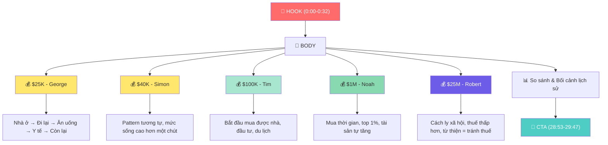

# Phân tích Kịch bản theo Công thức Hook – Body – CTA

## Video: "How Much Money You Need To Live" — Johnny Harris
**Chủ đề:** So sánh lối sống giữa các mức thu nhập từ $25K đến $25M/năm tại Mỹ, phơi bày bất bình đẳng thu nhập.

---

## I. PHÂN TÍCH CÔNG THỨC HOOK – BODY – CTA

### 🎣 HOOK (0:00 – 0:32) — *Câu mở đầu gây tò mò & thiết lập xung đột*

| Yếu tố | Chi tiết | Kỹ thuật sử dụng |
|---------|----------|-------------------|
| **Visual Hook** | So sánh hình ảnh $25M vs $25K | **Contrast framing** — tạo khoảng cách nhận thức cực lớn ngay giây đầu |
| **Data Hook** | "20% người Mỹ sống với số tiền này hoặc ít hơn" | **Statistical shock** — con số cụ thể tạo cảm giác cấp bách |
| **Promise Hook** | "Tôi muốn cho bạn thấy lối sống của những người kiếm từng này..." | **Content roadmap** — hứa hẹn nội dung, giữ chân người xem |
| **Problem Hook** | "Đồ thị này đang đi lên, và đó là một vấn đề" | **Tension builder** — thiết lập conflict chính của video |

> [!TIP]
> **Tại sao Hook này hiệu quả?** Johnny không chỉ dùng 1 hook mà **xếp chồng 4 lớp hook** trong 32 giây đầu: Visual → Data → Promise → Problem. Mỗi lớp hook giữ một nhóm khán giả khác nhau, đảm bảo retention tối đa.

---

### 📖 BODY (0:34 – 28:53) — *Nội dung chính, xây dựng theo cấu trúc leo thang*

Body được cấu trúc theo mô hình **"Escalation Ladder"** (Thang leo) — mỗi mức thu nhập là một bậc thang, tạo hiệu ứng so sánh tích lũy.

#### Cấu trúc mỗi bậc thang (Pattern lặp lại):

```
┌─────────────────────────────────────────┐
│  1. Giới thiệu nhân vật (tên, nghề)    │
│  2. Thu nhập → Thuế → Tiền thực nhận   │
│  3. Chi tiêu theo danh mục:            │
│     • Nhà ở                            │
│     • Phương tiện đi lại               │
│     • Thực phẩm                        │
│     • Y tế / Sức khỏe                  │
│     • Chi phí khác                     │
│  4. Số tiền còn lại & chất lượng sống  │
│  5. Emotional insight (nhận xét cảm xúc)│
└─────────────────────────────────────────┘
```

---

#### **Bậc 1: $25,000/năm — George** (0:34 – 5:30)

| Danh mục | Số tiền | Insight |
|----------|---------|---------|
| Thu nhập sau thuế | $1,764/tháng | Gần một nửa cho nhà ở |
| Nhà ở | $850 (41%) | Phải ở ghép, ngoại ô |
| Đi lại | $313 (15%) | Xe cũ 2004, lo sửa chữa |
| Thực phẩm | $313 (15%) | Mì gói, đậu, gạo. Không đủ tiêu chuẩn food stamps |
| Y tế | ~10% thu nhập | Tuổi thọ thấp hơn 7 năm so với người giàu nhất |
| **Còn lại** | **Gần 0 hoặc âm** | Không có quỹ khẩn cấp, phải vay nợ |

> [!CAUTION]
> **Emotional Punch:** *"Công việc toàn thời gian, lương cao hơn nhiều so với mức tối thiểu, vẫn không đủ sống qua tháng."* — Đây là câu kết bậc 1, tạo **empathy gap** mạnh mẽ.

---

#### **Bậc 2: $40,000/năm — Simon** (7:40 – 10:14)

| Danh mục | Số tiền | Insight |
|----------|---------|---------|
| Thu nhập sau thuế | $2,700/tháng | Thu nhập trung vị Mỹ |
| Nhà ở | $1,133 | Thuê nhà 1 phòng ngủ |
| Đi lại | ~$600 | Xe Subaru 2011, $136 xăng |
| Thực phẩm | $467 | Đi chợ có ý thức giá, ăn ngoài 1-2 lần |
| Y tế | $300 | Bắt đầu có bảo hiểm từ công ty |
| **Còn lại** | **$126** | Giải trí ít, vẫn lo chi phí bất ngờ |

> [!NOTE]
> **Transition insight:** *"Khá hơn George, nhưng không khá hơn nhiều"* — Kỹ thuật **diminishing contrast** để người xem nhận ra khoảng cách giữa $25K và $40K không lớn như tưởng.

---

#### **Bậc 3: $100,000/năm — Tim** (10:15 – 13:50)

| Danh mục | Số tiền | Insight |
|----------|---------|---------|
| Thu nhập sau thuế | ~$6,100/tháng | Top 10% thu nhập |
| Nhà ở | $2,700 (30%) | Mua được condo, nhưng phải tiết kiệm 10 năm |
| Đi lại | $1,333 | BMW $50K, trả góp |
| Thực phẩm | 11% thu nhập | DoorDash 1-2 lần/tuần, không lo giá |
| Y tế | $500 | Bảo hiểm tốt, nhưng phải trong mạng lưới |
| **Còn lại** | **Có dư để tiết kiệm & đầu tư** | Du lịch vài tháng 1 lần, phải chọn nơi rẻ |

> [!IMPORTANT]
> **Turning point:** Đây là mức thu nhập đầu tiên mà nhân vật bắt đầu **dùng tiền mua thời gian** — một insight quan trọng được cài sẵn cho bậc tiếp theo.

---

#### **Bậc 4: $1,000,000/năm — Noah** (13:51 – 18:53)

| Danh mục | Số tiền | Insight |
|----------|---------|---------|
| Thu nhập sau thuế | ~$48,000/tháng | Top 1%, gấp đôi thu nhập cả năm của George mỗi tháng |
| Nhà ở | $19,000 | Biệt thự 5 phòng ngủ, người dọn nhà, cảnh quan |
| Đi lại | $13,000 | Xe Rivian lease, bay business class, tài xế riêng part-time |
| Thực phẩm | $3,500 | Không nhìn giá, salad $20, smoothie $16, nhà hàng $300/người |
| Y tế | $2,500 | Bác sĩ riêng, spa cao cấp, trainer cá nhân |
| **Còn lại** | **$10,000+** | Đầu tư portfolio phức tạp, tài sản tự tăng trưởng |

> [!WARNING]
> **Key insight được cài:** *"George, Simon, Tim đều phải dành nhiều giờ nấu ăn, dọn dẹp, di chuyển — nhưng tôi chỉ cần trả tiền để lấy lại thời gian đó."* — Tiền không chỉ mua đồ, tiền mua **thời gian và tự do**.

---

#### **Bậc 5: $25,000,000/năm — Robert** (18:54 – 27:10)

| Danh mục | Chi tiết | Insight |
|----------|----------|---------|
| Nhà ở | Biệt thự + nhà nghỉ Lake Como ($30K/tháng) | Cách ly vật lý khỏi xã hội |
| Đi lại | Nhiều xe, tài xế riêng, jet riêng ($27K/chuyến) | $27K cảm giác như $43 với Simon |
| Thực phẩm | Đầu bếp riêng, chuyên gia dinh dưỡng, rượu $150K/chai | Không bao giờ nghĩ đến giá |
| Y tế | Bác sĩ riêng on-call ($20K/năm), veneer $28K | Y tế phòng ngừa hoàn toàn |
| Đầu tư | Bộ sưu tập nghệ thuật, mũ WWII $5K | Mọi thứ đều giữ/tăng giá trị |
| Thuế | Thấp hơn Tim ($100K) nhờ cổ phiếu & quỹ từ thiện | Hệ thống thuế có lợi cho người giàu |

> [!CAUTION]
> **Structural insight:** Robert dùng từ thiện vừa để làm việc tốt, vừa để **tránh thuế** — Johnny cài thông tin này một cách tinh tế, không phán xét trực tiếp nhưng để người xem tự kết luận.

---

#### **Phần kết Body: So sánh tổng hợp & Đồ thị lịch sử** (27:10 – 28:53)

- **So sánh gây sốc:** Robert kiếm trong 1 giờ > George kiếm trong 6 tháng
- **Bối cảnh lịch sử:** 100 năm trước bất bình đẳng cao → được sửa chữa → đang quay lại
- **Poverty trap:** Chi phí tạo ra chi phí mới, George không có lối thoát
- **Giấc mơ Mỹ:** Dữ liệu cho thấy di chuyển xã hội không còn khả thi

---

### 📢 CTA (28:53 – 29:47) — *Kêu gọi hành động qua cảm xúc và nhận thức*

| Loại CTA | Nội dung | Kỹ thuật |
|----------|----------|----------|
| **Emotional CTA** | "44 triệu người ở quốc gia giàu nhất thế giới không đủ ăn mỗi ngày" | **Moral urgency** — kích hoạt lương tâm |
| **Intellectual CTA** | "Đã đến lúc những người lãnh đạo làm như 100 năm trước — đảo ngược đường cong này" | **Historical precedent** — chứng minh giải pháp khả thi |
| **Media CTA** | Montage tin tức về bất bình đẳng | **Social proof** — không chỉ Johnny nói, cả thế giới nói |

> [!TIP]
> **Đặc biệt:** Video này không có CTA truyền thống (like, subscribe, share). Thay vào đó, CTA là **thay đổi nhận thức** — một dạng CTA cao cấp hơn, phù hợp với journalism và video dài.

---

## II. DÀN Ý KỊCH BẢN (Outline)



### Dàn ý chi tiết:

---

### **PHẦN 1: HOOK — Gây tò mò & Thiết lập vấn đề** *(30 giây)*

1. **Visual contrast:** Hình ảnh $25M vs $25K
2. **Số liệu gây sốc:** 20% người Mỹ sống với $25K hoặc ít hơn
3. **Lời hứa nội dung:** "Tôi sẽ cho bạn thấy lối sống ở mọi mức thu nhập"
4. **Thiết lập xung đột:** Đồ thị bất bình đẳng đang tăng — "đó là vấn đề"

---

### **PHẦN 2: BODY — Hành trình leo thang thu nhập** *(~28 phút)*

#### Chapter 1: $25,000/năm — George, Bảo vệ
- **Setup:** Đơn thân, Atlanta, lương $12.50/giờ
- **Budget breakdown:** $1,764 sau thuế → phân bổ chi tiết
- **Pain points:** Phải ở ghép, xe cũ, ăn mì gói, không đủ tiêu chuẩn trợ cấp
- **Kết luận cảm xúc:** Lương cao hơn tối thiểu vẫn không đủ sống

#### *(Sponsor break — Headspace: 5:31 – 7:31)*

#### Chapter 2: $40,000/năm — Simon, Điều phối sự kiện
- **Setup:** Thu nhập trung vị Mỹ
- **Cải thiện:** Nhà riêng 1 phòng, ăn uống tốt hơn, gym $10
- **Giới hạn:** Chỉ còn $126, chi phí bất ngờ = nợ
- **Transition:** "Khá hơn, nhưng không khá hơn bao nhiêu"

#### Chapter 3: $100,000/năm — Tim, Nhân viên kinh doanh
- **Setup:** Top 10%, 6 con số
- **Bước nhảy:** Mua nhà (dù phải tiết kiệm 10 năm), xe BMW, DoorDash
- **Insight mới:** Bắt đầu dùng tiền mua thời gian
- **Giới hạn:** Du lịch phải chọn nơi rẻ, bác sĩ phải trong mạng lưới

#### Chapter 4: $1,000,000/năm — Noah, Quản lý quỹ đầu tư
- **Setup:** Top 1%, làm 70 giờ/tuần
- **Cuộc sống khác biệt:** Biệt thự, xe lease, bay business, nhà hàng $300/người
- **Insight cốt lõi:** Mua lại toàn bộ thời gian — người khác nấu, dọn, lái cho mình
- **Paradox:** Vẫn có thể tiêu hết nếu lifestyle creep

#### Chapter 5: $25,000,000/năm — Robert, CEO / Chủ chuỗi
- **Setup:** Global elite, tư duy net worth thay vì salary
- **Cuộc sống:** Jet riêng, đầu bếp riêng, bác sĩ on-call, rượu $150K
- **Cách ly xã hội:** Sống tách biệt khỏi mọi vấn đề xã hội
- **Hệ thống thuế:** Thuế suất thực tế thấp hơn Tim ($100K)
- **Từ thiện:** Vừa tốt đẹp, vừa là công cụ tránh thuế

#### Phần tổng hợp: So sánh & Bối cảnh lịch sử
- **So sánh gây sốc:** 1 giờ của Robert = 6 tháng của George
- **Đồ thị lịch sử:** Bất bình đẳng từng được sửa, nay đang quay lại
- **Poverty trap:** Phân tích vòng xoáy nghèo đói
- **American Dream:** Dữ liệu cho thấy di chuyển xã hội đã chết

---

### **PHẦN 3: CTA — Kêu gọi thay đổi nhận thức** *(~1 phút)*

1. **Moral urgency:** 44 triệu người không đủ ăn, cho vay nặng lãi, phí overdraft $25
2. **Historical solution:** "Làm như 100 năm trước — đảo ngược đường cong"
3. **Media montage:** Tin tức quốc tế về bất bình đẳng gia tăng
4. **Open ending:** Không kết luận, để người xem tự suy ngẫm

---

## III. CÁC KỸ THUẬT KỊCH BẢN NỔI BẬT

### 1. **Nhân cách hóa dữ liệu (Data Personification)**
Thay vì nói "người có thu nhập $25K", Johnny tạo ra **George** — có tên, có nghề, có xe cụ thể (Toyota Solara 2004). Điều này biến số liệu khô khan thành câu chuyện có cảm xúc.

### 2. **Relative Value Anchoring (Neo giá trị tương đối)**
> *"$27,000 cho tôi cảm giác như $43 với Simon"*

Johnny liên tục so sánh **cảm giác chi tiêu** giữa các mức thu nhập, giúp người xem hiểu sự chênh lệch không chỉ qua con số mà qua **trải nghiệm**.

### 3. **Pattern + Break (Mẫu + Phá vỡ)**
5 bậc thu nhập theo cùng một pattern (nhà → xe → ăn → y tế), nhưng mỗi bậc có một **insight mới phá vỡ kỳ vọng:**
- $25K: Lương > tối thiểu nhưng vẫn không đủ
- $40K: Trung vị nhưng gần như không khá hơn
- $100K: 6 con số nhưng vẫn phải tiết kiệm 10 năm mua nhà
- $1M: Top 1% nhưng vẫn có thể hết tiền
- $25M: Thuế thấp hơn người kiếm $100K

### 4. **Delayed Thesis (Luận điểm trì hoãn)**
Johnny không nói trước kết luận. Anh để người xem tự tích lũy bằng chứng qua 5 bậc, rồi mới đưa ra **thesis cuối cùng** ở phút 27-29. Kỹ thuật này tạo ra **"aha moment"** mạnh mẽ hơn nhiều so với nêu luận điểm ngay từ đầu.

### 5. **Sponsor Integration tự nhiên**
Headspace được đặt ở **giữa video** (5:31), không phải đầu hay cuối. Nội dung sponsor (thiền, sức khỏe tâm thần) liên quan gián tiếp đến chủ đề stress tài chính, tạo transition mượt mà.

---

## IV. ÁP DỤNG CHO KỊCH BẢN CỦA BẠN

Nếu bạn muốn viết kịch bản theo mô hình này, đây là **framework**:

```
HOOK (5-10% thời lượng):
├── Visual/Statement gây sốc
├── Số liệu cụ thể
├── Lời hứa nội dung
└── Thiết lập xung đột/vấn đề

BODY (80-85% thời lượng):
├── Bậc 1: Baseline (xuất phát điểm thấp nhất)
├── Bậc 2: Slight improvement (cải thiện nhẹ, tạo false hope)
├── Bậc 3: Turning point (bước ngoặt, insight mới)
├── Bậc 4: Acceleration (tăng tốc, khoảng cách rõ ràng)
├── Bậc 5: Peak (đỉnh cao, xa vời hoàn toàn)
└── Synthesis (tổng hợp, so sánh, bối cảnh)

CTA (5-10% thời lượng):
├── Emotional impact (tác động cảm xúc)
├── Call to awareness (kêu gọi nhận thức)
└── Open-ended reflection (để người xem tự kết luận)
```
