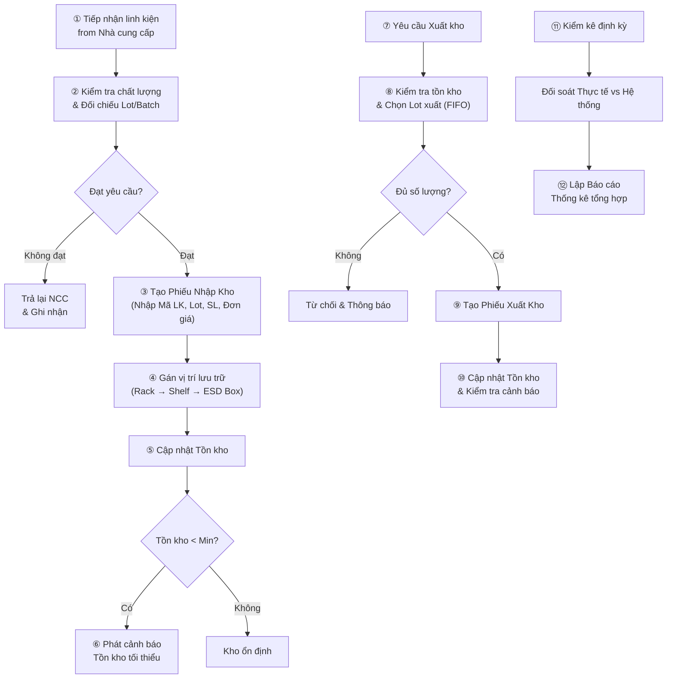
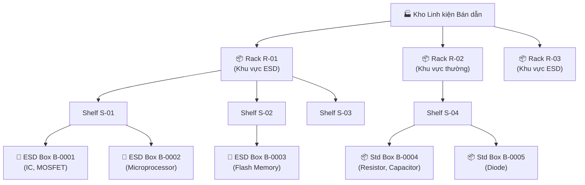

# BÁO CÁO ĐỒ ÁN MÔN HỌC
## PHƯƠNG PHÁP LẬP TRÌNH HƯỚNG ĐỐI TƯỢNG
### Đề tài: Hệ thống Quản lý Kho Linh kiện Bán dẫn (Semiconductor Components Warehouse Management System)

---

## I. ĐẶC TẢ BÀI TOÁN

### 1. Bối cảnh và phát biểu bài toán

Trong ngành công nghiệp điện tử, linh kiện bán dẫn (Semiconductor Components) là nhóm vật tư có tính chất đặc thù cao: nhạy cảm với tĩnh điện (ESD — Electrostatic Discharge), yêu cầu điều kiện bảo quản nghiêm ngặt về nhiệt độ và độ ẩm, đồng thời được quản lý theo lô sản xuất (Lot/Batch) với mã truy xuất nguồn gốc riêng biệt. Các loại linh kiện bán dẫn tiêu biểu bao gồm: vi mạch tích hợp (IC — Integrated Circuit), vi xử lý (Microprocessor/MCU), Transistor MOSFET, Diode, bộ nhớ Flash (Flash Memory), cảm biến bán dẫn (Sensor), mạch ổn áp (Voltage Regulator), v.v.

Hiện tại, nhiều kho linh kiện bán dẫn quy mô vừa và nhỏ vẫn quản lý bằng sổ sách hoặc bảng tính Excel, dẫn đến các vấn đề nghiêm trọng:

- **Sai sót trong nhập/xuất kho:** Ghi nhận số lượng không chính xác, nhầm lẫn giữa các mã linh kiện có ký hiệu tương tự (ví dụ: `STM32F103C8T6` và `STM32F103CBT6`).
- **Không kiểm soát được lô hàng:** Mất khả năng truy xuất nguồn gốc khi xảy ra sự cố chất lượng từ nhà cung cấp, không biết lô nào đã xuất cho đơn hàng nào.
- **Lưu trữ không đúng quy cách:** Linh kiện nhạy cảm tĩnh điện (như IC, MOSFET) bị đặt sai vị trí, không được bảo quản trong hộp/túi chống tĩnh điện (ESD bag/box), gây hư hỏng tiềm ẩn.
- **Hết hàng không cảnh báo:** Kho hết linh kiện quan trọng (ví dụ: Transistor MOSFET IRF540N dùng cho dây chuyền sản xuất) mà không có thông báo kịp thời, ảnh hưởng tiến độ sản xuất.
- **Thiếu báo cáo tổng hợp:** Không có số liệu thống kê tức thời về tình trạng tồn kho, lịch sử nhập/xuất, giá trị hàng tồn, khiến việc ra quyết định mua hàng thiếu cơ sở.

**Bài toán đặt ra:** Xây dựng một ứng dụng quản lý kho linh kiện bán dẫn sử dụng ngôn ngữ Java theo mô hình lập trình hướng đối tượng (OOP), nhằm tin học hóa toàn bộ quy trình quản lý kho — từ việc đăng ký danh mục linh kiện, quản lý vị trí lưu trữ, theo dõi nhập/xuất kho theo lô, kiểm soát tồn kho tối thiểu, đến tạo báo cáo thống kê — đồng thời tích hợp cơ chế kiểm tra tính hợp lệ dữ liệu (Validation) và xử lý ngoại lệ (Exception Handling) xuyên suốt hệ thống.

### 2. Phạm vi hệ thống

Hệ thống "Quản lý Kho Linh kiện Bán dẫn" được giới hạn trong phạm vi các chức năng chính sau:

| STT | Phạm vi | Mô tả |
|:---:|---------|-------|
| 1 | Quản lý danh mục linh kiện | Thêm, sửa, xóa, tìm kiếm thông tin linh kiện bán dẫn (IC, MOSFET, Diode, Flash Memory, v.v.) |
| 2 | Quản lý vị trí lưu trữ | Quản lý dãy kệ (Rack), ngăn (Shelf), hộp chống tĩnh điện (ESD Box) trong kho |
| 3 | Quản lý nhập kho | Tạo phiếu nhập, ghi nhận lô hàng (Lot/Batch), cập nhật tồn kho |
| 4 | Quản lý xuất kho | Tạo phiếu xuất, trừ tồn kho theo lô, kiểm tra số lượng khả dụng |
| 5 | Cảnh báo tồn kho | Tự động phát cảnh báo khi tồn kho giảm dưới mức tối thiểu (Min Stock Level) |
| 6 | Thống kê & Báo cáo | Báo cáo tồn kho, lịch sử nhập/xuất, thống kê theo danh mục/thời gian |
| 7 | Quản lý tài khoản | Đăng nhập, phân quyền, quản lý người dùng hệ thống |
| 8 | Kiểm kê kho | Đối soát số lượng thực tế và số lượng trên hệ thống |

> [!NOTE]
> Hệ thống **không** bao gồm: quản lý đơn đặt hàng mua/bán với bên ngoài, quản lý tài chính — kế toán, tích hợp với hệ thống ERP của doanh nghiệp, và quản lý vận chuyển logistics.

### 3. Mô tả luồng nghiệp vụ tổng quát

Luồng nghiệp vụ quản lý kho linh kiện bán dẫn được mô tả khái quát qua các bước chính sau:



**Mô tả chi tiết luồng:**

**Bước ①–②: Tiếp nhận và kiểm tra linh kiện**
Khi lô linh kiện bán dẫn được giao từ nhà cung cấp, Thủ kho tiến hành kiểm tra đối chiếu: số lượng thực tế so với chứng từ, mã Lot/Batch trên bao bì, tình trạng đóng gói chống tĩnh điện (bao bì ESD nguyên vẹn, có nhãn cảnh báo ESD), và nhãn nhận dạng linh kiện (Part Number, Date Code).

**Bước ③–④: Nhập kho và gán vị trí**
Sau khi kiểm tra đạt yêu cầu, Thủ kho tạo phiếu nhập kho trên hệ thống với các thông tin bắt buộc: mã linh kiện (Component ID), mã lô (Lot Number), số lượng nhập, đơn giá, nhà cung cấp, ngày sản xuất (Date Code). Hệ thống gợi ý vị trí lưu trữ phù hợp theo loại linh kiện — ví dụ: IC và MOSFET phải được đặt trong hộp chống tĩnh điện (ESD Box) tại dãy kệ chuyên dụng.

**Bước ⑤–⑥: Cập nhật tồn kho và cảnh báo**
Sau khi nhập kho thành công, hệ thống tự động cộng dồn số lượng tồn kho và kiểm tra ngưỡng tối thiểu. Nếu trước đó linh kiện đang ở trạng thái cảnh báo, hệ thống cập nhật lại trạng thái.

**Bước ⑦–⑩: Xuất kho**
Khi có yêu cầu xuất kho (phục vụ sản xuất, bán hàng, hoặc chuyển kho), Thủ kho tạo phiếu xuất. Hệ thống kiểm tra tồn kho khả dụng, áp dụng nguyên tắc FIFO (First In – First Out) để ưu tiên xuất lô hàng cũ nhất. Sau khi xuất kho, hệ thống tự động trừ tồn và kiểm tra ngưỡng cảnh báo.

**Bước ⑪–⑫: Kiểm kê và báo cáo**
Định kỳ, Thủ kho thực hiện kiểm kê hàng tồn kho thực tế, đối soát với dữ liệu trên hệ thống. Mọi chênh lệch được ghi nhận. Quản trị viên có thể xem báo cáo tổng hợp: hàng tồn kho theo danh mục, lịch sử nhập/xuất theo thời gian, danh sách linh kiện cần bổ sung, v.v.

### 4. Yêu cầu kiểm soát tính hợp lệ dữ liệu (Validation) — Tiền đề cho Exception Handling

Hệ thống đặt ra các quy tắc kiểm tra tính hợp lệ dữ liệu đầu vào nghiêm ngặt. Đây chính là **tiền đề kỹ thuật** để triển khai cơ chế **xử lý ngoại lệ (Exception Handling)** trong Java — mỗi quy tắc vi phạm sẽ ném ra một ngoại lệ tương ứng, được hệ thống bắt và xử lý phù hợp.

#### 4.1. Quy tắc Validation cho Linh kiện (Component)

| Trường dữ liệu | Quy tắc | Ngoại lệ khi vi phạm (Java) |
|-----------------|---------|------------------------------|
| Mã linh kiện (`componentId`) | Bắt buộc, theo định dạng `SC-XXXXX` (SC = Semiconductor, X = chữ số). Không được trùng lặp trong hệ thống. | `InvalidComponentIdException` — "Mã linh kiện không đúng định dạng SC-XXXXX" hoặc `DuplicateComponentException` |
| Tên linh kiện (`name`) | Bắt buộc, độ dài 2–100 ký tự, không chứa ký tự đặc biệt ngoài dấu gạch ngang và dấu cách. | `InvalidComponentNameException` |
| Loại linh kiện (`category`) | Bắt buộc, phải thuộc danh sách hợp lệ: `IC`, `MICROPROCESSOR`, `MOSFET`, `DIODE`, `FLASH_MEMORY`, `SENSOR`, `VOLTAGE_REGULATOR`, `CAPACITOR`, `RESISTOR`, `OTHER`. | `InvalidCategoryException` — "Loại linh kiện không hợp lệ" |
| Nhà sản xuất (`manufacturer`) | Bắt buộc, không được để trống. | `BlankFieldException` |
| Đơn giá (`unitPrice`) | Bắt buộc, phải là số thực dương (`> 0`). | `InvalidPriceException` — "Đơn giá phải lớn hơn 0" |
| Mức tồn kho tối thiểu (`minStockLevel`) | Bắt buộc, phải là số nguyên không âm (`≥ 0`). | `InvalidStockLevelException` |
| Yêu cầu chống tĩnh điện (`esdSensitive`) | Kiểu `boolean`, mặc định `true` cho các loại IC, MOSFET, MICROPROCESSOR. | — |

#### 4.2. Quy tắc Validation cho Phiếu Nhập kho (Import Receipt)

| Trường dữ liệu | Quy tắc | Ngoại lệ khi vi phạm (Java) |
|-----------------|---------|------------------------------|
| Mã phiếu nhập (`importId`) | Tự động sinh theo format `IM-yyyyMMdd-XXXX`. | — |
| Mã linh kiện (`componentId`) | Phải tồn tại trong danh mục linh kiện. | `ComponentNotFoundException` — "Không tìm thấy linh kiện với mã đã nhập" |
| Mã lô (`lotNumber`) | Bắt buộc, theo định dạng `LOT-XXXXXXXX` (8 ký tự chữ-số). **Không được trùng lặp** trong cùng một mã linh kiện. | `InvalidLotNumberException` hoặc `DuplicateLotException` — "Mã lô đã tồn tại cho linh kiện này" |
| Số lượng nhập (`quantity`) | Bắt buộc, phải là **số nguyên dương** (`> 0`). | `InvalidQuantityException` — "Số lượng nhập phải lớn hơn 0" |
| Ngày nhập (`importDate`) | Bắt buộc, không được là ngày trong tương lai. | `InvalidDateException` — "Ngày nhập không được sau ngày hiện tại" |
| Nhà cung cấp (`supplier`) | Bắt buộc, không được để trống. | `BlankFieldException` |
| Vị trí lưu trữ (`storageLocation`) | Bắt buộc. Nếu linh kiện `esdSensitive = true`, vị trí phải thuộc khu vực có hộp chống tĩnh điện. | `InvalidStorageException` — "Linh kiện nhạy ESD phải lưu trữ trong hộp chống tĩnh điện" |

#### 4.3. Quy tắc Validation cho Phiếu Xuất kho (Export Receipt)

| Trường dữ liệu | Quy tắc | Ngoại lệ khi vi phạm (Java) |
|-----------------|---------|------------------------------|
| Mã phiếu xuất (`exportId`) | Tự động sinh theo format `EX-yyyyMMdd-XXXX`. | — |
| Mã linh kiện (`componentId`) | Phải tồn tại trong danh mục. | `ComponentNotFoundException` |
| Số lượng xuất (`quantity`) | Bắt buộc, phải là **số nguyên dương** (`> 0`). Không được vượt quá tồn kho hiện tại. | `InvalidQuantityException` — "Số lượng xuất phải lớn hơn 0" hoặc `InsufficientStockException` — "Tồn kho không đủ để xuất" |
| Mã lô xuất (`lotNumber`) | Nếu chỉ định, phải tồn tại và còn số lượng khả dụng. | `LotNotFoundException` hoặc `LotDepletedException` |
| Lý do xuất (`reason`) | Bắt buộc, thuộc danh sách: `PRODUCTION`, `SALE`, `TRANSFER`, `DEFECTIVE_RETURN`. | `InvalidExportReasonException` |
| Người nhận (`receiver`) | Bắt buộc, không được để trống. | `BlankFieldException` |

#### 4.4. Quy tắc Validation cho Vị trí lưu trữ (Storage Location)

| Trường dữ liệu | Quy tắc | Ngoại lệ khi vi phạm (Java) |
|-----------------|---------|------------------------------|
| Mã dãy kệ (`rackId`) | Bắt buộc, theo định dạng `R-XX` (XX = 01–99). | `InvalidRackIdException` |
| Mã ngăn kệ (`shelfId`) | Bắt buộc, theo định dạng `S-XX` (XX = 01–20). | `InvalidShelfIdException` |
| Mã hộp (`boxId`) | Bắt buộc, theo định dạng `B-XXXX`. | `InvalidBoxIdException` |
| Loại hộp (`boxType`) | Phải là `ESD_BOX` hoặc `STANDARD_BOX`. | `InvalidBoxTypeException` |
| Sức chứa tối đa (`maxCapacity`) | Số nguyên dương (`> 0`). Không thể gán thêm linh kiện nếu đã đầy. | `StorageFullException` — "Vị trí lưu trữ đã đạt sức chứa tối đa" |

> [!IMPORTANT]
> Mỗi quy tắc Validation ở trên sẽ được triển khai thành một lớp ngoại lệ (Custom Exception) kế thừa từ `Exception` hoặc `RuntimeException` trong Java. Cơ chế `try-catch-finally` và `throws` sẽ được sử dụng xuyên suốt các tầng nghiệp vụ (Service Layer) để đảm bảo hệ thống phản hồi rõ ràng và không bị dừng đột ngột khi gặp dữ liệu không hợp lệ.

---

## II. DANH SÁCH TÁC NHÂN (ACTORS)

### 1. Tổng quan về tác nhân

Hệ thống Quản lý Kho Linh kiện Bán dẫn phục vụ **hai (02) tác nhân chính** tương tác trực tiếp với hệ thống thông qua giao diện người dùng. Mỗi tác nhân được phân quyền rõ ràng, đảm bảo nguyên tắc **"Least Privilege"** — mỗi người dùng chỉ có quyền truy cập tối thiểu cần thiết để thực hiện nhiệm vụ của mình.

### 2. Mô tả chi tiết từng tác nhân

#### 2.1. Tác nhân 1: Quản trị viên (Admin)

| Thuộc tính | Mô tả |
|------------|-------|
| **Tên tác nhân** | Quản trị viên (Administrator) |
| **Vai trò** | Người quản lý toàn bộ hệ thống, có quyền cao nhất |
| **Đối tượng thực tế** | Quản lý kho, Trưởng bộ phận kho vận, hoặc quản lý CNTT của doanh nghiệp |

**Danh sách quyền hạn chi tiết:**

| STT | Quyền hạn | Mô tả chi tiết |
|:---:|-----------|-----------------|
| 1 | Quản lý tài khoản người dùng | Tạo mới, chỉnh sửa, vô hiệu hóa (khóa/mở khóa) tài khoản Thủ kho. Đặt lại mật khẩu cho tài khoản khi Thủ kho quên mật khẩu. |
| 2 | Quản lý danh mục linh kiện | **Toàn quyền** thêm mới, chỉnh sửa, xóa (xóa mềm) thông tin linh kiện bán dẫn trong hệ thống. Thiết lập ngưỡng tồn kho tối thiểu (`minStockLevel`) cho từng linh kiện. |
| 3 | Quản lý cấu trúc kho | Thêm, sửa, xóa thông tin dãy kệ (Rack), ngăn kệ (Shelf), hộp chống tĩnh điện (ESD Box). Quy định loại hộp lưu trữ cho từng khu vực. |
| 4 | Xem và duyệt phiếu nhập/xuất | Xem toàn bộ lịch sử phiếu nhập kho, phiếu xuất kho do Thủ kho tạo. Có thể hủy phiếu khi phát hiện sai sót (trước khi xác nhận thực tế). |
| 5 | Thống kê và Báo cáo | Truy cập **toàn bộ** báo cáo hệ thống: tồn kho tổng hợp, báo cáo nhập/xuất theo thời gian, thống kê theo loại linh kiện, báo cáo giá trị hàng tồn, danh sách linh kiện dưới mức tồn kho tối thiểu. |
| 6 | Quản lý kiểm kê | Tạo đợt kiểm kê, xem kết quả đối soát, phê duyệt biên bản kiểm kê, xử lý chênh lệch. |
| 7 | Xem cảnh báo hệ thống | Nhận và xem tất cả các cảnh báo: tồn kho thấp, linh kiện lưu trữ sai vị trí, lô hàng sắp hết hạn Date Code. |
| 8 | Cấu hình hệ thống | Thiết lập các tham số hệ thống: quy tắc đặt tên mã linh kiện, định dạng mã lô, quy tắc FIFO khi xuất kho. |

> [!TIP]
> Quản trị viên **không trực tiếp** tạo phiếu nhập/xuất kho trong quy trình thông thường. Thao tác nhập/xuất kho là trách nhiệm của Thủ kho — người trực tiếp kiểm tra và xử lý hàng hóa vật lý tại kho.

#### 2.2. Tác nhân 2: Thủ kho (Warehouse Keeper / Storekeeper)

| Thuộc tính | Mô tả |
|------------|-------|
| **Tên tác nhân** | Thủ kho (Warehouse Keeper) |
| **Vai trò** | Người trực tiếp thao tác nghiệp vụ nhập/xuất kho hàng ngày |
| **Đối tượng thực tế** | Nhân viên kho, Thủ kho linh kiện tại nhà máy/xưởng sản xuất |

**Danh sách quyền hạn chi tiết:**

| STT | Quyền hạn | Mô tả chi tiết |
|:---:|-----------|-----------------|
| 1 | Đăng nhập hệ thống | Sử dụng tài khoản do Admin cấp để đăng nhập. Đổi mật khẩu cá nhân. |
| 2 | Tra cứu linh kiện | Tìm kiếm linh kiện theo mã (Component ID), tên, loại (Category), nhà sản xuất. Xem chi tiết thông tin linh kiện, tồn kho hiện tại, vị trí lưu trữ. **Không có quyền** thêm mới, sửa, xóa danh mục linh kiện. |
| 3 | Tạo phiếu nhập kho | Tạo mới phiếu nhập kho khi nhận linh kiện từ nhà cung cấp. Nhập các thông tin: mã linh kiện, mã lô (Lot Number), số lượng, đơn giá, nhà cung cấp, gán vị trí lưu trữ. |
| 4 | Tạo phiếu xuất kho | Tạo mới phiếu xuất kho khi có yêu cầu. Chọn linh kiện, chỉ định số lượng xuất, chọn lô hàng xuất (hoặc để hệ thống tự động chọn theo FIFO), ghi nhận lý do xuất và người nhận. |
| 5 | Xem lịch sử nhập/xuất cá nhân | Xem lại **các phiếu do mình tạo**. Không xem được phiếu của Thủ kho khác (nếu có nhiều Thủ kho). |
| 6 | Thực hiện kiểm kê | Nhập số lượng thực tế đếm được trong đợt kiểm kê do Admin tạo. Ghi nhận chênh lệch (nếu có). |
| 7 | Xem cảnh báo tồn kho | Nhận thông báo khi linh kiện mà mình phụ trách giảm dưới mức tồn kho tối thiểu. |
| 8 | Xem báo cáo cơ bản | Xem báo cáo tồn kho hiện tại (chỉ xem, không xuất file). **Không có quyền** xem báo cáo thống kê tổng hợp và báo cáo giá trị hàng tồn. |

### 3. Ma trận phân quyền tác nhân (Authorization Matrix)

Bảng dưới đây tổng hợp so sánh quyền hạn giữa hai tác nhân trên toàn bộ chức năng hệ thống:

| Chức năng | Quản trị viên (Admin) | Thủ kho (Warehouse Keeper) |
|-----------|:--------------------:|:--------------------------:|
| Đăng nhập / Đổi mật khẩu | ✅ | ✅ |
| Tạo / Khóa / Mở khóa tài khoản | ✅ | ❌ |
| Đặt lại mật khẩu người khác | ✅ | ❌ |
| Thêm / Sửa / Xóa linh kiện | ✅ | ❌ |
| Tra cứu linh kiện | ✅ | ✅ |
| Thiết lập mức tồn kho tối thiểu | ✅ | ❌ |
| Quản lý cấu trúc kho (Rack/Shelf/Box) | ✅ | ❌ |
| Tạo phiếu nhập kho | ❌ *(không trực tiếp)* | ✅ |
| Tạo phiếu xuất kho | ❌ *(không trực tiếp)* | ✅ |
| Xem / Hủy phiếu nhập-xuất | ✅ *(tất cả)* | ✅ *(chỉ của mình)* |
| Tạo đợt kiểm kê | ✅ | ❌ |
| Thực hiện kiểm kê (nhập số thực tế) | ❌ | ✅ |
| Phê duyệt kết quả kiểm kê | ✅ | ❌ |
| Xem cảnh báo tồn kho thấp | ✅ *(tất cả)* | ✅ *(linh kiện phụ trách)* |
| Báo cáo tồn kho hiện tại | ✅ | ✅ *(chỉ xem)* |
| Báo cáo thống kê tổng hợp | ✅ | ❌ |
| Báo cáo giá trị hàng tồn kho | ✅ | ❌ |
| Cấu hình tham số hệ thống | ✅ | ❌ |

### 4. Sơ đồ tác nhân và quan hệ với hệ thống

```mermaid
flowchart LR
    subgraph ACTORS["Tác nhân"]
        A["👤 Quản trị viên\n(Admin)"]
        B["👤 Thủ kho\n(Warehouse Keeper)"]
    end
    
    subgraph SYSTEM["Hệ thống QLKLKBD"]
        S1["Quản lý Tài khoản"]
        S2["Quản lý Danh mục LK"]
        S3["Quản lý Vị trí Kho"]
        S4["Quản lý Nhập kho"]
        S5["Quản lý Xuất kho"]
        S6["Cảnh báo Tồn kho"]
        S7["Kiểm kê"]
        S8["Thống kê & Báo cáo"]
    end
    
    A --- S1
    A --- S2
    A --- S3
    A --- S6
    A --- S7
    A --- S8
    
    B --- S4
    B --- S5
    B --- S6
    B --- S7
    B --- S2
end
```

---

## III. DANH SÁCH PHÂN HỆ CHỨC NĂNG (FUNCTIONAL SUBSYSTEMS)

Hệ thống được phân chia thành **sáu (06) phân hệ chức năng** chính, mỗi phân hệ đảm nhiệm một nhóm nghiệp vụ riêng biệt, tương tác với nhau thông qua các đối tượng dữ liệu dùng chung.

### Phân hệ 1: Quản lý Tài khoản và Phân quyền (User & Authorization Management)

**Mục đích:** Quản lý người dùng hệ thống, xác thực đăng nhập, và kiểm soát quyền truy cập theo vai trò.

**Tác nhân sử dụng:** Quản trị viên (chính), Thủ kho (đăng nhập, đổi mật khẩu).

| STT | Chức năng | Mô tả | Validation & Exception Handling |
|:---:|-----------|-------|---------------------------------|
| 1.1 | Đăng nhập | Người dùng nhập tên đăng nhập và mật khẩu. Hệ thống xác thực và chuyển đến giao diện tương ứng với vai trò. | `AuthenticationException` — sai tên đăng nhập hoặc mật khẩu. `AccountLockedException` — tài khoản bị khóa sau 5 lần nhập sai liên tiếp. |
| 1.2 | Đăng xuất | Kết thúc phiên làm việc, quay về màn hình đăng nhập. | — |
| 1.3 | Tạo tài khoản | Admin tạo tài khoản mới cho Thủ kho, gán vai trò. | `DuplicateUsernameException` — tên đăng nhập đã tồn tại. `InvalidPasswordException` — mật khẩu không đủ mạnh (yêu cầu tối thiểu 8 ký tự, bao gồm chữ hoa, chữ thường, số). |
| 1.4 | Chỉnh sửa tài khoản | Admin chỉnh sửa thông tin tài khoản (họ tên, email, số điện thoại). | `InvalidEmailException`, `InvalidPhoneException` — email/SĐT không đúng định dạng. |
| 1.5 | Khóa / Mở khóa tài khoản | Admin vô hiệu hóa hoặc kích hoạt lại tài khoản Thủ kho. | `CannotLockSelfException` — Admin không thể tự khóa tài khoản của mình. |
| 1.6 | Đổi mật khẩu | Người dùng đổi mật khẩu cá nhân. Yêu cầu nhập mật khẩu cũ để xác nhận. | `IncorrectOldPasswordException` — mật khẩu cũ không đúng. `PasswordMismatchException` — mật khẩu mới và xác nhận không khớp. |
| 1.7 | Đặt lại mật khẩu | Admin đặt lại mật khẩu mặc định cho Thủ kho khi quên mật khẩu. | — |

---

### Phân hệ 2: Quản lý Danh mục Linh kiện Bán dẫn (Component Catalog Management)

**Mục đích:** Quản lý toàn bộ thông tin danh mục linh kiện bán dẫn trong kho, bao gồm thông tin kỹ thuật đặc thù của ngành bán dẫn.

**Tác nhân sử dụng:** Quản trị viên (thêm, sửa, xóa), Thủ kho (tra cứu).

**Cấu trúc thông tin một linh kiện bán dẫn:**

| Trường | Kiểu dữ liệu | Ví dụ | Ghi chú |
|--------|:------------:|-------|---------|
| `componentId` | `String` | `SC-00142` | Mã định danh duy nhất |
| `partNumber` | `String` | `STM32F103C8T6` | Mã Part Number của nhà SX |
| `name` | `String` | `Vi điều khiển ARM Cortex-M3` | Tên mô tả |
| `category` | `Enum` | `MICROPROCESSOR` | Loại linh kiện |
| `manufacturer` | `String` | `STMicroelectronics` | Nhà sản xuất |
| `packageType` | `String` | `LQFP-48` | Kiểu đóng gói (LQFP, QFN, SOT-23, DIP, SOP...) |
| `unitPrice` | `double` | `35000.0` | Đơn giá (VNĐ) |
| `currentStock` | `int` | `250` | Tồn kho hiện tại (tự động cập nhật) |
| `minStockLevel` | `int` | `50` | Ngưỡng tồn kho tối thiểu |
| `esdSensitive` | `boolean` | `true` | Nhạy cảm tĩnh điện? |
| `datasheet` | `String` | `STM32F103C8T6.pdf` | Đường dẫn Datasheet |
| `description` | `String` | `MCU 32-bit, 72MHz, 64KB Flash` | Mô tả kỹ thuật |
| `isActive` | `boolean` | `true` | Trạng thái hoạt động (xóa mềm) |

| STT | Chức năng | Mô tả | Validation & Exception Handling |
|:---:|-----------|-------|---------------------------------|
| 2.1 | Thêm linh kiện mới | Admin nhập đầy đủ thông tin linh kiện bán dẫn vào hệ thống. | `InvalidComponentIdException`, `DuplicateComponentException`, `InvalidCategoryException`, `InvalidPriceException` — như đã mô tả tại Mục I.4.1. |
| 2.2 | Chỉnh sửa thông tin linh kiện | Admin cập nhật thông tin linh kiện (tên, giá, ngưỡng tồn kho, mô tả...). Không cho phép sửa `componentId`. | `ComponentNotFoundException` — mã linh kiện không tồn tại. `ImmutableFieldException` — cố sửa trường không được phép thay đổi. |
| 2.3 | Xóa linh kiện (xóa mềm) | Admin đánh dấu linh kiện không còn sử dụng (`isActive = false`). Linh kiện vẫn lưu trong cơ sở dữ liệu nhưng không hiển thị mặc định. | `ComponentInUseException` — không thể xóa linh kiện đang có tồn kho > 0 hoặc đang được tham chiếu trong phiếu nhập/xuất chưa hoàn tất. |
| 2.4 | Tìm kiếm linh kiện | Tìm kiếm theo nhiều tiêu chí: mã, tên, Part Number, loại, nhà sản xuất. Hỗ trợ tìm kiếm gần đúng (fuzzy search). | `NoResultFoundException` — không tìm thấy kết quả phù hợp (cảnh báo mềm, không phải lỗi nghiêm trọng). |
| 2.5 | Xem danh sách linh kiện | Hiển thị danh sách linh kiện có phân trang, lọc theo loại, sắp xếp theo tên/mã/tồn kho. | — |
| 2.6 | Xem chi tiết linh kiện | Hiển thị toàn bộ thông tin chi tiết của một linh kiện, bao gồm: tồn kho theo từng lô, vị trí lưu trữ, lịch sử nhập/xuất gần nhất. | `ComponentNotFoundException` |

---

### Phân hệ 3: Quản lý Vị trí Lưu trữ trong Kho (Storage Location Management)

**Mục đích:** Quản lý cấu trúc vật lý của kho theo mô hình phân cấp 3 tầng: **Dãy kệ (Rack) → Ngăn kệ (Shelf) → Hộp (Box)**, đảm bảo linh kiện nhạy ESD được lưu trữ đúng quy cách.

**Tác nhân sử dụng:** Quản trị viên (quản lý cấu trúc), Thủ kho (tra cứu vị trí, gán vị trí khi nhập kho).

**Mô hình phân cấp vị trí kho:**



| STT | Chức năng | Mô tả | Validation & Exception Handling |
|:---:|-----------|-------|---------------------------------|
| 3.1 | Thêm dãy kệ (Rack) | Admin thêm dãy kệ mới, chỉ định thuộc tính khu vực ESD hoặc thường. | `DuplicateRackException` — mã Rack đã tồn tại. `InvalidRackIdException` — mã không đúng định dạng `R-XX`. |
| 3.2 | Thêm ngăn kệ (Shelf) | Admin thêm ngăn kệ vào dãy kệ đã tồn tại. | `RackNotFoundException` — Rack cha không tồn tại. `DuplicateShelfException`. `MaxShelfExceededException` — một Rack tối đa 20 Shelf. |
| 3.3 | Thêm hộp lưu trữ (Box) | Admin thêm hộp vào ngăn kệ, chỉ định loại hộp (ESD Box / Standard Box) và sức chứa. | `ShelfNotFoundException`. `InvalidBoxTypeException` — nếu Rack thuộc khu vực ESD, bắt buộc loại hộp phải là `ESD_BOX`. |
| 3.4 | Tra cứu vị trí trống | Thủ kho tìm kiếm vị trí (Box) còn trống để gán linh kiện khi nhập kho. Lọc theo loại hộp (ESD/Standard). | — |
| 3.5 | Xem sơ đồ kho | Hiển thị cấu trúc phân cấp của kho: tất cả Rack → Shelf → Box cùng trạng thái (trống/đầy/bao nhiêu %). | — |
| 3.6 | Chỉnh sửa / Xóa vị trí | Admin chỉnh sửa thông tin hoặc xóa vị trí không còn sử dụng. | `StorageNotEmptyException` — không thể xóa vị trí đang chứa linh kiện. |

---

### Phân hệ 4: Quản lý Nhập kho và Xuất kho (Import/Export Management)

**Mục đích:** Xử lý toàn bộ nghiệp vụ nhập linh kiện vào kho và xuất linh kiện ra khỏi kho, quản lý theo lô (Lot/Batch), đảm bảo tính chính xác và truy xuất nguồn gốc.

**Tác nhân sử dụng:** Thủ kho (tạo phiếu), Quản trị viên (xem, hủy phiếu).

#### A. Nhập kho (Import)

| STT | Chức năng | Mô tả | Validation & Exception Handling |
|:---:|-----------|-------|---------------------------------|
| 4.1 | Tạo phiếu nhập kho | Thủ kho tạo phiếu nhập mới. Nhập mã linh kiện → hệ thống tự động hiển thị thông tin linh kiện. Nhập mã lô (Lot Number), số lượng, đơn giá, nhà cung cấp, ngày sản xuất (Date Code). Chọn vị trí lưu trữ. | `ComponentNotFoundException`, `DuplicateLotException`, `InvalidQuantityException` (SL ≤ 0), `InvalidDateException` (ngày tương lai), `InvalidStorageException` (LK nhạy ESD gán vào hộp thường), `StorageFullException` — như đã mô tả tại Mục I.4.2. |
| 4.2 | Xác nhận nhập kho | Sau khi tạo phiếu, Thủ kho kiểm tra lại thông tin và xác nhận. Hệ thống cập nhật: (1) cộng số lượng vào tồn kho, (2) ghi nhận lô hàng mới, (3) cập nhật vị trí lưu trữ. | — |
| 4.3 | Hủy phiếu nhập | Admin hủy phiếu nhập chưa xác nhận hoặc phiếu nhập bị nhầm. Hệ thống trừ lại tồn kho tương ứng. | `ReceiptAlreadyConfirmedException` — không thể hủy phiếu đã xác nhận quá 24 giờ. `InsufficientStockToReverseException` — tồn kho hiện tại không đủ để trừ ngược (do đã xuất bớt). |
| 4.4 | Xem lịch sử nhập kho | Danh sách phiếu nhập theo bộ lọc: thời gian, mã linh kiện, nhà cung cấp, Thủ kho tạo phiếu. | — |

#### B. Xuất kho (Export)

| STT | Chức năng | Mô tả | Validation & Exception Handling |
|:---:|-----------|-------|---------------------------------|
| 4.5 | Tạo phiếu xuất kho | Thủ kho tạo phiếu xuất. Chọn linh kiện, nhập số lượng xuất, chọn lô hàng xuất (hoặc để hệ thống chọn theo FIFO — lô nhập trước xuất trước). Nhập lý do xuất và người nhận. | `ComponentNotFoundException`, `InvalidQuantityException` (SL ≤ 0), `InsufficientStockException` (xuất vượt tồn kho), `LotNotFoundException`, `LotDepletedException` (lô đã hết hàng), `InvalidExportReasonException` — như Mục I.4.3. |
| 4.6 | Xác nhận xuất kho | Thủ kho xác nhận phiếu xuất. Hệ thống: (1) trừ tồn kho, (2) cập nhật số lượng còn lại theo lô, (3) kiểm tra ngưỡng tồn kho tối thiểu → phát cảnh báo nếu cần. | — |
| 4.7 | Hủy phiếu xuất | Admin hủy phiếu xuất. Quy tắc tương tự hủy phiếu nhập. | `ReceiptAlreadyConfirmedException` |
| 4.8 | Xem lịch sử xuất kho | Danh sách phiếu xuất theo bộ lọc: thời gian, mã linh kiện, lý do xuất, người nhận. | — |

> [!WARNING]
> Khi xuất kho linh kiện nhạy ESD (IC, MOSFET, Microprocessor), hệ thống hiển thị cảnh báo nhắc Thủ kho sử dụng bao bì chống tĩnh điện (ESD bag) khi giao hàng ra khỏi kho: *"⚠ Linh kiện [STM32F103C8T6] nhạy cảm tĩnh điện. Vui lòng đóng gói trong túi/hộp ESD trước khi xuất kho."*

---

### Phân hệ 5: Cảnh báo và Kiểm kê (Alert & Inventory Audit)

**Mục đích:** Tự động giám sát mức tồn kho, phát cảnh báo kịp thời khi tồn kho giảm dưới ngưỡng an toàn, và hỗ trợ kiểm kê đối soát hàng tồn kho định kỳ.

**Tác nhân sử dụng:** Quản trị viên (tạo đợt kiểm kê, xem cảnh báo), Thủ kho (nhận cảnh báo, thực hiện kiểm kê).

#### A. Cảnh báo tồn kho (Stock Alert)

| STT | Chức năng | Mô tả | Validation & Exception Handling |
|:---:|-----------|-------|---------------------------------|
| 5.1 | Cảnh báo tồn kho tối thiểu | Sau mỗi giao dịch xuất kho, hệ thống tự động so sánh `currentStock` với `minStockLevel`. Nếu `currentStock ≤ minStockLevel`, hệ thống tạo cảnh báo hiển thị trên Dashboard. | — |
| 5.2 | Danh sách linh kiện cần bổ sung | Hiển thị danh sách tất cả linh kiện đang ở trạng thái cảnh báo (dưới mức tồn kho tối thiểu), kèm thông tin: mã, tên, tồn kho hiện tại, ngưỡng tối thiểu, số lượng thiếu hụt. | — |
| 5.3 | Cảnh báo linh kiện hết hàng hoàn toàn | Cảnh báo đặc biệt khi `currentStock = 0` (mức ưu tiên cao nhất). | — |

#### B. Kiểm kê kho (Inventory Audit)

| STT | Chức năng | Mô tả | Validation & Exception Handling |
|:---:|-----------|-------|---------------------------------|
| 5.4 | Tạo đợt kiểm kê | Admin tạo đợt kiểm kê mới, chỉ định phạm vi (toàn kho hoặc theo Rack/Shelf cụ thể), ngày kiểm kê. | `AuditAlreadyExistsException` — đã có đợt kiểm kê đang mở (chưa hoàn thành) cho cùng phạm vi. |
| 5.5 | Thực hiện kiểm kê | Thủ kho nhập số lượng thực tế đếm được cho từng linh kiện tại từng vị trí. Hệ thống tự động tính chênh lệch so với số liệu hệ thống. | `InvalidQuantityException` — số lượng thực tế nhập phải ≥ 0. `AuditNotOpenException` — đợt kiểm kê đã đóng hoặc chưa mở. |
| 5.6 | Xem kết quả kiểm kê | Hiển thị bảng đối soát: linh kiện, tồn kho hệ thống, tồn kho thực tế, chênh lệch (thừa/thiếu), tỷ lệ sai lệch. | — |
| 5.7 | Phê duyệt kiểm kê | Admin xem xét kết quả, phê duyệt hoặc yêu cầu kiểm kê lại. Nếu phê duyệt, hệ thống cập nhật tồn kho theo số thực tế. | — |

---

### Phân hệ 6: Thống kê và Báo cáo (Statistics & Reports)

**Mục đích:** Cung cấp các báo cáo tổng hợp, biểu đồ thống kê giúp Quản trị viên nắm bắt tình hình kho và đưa ra quyết định quản lý phù hợp.

**Tác nhân sử dụng:** Quản trị viên (toàn quyền), Thủ kho (xem báo cáo tồn kho cơ bản).

| STT | Chức năng | Mô tả | Quyền truy cập |
|:---:|-----------|-------|:---------------:|
| 6.1 | Báo cáo tồn kho hiện tại | Danh sách tất cả linh kiện cùng số lượng tồn kho hiện tại, phân loại theo Category. Đánh dấu linh kiện dưới ngưỡng tồn kho tối thiểu. | Admin, Thủ kho |
| 6.2 | Báo cáo nhập kho theo thời gian | Thống kê tổng số lượng và giá trị nhập kho trong khoảng thời gian chỉ định. Lọc theo linh kiện, nhà cung cấp, Thủ kho. | Chỉ Admin |
| 6.3 | Báo cáo xuất kho theo thời gian | Thống kê tổng số lượng và giá trị xuất kho trong khoảng thời gian chỉ định. Lọc theo linh kiện, lý do xuất, người nhận. | Chỉ Admin |
| 6.4 | Báo cáo giá trị hàng tồn kho | Tính tổng giá trị hàng tồn kho (`= Σ currentStock × unitPrice`), phân bổ theo loại linh kiện. | Chỉ Admin |
| 6.5 | Báo cáo linh kiện dưới mức tồn kho tối thiểu | Danh sách linh kiện cần bổ sung khẩn cấp, kèm đề xuất số lượng cần nhập thêm (`= minStockLevel − currentStock`). | Chỉ Admin |
| 6.6 | Báo cáo lịch sử nhập/xuất theo linh kiện | Xem toàn bộ lịch sử giao dịch nhập/xuất của một linh kiện cụ thể, bao gồm thông tin lô, thời gian, số lượng, người thực hiện. | Chỉ Admin |
| 6.7 | Báo cáo tình trạng kho lưu trữ | Thống kê tỷ lệ sử dụng kho: số vị trí đã dùng / tổng vị trí, theo từng Rack và Shelf. Cảnh báo khu vực sắp đầy. | Chỉ Admin |

---

## TỔNG KẾT

Bảng tóm tắt toàn bộ phân hệ chức năng:

| Phân hệ | Số chức năng | Tác nhân chính |
|----------|:------------:|:--------------:|
| PH1 — Quản lý Tài khoản & Phân quyền | 7 | Admin |
| PH2 — Quản lý Danh mục Linh kiện | 6 | Admin, Thủ kho |
| PH3 — Quản lý Vị trí Lưu trữ | 6 | Admin, Thủ kho |
| PH4 — Quản lý Nhập/Xuất kho | 8 | Thủ kho, Admin |
| PH5 — Cảnh báo & Kiểm kê | 7 | Admin, Thủ kho |
| PH6 — Thống kê & Báo cáo | 7 | Admin |
| **Tổng cộng** | **41** | — |

> [!IMPORTANT]
> Toàn bộ 41 chức năng trên đều được thiết kế với cơ chế **Validation chặt chẽ** tại tầng nghiệp vụ (Business Logic Layer). Mỗi quy tắc kiểm tra dữ liệu sẽ được triển khai thành một **lớp ngoại lệ tùy chỉnh (Custom Exception Class)** trong Java, sử dụng cơ chế kế thừa (`extends Exception` / `extends RuntimeException`) — thể hiện rõ tính **đa hình (Polymorphism)** và **kế thừa (Inheritance)** của lập trình hướng đối tượng. Cơ chế `try-catch-finally` và `throws` được áp dụng xuyên suốt để đảm bảo hệ thống phản hồi lỗi rõ ràng, thân thiện với người dùng, và không bị dừng đột ngột.
