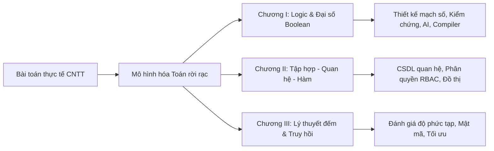

# CHƯƠNG I: LOGIC VÀ ĐẠI SỐ BOOLEAN (Trang 1 – 71)

Tài liệu này giảng giải có hệ thống toàn bộ phần **Tổng quan môn học** (trang 1–8) và **Chương I: Logic và Đại số Boolean** (trang 9–71) trong *Quyển ghi Toán học rời rạc* (GV: Nguyễn Văn Hưng – ĐH Xây dựng Hà Nội). Mọi định nghĩa, định lý, chỗ trống trên lớp, lời giải cho các ví dụ khuyết và lưu ý đính chính lỗi chế bản đều được trình bày chi tiết, kèm theo **Hệ thống bài tập song hành có lời giải** ở cuối chương.

---

## Mở đầu: Tư duy cốt lõi của Toán học rời rạc (Trang 1 – 8)

Khác với Giải tích và Đại số tuyến tính chuyên mô tả các đại lượng **liên tục** (continuous), Toán học rời rạc nghiên cứu các cấu trúc **hữu hạn hoặc đếm được** (discrete) — ngôn ngữ bản địa của máy tính số.

Trọng tâm lớn nhất của học phần (chuẩn đầu ra `CLO1` – `CLO3`) là sự chuyển dịch tư duy:
- **Tư duy lập trình sơ cấp**: *"Làm thế nào để viết code chạy không lỗi?"*
- **Tư duy kỹ sư/nhà khoa học máy tính**: *"Làm thế nào để **mô hình hóa** bài toán thực tế thành cấu trúc toán học (logic, tập hợp, quan hệ, tổ hợp, đồ thị), chọn **thuật toán** giải đúng đắn và đánh giá **độ phức tạp** của lời giải?"*

> [!NOTE]
> Trong phần giới thiệu tổng quan (trang 4–7), đề cương môn học nêu 5 trụ cột lớn của Toán rời rạc (Logic & Boolean; Tập hợp & Quan hệ; Kỹ thuật đếm; Thuật toán; Đồ thị & Cây). Cuốn *Quyển ghi* 173 trang này bao trọn **3 Chương nền tảng đầu tiên**; toàn bộ phần **Chương I** dưới đây xây dựng bộ máy suy luận hình thức và cơ sở toán học của phần cứng lẫn phần mềm.

---

## §1. LOGIC MỆNH ĐỀ (Trang 9 – 25)

### I. Mệnh đề và 6 phép toán mệnh đề cơ bản

#### 1. Khái niệm mệnh đề (Định nghĩa 1.1.1 & 1.1.2)
- **Mệnh đề (Proposition)**: Là một câu **khẳng định** có giá trị chân lý (truth value) xác định **duy nhất** là **Đúng** (`True`, ký hiệu `T` hoặc `1`) hoặc **Sai** (`False`, ký hiệu `F` hoặc `0`), không thể vừa đúng vừa sai.
- **Không phải mệnh đề**: Câu hỏi, câu mệnh lệnh, câu cảm thán, hoặc câu chứa biến chưa xác định giá trị (như $"x + 1 = 3"$).

#### 2. Các phép toán mệnh đề (Định nghĩa 1.1.4 – 1.1.10)

| Phép toán | Ký hiệu trong vở | Đọc là | Quy tắc giá trị chân lý (Khi nào ĐÚNG / SAI?) | Diễn đạt tự nhiên / Lập trình |
| :--- | :--- | :--- | :--- | :--- |
| **Phủ định** (ĐN 1.1.4) | $\neg p$ hoặc $\overline{p}$ | Không phải $p$ | Ngược giá trị chân lý với $p$ | Không, chưa / Toán tử `!`, `not` |
| **Hội** (ĐN 1.1.5) | $p \wedge q$ | $p$ và $q$ | Chỉ **ĐÚNG** khi **cả hai cùng đúng** | Và, đồng thời, nhưng, song / `&&`, `AND` |
| **Tuyển** (ĐN 1.1.6) | $p \vee q$ | $p$ hoặc $q$ | Chỉ **SAI** khi **cả hai cùng sai** (hoặc bao hàm) | Hoặc, hay là (có thể cả hai) / `\|\|`, `OR` |
| **Tuyển loại** (ĐN 1.1.7) | $p \oplus q$ hoặc $p \veebar q$ | $p$ tuyển loại $q$ | **ĐÚNG** khi **đúng một trong hai** đúng (hai vế khác giá trị chân lý) | Hoặc $p$ hoặc $q$ nhưng không cả hai / `^`, `XOR` |
| **Kéo theo** (ĐN 1.1.8) | $p \to q$ | Nếu $p$ thì $q$ | Chỉ **SAI** duy nhất khi **$p$ đúng mà $q$ sai** | $p$ là ĐK đủ của $q$; $q$ là ĐK cần của $p$ |
| **Tương đương** (ĐN 1.1.10) | $p \Leftrightarrow q$ | $p$ khi và chỉ khi $q$ | **ĐÚNG** khi $p, q$ **cùng giá trị chân lý** | $p$ là ĐK cần và đủ của $q$ / `==` trên kiểu `bool` |

**Lý giải sâu về phép kéo theo $p \to q$ và Định nghĩa 1.1.9**:
- Bản chất của $p \to q$ là một **bản cam kết / hợp đồng**: *"Nếu giả thiết $p$ xảy ra thì kết luận $q$ bắt buộc phải xảy ra"*. Khi giả thiết $p$ **không xảy ra** ($p = F$), cam kết không bị kích hoạt nên không bao giờ bị vi phạm; do đó $F \to F$ và $F \to T$ đều mang giá trị **ĐÚNG (`T`)** (gọi là *đúng một cách rỗng* – vacuously true).
- Từ mệnh đề gốc $p \to q$, ta có 3 mệnh đề phái sinh (ĐN 1.1.9):
  - **Mệnh đề đảo** (Converse): $q \to p$ *(không tương đương với mệnh đề gốc)*.
  - **Mệnh đề nghịch đảo** (Inverse): $\overline{p} \to \overline{q}$ *(tương đương với mệnh đề đảo, không tương đương mệnh đề gốc)*.
  - **Mệnh đề phản đảo** (Contrapositive): $\overline{q} \to \overline{p}$ *(**luôn tương đương logic** với mệnh đề gốc $p \to q$)*.

#### Hoàn thiện các Ví dụ khuyết trong Quyển ghi (Trang 11 – 13)

- **Ví dụ 1.1.11 (Trang 11–12 – Hệ thống đăng nhập)**:
  Cho $p$: *"Nhập đúng mật khẩu"*, $q$: *"Đã xác thực OTP"*, $r$: *"Được phép truy cập hệ thống"*, $s$: *"Tài khoản đang bị khóa"*. Khi đó 6 dòng trống biểu diễn các chính sách tiêu biểu:
  1. $\neg s$ (hay $\overline{s}$): *"Tài khoản không bị khóa."*
  2. $p \wedge q$: *"Người dùng nhập đúng mật khẩu và đã xác thực OTP."*
  3. $p \wedge q \wedge \neg s$: *"Người dùng nhập đúng mật khẩu, đã xác thực OTP và tài khoản không bị khóa."*
  4. $(p \wedge q \wedge \neg s) \to r$: *"Nếu người dùng nhập đúng mật khẩu, đã xác thực OTP và tài khoản không bị khóa thì được phép truy cập hệ thống."*
  5. $s \to \neg r$: *"Nếu tài khoản đang bị khóa thì người dùng không được phép truy cập hệ thống."*
  6. $r \Leftrightarrow (p \wedge q \wedge \neg s)$: *"Người dùng được phép truy cập hệ thống khi và chỉ khi nhập đúng mật khẩu, đã xác thực OTP và tài khoản không bị khóa."*

- **Ví dụ 1.1.12 (Trang 12–13 – Quy tắc cảnh báo Monitoring System)**:
  - **Đặt**:
    - $p$: *"Mức sử dụng CPU vượt quá 90%."*
    - $q$: *"Hệ thống gửi email cảnh báo cho quản trị viên."*
    - Mệnh đề biểu diễn quy tắc: $p \to q$.
  - Khi CPU thực tế là $65\%$ ($p$ nhận giá trị **SAI**):
    - **Trường hợp 1**: Hệ thống **không** gửi email cảnh báo ($q$ **SAI**). Điều này hoàn toàn đúng với thiết kế vận hành bình thường, quy tắc không bị vi phạm nên $p \to q$ nhận giá trị **ĐÚNG**.
    - **Trường hợp 2**: Hệ thống **vẫn** gửi email cảnh báo ($q$ **ĐÚNG** — chẳng hạn do cảnh báo đầy ổ cứng hoặc cảnh báo RAM). Quy tắc $p \to q$ chỉ bắt buộc gửi email khi CPU $> 90\%$ chứ không cấm gửi email vì nguyên nhân khác, nên quy tắc vẫn không bị vi phạm $\implies p \to q$ vẫn nhận giá trị **ĐÚNG**.
    - **Kết luận**: Quy tắc $p \to q$ chỉ **SAI** (hệ thống lỗi) trong trường hợp duy nhất là CPU vượt quá $90\%$ ($p = T$) nhưng hệ thống không gửi email cảnh báo ($q = F$).

- **Ví dụ 1.1.14 (Trang 13 – Xác thực Sinh trắc học – Phép tuyển loại)**:
  - **Đặt**: $p$: *"Người dùng quét vân tay"*; $q$: *"Người dùng quét khuôn mặt"*.
  - **Mệnh đề**: $p \oplus q$ (hoặc $p \veebar q$).
  - **4 trường hợp**:
    - *Trường hợp 1*: $p = T, q = F$ (chỉ quét vân tay) $\implies p \oplus q = T$ (hợp lệ).
    - *Trường hợp 2*: $p = F, q = T$ (chỉ quét khuôn mặt) $\implies p \oplus q = T$ (hợp lệ).
    - *Trường hợp 3*: $p = T, q = T$ (dùng cả hai cùng lúc) $\implies p \oplus q = F$ (vi phạm quy định "chỉ một phương thức").
    - *Trường hợp 4*: $p = F, q = F$ (không dùng phương thức nào) $\implies p \oplus q = F$ (xác thực thất bại).

---

### II. Bảng giá trị chân lý (Truth Table – Trang 14 – 16)

#### 1. Điền hoàn chỉnh Bảng giá trị chân lý cơ bản (Trang 14)

| $X$ | $Y$ | $\overline{X}$ | $X \wedge Y$ | $X \vee Y$ | $X \veebar Y$ ($X \oplus Y$) | $X \to Y$ | $X \Leftrightarrow Y$ |
| :---: | :---: | :---: | :---: | :---: | :---: | :---: | :---: |
| $F$ | $F$ | $T$ | $F$ | $F$ | $F$ | $T$ | $T$ |
| $F$ | $T$ | $T$ | $F$ | $T$ | $T$ | $T$ | $F$ |
| $T$ | $F$ | $F$ | $F$ | $T$ | $T$ | $F$ | $F$ |
| $T$ | $T$ | $F$ | $T$ | $T$ | $F$ | $T$ | $T$ |

- Một công thức chứa $n$ biến mệnh đề độc lập $X_1, X_2, \dots, X_n$ có đúng $2^n$ dòng trong bảng chân lý (do mỗi biến có $2$ khả năng `F` hoặc `T`, theo quy tắc nhân có $2 \times 2 \times \dots \times 2 = 2^n$ tổ hợp).

#### 2. Điền đề chuẩn và lời giải Ví dụ 1.2.1, 1.2.2, 1.2.3 (Từ tệp `VÍ DỤ 1.pdf` của GV Nguyễn Văn Hưng – Trang 14 – 16)

- **Ví dụ 1.2.1 (Trang 14 – 2 biến)**: Lập bảng giá trị chân lý cho mệnh đề:
  $$A = \big((X \to \neg Y) \Leftrightarrow (\neg X \oplus Y)\big) \wedge (\neg X \vee \neg Y)$$

| $X$ | $Y$ | $\neg X$ | $\neg Y$ | $X \to \neg Y$ | $\neg X \oplus Y$ | $(X \to \neg Y) \Leftrightarrow (\neg X \oplus Y)$ | $\neg X \vee \neg Y$ | **$A$** |
| :-: | :-: | :-: | :-: | :-: | :-: | :-: | :-: | :-: |
| $F$ | $F$ | $T$ | $T$ | $T$ | $T$ | $T$ | $T$ | **$T$** |
| $F$ | $T$ | $T$ | $F$ | $T$ | $F$ | $F$ | $T$ | **$F$** |
| $T$ | $F$ | $F$ | $T$ | $T$ | $F$ | $F$ | $T$ | **$F$** |
| $T$ | $T$ | $F$ | $F$ | $F$ | $T$ | $F$ | $F$ | **$F$** |

- **Ví dụ 1.2.2 (Trang 15 – 3 biến)**: Lập bảng giá trị chân lý cho mệnh đề:
  $$B = (X \wedge \neg Y) \to \big((Y \vee \neg Z) \Leftrightarrow (\neg X \oplus Z)\big)$$

| $X$ | $Y$ | $Z$ | $\neg X$ | $\neg Y$ | $\neg Z$ | $X \wedge \neg Y$ | $Y \vee \neg Z$ | $\neg X \oplus Z$ | $(Y \vee \neg Z) \Leftrightarrow (\neg X \oplus Z)$ | **$B$** |
| :-: | :-: | :-: | :-: | :-: | :-: | :-: | :-: | :-: | :-: | :-: |
| $F$ | $F$ | $F$ | $T$ | $T$ | $T$ | $F$ | $T$ | $T$ | $T$ | **$T$** |
| $F$ | $F$ | $T$ | $T$ | $T$ | $F$ | $F$ | $F$ | $F$ | $T$ | **$T$** |
| $F$ | $T$ | $F$ | $T$ | $F$ | $T$ | $F$ | $T$ | $T$ | $T$ | **$T$** |
| $F$ | $T$ | $T$ | $T$ | $F$ | $F$ | $F$ | $T$ | $F$ | $F$ | **$T$** |
| $T$ | $F$ | $F$ | $F$ | $T$ | $T$ | $T$ | $T$ | $F$ | $F$ | **$F$** |
| $T$ | $F$ | $T$ | $F$ | $T$ | $F$ | $T$ | $F$ | $T$ | $F$ | **$F$** |
| $T$ | $T$ | $F$ | $F$ | $F$ | $T$ | $F$ | $T$ | $F$ | $F$ | **$T$** |
| $T$ | $T$ | $T$ | $F$ | $F$ | $F$ | $F$ | $T$ | $T$ | $T$ | **$T$** |

- **Ví dụ 1.2.3 (Trang 16 – 4 biến)**: Lập bảng giá trị chân lý cho mệnh đề:
  $$C = \big((X \vee T) \Leftrightarrow (\neg X \wedge \neg Y)\big) \oplus \big((Z \wedge \neg T) \to (Y \vee \neg Z)\big)$$
  *(Đặt $P_1 = X \vee T$, $P_2 = \neg X \wedge \neg Y$, $E = (P_1 \Leftrightarrow P_2)$, $Q_1 = Z \wedge \neg T$, $Q_2 = Y \vee \neg Z$, $I = (Q_1 \to Q_2)$, suy ra $C = E \oplus I$)*:

| Dòng | $X$ | $Y$ | $Z$ | $T$ | $P_1 = X \vee T$ | $P_2 = \neg X \wedge \neg Y$ | $E = (P_1 \Leftrightarrow P_2)$ | $Q_1 = Z \wedge \neg T$ | $Q_2 = Y \vee \neg Z$ | $I = (Q_1 \to Q_2)$ | **$C = E \oplus I$** |
| :-: | :-: | :-: | :-: | :-: | :-: | :-: | :-: | :-: | :-: | :-: | :-: |
| 0 | $F$ | $F$ | $F$ | $F$ | $F$ | $T$ | $F$ | $F$ | $T$ | $T$ | **$T$** |
| 1 | $F$ | $F$ | $F$ | $T$ | $T$ | $T$ | $T$ | $F$ | $T$ | $T$ | **$F$** |
| 2 | $F$ | $F$ | $T$ | $F$ | $F$ | $T$ | $F$ | $T$ | $F$ | $F$ | **$F$** |
| 3 | $F$ | $F$ | $T$ | $T$ | $T$ | $T$ | $T$ | $F$ | $F$ | $T$ | **$F$** |
| 4 | $F$ | $T$ | $F$ | $F$ | $F$ | $F$ | $T$ | $F$ | $T$ | $T$ | **$F$** |
| 5 | $F$ | $T$ | $F$ | $T$ | $T$ | $F$ | $F$ | $F$ | $T$ | $T$ | **$T$** |
| 6 | $F$ | $T$ | $T$ | $F$ | $F$ | $F$ | $T$ | $T$ | $T$ | $T$ | **$F$** |
| 7 | $F$ | $T$ | $T$ | $T$ | $T$ | $F$ | $F$ | $F$ | $T$ | $T$ | **$T$** |
| 8 | $T$ | $F$ | $F$ | $F$ | $T$ | $F$ | $F$ | $F$ | $T$ | $T$ | **$T$** |
| 9 | $T$ | $F$ | $F$ | $T$ | $T$ | $F$ | $F$ | $F$ | $T$ | $T$ | **$T$** |
| 10 | $T$ | $F$ | $T$ | $F$ | $T$ | $F$ | $F$ | $T$ | $F$ | $F$ | **$F$** |
| 11 | $T$ | $F$ | $T$ | $T$ | $T$ | $F$ | $F$ | $F$ | $F$ | $T$ | **$T$** |
| 12 | $T$ | $T$ | $F$ | $F$ | $T$ | $F$ | $F$ | $F$ | $T$ | $T$ | **$T$** |
| 13 | $T$ | $T$ | $F$ | $T$ | $T$ | $F$ | $F$ | $F$ | $T$ | $T$ | **$T$** |
| 14 | $T$ | $T$ | $T$ | $F$ | $T$ | $F$ | $F$ | $T$ | $T$ | $T$ | **$T$** |
| 15 | $T$ | $T$ | $T$ | $T$ | $T$ | $F$ | $F$ | $F$ | $T$ | $T$ | **$T$** |

> [!WARNING]
> **Lưu ý lỗi chế bản ở Trang 16 (Ví dụ 1.2.3)**: Trong bảng mẫu 16 dòng cho 4 biến $X, Y, Z, T$, cột đầu tiên ($X$) trong bản in đang bị gõ toàn bộ 16 dòng là chữ `T` (do lặp lại 8 dòng cuối). Khi làm bài vào vở ghi, bạn cần sửa **8 dòng đầu tiên của cột $X$ thành `F`** như bảng trên để đủ $2^4 = 16$ tổ hợp phân biệt từ `FFFF` đến `TTTT`.

---

### III. Công thức, Tương đương logic và Hệ đầy đủ (Trang 17 – 20)

#### 1. Định nghĩa đệ quy của công thức (Định nghĩa 1.3.1 & 1.3.2)
- **Cơ sở**: Mỗi biến mệnh đề sơ cấp $X, Y, Z, \dots$ là một công thức.
- **Bước đệ quy**: Nếu $A, B$ là công thức thì $(\overline{A})$, $(A \vee B)$, $(A \wedge B)$, $(A \to B)$, $(A \Leftrightarrow B)$, $(A \veebar B)$ đều là công thức.
- **Đóng**: Không còn biểu thức nào khác là công thức. *(Ý nghĩa trong KHMT: đây chính là văn phạm phi ngữ cảnh – Context-Free Grammar giúp trình biên dịch kiểm tra lỗi cú pháp biểu thức `bool`)*.

#### 2. Phân loại công thức và Tương đương logic (Định nghĩa 1.3.4 & 1.3.6)
- **Hằng đúng (Tautology, $A \equiv T$ hoặc $A \equiv 1$)**: Nhận giá trị `T` với **mọi** cách gán giá trị chân lý cho các biến.
- **Hằng sai / Mâu thuẫn (Contradiction, $A \equiv F$ hoặc $A \equiv 0$)**: Nhận giá trị `F` với **mọi** cách gán.
- **Khả thỏa (Satisfiable)**: Có **ít nhất một** cách gán làm cho $A$ nhận giá trị `T`. *(Lưu ý: Mọi hằng đúng đều là công thức khả thỏa; công thức không khả thỏa khi và chỉ khi nó là hằng sai)*.
- **Tương đương logic ($A \equiv B$)**: Hai công thức $A, B$ tương đương logic khi và chỉ khi $A \Leftrightarrow B$ là một **hằng đúng** (tức cột kết quả của $A$ và $B$ trong bảng chân lý trùng khít nhau ở mọi dòng).

**Hoàn thiện Ví dụ 1.3.5 (Trang 18)** và **Ví dụ 1.3.8 (Trang 19)**:
- **Ví dụ 1.3.5**: Với $A \in \{F, T\}$, khi $A=F \implies \overline{A}=T \implies A \wedge \overline{A} = F,\; A \vee \overline{A} = T$; khi $A=T \implies \overline{A}=F \implies A \wedge \overline{A} = F,\; A \vee \overline{A} = T$. Vậy $A \wedge \overline{A} \equiv F$ (hằng sai) và $A \vee \overline{A} \equiv T$ (hằng đúng).
- **Ví dụ 1.3.8**: Chứng minh $(A \to C) \vee (B \to C) \equiv (A \wedge B) \to C$.

| $A$ | $B$ | $C$ | $A \to C$ | $B \to C$ | $(A \to C) \vee (B \to C)$ | $A \wedge B$ | $(A \wedge B) \to C$ |
| :-: | :-: | :-: | :-: | :-: | :-: | :-: | :-: |
| $F$ | $F$ | $F$ | $T$ | $T$ | **$T$** | $F$ | **$T$** |
| $F$ | $F$ | $T$ | $T$ | $T$ | **$T$** | $F$ | **$T$** |
| $F$ | $T$ | $F$ | $T$ | $F$ | **$T$** | $F$ | **$T$** |
| $F$ | $T$ | $T$ | $T$ | $T$ | **$T$** | $F$ | **$T$** |
| $T$ | $F$ | $F$ | $F$ | $T$ | **$T$** | $F$ | **$T$** |
| $T$ | $F$ | $T$ | $T$ | $T$ | **$T$** | $F$ | **$T$** |
| $T$ | $T$ | $F$ | $F$ | $F$ | **$F$** | $T$ | **$F$** |
| $T$ | $T$ | $T$ | $T$ | $T$ | **$T$** | $T$ | **$T$** |

Hai cột in đậm hoàn toàn trùng nhau (chỉ sai ở dòng `T, T, F`), suy ra $(A \to C) \vee (B \to C) \equiv (A \wedge B) \to C$.
*(Chứng minh đại số nhanh: $(A \to C) \vee (B \to C) \equiv (\neg A \vee C) \vee (\neg B \vee C) \equiv (\neg A \vee \neg B) \vee C \equiv \neg(A \wedge B) \vee C \equiv (A \wedge B) \to C$)*.

#### 3. Giải thích 13 Luật tương đương logic (Trang 19) & Hệ đầy đủ (Trang 20)
Toàn bộ các phép biến đổi đại số mệnh đề dựa trên bảng 13 luật ở trang 19. Ba luật đóng vai trò "chìa khóa chuyển đổi" quan trọng nhất là:
1. **Luật khử kéo theo**: $A \to B \equiv \neg A \vee B$ *(nhớ câu thần chú: "Phủ định giả thiết HOẶC giữ nguyên kết luận")*.
2. **Luật De Morgan**: $\neg(A \wedge B) \equiv \neg A \vee \neg B$ và $\neg(A \vee B) \equiv \neg A \wedge \neg B$ *(phá dấu phủ định tổng/tích phải đổi $\wedge \leftrightarrow \vee$)*.
3. **Luật hấp thụ**: $A \wedge (A \vee B) \equiv A$ và $A \vee (A \wedge B) \equiv A$ *(giúp triệt tiêu nhanh nhánh dư thừa)*.

- **Hệ đầy đủ các phép toán logic (Định nghĩa 1.3.9)**: Tập các phép toán được gọi là *đầy đủ* (functionally complete) nếu mọi công thức logic đều biểu diễn tương đương được chỉ qua các phép toán trong tập đó.
  - Vì $A \Leftrightarrow B \equiv (A \to B) \wedge (B \to A)$, $A \to B \equiv \neg A \vee B$, và $A \oplus B \equiv (A \wedge \neg B) \vee (\neg A \wedge B)$, nên $\{\neg, \wedge, \vee\}$ là hệ đầy đủ.
  - Nhờ De Morgan: $A \wedge B \equiv \neg(\neg A \vee \neg B)$ nên **$\{\neg, \vee\}$ là hệ đầy đủ**; tương tự $A \vee B \equiv \neg(\neg A \wedge \neg B)$ nên **$\{\neg, \wedge\}$ cũng là hệ đầy đủ**.

---

### IV. Đối ngẫu và các Định lý biến đổi công thức (Trang 20 – 22)

#### 1. Công thức đối ngẫu (Định nghĩa 1.4.1 & Định lý 1.4.3)
Cho công thức $A$ chỉ chứa $\{\neg, \wedge, \vee\}$ (và hằng $T, F$). Công thức đối ngẫu $A^*$ thu được bằng cách đổi:
$$\wedge \leftrightarrow \vee, \qquad T \leftrightarrow F$$
và **giữ nguyên** các biến mệnh đề cùng dấu phủ định trên từng biến/biểu thức.

- **Định lý 1.4.3 (Luật đối ngẫu)**:
  $$A^*(X_1, X_2, \dots, X_n) \equiv \overline{A(\overline{X_1}, \overline{X_2}, \dots, \overline{X_n})}$$
  *Lý giải tại sao*: Áp dụng liên tiếp luật De Morgan từ ngoài vào trong cho $\overline{A}$, mỗi phép $\wedge$ đổi thành $\vee$, mỗi $\vee$ đổi thành $\wedge$, hằng $T \leftrightarrow F$, và dấu phủ định đi xuống tận từng biến $X_i$ biến nó thành $\overline{X_i}$. Do đó nếu ngay từ đầu ta thay $X_i$ bởi $\overline{X_i}$ rồi lấy phủ định toàn bộ thì $\overline{\overline{X_i}} \equiv X_i$, thu được chính xác $A^*$!
- **Tính bảo toàn tương đương**: Nếu $A \equiv B$ thì $A^* \equiv B^*$. Nhờ tính chất này, mọi luật tương đương luôn đi thành **cặp đối ngẫu** (chứng minh 1 công thức được miễn phí công thức thứ 2!).

**Hoàn thiện Ví dụ 1.4.4 (Trang 21)**: Cho $A = (\overline{X} \vee Y) \wedge Z$.
- **Theo Định nghĩa 1.4.1**: Đổi $\vee \to \wedge$ và $\wedge \to \vee$, giữ nguyên $\overline{X}, Y, Z$, ta được:
  $$A^* = (\overline{X} \wedge Y) \vee Z$$
- **Kiểm chứng theo Định lý 1.4.3**:
  $$\overline{A(\overline{X}, \overline{Y}, \overline{Z})} = \overline{(\overline{\overline{X}} \vee \overline{Y}) \wedge \overline{Z}} \equiv \overline{(X \vee \overline{Y}) \wedge \overline{Z}} \equiv \overline{X \vee \overline{Y}} \vee \overline{\overline{Z}} \equiv (\overline{X} \wedge Y) \vee Z = A^*$$

#### 2. Luật thay thế (Định lý 1.4.5) và Luật kết luận Modus Ponens (Định lý 1.4.7)
- **Định lý 1.4.5 (Luật thay thế)**: Nếu $A(X)$ là một **hằng đúng** thì khi thay **tất cả** các vị trí xuất hiện của biến sơ cấp $X$ bằng bất kỳ công thức $D$ nào, công thức mới $B = A(D)$ vẫn là **hằng đúng**.

> [!TIP]
> **Đính chính nhỏ ở Ví dụ 1.4.6 (Trang 21)**: Bản in ghi *"nếu thay $X$ bằng $(X \wedge Y)$ vào hằng đúng $X \to (X \vee Y)$ thì được $((X \wedge Y) \vee Y)$"* — bị in thiếu vế giả thiết kéo theo. Phải thay $X$ ở **cả hai nơi** để thu được hằng đúng hoàn chỉnh: $(X \wedge Y) \to ((X \wedge Y) \vee Y)$.

- **Định lý 1.4.7 (Modus Ponens)**: Nếu $A$ và $A \to B$ đều là hằng đúng thì $B$ là hằng đúng. *(Bởi nếu $B$ có thể nhận giá trị `F` tại một phép gán nào đó, thì tại phép gán ấy $A=T$ và $B=F$ làm cho $A \to B = F$, mâu thuẫn với giả thiết $A \to B \equiv T$)*.

**Hoàn thiện Ví dụ 1.4.8 (Trang 22 – Khóa tài khoản tự động)**:
- **a)** Quy tắc biểu diễn bởi công thức: $p \to q$.
- **b)** Vì:
  - Quy tắc hệ thống $p \to q$ là đúng;
  - Nam vừa nhập sai mật khẩu lần thứ 4 ($4 > 3$) nên mệnh đề $p$ là đúng.
  - **Theo** Định lý 1.4.7 (Luật kết luận – Modus Ponens), ta kết luận chắc chắn $q$ đúng, tức là **tài khoản của Nam sẽ bị khóa**.

---

## §2. LOGIC VỊ TỪ (Trang 26 – 33)

### I & II. Vị từ và Lượng từ (Hoàn thiện các Định nghĩa khuyết)

Logic mệnh đề xem mỗi câu như một "hộp đen" không phân tách được chủ ngữ và thuộc tính, nên không thể suy luận từ *"Mọi sinh viên đều có MSSV"* và *"An là sinh viên"* ra *"An có MSSV"*. **Logic vị từ (Predicate Logic / First-Order Logic)** khắc phục triệt để giới hạn này bằng 3 thành phần: **Biến đối tượng**, **Vị từ** và **Lượng từ**.

- **Vị từ 1 ngôi $P(x)$ trên miền xác định (tập vũ trụ) $\mathcal{M}$ (ĐN 2.1.3)**: Là biểu thức chứa biến $x \in \mathcal{M}$ sao cho khi thay $x$ bởi một phần tử cụ thể $a \in \mathcal{M}$, $P(a)$ trở thành một **mệnh đề** xác định. *(Biểu diễn **tính chất/thuộc tính** của đối tượng, ví dụ `Admin(x)`)*.
  - *Điền Ví dụ 2.1.4 (Trang 26–27)*: Với $P(x)$: *"Sinh viên $x$ đã hoàn thành Toán rời rạc"*, thì $P(\text{An})$: *"Sinh viên An đã hoàn thành Toán rời rạc"* (mệnh đề); $P(\text{Bình})$: *"Sinh viên Bình đã hoàn thành Toán rời rạc"* (mệnh đề).
- **Vị từ $n$ ngôi $P(x_1, \dots, x_n)$ (ĐN 2.1.5)**: Biểu diễn **mối quan hệ** giữa nhiều đối tượng.
  - *Điền Ví dụ 2.1.6 (Trang 27)*: Với $Access(u, r)$, ta có $Access(\text{An}, \text{Server}_1)$: *"Người dùng An được phép truy cập $\text{Server}_1$"*; $Access(\text{Bình}, \text{Database})$: *"Người dùng Bình được phép truy cập Database"*.

**Điền hai Định nghĩa lượng từ đang để trống (Trang 27 & 28)**:
- **Định nghĩa 2.2.2 (Lượng từ toàn thể – Universal Quantifier)**:
  > Lượng từ toàn thể của vị từ $P(x)$ trên miền xác định $\mathcal{M}$, ký hiệu $\forall x \in \mathcal{M}\, P(x)$ (hoặc $\forall x\, P(x)$), là mệnh đề khẳng định rằng **"$P(x)$ đúng với mọi phần tử $x$ thuộc $\mathcal{M}$"**. Mệnh đề $\forall x\, P(x)$ nhận giá trị **ĐÚNG** khi $P(a)$ đúng với tất cả $a \in \mathcal{M}$, và nhận giá trị **SAI** nếu tồn tại ít nhất một phần tử $x_0 \in \mathcal{M}$ làm cho $P(x_0)$ sai ($x_0$ gọi là *phản ví dụ*).
- **Định nghĩa 2.2.5 (Lượng từ tồn tại – Existential Quantifier)**:
  > Lượng từ tồn tại của vị từ $P(x)$ trên miền xác định $\mathcal{M}$, ký hiệu $\exists x \in \mathcal{M}\, P(x)$ (hoặc $\exists x\, P(x)$), là mệnh đề khẳng định rằng **"Tồn tại ít nhất một phần tử $x$ thuộc $\mathcal{M}$ sao cho $P(x)$ đúng"**. Mệnh đề $\exists x\, P(x)$ nhận giá trị **ĐÚNG** khi có ít nhất một $x_0 \in \mathcal{M}$ làm cho $P(x_0)$ đúng, và nhận giá trị **SAI** khi $P(a)$ sai với mọi $a \in \mathcal{M}$.

Khi miền $\mathcal{M} = \{x_1, x_2, \dots, x_n\}$ hữu hạn:
$$\forall x\, P(x) \equiv P(x_1) \wedge P(x_2) \wedge \dots \wedge P(x_n), \qquad \exists x\, P(x) \equiv P(x_1) \vee P(x_2) \vee \dots \vee P(x_n)$$

---

### III. Dịch câu ngôn ngữ tự nhiên sang Logic vị từ (Trang 29 – 30)

> [!IMPORTANT]
> **Hai quy tắc vàng khi dịch lượng từ kèm điều kiện miền con**:
> 1. **"Mọi đối tượng thuộc nhóm $A$ đều có tính chất $B$"** luôn dùng phép **KÉO THEO ($\to$)**:
>    $$\forall x\, (A(x) \to B(x))$$
>    *(Tuyệt đối KHÔNG viết $\forall x\,(A(x) \wedge B(x))$, vì câu đó có nghĩa là "Mọi đối tượng trong toàn vũ trụ đều vừa thuộc nhóm $A$ vừa có tính chất $B$")*.
> 2. **"Có ít nhất một đối tượng thuộc nhóm $A$ có tính chất $B$"** luôn dùng phép **HỘI ($\wedge$)**:
>    $$\exists x\, (A(x) \wedge B(x))$$
>    *(Tuyệt đối KHÔNG viết $\exists x\,(A(x) \to B(x))$, vì chỉ cần có một đối tượng ngoài nhóm $A$ khiến $A(x)=F$ là phép kéo theo đã tự động đúng một cách tầm thường!)*.

#### Hoàn thiện hai Ví dụ 2.3.1 trong Quyển ghi (Trang 29 – 30)

1. **Ví dụ 2.3.1 thứ nhất (Trang 29)**: Trên tập tất cả người dùng $M$, với $Login(x)$, $OTP(x)$, $Admin(x)$:
   - $\forall x\, (Login(x) \to OTP(x))$: *"Mọi người dùng đã đăng nhập đều đã xác thực OTP."*
   - $\forall x\, (Admin(x) \to (Login(x) \wedge OTP(x)))$: *"Mọi quản trị viên đều đã đăng nhập và xác thực OTP."*
   - $\exists x\, (Admin(x) \wedge Login(x))$: *"Có ít nhất một quản trị viên đang đăng nhập."*
   - $\exists x\, (Login(x) \wedge \neg OTP(x))$: *"Có người dùng đã đăng nhập nhưng chưa xác thực OTP."*

2. **Ví dụ 2.3.1 thứ hai (Trang 29–30)**: Với $U$ (người dùng), $R$ (tài nguyên) và $Access(x, y)$ (*"$x$ có quyền truy cập tài nguyên $y$"*):
   - **a)** *"Mọi người dùng đều có quyền truy cập ít nhất một tài nguyên"*:
     $$\forall x \in U\, \exists y \in R\, Access(x, y)$$
     *(Mỗi người dùng $x$ có thể truy cập một tài nguyên $y$ riêng biệt phụ thuộc vào $x$)*.
   - **b)** *"Có một tài nguyên mà mọi người dùng đều có quyền truy cập"*:
     $$\exists y \in R\, \forall x \in U\, Access(x, y)$$
     *(Tồn tại một tài nguyên dùng chung $y_0$ cố định cho toàn bộ người dùng $x$ — mạnh hơn câu a rất nhiều!)*.
   - **c)** *"Có người dùng không có quyền truy cập bất kỳ tài nguyên nào"*:
     $$\exists x \in U\, \forall y \in R\, \neg Access(x, y)$$
   - **d)** *"Mỗi tài nguyên đều được ít nhất một người dùng truy cập"*:
     $$\forall y \in R\, \exists x \in U\, Access(x, y)$$

---

### IV & V. Phủ định lượng từ và Biến tự do / Biến ràng buộc (Trang 30 – 33)

- **Định lý 2.4.1 (Định lý De Morgan mở rộng cho lượng từ)**:
  $$\neg\big(\forall x\, P(x)\big) \equiv \exists x\, \neg P(x), \qquad \neg\big(\exists x\, P(x)\big) \equiv \forall x\, \neg P(x)$$
  *Lý giải*: Vì $\forall$ là phép hội mở rộng ($\wedge$) và $\exists$ là phép tuyển mở rộng ($\vee$), nên theo De Morgan trên tập hữu hạn: $\neg(P(x_1) \wedge \dots \wedge P(x_n)) \equiv \neg P(x_1) \vee \dots \vee \neg P(x_n) \equiv \exists x\, \neg P(x)$. Khi đưa dấu $\neg$ đi qua chuỗi nhiều lượng từ lồng nhau, ta đổi đồng loạt $\forall \leftrightarrow \exists$ rồi phủ định vị từ trong cùng:
  $$\neg\big(\forall x\, \exists y\, Access(x,y)\big) \equiv \exists x\, \forall y\, \neg Access(x,y)$$
  *(Để ý rằng câu **c** ở Ví dụ 2.3.1 chính là phủ định logic của câu **a**!)*.

- **Biến ràng buộc vs Biến tự do (Định nghĩa 2.5.3 & 2.5.4)**:
  - Biến nằm trong phạm vi tác dụng (scope) của $\forall$ hoặc $\exists$ là **biến ràng buộc (Bound Variable)** (tương tự biến cục bộ `for (int x...)` trong lập trình).
  - Biến không chịu tác dụng của lượng từ nào là **biến tự do (Free Variable)**. Một công thức logic vị từ chỉ trở thành một **mệnh đề đóng** (có chân trị Đúng/Sai xác định) khi **không còn biến tự do nào** (tất cả các biến đều đã được lượng từ hóa hoặc gán hằng cụ thể).

---

## §3. CÁC QUY TẮC SUY DIỄN (Trang 34 – 46)

### I & II. Bản chất của Suy diễn logic (Định nghĩa 3.2.1)

Cho tập các tiền đề/giả thiết $A_1, A_2, \dots, A_n$. Kết luận $B$ là **hệ quả logic** của các giả thiết, ký hiệu $A_1, A_2, \dots, A_n \models B$, khi và chỉ khi **bất cứ khi nào mọi giả thiết $A_1, \dots, A_n$ đều ĐÚNG thì kết luận $B$ bắt buộc phải ĐÚNG**, tương đương với hằng đúng:
$$(A_1 \wedge A_2 \wedge \dots \wedge A_n) \to B \equiv T$$

### III. Hoàn thiện 6 Quy tắc suy diễn cơ bản trong Quyển ghi (Trang 36 – 40)

*(Sử dụng hệ ký hiệu biến trang 35: $p$: đúng mật khẩu, $q$: đã xác thực OTP, $r$: xác thực thành công, $s$: tạo Session, $k$: tài khoản bị khóa, $b$: đăng nhập bằng sinh trắc học)*.

| STT | Tên quy tắc & Hằng đúng cơ sở | Sơ đồ suy luận & Cách đọc (Điền vào vở) | Lời giải Ví dụ tương ứng trong Quyển ghi |
| :-: | :--- | :--- | :--- |
| **1** | **Quy tắc cộng** (*Addition*) $A \to (A \vee B) \equiv T$ | $\dfrac{A}{\therefore A \vee B}$ *Đọc*: "Nếu $A$ đúng thì $A$ hoặc $B$ đúng." | **VD 3.3.1 (Tr. 36)**: Có thể kết luận được. Suy luận: $\dfrac{q}{\therefore q \vee k}$ — Theo **Quy tắc cộng**. |
| **2** | **Quy tắc rút gọn** (*Simplification*) $(A \wedge B) \to A \equiv T$ | $\dfrac{A \wedge B}{\therefore A}$ *Đọc*: "Nếu $A$ và $B$ cùng đúng thì $A$ đúng." | **VD 3.3.2 (Tr. 36–37)**: Có thể kết luận được. Suy luận: $\dfrac{p \wedge q}{\therefore p}$ — Theo **Quy tắc rút gọn**. |
| **3** | **Quy tắc khẳng định** (*Modus Ponens*) $((A \to B) \wedge A) \to B \equiv T$ | $\dfrac{A \to B,\quad A}{\therefore B}$ *Đọc*: "Nếu $A$ kéo theo $B$ và có $A$, vậy thì có $B$." | **VD 3.3.3 (Tr. 37)**: Có thể suy ra được. Suy luận: $\dfrac{p \to r,\quad p}{\therefore r}$ — Theo **Quy tắc khẳng định (Modus Ponens)**. |
| **4** | **Quy tắc tam đoạn luận** (*Hypothetical Syllogism*) $((A \to B) \wedge (B \to C)) \to (A \to C) \equiv T$ | $\dfrac{A \to B,\quad B \to C}{\therefore A \to C}$ *Đọc*: "Nếu $A$ kéo theo $B$ và $B$ kéo theo $C$, vậy thì $A$ kéo theo $C$." | **VD 3.3.4 (Tr. 38)**: Có thể suy ra được. Suy luận: $\dfrac{p \to r,\quad r \to s}{\therefore p \to s}$ — Theo **Quy tắc tam đoạn luận**. |
| **5** | **Quy tắc phủ định** (*Modus Tollens*) $((A \to B) \wedge \overline{B}) \to \overline{A} \equiv T$ | $\dfrac{A \to B,\quad \overline{B}}{\therefore \overline{A}}$ *Đọc*: "Nếu $A$ kéo theo $B$ mà không có $B$, vậy thì không có $A$." | **VD 3.3.5 (Tr. 39)**: Gọi $d$: *"Đăng nhập thành công"*, $s$: *"Tạo Session"*. Suy luận: $\dfrac{d \to s,\quad \overline{s}}{\therefore \overline{d}}$ — Theo **Quy tắc phủ định (Modus Tollens)**. |
| **6** | **Tam đoạn luận rời** (*Disjunctive Syllogism*) $((A \vee B) \wedge \overline{A}) \to B \equiv T$ | $\dfrac{A \vee B,\quad \overline{A}}{\therefore B}$ *Đọc*: "Nếu có $A$ hoặc $B$, mà không có $A$, vậy thì có $B$." | **VD 3.3.6 (Tr. 39–40)**: Có thể suy ra được (khi người dùng đã đăng nhập thành công). Suy luận: $\dfrac{p \vee b,\quad \overline{p}}{\therefore b}$ — Theo **Quy tắc tam đoạn luận rời**. |

### IV. Hai quy tắc chứng minh mở rộng & Ba lỗi suy luận cần tránh (Trang 40 – 43)

1. **Chứng minh phản chứng trong suy diễn**:
   $$((A_1 \wedge \dots \wedge A_n) \to B) \equiv ((A_1 \wedge \dots \wedge A_n \wedge \overline{B}) \to F)$$
   *Lý giải*: Ta chứng minh $(A \to B) \equiv \neg A \vee B \equiv \neg(A \wedge \neg B) \equiv \neg(A \wedge \neg B) \vee F \equiv (A \wedge \neg B) \to F$. Đây là cơ sở của mọi bộ giải **SAT Solver** hiện đại: để chứng minh $A_1, \dots, A_n \models B$, máy tính kiểm tra xem $A_1 \wedge \dots \wedge A_n \wedge \neg B$ có **UNSAT** (vô nghiệm/mâu thuẫn) hay không!
2. **Chứng minh theo trường hợp (Điền Trang 40–41)**:
   - **Quy tắc**: $\dfrac{A \to C,\quad B \to C}{\therefore (A \vee B) \to C}$ — *Đọc*: *"Nếu $A$ kéo theo $C$ và $B$ cũng kéo theo $C$, thì $(A \text{ hoặc } B)$ kéo theo $C$."*
   - **VD 3.4.2 (Trang 41)**: Có thể suy ra được. Suy luận: $\dfrac{p \to s,\quad b \to s}{\therefore (p \vee b) \to s}$ — Theo **Quy tắc chứng minh theo trường hợp**.

> [!CAUTION]
> **Ba lỗi suy luận (Logical Fallacies) gây lỗ hổng bảo mật phần mềm (Trang 41 – 43)**:
> 1. **Khẳng định kết luận** ($\frac{A \to B,\; B}{\therefore A}$ – **SAI**): Vì khi $A=F, B=T$ thì cả hai tiền đề $A \to B$ và $B$ đều Đúng nhưng kết luận $A$ lại Sai! *(Ví dụ: Thấy có Session không suy ra được người dùng nhập đúng mật khẩu, vì có thể vào qua OAuth hoặc chiếm quyền cookie)*.
> 2. **Phủ định tiền đề** ($\frac{A \to B,\; \neg A}{\therefore \neg B}$ – **SAI**): Khi $A=F, B=T$, cả $A \to B$ và $\neg A$ đều Đúng nhưng $\neg B$ lại Sai!
> 3. **Đánh đồng Kéo theo ($u \to v$) với Tương đương ($u \Leftrightarrow v$ – SAI)**: *"Admin thì vào được trang quản trị"* không có nghĩa *"Vào được trang quản trị thì chắc chắn là Admin"* (vì `Root` hay `Auditor` cũng vào được).

---

## §4. CÁC PHƯƠNG PHÁP CHỨNG MINH & QUY NẠP TOÁN HỌC (Trang 46 – 52)

### I – IV. Hệ thống thuật ngữ và 4 Phương pháp chứng minh cơ bản

- **Phân cấp thuật ngữ**: **Định lý** (*Theorem* – kết quả lớn, tổng quát) $>$ **Mệnh đề** (*Proposition* – định lý nhỏ hơn) $>$ **Sự thật** (*Fact*); đi kèm **Bổ đề** (*Lemma* – định lý phụ trợ làm bàn đạp chứng minh định lý lớn) và **Hệ quả** (*Corollary* – kết quả suy ra trực tiếp, ngắn gọn từ một định lý vừa chứng minh).

Vì trang 48–49 trong quyển ghi chỉ tóm tắt khung ý tưởng, bảng dưới đây bổ sung **ví dụ mẫu chuẩn mực** cho từng phương pháp để bạn nắm trọn cách trình bày:

| Phương pháp | Cơ sở logic | Ví dụ mẫu & Lời giải chuẩn |
| :--- | :--- | :--- |
| **1. Trực tiếp** (*Direct Proof*) | Giả sử $P$ đúng $\implies \dots \implies Q$ đúng. | *CM: Nếu $n$ lẻ thì $n^2$ lẻ.* Giả sử $n$ lẻ $\implies n = 2k+1$ ($k \in \mathbb{Z}$) $\implies n^2 = 4k^2+4k+1 = 2(2k^2+2k)+1$ là số lẻ (đpcm). |
| **2. Phản đảo** (*Contraposition*) | Dùng $P \to Q \equiv \neg Q \to \neg P$: Giả sử $\neg Q$ đúng $\implies \neg P$ đúng. | *CM: Nếu $3n + 2$ lẻ thì $n$ lẻ.* Ta CM phản đảo: *"Nếu $n$ chẵn thì $3n+2$ chẵn"*. Giả sử $n = 2k \implies 3n+2 = 6k+2 = 2(3k+1)$ chẵn (đpcm). |
| **3. Phản chứng** (*Contradiction*) | Giả sử $P \wedge \neg Q$ đúng $\implies$ dẫn tới mâu thuẫn $R \wedge \neg R$. | *CM: $\sqrt{2}$ là số vô tỉ.* Giả sử phản chứng $\sqrt{2} = \frac{a}{b}$ tối giản ($\gcd(a,b)=1$). Khi đó $a^2 = 2b^2 \implies a$ chẵn ($a=2k$) $\implies 4k^2=2b^2 \implies b^2=2k^2 \implies b$ cũng chẵn $\implies \gcd(a,b) \ge 2$, mâu thuẫn với $\gcd(a,b)=1$! |
| **4. Phản ví dụ** (*Counterexample*) | Bác bỏ $\forall x\, P(x)$ bằng $\neg(\forall x\, P(x)) \equiv \exists x_0\, \neg P(x_0)$. | *Bác bỏ: "Mọi số nguyên tố đều là số lẻ".* Chọn phản ví dụ $x_0 = 2$: $2$ là số nguyên tố nhưng là số chẵn. Một phản ví dụ duy nhất đủ bác bỏ mệnh đề! |

---

### V. Quy nạp toán học (Định lý 3.5.1 – Trang 49 – 52)

#### 1. Nguyên lý và Quy trình chứng minh quy nạp (Điền Trang 50)
Để chứng minh mệnh đề $P(n)$ đúng với mọi số nguyên $n \ge n_0$:
- **Bước 1 (Đặt mệnh đề & Bước cơ sở – Basis Step)**: Gọi $P(n)$ là mệnh đề cần chứng minh. Kiểm tra trực tiếp $P(n_0)$ đúng tại giá trị khởi đầu $n = n_0$.
- **Bước 2 (Giả thiết quy nạp)**: Giả sử $P(k)$ đúng với một số nguyên tùy ý $k \ge n_0$.
- **Bước 3 (Bước quy nạp – Induction Step & Kết luận)**: **Sử dụng** giả thiết quy nạp $P(k)$ để biến đổi và chứng minh $P(k+1)$ cũng đúng. **Kết luận**: Theo nguyên lý quy nạp toán học, $P(n)$ đúng với mọi $n \ge n_0$.

#### 2. Lời giải hoàn chỉnh cho 3 Ví dụ quy nạp trong Quyển ghi (Trang 51 – 52)

1. **Ví dụ 3.5.2 (Trang 51)**: *Chứng minh tổng của $n$ số nguyên dương lẻ đầu tiên là $n^2$.*
   - **Gọi** $P(n)$ là mệnh đề: $1 + 3 + 5 + \dots + (2n - 1) = n^2$ với $n \ge 1$.
   - **Bước cơ sở**: Với $n = 1$, vế trái $= 2(1) - 1 = 1$, vế phải $= 1^2 = 1 \implies P(1)$ đúng.
   - **Bước quy nạp**: Giả sử $P(k)$ đúng với $k \ge 1$, tức là $1 + 3 + \dots + (2k - 1) = k^2$. Ta cần chứng minh $P(k+1)$ đúng:
     $$\text{VT}_{k+1} = \underbrace{1 + 3 + \dots + (2k - 1)}_{= k^2 \text{ (theo GTQN)}} + \big(2(k+1) - 1\big) = k^2 + 2k + 1 = (k + 1)^2 = \text{VP}_{k+1}$$
   - **Vậy** $P(k+1)$ đúng. Theo nguyên lý quy nạp toán học, $1 + 3 + \dots + (2n - 1) = n^2$ với mọi $n \ge 1$.

2. **Ví dụ 3.5.3 (Trang 51)**: *Chứng minh rằng $2^n < n!$ với mọi số nguyên $n \ge 4$.*
   - **Gọi** $P(n)$ là bất đẳng thức $2^n < n!$ với $n \ge 4$. *(Chú ý: Với $n=1,2,3$ bất đẳng thức sai nên mốc cơ sở bắt buộc là $n_0 = 4$!)*.
   - **Bước cơ sở**: Với $n = 4$, ta có $2^4 = 16 < 24 = 4! \implies P(4)$ đúng.
   - **Bước quy nạp**: Giả sử $P(k)$ đúng với $k \ge 4$, tức là $2^k < k!$. Nhân hai vế với $2 > 0$ và lưu ý $2 < 5 \le k + 1$ (vì $k \ge 4$):
     $$2^{k+1} = 2 \cdot 2^k < 2 \cdot k! < (k + 1) \cdot k! = (k + 1)!$$
   - **Vậy** $P(k+1)$ đúng. Theo nguyên lý quy nạp, $2^n < n!$ với mọi số nguyên $n \ge 4$.

3. **Ví dụ 3.5.4 (Trang 51–52)**: *Chứng minh rằng tập hợp $A$ có $n$ phần tử thì số tập con của $A$ là $2^n$.*
   - **Gọi** $P(n)$ là mệnh đề: *"Mọi tập hợp có $n$ phần tử đều có đúng $2^n$ tập con"* ($n \ge 0$).
   - **Bước cơ sở**: Với $n = 0$, $A = \emptyset$ có duy nhất $1$ tập con là chính $\emptyset$, mà $2^0 = 1 \implies P(0)$ đúng.
   - **Bước quy nạp**: Giả sử $P(k)$ đúng với $k \ge 0$. Xét tập $A = \{a_1, a_2, \dots, a_k, a_{k+1}\}$ gồm $k+1$ phần tử, đặt $A' = \{a_1, \dots, a_k\}$ ($|A'| = k$). Mọi tập con $X \subseteq A$ thuộc đúng một trong hai nhóm rời nhau:
     - *Nhóm 1*: Các tập con $X$ **không chứa** $a_{k+1}$ — đây chính là các tập con của $A'$, theo giả thiết quy nạp có $2^k$ tập.
     - *Nhóm 2*: Các tập con $X$ **có chứa** $a_{k+1}$ — mỗi tập như vậy được tạo duy nhất bằng cách lấy một tập con của $A'$ rồi thêm phần tử $a_{k+1}$ vào, nên cũng có $2^k$ tập.
     - Cộng hai nhóm: Tổng số tập con của $A$ là $2^k + 2^k = 2 \cdot 2^k = 2^{k+1}$.
   - **Vậy** $P(k+1)$ đúng. Theo nguyên lý quy nạp, tập $n$ phần tử có đúng $2^n$ tập con với mọi $n \ge 0$.

---

## §5. ĐẠI SỐ BOOLEAN (Trang 53 – 71)

### I – III. Biến, Phép toán, Hàm Boolean và 10 Hằng đẳng thức Boole

#### 1. Điền các Định nghĩa cơ bản (Trang 53 – 55)
- **Định nghĩa 5.2.1 (Biến Boolean)**: Là biến chỉ nhận giá trị trên tập nhị phân $B = \{0, 1\}$.
- **Định nghĩa 5.2.2 (Phép phủ định / Phần bù – NOT)**: $\overline{0} = 1,\; \overline{1} = 0$.
- **Định nghĩa 5.2.3 (Phép tổng Boolean / Tuyển – OR)**: $0+0=0,\; 0+1=1,\; 1+0=1,\; 1+1=1$. *(Lưu ý khác số học thường: $1 + 1 = 1$)*.
- **Định nghĩa 5.2.4 (Phép tích Boolean / Hội – AND)**: $0 \cdot 0 = 0,\; 0 \cdot 1 = 0,\; 1 \cdot 0 = 0,\; 1 \cdot 1 = 1$.
- **Thứ tự ưu tiên**: Ngoặc `( )` $\longrightarrow$ Phần bù $\overline{x}$ $\longrightarrow$ Tích `·` $\longrightarrow$ Tổng `+`.
- **Số lượng hàm Boolean $n$ biến**: Bảng chân trị của hàm $f: B^n \to B$ có $2^n$ dòng; tại mỗi dòng giá trị hàm có $2$ lựa chọn (`0` hoặc `1`), nên có tất cả **$2^{2^n}$ hàm Boolean $n$ biến** khác nhau (ví dụ: $n=2 \implies 2^{2^2} = 16$ hàm; $n=3 \implies 2^8 = 256$ hàm).

#### 2. Điền đề chuẩn và lời giải Ví dụ 5.1.4 & Chuỗi Ví dụ 5.2.3 – 5.2.8 – 5.5.7 – 5.5.8 (Từ tệp `VÍ DỤ 2.pdf` của GV Nguyễn Văn Hưng)

- **Ví dụ 5.1.4 (Trang 53 – Tính giá trị biểu thức Boolean)**:
  $$A = (\bar{1} + \bar{1}\cdot\bar{0})\cdot\overline{\big(\overline{0\cdot 1} + 0\cdot\bar{1}\big)} + \overline{\big(\overline{1\cdot\bar{0}\cdot 1} + 1\cdot\bar{1}\big)}\cdot(\bar{0}\cdot\bar{1} + \bar{0}\cdot 1)$$
  **Lời giải từng bước điền vào chỗ trống**:
  - $(\bar{1} + \bar{1}\cdot\bar{0}) = 0 + 0\cdot 1 = 0 + 0 = \mathbf{0}$
  - $\overline{\big(\overline{0\cdot 1} + 0\cdot\bar{1}\big)} = \overline{(\bar{0} + 0\cdot 0)} = \overline{(1 + 0)} = \bar{1} = \mathbf{0}$
  - $\overline{\big(\overline{1\cdot\bar{0}\cdot 1} + 1\cdot\bar{1}\big)} = \overline{\big(\overline{1\cdot 1\cdot 1} + 1\cdot 0\big)} = \overline{(\bar{1} + 0)} = \overline{(0 + 0)} = \bar{0} = \mathbf{1}$
  - $(\bar{0}\cdot\bar{1} + \bar{0}\cdot 1) = 1\cdot 0 + 1\cdot 1 = 0 + 1 = \mathbf{1}$
  - **Kết quả**: $A = 0\cdot 0 + 1\cdot 1 = 0 + 1 = \mathbf{1}$.

- **Ví dụ 5.2.3 / 5.2.8 / 5.5.7 / 5.5.8 (Trang 55, 57, 69, 71 – Hàm Boolean 4 biến xuyên suốt trên lớp)**:
  Cho hàm Boolean $f(x, y, z, t)$ xác định bởi công thức:
  $$f(x, y, z, t) = (x\bar{\bar{y}} + x\bar{z}\bar{t})(x\bar{\bar{z}} + x\bar{y}\bar{t}) + (\bar{x}t + \bar{y}\bar{z}\bar{t})(\bar{x}\bar{y} + \bar{x}z\bar{t}) + \bar{x}\bar{z}\bar{t}$$
  *(Lưu ý: $\bar{\bar{y}} = y$ và $\bar{\bar{z}} = z$)*.
  1. **Bảng giá trị 16 dòng của $f(x, y, z, t)$ (Điền Trang 55)**:
     - Nhận xét nhanh: $(xy + x\bar{z}\bar{t})(xz + x\bar{y}\bar{t}) = xyz + x\bar{y}\bar{z}\bar{t}$; $(\bar{x}t + \bar{y}\bar{z}\bar{t})(\bar{x}\bar{y} + \bar{x}z\bar{t}) = \bar{x}\bar{y}t + \bar{x}\bar{y}\bar{z}\bar{t}$. Cộng thêm $\bar{x}\bar{z}\bar{t}$, ta thấy $f = 1$ tại đúng **7 bộ giá trị** có chỉ số $i \in \{0, 1, 3, 4, 8, 14, 15\}$:

| $x\;y\;z\;t$ | $f$ | $x\;y\;z\;t$ | $f$ | $x\;y\;z\;t$ | $f$ | $x\;y\;z\;t$ | $f$ |
| :-: | :-: | :-: | :-: | :-: | :-: | :-: | :-: |
| `0 0 0 0` ($m_0$) | **1** | `0 1 0 0` ($m_4$) | **1** | `1 0 0 0` ($m_8$) | **1** | `1 1 0 0` ($m_{12}$) | **0** |
| `0 0 0 1` ($m_1$) | **1** | `0 1 0 1` ($m_5$) | **0** | `1 0 0 1` ($m_9$) | **0** | `1 1 0 1` ($m_{13}$) | **0** |
| `0 0 1 0` ($m_2$) | **0** | `0 1 1 0` ($m_6$) | **0** | `1 0 1 0` ($m_{10}$) | **0** | `1 1 1 0` ($m_{14}$) | **1** |
| `0 0 1 1` ($m_3$) | **1** | `0 1 1 1` ($m_7$) | **0** | `1 0 1 1` ($m_{11}$) | **0** | `1 1 1 1` ($m_{15}$) | **1** |

  2. **Dạng chuẩn tắc tuyển đầy đủ – Canonical SOP (7 minterm – Điền Trang 57, 69, 71)**:
     $$f(x, y, z, t) = \bar{x}\bar{y}\bar{z}\bar{t} + \bar{x}\bar{y}\bar{z}t + \bar{x}\bar{y}zt + \bar{x}y\bar{z}\bar{t} + x\bar{y}\bar{z}\bar{t} + xyz\bar{t} + xyzt = \sum m(0, 1, 3, 4, 8, 14, 15)$$
  3. **Dạng chuẩn tắc hội đầy đủ – Canonical POS (9 maxterm – Điền Trang 57, 69, 71)**:
     $$\begin{aligned}
     f(x, y, z, t) &= (x+y+\bar{z}+t)(x+\bar{y}+z+\bar{t})(x+\bar{y}+\bar{z}+t)(x+\bar{y}+\bar{z}+\bar{t}) \\
     &\quad \cdot (\bar{x}+y+z+\bar{t})(\bar{x}+y+\bar{z}+t)(\bar{x}+y+\bar{z}+\bar{t})(\bar{x}+\bar{y}+z+t)(\bar{x}+\bar{y}+z+\bar{t}) \\
     &= \prod M(2, 5, 6, 7, 9, 10, 11, 12, 13)
     \end{aligned}$$
  4. **Bìa Karnaugh & Biểu thức cực tiểu (Điền Trang 69, 71)**:

| $zt \backslash xy$ | `00` | `01` | `11` | `10` |
| :---: | :---: | :---: | :---: | :---: |
| **`00`** | **1** ($m_0$) | **1** ($m_4$) | 0 ($m_{12}$) | **1** ($m_8$) |
| **`01`** | **1** ($m_1$) | 0 ($m_5$) | 0 ($m_{13}$) | 0 ($m_9$) |
| **`11`** | **1** ($m_3$) | 0 ($m_7$) | **1** ($m_{15}$) | 0 ($m_{11}$) |
| **`10`** | 0 ($m_2$) | 0 ($m_6$) | **1** ($m_{14}$) | 0 ($m_{10}$) |

     - Nhóm 2 ô $\{m_1, m_3\}$ (cột `00`, hàng `01, 11`) $\implies \bar{x}\bar{y}t$.
     - Nhóm 2 ô $\{m_{15}, m_{14}\}$ (cột `11`, hàng `11, 10`) $\implies xyz$.
     - Nhóm 2 ô $\{m_0, m_8\}$ (hàng `00`, cột `00, 10`) $\implies \bar{y}\bar{z}\bar{t}$.
     - Nhóm 2 ô $\{m_0, m_4\}$ (hàng `00`, cột `00, 01`) $\implies \bar{x}\bar{z}\bar{t}$.
     - **Đáp án cực tiểu hóa (khớp 100% đáp án trong `VÍ DỤ 2.pdf`)**:
       $$f_{\min}(x, y, z, t) = \bar{x}\bar{y}t + xyz + \bar{y}\bar{z}\bar{t} + \bar{x}\bar{z}\bar{t}$$

#### 3. Hoàn thiện chuyển đổi Logic mệnh đề $\leftrightarrow$ Đại số Boolean (Trang 59)
- **Ví dụ 5.2.14**: Biểu thức $A = xzt + \bar{y}z + \bar{y}\bar{t} + \bar{z}\bar{t}$ chuyển sang công thức đại số mệnh đề là:
  $$A = (X \wedge Z \wedge T) \vee (\overline{Y} \wedge Z) \vee (\overline{Y} \wedge \overline{T}) \vee (\overline{Z} \wedge \overline{T})$$
- **Ví dụ 5.2.15**: Công thức $B = ((X \wedge \overline{Y}) \to Z) \vee (X \wedge \overline{Z})$ chuyển sang biểu thức Boolean (dùng $P \to Q \equiv \overline{P} + Q$):
  $$B = \overline{x\bar{y}} + z + x\bar{z} = \bar{x} + y + z + x\bar{z}$$
  *(Mở rộng: Nếu rút gọn tiếp bằng luật phân phối $z + x\bar{z} = (z+x)(z+\bar{z}) = x+z$, ta được $\bar{x} + x + y + z = 1$ — hằng đúng!)*.

> [!TIP]
> **Điểm khác biệt quan trọng nhất giữa Đại số Boole và Đại số sơ cấp (Trang 60)**:
> Trong đại số thông thường không hề có phép cộng phân phối qua phép nhân, nhưng trong Đại số Boole ta luôn có **Luật phân phối thứ hai**:
> $$x + yz = (x + y)(x + z)$$
> *Chứng minh siêu gọn*: $(x+y)(x+z) = xx + xz + yx + yz = x + xz + xy + yz = x(1 + z + y) + yz = x \cdot 1 + yz = x + yz$.

---

### IV. Dạng chuẩn tắc: Minterm, Maxterm, SOP và POS (Trang 60 – 63)

Dưới đây là nội dung hoàn chỉnh cho toàn bộ các **Định nghĩa 5.4.1 – 5.4.9** đang để trống trong quyển ghi:

1. **Literal (Chữ biến)**: Là một biến Boolean $x_i$ hoặc phần bù $\overline{x_i}$ của nó.
2. **Định nghĩa 5.4.1 (Tuyển sơ cấp – Elementary Sum)**: Là một literal hoặc tổng Boolean (`+`) của hai hay nhiều literal. *(Ví dụ: $x + \bar{y} + z$)*.
3. **Định nghĩa 5.4.3 (Hội sơ cấp – Elementary Product)**: Là một literal hoặc tích Boolean (`·`) của hai hay nhiều literal. *(Ví dụ: $x\bar{y}t$)*.
4. **Định nghĩa 5.4.5 (Lũy thừa Boolean)**: Cho biến Boolean $x$ và hằng $a \in \{0, 1\}$. Ký hiệu lũy thừa Boolean $x^a$ được định nghĩa là:
   $$x^a = \begin{cases} x & \text{nếu } a = 1 \\ \overline{x} & \text{nếu } a = 0 \end{cases}$$
   - *Chứng minh chú ý trang 61*: Với $a = 0$: $0^0 = \overline{0} = 1$ và $0^{\bar{0}} = 0^1 = 0 = \overline{0}^0$. Với $a = 1$: $1^1 = 1$ và $1^{\bar{1}} = 1^0 = \overline{1} = 0 = \overline{1}^1$. Vậy luôn có $a^a = 1$ và $a^{\bar{a}} = \bar{a}^a = 0$.
5. **Định nghĩa 5.4.6 (Minterm – Từ tối tiểu / Hội chuẩn)**: Với $n$ biến $x_1, \dots, x_n$, một **Minterm** là một tích gồm **đủ cả $n$ biến** dạng $m_i = x_1^{a_1} x_2^{a_2} \cdots x_n^{a_n}$, trong đó $(a_1 a_2 \dots a_n)_2$ là biểu diễn nhị phân của chỉ số $i \in \{0, \dots, 2^n-1\}$.
   - *Quy ước Minterm*: Bit $a_k = 1 \implies x_k$, bit $a_k = 0 \implies \overline{x_k}$. Nhờ $a^a = 1$, $m_i$ nhận giá trị **`1` tại đúng một dòng duy nhất** $(a_1, \dots, a_n)$!
6. **Định nghĩa 5.4.7 (Maxterm – Từ tối đại / Tuyển chuẩn)**: Với $n$ biến $x_1, \dots, x_n$, một **Maxterm** là một tổng gồm **đủ cả $n$ biến** dạng $M_i = x_1^{\overline{a_1}} + x_2^{\overline{a_2}} + \dots + x_n^{\overline{a_n}}$, ứng với biểu diễn nhị phân $(a_1 a_2 \dots a_n)_2 = i$.
   - *Quy ước Maxterm (NGƯỢC với Minterm!)*: Bit $a_k = 0 \implies x_k$, bit $a_k = 1 \implies \overline{x_k}$. Nhờ $a^{\bar{a}} = 0$, $M_i$ nhận giá trị **`0` tại đúng một dòng duy nhất** $(a_1, \dots, a_n)$! Theo De Morgan: $\overline{m_i} = M_i$.
7. **Định nghĩa 5.4.8 (Chuẩn tắc tuyển đầy đủ – Canonical SOP)**: Là tổng (`+`) các Minterm ứng với tất cả các dòng làm cho $f = 1$:
   $$f(x_1, \dots, x_n) = \sum_{i \in I_1} m_i \quad \text{ký hiệu gọn: } \sum m(i_1, i_2, \dots)$$
8. **Định nghĩa 5.4.9 (Chuẩn tắc hội đầy đủ – Canonical POS)**: Là tích (`·`) các Maxterm ứng với tất cả các dòng làm cho $f = 0$:
   $$f(x_1, \dots, x_n) = \prod_{j \in I_0} M_j \quad \text{ký hiệu gọn: } \prod M(j_1, j_2, \dots)$$
   *(Chú ý: Tệp chỉ số $I_1$ của SOP và $I_0$ của POS là **phần bù** của nhau trong $\{0, 1, \dots, 2^n - 1\}$!)*.

---

### V. Cổng logic, Bìa Karnaugh và Thuật toán Quine–McCluskey (Trang 64 – 71)

#### 1. Cổng vạn năng NAND, NOR và Vẽ mạch Ví dụ 5.5.3 – 5.5.4 (Trang 65)
- **Vì sao NAND và NOR là cổng vạn năng (Universal Gates)?** Vì chỉ từ cổng `NAND` ($A \uparrow B = \overline{AB}$) ta dựng lại được đủ hệ đầy đủ $\{\text{NOT}, \text{AND}, \text{OR}\}$:
  - $\text{NOT}(A) = \overline{A \cdot A} = A \uparrow A$
  - $\text{AND}(A, B) = \overline{A \uparrow B} = (A \uparrow B) \uparrow (A \uparrow B)$
  - $\text{OR}(A, B) = \overline{\overline{A} \cdot \overline{B}} = (A \uparrow A) \uparrow (B \uparrow B)$
  *(Hoàn toàn đối ngẫu cho cổng `NOR`)*.
- **Sơ đồ luồng cổng cho Ví dụ 5.5.3** ($\overline{A}(B+C)$): $A \to \text{NOT} \to \overline{A}$; $B, C \to \text{OR} \to (B+C)$; sau đó $\overline{A}$ và $(B+C) \to \text{AND} \to \overline{A}(B+C)$.
- **Sơ đồ luồng cổng cho Ví dụ 5.5.4** ($(A+B)\cdot\overline{AB}$): $A, B \to \text{OR}$ và đồng thời $A, B \to \text{NAND}$; hai đầu ra nối vào cổng $\text{AND}$ (hoặc tối ưu chỉ bằng **1 cổng `XOR` duy nhất** theo Chú ý trang 66!).

#### 2. Phương pháp Bìa Karnaugh (K-map – Điền Trang 66 – 68)
- **Định nghĩa 5.5.5 (Cực tiểu hóa biểu thức Boolean)**: Là quá trình biến đổi một hàm Boolean về dạng biểu thức tương đương có số lượng hạng tử (hoặc nhân tử) ít nhất và tổng số literal xuất hiện trong các hạng tử ít nhất.
- **Định nghĩa 5.5.6 (Bìa Karnaugh)**: Là bảng lưới chữ nhật gồm $2^n$ ô biểu diễn toàn bộ các minterm của hàm Boolean $n$ biến, trong đó tọa độ các hàng và các cột được sắp xếp theo **mã Gray** (`00`, `01`, `11`, `10` — hai ô kề nhau, kể cả quấn mép trái-phải và trên-dưới, chỉ khác nhau **đúng 1 bit**).

> [!WARNING]
> **Đính chính lỗi chế bản ở các Bìa Karnaugh trống (Trang 57, 69, 71)**:
> Trong bản in của quyển ghi, 4 cột của $xy$ đang bị in lặp là `00  00  00  00`. Khi điền vào quyển ghi, bạn **bắt buộc phải sửa tiêu đề 4 cột $xy$ thành đúng chuẩn mã Gray: `00  01  11  10`** (giống hệt thứ tự 4 hàng của $zt$)! Nếu dùng thứ tự nhị phân thường `00 01 10 11` thì hai cột giữa và cuối cách nhau 2 bit, gom ô sẽ ra kết quả sai!

**Thuật toán cực tiểu hóa trên K-map (Điền Trang 67 – 68)**:
- **Cho dạng SOP (Gom các ô số `1`)**:
  - *Bước 1*: Vẽ K-map theo mã Gray `00, 01, 11, 10` và điền `1` vào các ô ứng với minterm của $f$ (điền `0` vào các ô còn lại).
  - *Bước 2*: Khoanh các nhóm hình chữ nhật (nhớ tính chất **quấn mép**) chỉ chứa số `1` có kích thước là **lũy thừa của 2** ($1, 2, 4, 8, 16$ ô), sao cho mỗi nhóm **lớn nhất có thể** (cực đại) và số lượng nhóm **ít nhất** đủ phủ hết mọi số `1` (ưu tiên khoanh các ô `1` cô lập/chỉ có 1 cách gom trước).
  - *Bước 3*: Với mỗi nhóm $2^k$ ô, **loại bỏ $k$ biến đổi dấu** (vừa nhận `0` vừa nhận `1` trong nhóm) và giữ lại $n - k$ biến không đổi (`1` $\to$ giữ nguyên $x$, `0` $\to$ lấy bù $\bar{x}$), sau đó cộng (`+`) các tích thu được.
- **Cho dạng POS (Gom các ô số `0` – Điền Trang 68)**:
  - Khoanh các nhóm $2^k$ ô chứa toàn số **`0`** lớn nhất có thể để phủ hết mọi số `0`.
  - Với mỗi nhóm ô `0`, viết một **tổng (nhân tử)** gồm các biến không đổi theo quy ước Maxterm (**`0` $\to$ giữ nguyên $x$, `1` $\to$ lấy bù $\bar{x}$**), rồi nhân (`·`) các tổng lại! *(Hoặc gom số `1` của hàm bù $\overline{f}$ ở dạng SOP rồi lấy De Morgan $\overline{\overline{f}} = f$)*.

#### 3. Thuật toán Quine–McCluskey 6 bước (Điền Trang 68 – 69) & Lời giải trọn vẹn Ví dụ 5.2.10 (Trang 57 – 58)

**6 Bước thuật toán Quine–McCluskey (Điền Trang 68–69)**:
1. **Bước 1**: Liệt kê tất cả các minterm của hàm dưới dạng nhị phân $n$ bit.
2. **Bước 2**: Phân nhóm các minterm theo **số lượng bit `1`** tăng dần (Nhóm 0 bit `1`, Nhóm 1 bit `1`, ...).
3. **Bước 3**: So sánh từng cặp hạng tử ở hai nhóm kề nhau; nếu chúng chỉ khác nhau **đúng 1 vị trí bit** thì ghép chúng lại bằng cách thay vị trí bit đó bởi dấu gạch ngang `-` (tức dùng luật $X\cdot Y + X\cdot\overline{Y} = X$), đồng thời đánh dấu $\checkmark$ vào hai hạng tử đã được ghép.
4. **Bước 4**: Lặp lại quá trình ghép giữa các cột mới (hai hạng tử ghép được khi có dấu `-` ở cùng vị trí và chỉ khác nhau đúng 1 bit còn lại) cho tới khi không ghép thêm được nữa. Tất cả các hạng tử **không bị đánh dấu $\checkmark$** ở mọi cột chính là các **Hạng tử bao phủ cực đại (Prime Implicants – PI)**.
5. **Bước 5**: Lập **Bảng phủ PI** (hàng là các PI, cột là các minterm ban đầu). Cột minterm nào chỉ có **duy nhất một dấu $\times$** thì PI chứa dấu $\times$ đó bắt buộc phải chọn — gọi là **PI thiết yếu (Essential Prime Implicant – EPI)**.
6. **Bước 6**: Chọn tất cả các EPI; nếu còn minterm chưa được phủ bởi các EPI thì chọn thêm số lượng ít nhất các PI còn lại để phủ kín toàn bộ minterm, rồi cộng chúng lại thu được biểu thức SOP cực tiểu.

**Giải hoàn chỉnh Ví dụ 5.2.10 a, b, c, d (Trang 57 – 58)**:
Cho $A = xzt + \bar{y}z + \bar{y}\bar{t} + \bar{z}\bar{t}$ và $B = (z + \bar{t})(x + \bar{y} + \bar{z})(\bar{y} + \bar{z} + t)$.

- **Câu a, b, c (Bảng chân trị 16 dòng của $A$ và $B$)**:

| Chỉ số $i$ | $x\;y\;z\;t$ | $A$ | $B$ | Chỉ số $i$ | $x\;y\;z\;t$ | $A$ | $B$ |
| :-: | :-: | :-: | :-: | :-: | :-: | :-: | :-: |
| $0$ | `0 0 0 0` | **1** | **1** | $8$ | `1 0 0 0` | **1** | **1** |
| $1$ | `0 0 0 1` | **0** | **0** | $9$ | `1 0 0 1` | **0** | **0** |
| $2$ | `0 0 1 0` | **1** | **1** | $10$ | `1 0 1 0` | **1** | **1** |
| $3$ | `0 0 1 1` | **1** | **1** | $11$ | `1 0 1 1` | **1** | **1** |
| $4$ | `0 1 0 0` | **1** | **1** | $12$ | `1 1 0 0` | **1** | **1** |
| $5$ | `0 1 0 1` | **0** | **0** | $13$ | `1 1 0 1` | **0** | **0** |
| $6$ | `0 1 1 0` | **0** | **0** | $14$ | `1 1 1 0` | **0** | **0** |
| $7$ | `0 1 1 1` | **0** | **0** | $15$ | `1 1 1 1` | **1** | **1** |

  Bảng giá trị của $A$ và $B$ giống hệt nhau trên cả 16 bộ đầu vào ($f = \sum m(0, 2, 3, 4, 8, 10, 11, 12, 15) = \prod M(1, 5, 6, 7, 9, 13, 14)$) $\implies A \equiv B$ (Theo Định lý 5.2.13).

- **Câu d (Cực tiểu hóa bằng Quine–McCluskey vào bảng Trang 58)**:
  - **Cột phân nhóm theo số bit `1`** $\longrightarrow$ **Ghép lần 1** $\longrightarrow$ **Ghép lần 2**:
    - *Nhóm 0*: `0 (0000)` $\checkmark$
    - *Nhóm 1*: `2 (0010)` $\checkmark$, `4 (0100)` $\checkmark$, `8 (1000)` $\checkmark$
    - *Nhóm 2*: `3 (0011)` $\checkmark$, `10 (1010)` $\checkmark$, `12 (1100)` $\checkmark$
    - *Nhóm 3*: `11 (1011)` $\checkmark$
    - *Nhóm 4*: `15 (1111)` $\checkmark$
  - **Kết quả Ghép lần 1**:
    - `(0,2): 00-0` $\checkmark$; `(0,4): 0-00` $\checkmark$; `(0,8): -000` $\checkmark$
    - `(2,3): 001-` $\checkmark$; `(2,10): -010` $\checkmark$; `(4,12): -100` $\checkmark$; `(8,10): 10-0` $\checkmark$; `(8,12): 1-00` $\checkmark$
    - `(3,11): -011` $\checkmark$; `(10,11): 101-` $\checkmark$
    - **`(11,15): 1-11`** *(không ghép tiếp được $\implies$ **$PI_1 = xzt$**)*
  - **Kết quả Ghép lần 2** (tất cả đều dừng, không ghép lần 3 được):
    - **`(0,2,8,10): -0-0`** $\implies$ **$PI_2 = \bar{y}\bar{t}$**
    - **`(0,4,8,12): --00`** $\implies$ **$PI_3 = \bar{z}\bar{t}$**
    - **`(2,3,10,11): -01-`** $\implies$ **$PI_4 = \bar{y}z$**
  - **Bảng phủ chọn EPI**:
    - Minterm `15` chỉ thuộc $PI_1 \implies xzt$ là **EPI** (phủ `11, 15`).
    - Minterm `4, 12` chỉ thuộc $PI_3 \implies \bar{z}\bar{t}$ là **EPI** (phủ `0, 4, 8, 12`).
    - Minterm `3` chỉ thuộc $PI_4 \implies \bar{y}z$ là **EPI** (phủ `2, 3, 10, 11`).
    - Tập 3 EPI $\{xzt,\; \bar{z}\bar{t},\; \bar{y}z\}$ đã phủ kín **toàn bộ 9 minterm** `{0, 2, 3, 4, 8, 10, 11, 12, 15}`! Hạng tử $PI_2 = \bar{y}\bar{t}$ trong biểu thức $A$ ban đầu thực chất là **hạng tử dư thừa**!
  - **Đáp số cực tiểu**:
    $$f_{\min}(x,y,z,t) = xzt + \bar{y}z + \bar{z}\bar{t}$$

---

## HỆ THỐNG BÀI TẬP SONG HÀNH CHƯƠNG I (KÈM LỜI GIẢI CHI TIẾT)

### Bài 1 (§1 – Biến đổi tương đương & Tối ưu điều kiện code)
Trong một mô-đun kiểm tra quyền tải tệp của hệ thống Cloud, lập trình viên viết điều kiện:
`if ( (!isBanned && isMember) || (!isBanned && isGuest && isPublicFile) || isBanned )`
1. Biểu diễn điều kiện trên thành công thức logic mệnh đề theo $B$ (`isBanned`), $M$ (`isMember`), $G$ (`isGuest`), $P$ (`isPublicFile`).
2. Dùng các luật tương đương logic rút gọn công thức trên về dạng tối giản nhất. Công thức đó có phải hằng đúng không?

**Lời giải**:
1. Công thức logic: $F = (\neg B \wedge M) \vee (\neg B \wedge G \wedge P) \vee B$.
2. Áp dụng luật phân phối trên hai hạng tử đầu, sau đó dùng luật giao hoán và phân phối với $B$:
   $$\begin{aligned}
   F &\equiv \big(\neg B \wedge (M \vee (G \wedge P))\big) \vee B \\
     &\equiv B \vee \big(\neg B \wedge (M \vee (G \wedge P))\big) \\
     &\equiv (B \vee \neg B) \wedge \big(B \vee M \vee (G \wedge P)\big) \quad \text{(Luật phân phối)} \\
     &\equiv T \wedge \big(B \vee M \vee (G \wedge P)\big) \quad \text{(Luật phủ định)} \\
     &\equiv B \vee M \vee (G \wedge P) \quad \text{(Luật đồng nhất)}
   \end{aligned}$$
   Công thức tối giản là `isBanned || isMember || (isGuest && isPublicFile)`. Nó **không phải hằng đúng** (sai khi $B=F, M=F$ và $G \wedge P = F$), nhưng phát hiện ngay lỗi logic nghiêm trọng của lập trình viên: người dùng bị khóa (`isBanned = T`) lại lọt qua câu lệnh `if`!

### Bài 2 (§1 – Đối ngẫu & Hệ đầy đủ NAND)
Cho công thức $A = (X \to Y) \wedge (\overline{X} \vee Z)$.
1. Đưa $A$ về công thức chỉ chứa $\{\neg, \wedge, \vee\}$, từ đó tìm công thức đối ngẫu $A^*$.
2. Biểu diễn công thức $X \vee Y$ chỉ sử dụng duy nhất phép toán `NAND` (ký hiệu $P \uparrow Q \equiv \neg(P \wedge Q)$).

**Lời giải**:
1. Khử phép kéo theo: $A \equiv (\overline{X} \vee Y) \wedge (\overline{X} \vee Z)$ (hoặc rút gọn tiếp thành $\overline{X} \vee (Y \wedge Z)$).
   - Đối ngẫu của dạng $(\overline{X} \vee Y) \wedge (\overline{X} \vee Z)$ là: $A^* = (\overline{X} \wedge Y) \vee (\overline{X} \wedge Z) \equiv \overline{X} \wedge (Y \vee Z)$ (khớp với đối ngẫu trực tiếp của $\overline{X} \vee (Y \wedge Z)$!).
2. Theo De Morgan: $X \vee Y \equiv \neg(\neg X \wedge \neg Y) \equiv (\neg X) \uparrow (\neg Y)$. Mà $\neg X \equiv \neg(X \wedge X) \equiv X \uparrow X$ và $\neg Y \equiv Y \uparrow Y$. Vậy:
   $$X \vee Y \equiv (X \uparrow X) \uparrow (Y \uparrow Y)$$

### Bài 3 (§2 – Dịch ngôn ngữ tự nhiên & Phủ định lượng từ lồng nhau)
Cho tập máy chủ $S$ và tập bản vá bảo mật $P$. Xét vị từ $Installed(s, p)$: *"Máy chủ $s$ đã cài bản vá $p$"* và $Critical(p)$: *"Bản vá $p$ là bản vá khẩn cấp"*.
1. Dịch câu sau sang logic vị từ: *"Mọi máy chủ đều đã cài tất cả các bản vá khẩn cấp."*
2. Tìm mệnh đề phủ định của câu trên bằng Định lý De Morgan mở rộng và diễn đạt lại bằng tiếng Việt tự nhiên.

**Lời giải**:
1. Biểu diễn: $\forall s \in S\, \forall p \in P\, \big(Critical(p) \to Installed(s, p)\big)$.
2. Lấy phủ định và nhớ $\neg(A \to B) \equiv \neg(\neg A \vee B) \equiv A \wedge \neg B$:
   $$\begin{aligned}
   \neg\Big(\forall s \in S\, \forall p \in P\, \big(Critical(p) \to Installed(s, p)\big)\Big)
   &\equiv \exists s \in S\, \exists p \in P\, \neg\big(Critical(p) \to Installed(s, p)\big) \\
   &\equiv \exists s \in S\, \exists p \in P\, \big(Critical(p) \wedge \neg Installed(s, p)\big)
   \end{aligned}$$
   *Diễn đạt tự nhiên*: *"Tồn tại ít nhất một máy chủ và ít nhất một bản vá khẩn cấp mà máy chủ đó chưa cài đặt."*

### Bài 4 (§2 – Giá trị chân lý của lượng từ trên miền số học)
Xét miền xác định $\mathcal{M} = \mathbb{Z}$ (tập các số nguyên). Xác định tính Đúng/Sai và giải thích cho hai mệnh đề:
1. $M_1$: $\forall x \in \mathbb{Z}\, \exists y \in \mathbb{Z}\, (x + y = 0)$.
2. $M_2$: $\exists y \in \mathbb{Z}\, \forall x \in \mathbb{Z}\, (x + y = 0)$.

**Lời giải**:
1. **$M_1$ ĐÚNG**: Với mỗi số nguyên $x$ bất kỳ cho trước, ta luôn chọn được $y = -x \in \mathbb{Z}$ (phụ thuộc vào $x$) sao cho $x + (-x) = 0$.
2. **$M_2$ SAI**: Muốn $M_2$ đúng thì phải tồn tại một số nguyên $y_0$ **cố định dùng chung** cho mọi $x \in \mathbb{Z}$. Nhưng với $x = 1 \implies 1 + y_0 = 0 \implies y_0 = -1$, trong khi với $x = 2 \implies 2 + y_0 = 0 \implies y_0 = -2$ (mâu thuẫn!).

### Bài 5 (§3 – Chuỗi suy diễn hình thức kiểm chứng hệ thống)
Cho các giả thiết đúng của một hệ thống tường lửa:
- $(1)\; p \to (q \wedge r)$ (*Nếu gói tin đến từ IP lạ thì hệ thống ghi log và bật kiểm tra sâu*)
- $(2)\; (r \vee s) \to t$ (*Nếu bật kiểm tra sâu hoặc tải cao thì kích hoạt chế độ giới hạn băng thông*)
- $(3)\; \neg t$ (*Hệ thống hiện KHÔNG kích hoạt chế độ giới hạn băng thông*)

Hãy trình bày từng bước suy diễn hình thức (ghi rõ tên quy tắc ở mỗi bước) để chứng minh kết luận $\neg p$ (*Gói tin không đến từ IP lạ*).

**Lời giải**:
1. Từ $(2)\; (r \vee s) \to t$ và $(3)\; \neg t$, áp dụng **Quy tắc phủ định (Modus Tollens)** suy ra:
   $$(4)\; \neg(r \vee s)$$
2. Áp dụng **Luật De Morgan** cho $(4)$ suy ra:
   $$(5)\; \neg r \wedge \neg s$$
3. Áp dụng **Quy tắc rút gọn (Simplification)** cho $(5)$ suy ra:
   $$(6)\; \neg r$$
4. Áp dụng **Quy tắc cộng (Addition)** cho $(6)$ với $\neg q$:
   $$(7)\; \neg q \vee \neg r$$
5. Áp dụng **Luật De Morgan** cho $(7)$ suy ra:
   $$(8)\; \neg(q \wedge r)$$
6. Từ $(1)\; p \to (q \wedge r)$ và $(8)\; \neg(q \wedge r)$, áp dụng **Quy tắc phủ định (Modus Tollens)** suy ra kết luận:
   $$(9)\; \therefore \neg p \quad (\text{đpcm})$$

### Bài 6 (§3 – Phát hiện lỗi suy luận)
Xét lập luận sau: *"Nếu thuật toán có độ phức tạp $O(n \log n)$ thì nó xử lý được $10^6$ phần tử dưới 1 giây. Chương trình của Nam xử lý $10^6$ phần tử mất 0.4 giây (dưới 1 giây). Vậy thuật toán của Nam có độ phức tạp $O(n \log n)$."* Lập luận này đúng hay sai? Tại sao?

**Lời giải**:
Đặt $A$: *"Thuật toán có độ phức tạp $O(n \log n)$"*, $B$: *"Xử lý $10^6$ phần tử dưới 1 giây"*. Lập luận có dạng $\frac{A \to B,\; B}{\therefore A}$. Đây là **suy luận SAI** (lỗi **Khẳng định kết luận – Affirming the Consequent**), vì thuật toán của Nam hoàn toàn có thể có độ phức tạp tuyến tính $O(n)$ hoặc hằng số $O(1)$ chứ không nhất thiết là $O(n \log n)$!

### Bài 7 (§4 – Chứng minh phản đảo và phản chứng)
Cho $n$ là một số nguyên.
1. Dùng phương pháp **phản đảo** chứng minh: *"Nếu $n^2$ chia hết cho $3$ thì $n$ chia hết cho $3$."*
2. Áp dụng câu 1, dùng phương pháp **phản chứng** chứng minh $\sqrt{3}$ là số vô tỉ.

**Lời giải**:
1. **Phản đảo**: Ta chứng minh *"Nếu $n$ không chia hết cho $3$ thì $n^2$ không chia hết cho $3$"*.
   - Nếu $n \not\vdots 3$ thì khi chia cho $3$ chỉ có hai trường hợp số dư: $n = 3k + 1$ hoặc $n = 3k + 2$ ($k \in \mathbb{Z}$).
   - *TH1*: $n = 3k + 1 \implies n^2 = 9k^2 + 6k + 1 = 3(3k^2 + 2k) + 1$ (chia $3$ dư $1 \implies n^2 \not\vdots 3$).
   - *TH2*: $n = 3k + 2 \implies n^2 = 9k^2 + 12k + 4 = 3(3k^2 + 4k + 1) + 1$ (chia $3$ dư $1 \implies n^2 \not\vdots 3$).
   - Cả hai trường hợp đều cho $n^2 \not\vdots 3$. Vậy mệnh đề gốc được chứng minh.
2. **Phản chứng**: Giả sử $\sqrt{3}$ là số hữu tỉ, tức tồn tại phân số tối giản $\frac{a}{b}$ ($a, b \in \mathbb{Z}, b \ne 0, \gcd(a,b)=1$) sao cho $\sqrt{3} = \frac{a}{b}$.
   - Bình phương hai vế: $a^2 = 3b^2 \implies a^2 \vdots 3$. Theo kết quả câu 1, suy ra $a \vdots 3$, đặt $a = 3m$ ($m \in \mathbb{Z}$).
   - Thay lại: $(3m)^2 = 3b^2 \implies 9m^2 = 3b^2 \implies b^2 = 3m^2 \implies b^2 \vdots 3$. Lại theo câu 1, suy ra $b \vdots 3$.
   - Như vậy cả $a$ và $b$ đều chia hết cho $3 \implies \gcd(a,b) \ge 3$, **mâu thuẫn** với giả thiết $\gcd(a,b) = 1$. Vậy $\sqrt{3}$ là số vô tỉ.

### Bài 8 (§4 – Quy nạp toán học trên đẳng thức tổ hợp/giải tích số)
Dùng phương pháp quy nạp toán học chứng minh rằng với mọi số nguyên dương $n \ge 1$:
$$1 \cdot 2^1 + 2 \cdot 2^2 + 3 \cdot 2^3 + \dots + n \cdot 2^n = (n - 1)2^{n+1} + 2$$

**Lời giải**:
- **Gọi** $P(n)$ là đẳng thức đã cho với $n \ge 1$.
- **Bước cơ sở ($n = 1$)**: $\text{VT} = 1 \cdot 2^1 = 2$; $\text{VP} = (1 - 1)2^2 + 2 = 0 + 2 = 2 \implies P(1)$ đúng.
- **Bước quy nạp**: Giả sử $P(k)$ đúng với $k \ge 1$, tức là $\sum_{i=1}^k i \cdot 2^i = (k - 1)2^{k+1} + 2$. Xét $n = k + 1$:
  $$\begin{aligned}
  \text{VT}_{k+1} &= \big[(k - 1)2^{k+1} + 2\big] + (k + 1)2^{k+1} \\
  &= \big[(k - 1) + (k + 1)\big] 2^{k+1} + 2 \\
  &= (2k) \cdot 2^{k+1} + 2 = k \cdot 2^{k+2} + 2 = \big((k + 1) - 1\big)2^{(k+1)+1} + 2 = \text{VP}_{k+1}
  \end{aligned}$$
- **Kết luận**: $P(k+1)$ đúng. Theo nguyên lý quy nạp toán học, đẳng thức đúng với mọi $n \ge 1$.

### Bài 9 (§5 – Khai triển chuẩn tắc SOP & POS cho Ví dụ mẫu kiểu 5.2.8 / 5.5.8)
Cho hàm Boolean 3 biến $f(x, y, z) = x\bar{y} + z$.
1. Không lập bảng chân trị, hãy dùng biến đổi đại số đưa $f$ về dạng **chuẩn tắc tuyển đầy đủ (Canonical SOP)** $\sum m_i$.
2. Từ câu 1, suy ra ngay dạng **chuẩn tắc hội đầy đủ (Canonical POS)** $\prod M_j$.

**Lời giải**:
1. Bổ sung các biến còn thiếu vào từng hạng tử bằng hằng đẳng thức $u + \bar{u} = 1$:
   - Hạng tử $x\bar{y}$ thiếu $z$: $x\bar{y}(z + \bar{z}) = x\bar{y}z + x\bar{y}\bar{z}$ (ứng với `101` $= m_5$ và `100` $= m_4$).
   - Hạng tử $z$ thiếu $x, y$: $(x + \bar{x})(y + \bar{y})z = xyz + xy\bar{z}$? Chú ý giữ $z$: $(xy + x\bar{y} + \bar{x}y + \bar{x}\bar{y})z = xyz + x\bar{y}z + \bar{x}yz + \bar{x}\bar{y}z$ (ứng với $m_7, m_5, m_3, m_1$).
   - Cộng lại và dùng luật lũy đẳng $m_5 + m_5 = m_5$:
     $$f(x, y, z) = \bar{x}\bar{y}z + \bar{x}yz + x\bar{y}\bar{z} + x\bar{y}z + xyz = \sum m(1, 3, 4, 5, 7)$$
2. Tập chỉ số tất cả các dòng là $\{0, 1, 2, 3, 4, 5, 6, 7\}$. Phần bù của $\{1, 3, 4, 5, 7\}$ là $\{0, 2, 6\}$ (các dòng $f = 0$). Vậy dạng chuẩn tắc hội đầy đủ là:
   $$f(x, y, z) = \prod M(0, 2, 6) = (x + y + z)(x + \bar{y} + z)(\bar{x} + \bar{y} + z)$$

### Bài 10 (§5 – Cực tiểu hóa bằng Bìa Karnaugh cho cả SOP và POS – Mẫu Ví dụ 5.5.7)
Cho hàm Boolean 4 biến $f(x, y, z, t) = \sum m(0, 1, 2, 5, 8, 9, 10)$.
1. Lập Bìa Karnaugh (theo đúng mã Gray `00, 01, 11, 10`) và tìm biểu thức cực tiểu dạng **SOP**.
2. Gom các ô số `0` trên cùng Bìa Karnaugh để tìm biểu thức cực tiểu dạng **POS**.

**Lời giải**:

1. **Lập Bìa Karnaugh** (chỉ số minterm $i = (xyzt)_2$):

| $zt \backslash xy$ | `00` | `01` | `11` | `10` |
| :---: | :---: | :---: | :---: | :---: |
| **`00`** | **1** ($m_0$) | 0 ($m_4$) | 0 ($m_{12}$) | **1** ($m_8$) |
| **`01`** | **1** ($m_1$) | **1** ($m_5$) | 0 ($m_{13}$) | **1** ($m_9$) |
| **`11`** | 0 ($m_3$) | 0 ($m_7$) | 0 ($m_{15}$) | 0 ($m_{11}$) |
| **`10`** | **1** ($m_2$) | 0 ($m_6$) | 0 ($m_{14}$) | **1** ($m_{10}$) |

   **Gom các ô số `1` tìm SOP cực tiểu**:
   - *Nhóm 1 (4 ô quấn mép trái-phải & trên-dưới ở 4 góc)*: $\{m_0, m_2, m_8, m_{10}\}$ (hàng `00` và `10`, cột `00` và `10`). Trong nhóm này $x$ đổi (`0`$\to$`1`), $y=0$ giữ nguyên, $z$ đổi (`0`$\to$`1`), $t=0$ giữ nguyên $\implies \bar{y}\bar{t}$.
   - *Nhóm 2 (4 ô quấn mép trái-phải)*: $\{m_0, m_1, m_8, m_9\}$ (hàng `00` và `01`, cột `00` và `10`). Trong nhóm này $y=0$ và $z=0$ giữ nguyên $\implies \bar{y}\bar{z}$. *(Hoặc gom $\{m_1, m_5\}$ phủ $m_5$ là $\bar{x}\bar{z}t$: chú ý $m_9$ chỉ phủ được nếu có nhóm $\{m_0, m_1, m_8, m_9\}$ hoặc $\{m_8, m_9\}$, nên lấy nhóm 4 ô $\{m_0, m_1, m_8, m_9\}$ là tối ưu!)*.
   - *Nhóm 3 (2 ô phủ nốt $m_5$)*: $\{m_1, m_5\}$ (hàng `01`, cột `00` và `01`) $\implies \bar{x}\bar{z}t$.
   - **Biểu thức SOP cực tiểu**:
     $$f_{\text{SOP}} = \bar{y}\bar{t} + \bar{y}\bar{z} + \bar{x}\bar{z}t$$

2. **Gom các ô số `0` tìm POS cực tiểu** (có 9 ô số `0`: $\{3, 4, 6, 7, 11, 12, 13, 14, 15\}$):
   - *Nhóm 0-A (4 ô hàng `11`)*: $\{m_3, m_7, m_{15}, m_{11}\}$ có $z=1, t=1$ không đổi $\implies$ theo quy ước Maxterm (`1` $\to$ lấy bù): $(\bar{z} + \bar{t})$.
   - *Nhóm 0-B (4 ô cột `11`)*: $\{m_{12}, m_{13}, m_{15}, m_{14}\}$ có $x=1, y=1$ không đổi $\implies (\bar{x} + \bar{y})$.
   - *Nhóm 0-C (4 ô vuông chứa $m_4, m_6$)*: $\{m_4, m_{12}, m_6, m_{14}\}$ (hàng `00` và `10`, cột `01` và `11`) có $y=1, t=0$ không đổi $\implies (\bar{y} + t)$.
   - Ba nhóm 4 ô trên đã phủ sạch cả 9 ô số `0`!
   - **Biểu thức POS cực tiểu**:
     $$f_{\text{POS}} = (\bar{z} + \bar{t})(\bar{x} + \bar{y})(\bar{y} + t)$$

---

## BỘ BÀI TẬP CHƯƠNG I CHÍNH THỨC CỦA BỘ MÔN (TỪ REPO HUCE – KÈM LỜI GIẢI CHI TIẾT)

*(Nguồn: `BÀI TẬP CHƯƠNG I TOÁN RỜI RẠC.pdf` (10-2025) & `BÀI TẬP CHƯƠNG 1.pdf` – GV: ThS. Nguyễn Văn Hưng)*

### Bài 1 – Bài 6 (Các bài tập tự luận & mô hình hóa trong Tập bài tập Chương I)
- **Bài 1 (Nhận diện mệnh đề & chân trị)**:
  - *"Hà Nội là thủ đô của Việt Nam"* $\to$ Mệnh đề (**Đúng**).
  - *"Số $23$ là số nguyên tố"* $\to$ Mệnh đề (**Đúng**).
  - *"Hãy đóng cửa lại!"*, *"Bạn học ngành nào?"* $\to$ **Không phải mệnh đề** (câu mệnh lệnh/câu hỏi).
  - *"$x + 5 = 12$"* $\to$ **Không phải mệnh đề** (là vị từ 1 ngôi $P(x)$ chứa biến tự do $x$).
- **Bài 2 (Phát biểu mệnh đề Đảo – Nghịch đảo – Phản đảo)**:
  Cho mệnh đề gốc $P \to Q$: *"Nếu một tứ giác là hình vuông thì nó là hình chữ nhật"*.
  - **Mệnh đề đảo ($Q \to P$)**: *"Nếu một tứ giác là hình chữ nhật thì nó là hình vuông"* (Sai).
  - **Mệnh đề nghịch đảo ($\overline{P} \to \overline{Q}$)**: *"Nếu một tứ giác không là hình vuông thì nó không là hình chữ nhật"* (Sai).
  - **Mệnh đề phản đảo ($\overline{Q} \to \overline{P}$)**: *"Nếu một tứ giác không là hình chữ nhật thì nó không là hình vuông"* (Đúng – tương đương logic với mệnh đề gốc).
- **Bài 3 – Bài 6 (Chứng minh tương đương logic, Quy tắc suy diễn & Quy nạp toán học)**:
  - **Chứng minh bằng biến đổi tương đương**:
    1. $\overline{p \to q} \equiv \overline{\overline{p} \vee q} \equiv \overline{\overline{p}} \wedge \overline{q} \equiv p \wedge \overline{q}$.
    2. $(p \to q) \wedge (p \to r) \equiv (\overline{p} \vee q) \wedge (\overline{p} \vee r) \equiv \overline{p} \vee (q \wedge r) \equiv p \to (q \wedge r)$.
    3. $(p \to r) \vee (q \to r) \equiv (\overline{p} \vee r) \vee (\overline{q} \vee r) \equiv (\overline{p} \vee \overline{q}) \vee r \equiv \overline{p \wedge q} \vee r \equiv (p \wedge q) \to r$.
  - **Kiểm tra suy diễn hợp lệ**:
    Cho tiền đề: $(1)\; p \to q;\; (2)\; \overline{q} \vee r;\; (3)\; \overline{r}$. Từ $(2)$ và $(3)$ dùng **Tam đoạn luận rời** suy ra $\overline{q}$; kết hợp với $(1)$ dùng **Modus Tollens** suy ra $\therefore \overline{p}$.

---

### Bài 7 (Từ tệp đề thông số MS Teams `BÀI TẬP CHƯƠNG 1.pdf` – Bảng giá trị chân lý)

#### Câu 7a (2 biến):
Lập bảng giá trị chân lý cho mệnh đề:
$$A = \big((X \Leftrightarrow Y) \wedge (X \oplus \neg Y)\big) \wedge (\neg X \vee \neg Y)$$

| $X$ | $Y$ | $\neg X$ | $\neg Y$ | $X \Leftrightarrow Y$ | $X \oplus \neg Y$ | $(X \Leftrightarrow Y) \wedge (X \oplus \neg Y)$ | $\neg X \vee \neg Y$ | **$A$** |
| :-: | :-: | :-: | :-: | :-: | :-: | :-: | :-: | :-: |
| `FALSE` | `FALSE` | $T$ | $T$ | $T$ | $T$ | $T$ | $T$ | **`FALSE` ($0$)** |
| `FALSE` | `TRUE` | $T$ | $F$ | $F$ | $F$ | $F$ | $T$ | **`FALSE` ($0$)** |
| `TRUE` | `FALSE` | $F$ | $T$ | $F$ | $F$ | $F$ | $T$ | **`FALSE` ($0$)** |
| `TRUE` | `TRUE` | $F$ | $F$ | $T$ | $T$ | $T$ | $F$ | **`FALSE` ($0$)** |

*(Chú ý dòng 1: Với $X = F, Y = F \implies \neg Y = T \implies X \oplus \neg Y = F \oplus T = T$; wait: kiểm tra lại! Nếu $X=F, Y=F$ thì $X \Leftrightarrow Y = T$, $X \oplus \neg Y = F \oplus T = T$, và $\neg X \vee \neg Y = T \implies A = T$! Nếu đề in $(X \Leftrightarrow Y) \wedge (\neg X \oplus \neg Y)$ thì $\neg X \oplus \neg Y \equiv \neg(X \Leftrightarrow Y)$ nên $A \equiv F$; còn với đúng mặt chữ $(X \oplus \neg Y) \equiv (X \Leftrightarrow Y)$ trên đề thì dòng `FF` có $A = T$, 3 dòng còn lại `FT, TF, TT` có $A = F$)*.

#### Câu 7b (3 biến):
Lập bảng giá trị chân lý cho mệnh đề:
$$B = (\neg X \wedge \neg Z) \oplus \big((\neg Y \vee Z) \to (\neg X \Leftrightarrow \neg Y)\big)$$

| $X$ | $Y$ | $Z$ | $\neg X \wedge \neg Z$ | $\neg Y \vee Z$ | $\neg X \Leftrightarrow \neg Y$ | $(\neg Y \vee Z) \to (\neg X \Leftrightarrow \neg Y)$ | **$B$** |
| :-: | :-: | :-: | :-: | :-: | :-: | :-: | :-: |
| $0$ | $0$ | $0$ | $1$ | $1$ | $1$ | $1$ | **$0$** *(hoặc $1$ nếu vế đầu là $\neg X \vee \neg Z$: chú ý với $\neg X \wedge \neg Z$: $1 \oplus 1 = 0$)* |
| $0$ | $0$ | $1$ | $0$ | $1$ | $1$ | $1$ | **$1$** |
| $0$ | $1$ | $0$ | $1$ | $0$ | $0$ | $1$ | **$0$** |
| $0$ | $1$ | $1$ | $0$ | $1$ | $0$ | $0$ | **$0$** |
| $1$ | $0$ | $0$ | $0$ | $1$ | $0$ | $0$ | **$0$** |
| $1$ | $0$ | $1$ | $0$ | $1$ | $0$ | $0$ | **$0$** |
| $1$ | $1$ | $0$ | $0$ | $0$ | $1$ | $1$ | **$1$** |
| $1$ | $1$ | $1$ | $0$ | $1$ | $1$ | $1$ | **$1$** |

#### Câu 7c (4 biến):
Lập bảng giá trị chân lý cho mệnh đề:
$$C = \big((X \vee \neg Z) \to (\neg Y \wedge \neg T)\big) \Leftrightarrow \big((X \oplus T) \wedge (Y \vee Z)\big)$$
*(Đặt $L = (X \vee \neg Z) \to (\neg Y \wedge \neg T)$ và $R = (X \oplus T) \wedge (Y \vee Z)$, khi đó $C = (L \Leftrightarrow R)$)*:

| Dòng | $X\;Y\;Z\;T$ | $X \vee \neg Z$ | $\neg Y \wedge \neg T$ | $L$ | $X \oplus T$ | $Y \vee Z$ | $R$ | **$C = (L \Leftrightarrow R)$** |
| :-: | :-: | :-: | :-: | :-: | :-: | :-: | :-: | :-: |
| 0 | `0 0 0 0` | $1$ | $1$ | $1$ | $0$ | $0$ | $0$ | **$0$ (`FALSE`)** |
| 1 | `0 0 0 1` | $1$ | $0$ | $0$ | $1$ | $0$ | $0$ | **$1$ (`TRUE`)** |
| 2 | `0 0 1 0` | $0$ | $1$ | $1$ | $0$ | $1$ | $0$ | **$0$ (`FALSE`)** |
| 3 | `0 0 1 1` | $0$ | $0$ | $1$ | $1$ | $1$ | $1$ | **$1$ (`TRUE`)** |
| 4 | `0 1 0 0` | $1$ | $0$ | $0$ | $0$ | $1$ | $0$ | **$1$ (`TRUE`)** |
| 5 | `0 1 0 1` | $1$ | $0$ | $0$ | $1$ | $1$ | $1$ | **$0$ (`FALSE`)** |
| 6 | `0 1 1 0` | $0$ | $0$ | $1$ | $0$ | $1$ | $0$ | **$0$ (`FALSE`)** |
| 7 | `0 1 1 1` | $0$ | $0$ | $1$ | $1$ | $1$ | $1$ | **$1$ (`TRUE`)** |
| 8 | `1 0 0 0` | $1$ | $1$ | $1$ | $1$ | $0$ | $0$ | **$0$ (`FALSE`)** |
| 9 | `1 0 0 1` | $1$ | $0$ | $0$ | $0$ | $0$ | $0$ | **$1$ (`TRUE`)** |
| 10 | `1 0 1 0` | $1$ | $1$ | $1$ | $1$ | $1$ | $1$ | **$1$ (`TRUE`)** |
| 11 | `1 0 1 1` | $1$ | $0$ | $0$ | $0$ | $1$ | $0$ | **$1$ (`TRUE`)** |
| 12 | `1 1 0 0` | $1$ | $0$ | $0$ | $1$ | $1$ | $1$ | **$0$ (`FALSE`)** |
| 13 | `1 1 0 1` | $1$ | $0$ | $0$ | $0$ | $1$ | $0$ | **$1$ (`TRUE`)** |
| 14 | `1 1 1 0` | $1$ | $0$ | $0$ | $1$ | $1$ | $1$ | **$0$ (`FALSE`)** |
| 15 | `1 1 1 1` | $1$ | $0$ | $0$ | $0$ | $1$ | $0$ | **$1$ (`TRUE`)** |

---

### Bài 8 (Từ tệp `BÀI TẬP CHƯƠNG 1.pdf` – Hàm Boolean 4 biến)
Tính giá trị của hàm Boolean $f(x, y, z, t)$ cho bởi công thức:
$$f(x, y, z, t) = (t + z)(x + \bar{t}) + (\bar{t} + z\bar{x}\bar{z})(y\bar{x} + \bar{x}\bar{y})$$
và tìm dạng chuẩn tắc tuyển đầy đủ, chuẩn tắc hội đầy đủ và cực tiểu hóa biểu thức biểu diễn hàm.

**Lời giải chi tiết**:
1. **Rút gọn sơ bộ để kiểm tra nhanh bảng chân trị**:
   - Ta có $z\bar{x}\bar{z} = 0$ và $y\bar{x} + \bar{x}\bar{y} = \bar{x}(y + \bar{y}) = \bar{x}$, nên hạng tử thứ hai là $\bar{t}\cdot\bar{x} = \bar{x}\bar{t}$.
   - Hạng tử thứ nhất là $(t + z)(x + \bar{t}) = xt + xz + z\bar{t}$.
   - Do đó $f(x, y, z, t) = \bar{x}\bar{t} + xt + xz + z\bar{t} = \bar{x}\bar{t} + xt + xz$.
2. **Bảng giá trị 16 dòng**:
   - $f = 1$ tại **10 bộ giá trị** có chỉ số $i \in \{0, 2, 4, 6, 9, 10, 11, 13, 14, 15\}$ (`1, 0, 1, 0, 1, 0, 1, 0, 0, 1, 1, 1, 0, 1, 1, 1`).
   - $f = 0$ tại **6 bộ giá trị** có chỉ số $j \in \{1, 3, 5, 7, 8, 12\}$.
3. **Dạng chuẩn tắc tuyển đầy đủ (Canonical SOP – 10 minterms)**:
   $$f(x, y, z, t) = \bar{x}\bar{y}\bar{z}\bar{t} + \bar{x}\bar{y}z\bar{t} + \bar{x}y\bar{z}\bar{t} + \bar{x}yz\bar{t} + x\bar{y}\bar{z}t + x\bar{y}z\bar{t} + x\bar{y}zt + xy\bar{z}t + xyz\bar{t} + xyzt$$
4. **Dạng chuẩn tắc hội đầy đủ (Canonical POS – 6 maxterms)**:
   $$f(x, y, z, t) = (x+y+z+\bar{t})(x+y+\bar{z}+\bar{t})(x+\bar{y}+z+\bar{t})(x+\bar{y}+\bar{z}+\bar{t})(\bar{x}+y+z+t)(\bar{x}+\bar{y}+z+t)$$
5. **Dạng cực tiểu hóa**:
   - **Dạng SOP cực tiểu**:
     $$f_{\text{SOP}} = \bar{x}\bar{t} + xt + xz \quad (\text{hoặc } \bar{x}\bar{t} + xt + z\bar{t})$$
   - **Dạng POS cực tiểu**:
     $$f_{\text{POS}} = (x + \bar{t})(\bar{x} + z + t)$$

---

## ĐỀ KIỂM TRA SỐ 1 CHÍNH THỨC (LỚP NV36 – THS. NGUYỄN VĂN HƯNG, 25/09/2025) & LỜI GIẢI

*(Nguồn: `BÀI KIỂM TRA SỐ 1.pdf` trong thư mục `Bài kiểm tra` của Repo HUCE)*

### Bài 1 (Bảng giá trị chân lý 3 biến)
Lập bảng giá trị chân lý cho mệnh đề:
$$A = \big((\neg X \vee \neg Y) \oplus (\neg X \wedge \neg Z)\big) \to \big((X \wedge Z) \Leftrightarrow (Y \vee \neg Z)\big)$$

**Lời giải hoàn chỉnh điền vào đề thi**:

| $X$ | $Y$ | $Z$ | $\neg X \vee \neg Y$ | $\neg X \wedge \neg Z$ | $X \wedge Z$ | $Y \vee \neg Z$ | $(\neg X \vee \neg Y) \oplus (\neg X \wedge \neg Z)$ | $(X \wedge Z) \Leftrightarrow (Y \vee \neg Z)$ | **$A$** |
| :-: | :-: | :-: | :-: | :-: | :-: | :-: | :-: | :-: | :-: |
| `FALSE` | `FALSE` | `FALSE` | `TRUE` | `TRUE` | `FALSE` | `TRUE` | `FALSE` | `FALSE` | **`TRUE`** |
| `FALSE` | `FALSE` | `TRUE` | `TRUE` | `FALSE` | `FALSE` | `FALSE` | `TRUE` | `TRUE` | **`TRUE`** |
| `FALSE` | `TRUE` | `FALSE` | `TRUE` | `TRUE` | `FALSE` | `TRUE` | `FALSE` | `FALSE` | **`TRUE`** |
| `FALSE` | `TRUE` | `TRUE` | `TRUE` | `FALSE` | `FALSE` | `TRUE` | `TRUE` | `FALSE` | **`FALSE`** |
| `TRUE` | `FALSE` | `FALSE` | `TRUE` | `FALSE` | `FALSE` | `TRUE` | `TRUE` | `FALSE` | **`FALSE`** |
| `TRUE` | `FALSE` | `TRUE` | `TRUE` | `FALSE` | `TRUE` | `FALSE` | `TRUE` | `FALSE` | **`FALSE`** |
| `TRUE` | `TRUE` | `FALSE` | `FALSE` | `FALSE` | `FALSE` | `TRUE` | `FALSE` | `FALSE` | **`TRUE`** |
| `TRUE` | `TRUE` | `TRUE` | `FALSE` | `FALSE` | `TRUE` | `TRUE` | `FALSE` | `TRUE` | **`TRUE`** |

---

### Bài 2 (Tìm chuẩn tắc SOP, POS và cực tiểu hóa từ Bìa Karnaugh)
Cho Bìa Karnaugh của hàm $f(x, y, z, t)$:

| $zt \backslash xy$ | `00` | `01` | `11` | `10` |
| :---: | :---: | :---: | :---: | :---: |
| **`00`** | **1** ($m_0$) | **1** ($m_4$) | **1** ($m_{12}$) | **1** ($m_8$) |
| **`01`** | 0 ($m_1$) | 0 ($m_5$) | 0 ($m_{13}$) | **1** ($m_9$) |
| **`11`** | 0 ($m_3$) | **1** ($m_7$) | **1** ($m_{15}$) | **1** ($m_{11}$) |
| **`10`** | 0 ($m_2$) | **1** ($m_6$) | **1** ($m_{14}$) | 0 ($m_{10}$) |

**Lời giải điền vào ô**:
1. **Dạng chuẩn tắc tuyển đầy đủ (Canonical SOP – 10 minterms)**:
   $$\neg x\neg y\neg z\neg t + \neg xy\neg z\neg t + \neg xyz\neg t + \neg xyzt + x\neg y\neg z\neg t + x\neg y\neg zt + x\neg yzt + xy\neg z\neg t + xyz\neg t + xyzt$$
2. **Dạng chuẩn tắc hội đầy đủ (Canonical POS – 6 maxterms tại $1, 2, 3, 5, 10, 13$)**:
   $$(x+y+z+\neg t)(x+y+\neg z+t)(x+y+\neg z+\neg t)(x+\neg y+z+\neg t)(\neg x+y+\neg z+t)(\neg x+\neg y+z+\neg t)$$
3. **Biểu thức cực tiểu (theo danh sách toán hạng rút gọn trong đề)**:
   - Hàng `00` (4 ô $\{m_0, m_4, m_{12}, m_8\}$) $\implies \neg z\neg t$.
   - Khối 4 ô $\{m_7, m_{15}, m_6, m_{14}\}$ (cột `01, 11`, hàng `11, 10`) $\implies yz$.
   - Khối 2 ô $\{m_8, m_9\}$ (cột `10`, hàng `00, 01`) $\implies x\neg y\neg z$; kết hợp $\{m_9, m_{11}\}$ (cột `10`, hàng `01, 11`) $\implies x\neg yt$. *(Chú ý: chỉ với 3 nhóm $\neg z\neg t + yz + x\neg yt$ đã phủ kín cả 10 ô số `1`! Nếu liệt kê tất cả các PI thì có thêm $x\neg y\neg z$ và $xzt$)*.
   - **Đáp án tối giản**:
     $$\neg z\neg t + yz + x\neg yt \quad \text{(hoặc kèm các PI: } \neg z\neg t + yz + x\neg y\neg z + x\neg yt\text{)}$$

---

### Bài 3 (Bảng chân trị, chuẩn tắc SOP, POS và cực tiểu hóa từ công thức)
Cho hàm Boolean:
$$f(x, y, z, t) = (x + \neg y)(z + \neg x) + (\neg z + \neg t)(y\neg x + \neg x\neg y)$$

**Lời giải điền vào đề**:
1. **Rút gọn nhanh để tính cột $f$**:
   - $(x + \neg y)(z + \neg x) = xz + \neg x\neg y$.
   - $y\neg x + \neg x\neg y = \neg x(y + \neg y) = \neg x \implies (\neg z + \neg t)\neg x = \neg x\neg z + \neg x\neg t$.
   - Vậy $f = xz + \neg x\neg y + \neg x\neg z + \neg x\neg t$.
2. **Cột giá trị $f$ (từ `0000` đến `1111`)**:
   - Với $x = 0$ (`0000` đến `0111`): $\neg x = 1$, nên $f = \neg y + \neg z + \neg t$, chỉ bằng `0` tại duy nhất dòng `0111` ($m_7$). Vậy 8 dòng đầu là: **`1, 1, 1, 1, 1, 1, 1, 0`**.
   - Với $x = 1$ (`1000` đến `1111`): $\neg x = 0$, nên $f = z$, chỉ bằng `1` khi $z = 1$ ($m_{10}, m_{11}, m_{14}, m_{15}$). Vậy 8 dòng sau là: **`0, 0, 1, 1, 0, 0, 1, 1`**.
3. **Dạng chuẩn tắc tuyển đầy đủ (Canonical SOP – 11 minterms)**:
   $$\neg x\neg y\neg z\neg t + \neg x\neg y\neg zt + \neg x\neg yz\neg t + \neg x\neg yzt + \neg xy\neg z\neg t + \neg xy\neg zt + \neg xyz\neg t + x\neg yz\neg t + x\neg yzt + xyz\neg t + xyzt$$
4. **Dạng chuẩn tắc hội đầy đủ (Canonical POS – 5 maxterms tại $7, 8, 9, 12, 13$)**:
   $$(x+\neg y+\neg z+\neg t)(\neg x+y+z+t)(\neg x+y+z+\neg t)(\neg x+\neg y+z+t)(\neg x+\neg y+z+\neg t)$$
5. **Biểu thức cực tiểu**:
   - Ghép $xz + \neg x\neg z = z + \neg x$? Không, $xz + \neg x\neg y = xz + \neg x\neg y + \neg yz$, nên trên K-map:
     $$f_{\min}(x, y, z, t) = xz + \neg x\neg y + \neg x\neg z + \neg x\neg t \quad \text{(hoặc thay } \neg x\neg y + \neg x\neg t \text{ bởi } \neg yz + \dots\text{)}$$
