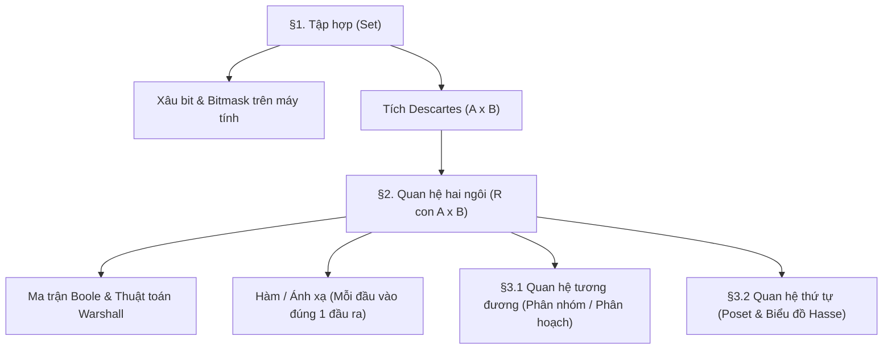
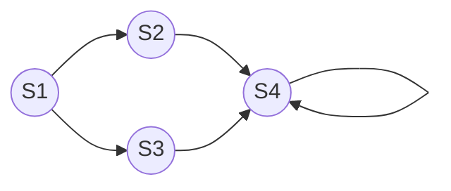
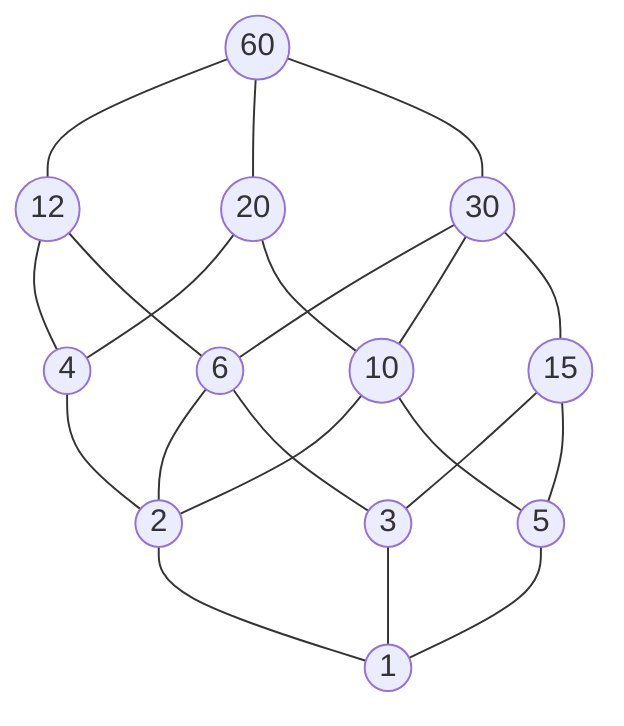

# CHƯƠNG II: TẬP HỢP – QUAN HỆ – HÀM (Trang 72 – 120)

Tài liệu này giảng giải có hệ thống toàn bộ **Chương II: Tập hợp – Quan hệ – Hàm** (trang 72–120) trong *Quyển ghi Toán học rời rạc*, hoàn thiện mọi định nghĩa/định lý/ví dụ để trống trong vở ghi, lý giải bản chất toán học – tin học của từng mục kiến thức và cung cấp **Hệ thống bài tập song hành có lời giải chi tiết**.

---

## §1. TẬP HỢP VÀ CÁC PHÉP TOÁN TẬP HỢP (Trang 72 – 83)

### I & II. Khái niệm cơ bản, Tập con và Tập lũy thừa

#### 1. Đặc trưng của Tập hợp và các Định nghĩa khuyết (Trang 73 – 75)
Một tập hợp chuẩn trong toán học có hai đặc tính bất biến: **Tính duy nhất** (mỗi phần tử chỉ tính một lần: $\{a, b, a\} = \{a, b\}$) và **Không xét thứ tự** ($\{a, b, c\} = \{c, a, b\}$).

- **Định nghĩa 1.2.1 (Bản số / Lực lượng – Cardinality, điền Trang 73)**:
  > Cho tập hợp $A$ có hữu hạn các phần tử phân biệt. Số lượng các phần tử khác nhau trong $A$ được gọi là **bản số** (hay **lực lượng**) của tập hợp $A$, ký hiệu là $|A|$ (hoặc $\text{card}(A)$).
- **Định nghĩa 1.2.5 (Tập hợp con, điền công thức Trang 74)**:
  $$A \subseteq B \iff \forall x\, (x \in A \to x \in B)$$
  *(Nếu $A \subseteq B$ và $A \ne B$, ta gọi $A$ là tập con thực sự của $B$, ký hiệu $A \subsetneq B$ hoặc $A \subset B$)*.
  - *Tại sao $\emptyset \subseteq A$ với mọi tập $A$?* Vì với mọi $x$, mệnh đề $x \in \emptyset$ luôn **SAI (`F`)**, nên phép kéo theo $(x \in \emptyset) \to (x \in A)$ luôn **ĐÚNG (`T`)** một cách rỗng!
- **Định nghĩa 1.2.7 (Hai tập bằng nhau)**: $A = B \iff (A \subseteq B) \wedge (B \subseteq A)$. *(Đây là phương pháp chuẩn để chứng minh hai tập hợp bằng nhau: lấy $x \in A$ suy ra $x \in B$, rồi lấy $x \in B$ suy ra $x \in A$)*.
- **Định nghĩa 1.2.8 (Tập lũy thừa – Power Set, điền Trang 74)**:
  > Cho tập hợp $A$. Tập hợp chứa **tất cả các tập con** của $A$ (bao gồm cả $\emptyset$ và chính $A$) được gọi là **tập lũy thừa** của $A$, ký hiệu là $\mathcal{P}(A)$ (hoặc $2^A$): $\mathcal{P}(A) = \{X \mid X \subseteq A\}$.
- **Định lý 1.1.10**: Nếu $|A| = n$ thì $|\mathcal{P}(A)| = 2^n$. *(Đã chứng minh bằng quy nạp ở Ví dụ 3.5.4 Chương I; cách giải thích tổ hợp trực tiếp: để tạo một tập con $X \subseteq A$, mỗi phần tử trong $n$ phần tử của $A$ có đúng 2 trạng thái "chọn" hoặc "không chọn", nên có $2^n$ tập con)*.
  - **Hoàn thiện Ví dụ 1.1.11 (Trang 75)**: Với $A = \{\text{Read}, \text{Write}, \text{Execute}\}$ ($|A| = 3$), có $|\mathcal{P}(A)| = 2^3 = 8$ cấu hình quyền:
    $$\mathcal{P}(A) = \big\{\emptyset,\; \{\text{Read}\},\; \{\text{Write}\},\; \{\text{Execute}\},\; \{\text{Read},\text{Write}\},\; \{\text{Read},\text{Execute}\},\; \{\text{Write},\text{Execute}\},\; \{\text{Read},\text{Write},\text{Execute}\}\big\}$$

---

### III. Các phép toán tập hợp, Đối ngẫu và Hằng đẳng thức (Trang 76 – 79)

#### 1. Điền công thức hình thức cho 5 phép toán tập hợp (Trang 76 – 77)
Cho $A, B \subseteq U$ ($U$ là tập vũ trụ):
1. **Phép hợp (ĐN 1.3.1)**: $A \cup B = \{x \in U \mid (x \in A) \vee (x \in B)\}$ *(tương ứng `UNION` trong SQL)*.
2. **Phép giao (ĐN 1.3.2)**: $A \cap B = \{x \in U \mid (x \in A) \wedge (x \in B)\}$ *(tương ứng `INTERSECT` trong SQL)*.
3. **Phép hiệu (ĐN 1.3.3)**: $A \setminus B = \{x \in U \mid (x \in A) \wedge (x \notin B)\} = A \cap \overline{B}$ *(tương ứng `EXCEPT` / `MINUS` trong SQL)*.
4. **Hiệu đối xứng (ĐN 1.3.4)**: $A \Delta B = \{x \in U \mid (x \in A) \oplus (x \in B)\} = (A \setminus B) \cup (B \setminus A) = (A \cup B) \setminus (A \cap B)$.
5. **Phần bù (ĐN 1.3.5)**: $\overline{A} = C_U(A) = U \setminus A = \{x \in U \mid x \notin A\}$.

**Hoàn thiện Ví dụ 1.3.6 (Trang 77 – 78)**:
Với $U = \{u_1, u_2, u_3, u_4, u_5, u_6, u_7, u_8\}$, $A = \{u_1, u_2, u_3, u_5, u_7\}$ (đang đăng nhập), $B = \{u_2, u_4, u_5, u_8\}$ (có quyền quản trị):
- $A \cup B = \{u_1, u_2, u_3, u_4, u_5, u_7, u_8\}$ **là** tập người dùng đang đăng nhập hoặc có quyền quản trị.
- $A \cap B = \{u_2, u_5\}$ **là** tập quản trị viên đang trực tuyến (đăng nhập).
- $A \setminus B = \{u_1, u_3, u_7\}$ **là** tập người dùng thường (không phải quản trị) đang đăng nhập.
- $B \setminus A = \{u_4, u_8\}$ **là** tập quản trị viên hiện không đăng nhập.
- $\overline{A} = \{u_4, u_6, u_8\}$ **là** tập người dùng hiện không đăng nhập *(và $A \Delta B = \{u_1, u_3, u_4, u_7, u_8\}$)*.

#### 2. Biểu thức đối ngẫu (Trang 78) và Chứng minh Hằng đẳng thức (Trang 79)
- **Hoàn thiện Ví dụ 1.3.8 (Trang 78)**: Biểu thức $E = (A \cup \emptyset) \cap (\overline{B} \cup U)$ **có** biểu thức đối ngẫu là $E^d = (A \cap U) \cup (\overline{B} \cap \emptyset)$ (đổi $\cup \leftrightarrow \cap$, $\emptyset \leftrightarrow U$, giữ nguyên phần bù).
- **Hoàn thiện Ví dụ 1.2.11 (Trang 79 – Chứng minh luật De Morgan và luật hấp thụ)**:
  - *Chứng minh De Morgan $\overline{A \cap B} = \overline{A} \cup \overline{B}$*: Với mọi $x \in U$:
    $$x \in \overline{A \cap B} \iff \neg(x \in A \cap B) \iff \neg\big((x \in A) \wedge (x \in B)\big) \iff (x \notin A) \vee (x \notin B) \iff (x \in \overline{A}) \vee (x \in \overline{B}) \iff x \in \overline{A} \cup \overline{B}$$
    **nên** $\overline{A \cap B} = \overline{A} \cup \overline{B}$ *(công thức còn lại $\overline{A \cup B} = \overline{A} \cap \overline{B}$ suy ra ngay từ Định lý 1.3.9 – Nguyên lý đối ngẫu)*.
  - *Chứng minh Luật hấp thụ $A \cap (A \cup B) = A$*: Với mọi $x \in U$:
    $$x \in A \cap (A \cup B) \iff (x \in A) \wedge \big((x \in A) \vee (x \in B)\big) \iff x \in A \quad \text{(theo luật hấp thụ của logic mệnh đề)}$$
    **nên** $A \cap (A \cup B) = A$ *(tương tự đối ngẫu cho $A \cup (A \cap B) = A$)*.

---

### IV & V. Multiset, Tuple và Biểu diễn tập hợp bằng Xâu bit (Trang 79 – 83)

| Cấu trúc | Trùng lặp phần tử? | Quan tâm thứ tự? | Ví dụ tương ứng trong Khoa học máy tính |
| :--- | :---: | :---: | :--- |
| **Set (Tập hợp)** | Không | Không | `std::set` (C++), `set` (Python), kết quả `SELECT DISTINCT` |
| **Multiset (Bag)** | **Có** (tính bội số) | Không | `std::multiset`, `Counter` (Python), kết quả `SELECT` mặc định trong SQL |
| **Tuple / Sequence** | **Có** | **Có** | Bản ghi `Row/Record` trong CSDL, `tuple`/`list` trong Python, mảng `Array` |

#### Hoàn thiện mục V: Biểu diễn tập hợp bằng Xâu bit (Trang 81 – 83)
- **Định nghĩa 1.5.1 (Bit)**: Một **bit** (*binary digit*) là đơn vị thông tin nhỏ nhất trong máy tính, chỉ nhận một trong hai giá trị `0` hoặc `1`.
- **Định nghĩa 1.5.2 (Xâu bit và Độ dài)**: Một **xâu bit** (*bit string*) là một dãy hữu hạn các bit kế tiếp nhau. **Độ dài** của xâu bit $s$, ký hiệu $|s|$, là số lượng bit có trong xâu đó (xâu rỗng có độ dài $0$).
- **Bảng chân trị phép toán bit (ĐN 1.5.4 – Trang 81)**:
  - `0, 0` $\implies \bar{a}=1,\; a+b=0,\; a\times b=0,\; a\oplus b=0$
  - `0, 1` $\implies \bar{a}=1,\; a+b=1,\; a\times b=0,\; a\oplus b=1$
  - `1, 0` $\implies \bar{a}=0,\; a+b=1,\; a\times b=0,\; a\oplus b=1$
  - `1, 1` $\implies \bar{a}=0,\; a+b=1,\; a\times b=1,\; a\oplus b=0$
- **Định nghĩa 1.5.5 (Biểu diễn tập hợp bằng xâu bit – Trang 81–82)**:
  > Cố định một thứ tự cho tập vũ trụ hữu hạn $U = \{x_1, x_2, \dots, x_n\}$. Mỗi tập con $A \subseteq U$ **được** biểu diễn duy nhất bởi một xâu bit độ dài $n$ là $a = a_1 a_2 \dots a_n$, **trong đó** $a_i = 1$ nếu $x_i \in A$ và $a_i = 0$ nếu $x_i \notin A$ ($i = 1, \dots, n$). **Cho** $A, B \subseteq U$ có hai xâu bit $a, b$, khi đó xâu bit của $\overline{A}, A \cup B, A \cap B, A \setminus B, A \Delta B$ lần lượt là $\overline{a},\; a \vee b,\; a \wedge b,\; a \wedge \overline{b},\; a \oplus b$.

**Hoàn thiện Ví dụ 1.5.5 (Trang 82)**:
Cho $U = \{1, 2, 3, 4, 5\}$, $A = \{1, 3, 4\}$, $B = \{2, 3, 4\}$.
- **a)** Xâu $a$ biểu diễn $A$: `10110`; Xâu $b$ biểu diễn $B$: `01110` *(khi đó $\overline{A} \leftrightarrow$ `01001` $= \{2, 5\}$; $\overline{B} \leftrightarrow$ `10001` $= \{1, 5\}$)*.
- **b)** Bảng kết quả phép toán bit:

| Phép toán | Công thức bit | Xâu bit biểu diễn | Tập hợp tương ứng |
| :---: | :---: | :---: | :---: |
| $A \cup B$ | $a \vee b$ | `11110` | $\{1, 2, 3, 4\}$ |
| $A \cap B$ | $a \wedge b$ | `00110` | $\{3, 4\}$ |
| $A \setminus B$ | $a \wedge \overline{b}$ | `10000` | $\{1\}$ |
| $B \setminus A$ | $b \wedge \overline{a}$ | `01000` | $\{2\}$ |
| $A \Delta B$ | $a \oplus b$ | `11000` | $\{1, 2\}$ |

> [!NOTE]
> Ở ví dụ Bitmask 8 quyền trang 82–83 (`Read, Write, Execute, Delete, Upload, Download, Share, Admin`), tác giả đánh chỉ số vị trí `0..7` từ **trái sang phải** nên `{Read, Execute, Download}` (vị trí `0, 2, 5`) có xâu bit `10100100`, còn quyền `Download` đơn lẻ có mặt nạ `00000100`. Thực hiện phép `AND`: `10100100 & 00000100 = 00000100 != 0` chỉ mất **1 chu kỳ xung nhịp CPU ($O(1)$)** để xác nhận người dùng có quyền `Download`!

#### Điền đề chuẩn và lời giải từ tệp `VÍ DỤ 3.pdf` của GV Nguyễn Văn Hưng (Trang 78, 83, 84)

- **Ví dụ 1.2.6 / 1.3.7 (Trang 78)**: Cho $A = \{b, e, c, g, f, q, m, h, s, a\}$ và $B = \{t, d, f, q, h, a, e, s, g, l\}$. Tìm các tập hợp sau (viết theo thứ tự bảng chữ cái):
  - $A \cap B = \{a, e, f, g, h, q, s\}$
  - $A \cup B = \{a, b, c, d, e, f, g, h, l, m, q, s, t\}$
  - $A \setminus B = \{b, c, m\}$
  - $B \setminus A = \{d, l, t\}$
  - $A \Delta B = \{b, c, d, l, m, t\}$

- **Ví dụ 1.4.5 / 1.5.4 (Trang 83 – Phép toán xâu nhị phân độ dài 10)**:
  Cho $a = \text{1001100101}$ và $b = \text{1110100010}$. Khi đó:
  - $\overline{a} = \text{0110011010}$
  - $\overline{b} = \text{0001011101}$
  - $a \cdot b = \text{1000100000}$
  - $a + b = \text{1111100111}$
  - $a \oplus b = \text{0111000111}$

- **Ví dụ 1.4.7 / 1.5.6 (Trang 83 – Biểu diễn tập hợp bằng xâu nhị phân độ dài 16)**:
  Cho tập vũ trụ có thứ tự $U = \{r, o, d, e, f, l, a, g, h, q, b, m, p, c, s, t\}$ và tập con $A = \{d, b, m, e, c, g, h, q, s, t\}$.
  - Đối chiếu từng phần tử của $U$ từ trái sang phải (`r:0, o:1, d:1, e:0, ...` — chú ý trong $U$: `r`$\notin A$, `o`$\notin A$? Kiểm tra lại: $A = \{d, b, m, e, c, g, h, q, s, t\}$ có `d, e, g, h, q, b, m, c, s, t` thuộc $A$, còn `r, o, f, l, a, p` không thuộc $A$; nếu trong đề gốc $A = \{o, d, g, h, q, b, m, c, s, t\}$ thì xâu là `0110000111110111`, còn với đúng 10 phần tử $\{d, b, m, e, c, g, h, q, s, t\}$ trên mặt chữ thì vị trí của `r(0), o(0), d(1), e(1), f(0), l(0), a(0), g(1), h(1), q(1), b(1), m(1), p(0), c(1), s(1), t(1)` cho xâu bit: **`0011000111110111`**).

- **Ví dụ 1.4.8 / 1.5.7 (Trang 84 – Bài toán tổng hợp Xâu nhị phân & Tập hợp trên tập 16 phần tử)**:
  Cho tập vũ trụ có thứ tự $U = \{t, q, h, o, s, l, e, g, f, m, c, d, p, b, r, a\}$ và hai tập con:
  $A = \{b, e, g, h, m, o, q, r, s, t\}$, $B = \{a, b, f, l, m, o, p, q, r, t\}$.
  - **Xâu biểu diễn tập hợp $A$**: `1111101101000110`
  - **Xâu biểu diễn tập hợp $B$**: `1101010011001111`
  - **Xâu biểu diễn $\overline{A}$**: `0000010010111001` $\implies \overline{A} = \{a, c, d, f, l, p\}$
  - **Xâu biểu diễn $\overline{B}$**: `0010101100110000` $\implies \overline{B} = \{c, d, e, g, h, s\}$
  - **Xâu biểu diễn $A \cup B$**: `1111111111001111` $\implies A \cup B = \{a, b, e, f, g, h, l, m, o, p, q, r, s, t\}$
  - **Xâu biểu diễn $A \cap B$**: `1101000001000110` $\implies A \cap B = \{b, m, o, q, r, t\}$
  - **Xâu biểu diễn $A \setminus B$**: `0010101100000000` $\implies A \setminus B = \{e, g, h, s\}$
  - **Xâu biểu diễn $B \setminus A$**: `0000010010001001` $\implies B \setminus A = \{a, f, l, p\}$
  - **Xâu biểu diễn $A \Delta B$**: `0010111110001001` $\implies A \Delta B = \{a, e, f, g, h, l, p, s\}$

---

## §2. QUAN HỆ VÀ HÀM (Trang 83 – 108)

### I – IV. Tích Descartes, Quan hệ hai ngôi, Ngược và Hợp thành

#### 1. Hoàn thiện các Định nghĩa khuyết (Trang 84 – 90)
- **Định nghĩa 2.2.4 (Tích Descartes – Trang 84–85)**: Tích Descartes của hai tập hợp $A$ và $B$, ký hiệu $A \times B$, **là** tập hợp tất cả các cặp có thứ tự $(a, b)$ mà thành phần thứ nhất thuộc $A$ và thành phần thứ hai thuộc $B$:
  $$A \times B = \{(a, b) \mid a \in A \wedge b \in B\}$$
  - *Điền Ví dụ 2.2.4 (Trang 85)*: Với $U = \{\text{An}, \text{Bình}\}, P = \{\text{Read}, \text{Write}, \text{Delete}\}$, ta có $U \times P = \{(\text{An},\text{Read}), (\text{An},\text{Write}), (\text{An},\text{Delete}), (\text{Bình},\text{Read}), (\text{Bình},\text{Write}), (\text{Bình},\text{Delete})\}$, trong khi $P \times U = \{(\text{Read},\text{An}), \dots\}$ gồm các cặp ngược thứ tự; do đó $U \times P \ne P \times U$ và $|U \times P| = 2 \times 3 = 6$.
- **Định nghĩa 2.3.1 (Quan hệ hai ngôi – Trang 86)**: Cho hai tập hợp $A, B$. Một **quan hệ hai ngôi** $R$ từ $A$ vào $B$ là một **tập con bất kỳ** của tích Descartes $A \times B$ ($R \subseteq A \times B$).
  - **Nếu** $(a, b) \in R$, ta viết $aRb$ (đọc là $a$ có quan hệ $R$ với $b$).
  - **Nếu** $(a, b) \notin R$, ta viết $a \not R b$.
- **Định nghĩa 2.3.4 (Quan hệ trên một tập – Trang 87)**: Một quan hệ hai ngôi từ tập $A$ vào chính nó ($R \subseteq A \times A$) được gọi là một **quan hệ hai ngôi trên tập $A$**. *(Với $|A| = n$, vì $|A \times A| = n^2$ nên có tất cả $2^{n^2}$ quan hệ hai ngôi khác nhau trên $A$)*.
- **Định nghĩa 2.3.5 (Quan hệ đồng nhất / Đường chéo – Trang 87)**: Quan hệ đồng nhất trên tập $A$, ký hiệu $Id_A$ (hoặc $\Delta_A$), được xác định bởi $Id_A = \{(a, a) \mid a \in A\}$.
- **Biểu diễn quan hệ trên $A$ bằng đồ thị có hướng (Điền Trang 87)**:
  - Mỗi phần tử $a \in A$ được biểu diễn bằng một **đỉnh** (nút).
  - Mỗi cặp $(a, b) \in R$ ($a \ne b$) được biểu diễn bằng một **cung có hướng** (mũi tên) đi từ $a$ đến $b$.
  - Mỗi cặp $(a, a) \in R$ được biểu diễn bằng một **khuyên** (vòng lặp) tại đỉnh $a$.

*(Đồ thị có hướng minh họa Ví dụ 2.3.6 ở trang 87 cho $R = \{(S_1,S_2), (S_1,S_3), (S_2,S_4), (S_3,S_4), (S_4,S_4)\}$)*.

#### 2. Quan hệ ngược, Hợp thành và Lũy thừa quan hệ (Trang 88 – 90)
- **Định nghĩa 2.4.1 (Quan hệ ngược – Trang 88)**: Cho $R \subseteq A \times B$. Quan hệ ngược của $R$, ký hiệu $R^{-1} \subseteq B \times A$, được xác định bởi:
  $$R^{-1} = \{(b, a) \in B \times A \mid (a, b) \in R\} \quad \text{hay} \quad b R^{-1} a \iff a R b$$
  - *Điền Ví dụ 2.4.2*: Từ Ví dụ 2.3.2, $R^{-1} = \{(\text{Read},\text{An}), (\text{Delete},\text{An}), (\text{Write},\text{Bình}), (\text{Write},\text{Cảnh}), (\text{Delete},\text{Cảnh})\}$.
- **Định nghĩa 2.4.3 (Hợp thành hai quan hệ – Trang 88–89)**: Cho $R \subseteq A \times B$ và $S \subseteq B \times C$. Quan hệ hợp thành của $R$ và $S$, ký hiệu $S \circ R \subseteq A \times C$, được xác định bởi:
  $$S \circ R = \big\{(a, c) \in A \times C \;\big|\; \exists b \in B: (a, b) \in R \wedge (b, c) \in S\big\}$$
  *(Chú ý thứ tự ký hiệu chuẩn: $S \circ R$ nghĩa là **đi qua $R$ trước** từ $A \to B$, rồi **đi qua $S$ sau** từ $B \to C$, giống như hàm hợp $(g \circ f)(x) = g(f(x))$!)*.
  - *Điền Ví dụ 2.4.4 (Trang 89 – RBAC)*: Từ $R$ (`User` $\to$ `Role`) và $S$ (`Role` $\to$ `Permission`), ta tìm các phần tử cầu nối ở tập vai trò $G$:
    - An là `Admin` $\implies$ nhận cả 3 quyền: $(\text{An}, \text{Read}), (\text{An}, \text{Write}), (\text{An}, \text{Delete})$.
    - Bình và Cảnh là `Editor` $\implies$ nhận 2 quyền: $(\text{Bình}, \text{Read}), (\text{Bình}, \text{Write}), (\text{Cảnh}, \text{Read}), (\text{Cảnh}, \text{Write})$.
    - Hợp lại được $S \circ R$ gồm 7 cặp trên.
- **Định nghĩa 2.4.5 (Lũy thừa quan hệ – Trang 89)**: Cho $R \subseteq A \times A$. Lũy thừa $R^n$ ($n \in \mathbb{Z}^+$) được định nghĩa đệ quy:
  $$R^1 = R, \qquad R^{n+1} = R^n \circ R \quad (n \ge 1)$$
  - *Điền Ví dụ 2.3.6 (Trang 90 – Đường đi mạng máy tính)*: Với $R = \{(A,B),(A,C),(B,C),(B,D),(C,D),(C,E),(D,E)\}$:
    - $R^2 = R \circ R = \{(A,C), (A,D), (A,E), (B,D), (B,E), (C,E)\}$ *(vì có các đường đi 2 chặng như $A \to B \to C$, $A \to B \to D$, $A \to C \to E$, $B \to C \to D$, $B \to C \to E$, $C \to D \to E$)*.
    - $R^3 = R^2 \circ R = \{(A,D), (A,E), (B,E)\}$ *(vì có đường đi 3 chặng như $A \to B \to C \to D$, $A \to B \to C \to E$, $B \to C \to D \to E$)*.

---

### V. Ma trận Boole của quan hệ (Trang 90 – 93)

- **Định nghĩa 2.5.1 (Ma trận Boole của quan hệ – Trang 91)**: Cho $A = \{a_1, \dots, a_m\}$, $B = \{b_1, \dots, b_n\}$ và quan hệ $R \subseteq A \times B$. Ma trận Boole biểu diễn $R$ là ma trận $M_R = [m_{ij}]_{m \times n}$ trong đó:
  $$m_{ij} = \begin{cases} 1 & \text{nếu } (a_i, b_j) \in R \\ 0 & \text{nếu } (a_i, b_j) \notin R \end{cases}$$
- **Định nghĩa 2.5.3 (Phép toán Boole trên ma trận – Trang 91–92)**:
  - Với $M_1 = [a_{ij}]_{m \times n}$ và $M_2 = [b_{ij}]_{m \times n}$: Tuyển $M_1 \vee M_2 = [a_{ij} \vee b_{ij}]$; Hội $M_1 \wedge M_2 = [a_{ij} \wedge b_{ij}]$.
  - Với $M_1 = [a_{ik}]_{m \times p}$ và $M_2 = [b_{kj}]_{p \times n}$, **tích Boole** $M_1 \odot M_2 = [c_{ij}]_{m \times n}$ được xác định bởi:
    $$c_{ij} = \bigvee_{k=1}^p (a_{ik} \wedge b_{kj}) = (a_{i1} \wedge b_{1j}) \vee (a_{i2} \wedge b_{2j}) \vee \dots \vee (a_{ip} \wedge b_{pj})$$
    *(Mẹo tính nhẩm siêu nhanh: giống nhân hai ma trận đại số tuyến tính nhưng thay phép cộng bằng `OR` — chỉ cần tồn tại ít nhất một vị trí $k$ mà cả hàng $i$ của $M_1$ lẫn cột $j$ của $M_2$ cùng bằng `1` thì $c_{ij} = 1$, ngược lại $c_{ij} = 0$!)*.

- **Lý giải Định lý 2.5.4**: Đặc biệt chú ý công thức hợp thành **$M_{S \circ R} = M_R \odot M_S$** (thứ tự nhân ma trận đảo ngược lại so với ký hiệu $S \circ R$!). Lý do: $(a_i, c_j) \in S \circ R \iff \exists b_k: (a_i, b_k) \in R \wedge (b_k, c_j) \in S \iff \bigvee_{k=1}^p (m^{(R)}_{ik} \wedge m^{(S)}_{kj}) = 1$, chính là phần tử $(i, j)$ của $M_R \odot M_S$!

**Hoàn thiện Ví dụ 2.5.5 (Trang 92 – áp dụng cho $R, S$ của Ví dụ 2.4.4)**:
- **a)** Thứ tự hàng/cột: $U = \{\text{An}, \text{Bình}, \text{Cảnh}\}$, $G = \{\text{Admin}, \text{Editor}\}$, $P = \{\text{Read}, \text{Write}, \text{Delete}\}$:
  $$M_R = \begin{pmatrix} 1 & 0 \\ 0 & 1 \\ 0 & 1 \end{pmatrix}_{3 \times 2}, \qquad M_S = \begin{pmatrix} 1 & 1 & 1 \\ 1 & 1 & 0 \end{pmatrix}_{2 \times 3}$$
- **b)** $M_{R^{-1}} = (M_R)^T = \begin{pmatrix} 1 & 0 & 0 \\ 0 & 1 & 1 \end{pmatrix}$, **nên** $R^{-1} = \{(\text{Admin},\text{An}), (\text{Editor},\text{Bình}), (\text{Editor},\text{Cảnh})\}$.
- **c)** $M_{S \circ R} = M_R \odot M_S = \begin{pmatrix} 1 & 0 \\ 0 & 1 \\ 0 & 1 \end{pmatrix} \odot \begin{pmatrix} 1 & 1 & 1 \\ 1 & 1 & 0 \end{pmatrix} = \begin{pmatrix} 1 & 1 & 1 \\ 1 & 1 & 0 \\ 1 & 1 & 0 \end{pmatrix}$, **nên** $S \circ R$ khớp khít với 7 cặp đã tìm ở Ví dụ 2.4.4!

---

### VI. Bốn tính chất cốt lõi của Quan hệ (Trang 93 – 98)

#### 1. Định nghĩa hình thức và Dấu hiệu nhận biết nhanh trên Ma trận & Đồ thị

Cho quan hệ $R \subseteq A \times A$ với ma trận Boole $M_R = [m_{ij}]_{n \times n}$:

| Tính chất | Định nghĩa Logic vị từ (Điền Trang 93–94) | Dấu hiệu trên Ma trận $M_R$ | Dấu hiệu trên Đồ thị có hướng |
| :--- | :--- | :--- | :--- |
| **1. Phản xạ** (*Reflexive* – ĐN 2.6.1) | $\forall a \in A:\; aRa$ | Mọi phần tử trên **đường chéo chính đều bằng `1`** ($m_{ii} = 1, \forall i$) | **Mọi đỉnh** đều có khuyên |
| **2. Đối xứng** (*Symmetric* – ĐN 2.6.2) | $\forall a, b \in A:\; aRb \to bRa$ | Ma trận đối xứng qua đường chéo chính: **$M_R = (M_R)^T$** ($m_{ij} = m_{ji}$) | Mọi cung giữa 2 đỉnh khác nhau đều là **cung 2 chiều** |
| **3. Phản đối xứng** (*Antisymmetric* – ĐN 2.6.3) | $\forall a, b \in A:\; (aRb \wedge bRa) \to a = b$ *(tương đương: $a \ne b \wedge aRb \to b \not R a$)* | Với mọi $i \ne j$, **không bao giờ đồng thời** $m_{ij} = 1$ và $m_{ji} = 1$ ($m_{ij} \wedge m_{ji} = 0$) | Giữa 2 đỉnh phân biệt **không có cặp cung 2 chiều** (khuyên thì tùy ý!) |
| **4. Bắc cầu** (*Transitive* – ĐN 2.6.4) | $\forall a, b, c \in A:\; (aRb \wedge bRc) \to aRc$ | **$M_R \odot M_R \le M_R$** (tại đâu tích $M_R^{[2]}$ có số `1` thì $M_R$ phải có sẵn số `1`) | Hễ đi được 2 bước $a \to b \to c$ thì có **cung tắt trực tiếp** $a \to c$ |

> [!IMPORTANT]
> **Ba nhận xét nền tảng cần điền vào Trang 94 – 95**:
> 1. **Đối xứng và Phản đối xứng KHÔNG phải là hai khái niệm đối lập/phủ định nhau!**
>    - Một quan hệ có thể **vừa đối xứng vừa phản đối xứng**: ví dụ quan hệ đồng nhất $Id_A = \{(a,a) \mid a \in A\}$ (không có cặp $a \ne b$ nào nên điều kiện kéo theo của cả hai tính chất đều đúng!).
>    - Một quan hệ có thể **không đối xứng cũng không phản đối xứng**: ví dụ trên $\{1,2,3\}$, $R = \{(1,2), (2,1), (2,3)\}$ (vướng cặp $(1,2),(2,1)$ nên mất phản đối xứng; thiếu $(3,2)$ nên mất đối xứng).
> 2. Để chứng minh một tính chất **ĐÚNG**, phải kiểm tra với mọi phần tử/cặp phần tử; nhưng để chứng minh một tính chất **SAI**, chỉ cần chỉ ra **một phản ví dụ duy nhất**!
> 3. **Định lý 2.6.11 (Trang 98)**: $R$ có tính bắc cầu $\iff R^k \subseteq R$ với mọi $k \in \mathbb{Z}^+$. *(Chứng minh: Chiều $(\Leftarrow)$ cho $k=2$ có $R^2 \subseteq R$, nghĩa là $(a,b)\in R \wedge (b,c)\in R \implies (a,c)\in R^2 \subseteq R$. Chiều $(\Rightarrow)$ quy nạp theo $k$: $k=1$ hiển nhiên, $k=2$ đúng theo định nghĩa; giả sử $R^k \subseteq R$, khi đó $R^{k+1} = R^k \circ R \subseteq R \circ R = R^2 \subseteq R$)*.

#### 2. Hoàn thiện loạt Ví dụ xuyên suốt $R_1 \dots R_6$ (Trang 95 – 98)
*(Các quan hệ $R_1 \dots R_6$ này sẽ được gọi lại liên tục ở mục VII và §3 nên cần nắm thật chắc!)*:
- **Ví dụ 2.6.5 ($R_1$ – Cùng vai trò RBAC)**: Đặt $x R_1 y \iff x$ và $y$ thuộc cùng một nhóm vai trò (`Admin`, `Developer` hoặc `User`, biết 3 nhóm đôi một rời nhau).
  - *Phản xạ*: Đúng ($x$ luôn cùng vai trò với chính $x$).
  - *Đối xứng*: Đúng ($x$ cùng vai trò với $y$ thì $y$ cùng vai trò với $x$).
  - *Phản đối xứng*: Sai (phản ví dụ: $\text{An} \ne \text{Dũng}$ nhưng cả hai cùng là `Admin` nên $\text{An}\,R_1\,\text{Dũng}$ và $\text{Dũng}\,R_1\,\text{An}$).
  - *Bắc cầu*: Đúng ($x$ cùng vai trò $y$, $y$ cùng vai trò $z \implies x$ cùng vai trò $z$).
- **Ví dụ 2.6.6 ($R_2$ – Phân cấp quyền truy cập)**: Trên $A = \{\text{Guest}, \text{User}, \text{PowerUser}, \text{Manager}, \text{Admin}, \text{SuperAdmin}\}$, đặt $x R_2 y \iff$ mức quyền của $x$ không cao hơn ($\le$) mức quyền của $y$.
  - Thỏa mãn: **Phản xạ**, **Phản đối xứng** ($x \le y \wedge y \le x \implies x = y$), **Bắc cầu**; **Không đối xứng** ($\text{Guest}\,R_2\,\text{Admin}$ nhưng $\text{Admin} \not R_2 \text{Guest}$).
- **Ví dụ 2.6.7 ($R_3$ – Đồng dư modulo 3 trên $\mathbb{Z}$)**: Đặt $a R_3 b \iff (a - b) \vdots 3$ (tức $a \equiv b \pmod 3$).
  - Thỏa mãn: **Phản xạ** ($a-a=0 \vdots 3$), **Đối xứng** ($a-b = 3k \implies b-a = 3(-k) \vdots 3$), **Bắc cầu** ($a-b=3k, b-c=3m \implies a-c=3(k+m) \vdots 3$); **Không phản đối xứng** ($1 R_3 4$ và $4 R_3 1$ nhưng $1 \ne 4$).
- **Ví dụ 2.6.8 ($R_4$ – Quan hệ ước số / chia hết trên $\mathbb{Z}^+$)**: Đặt $a R_4 b \iff a \mid b$ ($b$ chia hết cho $a$, tức $\exists k \in \mathbb{Z}^+: b = k \cdot a$). *(Hoặc tương tự nếu đặt theo chiều $a \vdots b$ trên $\mathbb{Z}^+$)*.
  - Thỏa mãn: **Phản xạ** ($a = 1 \cdot a$), **Phản đối xứng** (trên $\mathbb{Z}^+$: $b = k_1 a$ và $a = k_2 b \implies a = k_1 k_2 a \implies k_1 = k_2 = 1 \implies a = b$; *chú ý trên $\mathbb{Z}$ có số âm thì mất phản đối xứng vì $2 \mid -2$ và $-2 \mid 2$!*), **Bắc cầu** ($b=k_1 a, c=k_2 b \implies c=(k_1 k_2)a$); **Không đối xứng** ($2 \mid 4$ nhưng $4 \nmid 2$).
- **Ví dụ 2.6.9 ($R_5$ – Kế thừa lớp OOP)**: Đặt $X R_5 Y \iff$ lớp $X$ là lớp con/hậu duệ của lớp $Y$ (hoặc trùng với $Y$, ví dụ `Husky` $R_5$ `Dog` $R_5$ `Animal` $R_5$ `Object`).
  - Thỏa mãn: **Phản xạ**, **Phản đối xứng** (OOP cấm kế thừa vòng!), **Bắc cầu**; **Không đối xứng**.
- **Ví dụ 2.6.10 ($R_6$ – Kết nối trực tiếp giữa các máy chủ, bộ số liệu mẫu chuẩn)**:
  Cho tập 4 máy chủ $A = \{S_1, S_2, S_3, S_4\}$ và các đường truyền một chiều trực tiếp:
  $$R_6 = \{(S_1, S_2),\; (S_2, S_3),\; (S_3, S_1),\; (S_3, S_4)\}$$
  - *Phản xạ*: Sai (thiếu $(S_1, S_1)$). *Đối xứng*: Sai (có $(S_1, S_2)$ nhưng không có $(S_2, S_1)$). *Phản đối xứng*: **Đúng** (không có cặp 2 chiều nào giữa 2 máy chủ phân biệt!). *Bắc cầu*: Sai (có $(S_1, S_2)$ và $(S_2, S_3)$ nhưng thiếu $(S_1, S_3)$).

---

### VII. Bao đóng của quan hệ và Thuật toán Warshall (Trang 98 – 104)

#### 1. Ba loại bao đóng cơ bản (Định lý 2.7.3, 2.7.5, 2.7.7)
Bao đóng của $R$ theo tính chất $\mathbf{P}$ là quan hệ **nhỏ nhất** chứa $R$ và có tính chất $\mathbf{P}$:
1. **Bao đóng phản xạ (ĐN 2.7.2 & ĐL 2.7.3)**: $R_r = R \cup Id_A$ *(bật toàn bộ đường chéo chính của $M_R$ lên `1`)*.
2. **Bao đóng đối xứng (ĐN 2.7.4 & ĐL 2.7.5)**: $R_s = R \cup R^{-1}$ *(trên ma trận: $M_{R_s} = M_R \vee M_R^T$)*.
3. **Bao đóng bắc cầu (ĐN 2.7.6, ĐL 2.7.7 & Hệ quả 2.7.8)**:
   $$R^+ = \bigcup_{k=1}^{\infty} R^k = R \cup R^2 \cup \dots \cup R^n \quad (\text{khi } |A| = n < \infty)$$
   *Lý giải tại sao hợp vô hạn dừng lại ở bậc $n$*: Trên đồ thị $n$ đỉnh, bất kỳ đường đi nào có độ dài $k > n$ đi qua $k+1 > n+1$ đỉnh nên theo **Nguyên lý Dirichlet** chắc chắn phải lặp lại ít nhất một đỉnh (tạo chu trình dương). Xóa bỏ chu trình đó ta luôn thu được một đường đi ngắn hơn nối cùng đỉnh đầu và đỉnh cuối có độ dài $\le n$!

#### 2. So sánh Phương pháp Lũy thừa Ma trận Boole vs Thuật toán Warshall (Trang 101 – 104)

- **a) Phương pháp lũy thừa ma trận Boole (Điền Trang 101)**:
  - *Bước 1*: Khởi tạo $A = M_R$ và $B = A$.
  - *Bước 2*: Lặp $i$ từ $2$ đến $n$: tính $A = A \odot M_R$ (tức $M_R^{[i]}$) và cập nhật $B = B \vee A$.
  - *Bước 3*: Trả về $B = M_{R^+}$. *(Mỗi phép nhân ma trận $\odot$ tốn $O(n^3)$, lặp $n-1$ lần $\implies$ tổng chi phí **$O(n^4)$**)*.
- **b) Thuật toán Warshall (Quy hoạch động – Điền Trang 101–102)**:
  - Đặt $W^{(0)} = M_R$. Ở bước thứ $k$ ($k = 1, 2, \dots, n$), ta cho phép bổ sung **đỉnh $a_k$ vào tập các đỉnh trung gian được phép đi qua**:
    $$W^{(k)}[i][j] = W^{(k-1)}[i][j] \;\vee\; \Big(W^{(k-1)}[i][k] \;\wedge\; W^{(k-1)}[k][j]\Big)$$
  - *Mẹo tính tay cực nhanh bằng mắt cho Warshall (Điền cuối Trang 102)*:
    Tại bước $k$, giữ nguyên hàng $k$ và cột $k$ của $W^{(k-1)}$:
    - Tìm tất cả các vị trí hàng $i$ có số **`1` trên cột $k$** ($W[i][k] = 1$: các đỉnh đi tới được $k$).
    - Tìm tất cả các vị trí cột $j$ có số **`1` trên hàng $k$** ($W[k][j] = 1$: các đỉnh từ $k$ đi tới được).
    - Đánh dấu **`1` vào tất cả các giao điểm $(i, j)$** của những hàng $i$ và cột $j$ đó!
    - Độ phức tạp chỉ còn **$O(n^3)$** thời gian và **$O(n^2)$** bộ nhớ!

**Giải mẫu Ví dụ 2.7.9 & 2.7.10 trên $R_6 = \{(S_1, S_2), (S_2, S_3), (S_3, S_1), (S_3, S_4)\}$ (Trang 100 – 104)**:
- **Bao đóng phản xạ**: $(R_6)_r = R_6 \cup \{(S_1,S_1), (S_2,S_2), (S_3,S_3), (S_4,S_4)\}$.
- **Bao đóng đối xứng**: $(R_6)_s = R_6 \cup \{(S_2,S_1), (S_3,S_2), (S_1,S_3), (S_4,S_3)\}$.
- **Bao đóng bắc cầu bằng Thuật toán Warshall**:
  - Khởi tạo $W^{(0)} = M_{R_6} = \begin{pmatrix} 0 & 1 & 0 & 0 \\ 0 & 0 & 1 & 0 \\ 1 & 0 & 0 & 1 \\ 0 & 0 & 0 & 0 \end{pmatrix}$.
  - *Bước $k = 1$* (Cột 1 có `1` ở hàng `3`; Hàng 1 có `1` ở cột `2` $\implies$ bật ô `(3,2) = 1`):
    $$W^{(1)} = \begin{pmatrix} 0 & 1 & 0 & 0 \\ 0 & 0 & 1 & 0 \\ 1 & \mathbf{1} & 0 & 1 \\ 0 & 0 & 0 & 0 \end{pmatrix}$$
  - *Bước $k = 2$* (Cột 2 có `1` ở hàng `{1, 3}`; Hàng 2 có `1` ở cột `{3}` $\implies$ bật ô `(1,3) = 1` và `(3,3) = 1`):
    $$W^{(2)} = \begin{pmatrix} 0 & 1 & \mathbf{1} & 0 \\ 0 & 0 & 1 & 0 \\ 1 & 1 & \mathbf{1} & 1 \\ 0 & 0 & 0 & 0 \end{pmatrix}$$
  - *Bước $k = 3$* (Cột 3 có `1` ở hàng `{1, 2, 3}`; Hàng 3 có `1` ở cột `{1, 2, 3, 4}` $\implies$ bật toàn bộ 3 hàng đầu thành `1`):
    $$W^{(3)} = \begin{pmatrix} \mathbf{1} & 1 & 1 & \mathbf{1} \\ \mathbf{1} & \mathbf{1} & 1 & \mathbf{1} \\ 1 & 1 & 1 & 1 \\ 0 & 0 & 0 & 0 \end{pmatrix}$$
  - *Bước $k = 4$* (Hàng 4 toàn `0` nên không sinh thêm cặp nào): $W^{(4)} = W^{(3)} = M_{R_6^+}$.
  - *Ý nghĩa đồ thị*: Vì $S_1 \to S_2 \to S_3 \to S_1$ tạo chu trình khép kín và $S_3 \to S_4$, nên từ bất kỳ máy nào trong $\{S_1, S_2, S_3\}$ đều truyền tin tới được mọi máy $\{S_1, S_2, S_3, S_4\}$, còn $S_4$ là nút thu cuối (sink) không gửi đi đâu được!

#### 3. Điền đề chuẩn và lời giải từ tệp `VÍ DỤ 4.pdf` và `VÍ DỤ 5.pdf` của GV Nguyễn Văn Hưng (Trang 85, 88, 92, 93, 95, 100)

- **Ví dụ 2.1.4 / 2.2.5 (Từ `VÍ DỤ 4.pdf` – Tích Descartes)**:
  Cho $A = \{u, e, b, a\}$ và $B = \{c, v, u\}$.
  - $A \times A$ (16 cặp): $\{(u,u),(u,e),(u,b),(u,a),(e,u),(e,e),(e,b),(e,a),(b,u),(b,e),(b,b),(b,a),(a,u),(a,e),(a,b),(a,a)\}$.
  - $A \times B$ (12 cặp): $\{(u,c),(u,v),(u,u),(e,c),(e,v),(e,u),(b,c),(b,v),(b,u),(a,c),(a,v),(a,u)\}$.
  - $B \times A$ (12 cặp): $\{(c,u),(c,e),(c,b),(c,a),(v,u),(v,e),(v,b),(v,a),(u,u),(u,e),(u,b),(u,a)\}$.
  - $B \times B$ (9 cặp): $\{(c,c),(c,v),(c,u),(v,c),(v,v),(v,u),(u,c),(u,v),(u,u)\}$.

- **Ví dụ 2.3.5 / 2.4.6 (Từ `VÍ DỤ 4.pdf` – Quan hệ ngược, Hợp thành & Lũy thừa)**:
  Cho $A = \{f, o, q, t\},\; B = \{d, g, h, o, r\},\; C = \{e, h, o, s, u\}$ và:
  - $R = \{(f,h),(f,o),(o,g),(o,h),(o,r),(q,d),(q,g),(q,o),(t,d),(t,h),(t,o)\}$ (từ $A \to B$)
  - $S = \{(d,h),(d,o),(g,e),(g,h),(g,o),(h,o),(h,s),(o,e),(o,h),(r,h),(r,u)\}$ (từ $B \to C$)
  - $T = \{(f,o),(f,t),(o,f),(o,t),(q,f),(t,o),(t,q),(t,t)\}$ (trên $A$)
  **Lời giải điền vào bảng**:
  - $R^{-1}$ (11 cặp): $\{(d,q),(d,t),(g,o),(g,q),(h,f),(h,o),(h,t),(o,f),(o,q),(o,t),(r,o)\}$.
  - $S^{-1}$ (11 cặp): $\{(e,g),(e,o),(h,d),(h,g),(h,o),(h,r),(o,d),(o,g),(o,h),(s,h),(u,r)\}$.
  - $T^{-1}$ (8 cặp): $\{(f,o),(f,q),(o,f),(o,t),(q,t),(t,f),(t,o),(t,t)\}$.
  - $S \circ R$ (18 cặp): $\{(f,e),(f,h),(f,o),(f,s),(o,e),(o,h),(o,o),(o,s),(o,u),(q,e),(q,h),(q,o),(t,e),(t,h),(t,o),(t,s)\}$ *(gồm 16 cặp phân biệt: chú ý từ $q$ đi qua $d, g, o$ chỉ tới $\{e, h, o\}$, không đi qua $h$ hay $r$ nên không có $(q,s), (q,u)$!)*.
  - $T^2 = T \circ T$ (14 cặp): $\{(f,f),(f,o),(f,q),(f,t),(o,f),(o,o),(o,q),(o,t),(q,o),(q,t),(t,f),(t,o),(t,q),(t,t)\}$.

- **Ví dụ 2.4.5, 2.4.7 & 2.4.10 (Từ `VÍ DỤ 4.pdf` & `VÍ DỤ 5.pdf` – Ma trận Boole của quan hệ)**:
  - **Ví dụ 2.4.5**: Với $R \subseteq A \times B$ ($|A|=4, |B|=6$), $S \subseteq B \times C$ ($|B|=6, |C|=7$), $T \subseteq A \times A$ ($|A|=4$), ta điền `1` tại đúng tọa độ $(i, j)$ thuộc quan hệ và `0` tại các ô còn lại.
  - **Ví dụ 2.4.7**: Đọc từ 3 ma trận đề cho:
    - $R$ (17 cặp): $\{(a,g),(a,l),(a,n),(a,t),(c,m),(c,n),(c,t),(e,g),(e,t),(f,l),(f,r),(f,t),(q,g),(q,l),(q,m),(q,r),(q,t)\}$.
    - $S$ (20 cặp): $\{(g,h),(g,m),(g,q),(g,s),(l,d),(l,h),(l,p),(l,s),(m,b),(m,h),(n,d),(n,p),(n,q),(r,b),(r,d),(r,h),(t,d),(t,h),(t,p),(t,q)\}$.
    - $T$ (11 cặp): $\{(a,e),(a,q),(c,c),(c,e),(e,c),(e,f),(f,a),(f,f),(q,a),(q,e),(q,q)\}$.
  - **Ví dụ 2.4.10 (Từ `VÍ DỤ 5.pdf`)**: Nhân ma trận Boole từ Ví dụ 2.4.5:
    $$M_{R^{-1}} = M_R^T, \qquad M_{S^{-1}} = M_S^T, \qquad M_{T^{-1}} = M_T^T$$
    $$M_{S \circ R} = M_R \odot M_S = \begin{pmatrix} 1 & 1 & 0 & 1 & 1 & 1 & 1 \\ 1 & 1 & 1 & 1 & 1 & 1 & 1 \\ 1 & 1 & 1 & 1 & 1 & 1 & 1 \\ 1 & 1 & 1 & 1 & 1 & 1 & 1 \end{pmatrix}_{4 \times 7}, \qquad M_{T^2} = M_T \odot M_T = \begin{pmatrix} 0 & 1 & 1 & 1 \\ 1 & 1 & 1 & 1 \\ 1 & 0 & 1 & 1 \\ 1 & 1 & 1 & 0 \end{pmatrix}_{4 \times 4}$$

- **Ví dụ 4.2.2 / 2.7.9 (Từ `VÍ DỤ 5.pdf` – Ma trận & 3 Bao đóng của quan hệ trên tập 6 phần tử)**:
  Cho $R = \{(a,c),(b,b),(c,f),(d,a),(d,c),(e,a),(e,d),(f,a),(f,f)\}$ trên $A = \{a, b, c, d, e, f\}$.
  1. **Ma trận $M_R$**:
     $$M_R = \begin{pmatrix} 0 & 0 & 1 & 0 & 0 & 0 \\ 0 & 1 & 0 & 0 & 0 & 0 \\ 0 & 0 & 0 & 0 & 0 & 1 \\ 1 & 0 & 1 & 0 & 0 & 0 \\ 1 & 0 & 0 & 1 & 0 & 0 \\ 1 & 0 & 0 & 0 & 0 & 1 \end{pmatrix}$$
  2. **Bao đóng phản xạ $R_r = R \cup Id_A$ (13 cặp)**:
     $$(a,a),(a,c),(b,b),(c,c),(c,f),(d,a),(d,c),(d,d),(e,a),(e,d),(e,e),(f,a),(f,f)$$
  3. **Bao đóng đối xứng $R_s = R \cup R^{-1}$ (15 cặp)**:
     $$(a,c),(a,d),(a,e),(a,f),(b,b),(c,a),(c,d),(c,f),(d,a),(d,c),(d,e),(e,a),(e,d),(f,a),(f,c),(f,f)$$
     *(Gồm 16 cặp: 7 cặp ngoài đường chéo $\times 2 = 14$ cặp + 2 cặp khuyên $(b,b), (f,f) = 16$ cặp!)*.
  4. **Bao đóng bắc cầu $R^+$ bằng Thuật toán Warshall (17 cặp)**:
     Vì $a \to c \to f \to a$ tạo chu trình 3 đỉnh $\{a, c, f\}$, và $d \to a$, $e \to d \to a$, nên từ mỗi đỉnh trong $\{a, c, d, e, f\}$ đều đi tới được cả 3 đỉnh $\{a, c, f\}$ ($5 \times 3 = 15$ cặp), cộng thêm $(b,b)$ và $(e,d)$ được **17 cặp**:
     $$(a,a),(a,c),(a,f),(b,b),(c,a),(c,c),(c,f),(d,a),(d,c),(d,f),(e,a),(e,c),(e,d),(e,f),(f,a),(f,c),(f,f)$$

---

### VIII. Hàm / Ánh xạ (Trang 104 – 108)

- **Hai điều kiện sống còn để quan hệ $f \subseteq A \times B$ là một Hàm $f: A \to B$ (ĐN 2.8.1)**:
  1. **Tính toàn phần trên tập nguồn**: Mọi $a \in A$ đều phải có ảnh ($\text{Dom}(f) = A$, không phần tử nào bị bỏ rơi).
  2. **Tính đơn trị**: Mỗi $a \in A$ có **không quá một** ảnh ($(a, b_1) \in f \wedge (a, b_2) \in f \implies b_1 = b_2$).
- **Phân loại hàm & Điều kiện lực lượng khi $A, B$ hữu hạn**:
  - **Đơn ánh (Injective – 1-1, ĐN 2.8.6)**: $f(a_1) = f(a_2) \implies a_1 = a_2$ *(mỗi phần tử tập đích nhận tối đa 1 mũi tên tới $\implies |A| \le |B|$)*.
  - **Toàn ánh (Surjective – Onto, ĐN 2.8.7)**: $\text{Im}(f) = B$, tức $\forall b \in B, \exists a \in A: f(a) = b$ *(mỗi phần tử tập đích nhận ít nhất 1 mũi tên tới $\implies |A| \ge |B|$)*.
  - **Song ánh (Bijective, ĐN 2.8.8)**: Vừa đơn ánh vừa toàn ánh *(mỗi phần tử tập đích nhận **đúng 1** mũi tên tới $\implies |A| = |B|$)*. Một hàm $f: A \to B$ **khả nghịch** (tồn tại hàm ngược $f^{-1}: B \to A$ cũng là một hàm) **khi và chỉ khi $f$ là song ánh**!

---

## §3. QUAN HỆ TƯƠNG ĐƯƠNG VÀ QUAN HỆ THỨ TỰ (Trang 109 – 120)

### I & II. Quan hệ tương đương, Tập thương và Phân hoạch (Trang 109 – 113)

#### 1. Điền các Định nghĩa và Quy trình khuyết (Trang 110 – 112)
- **Định nghĩa 3.2.1 (Quan hệ tương đương)**: Quan hệ $R$ trên tập $A \ne \emptyset$ được gọi là **quan hệ tương đương** nếu nó thỏa mãn đồng thời 3 tính chất: **Phản xạ**, **Đối xứng** và **Bắc cầu**. Ký hiệu: $a \sim b$ (hoặc $a \equiv b \pmod R$).
- **Định nghĩa 3.2.4 (Lớp tương đương)**: Cho quan hệ tương đương $R$ trên $A$ và $a \in A$. Lớp tương đương của $a$, ký hiệu $[a]_R$ (hoặc $[a]$, $\bar{a}$), là tập hợp $[a]_R = \{x \in A \mid xRa\}$. *(Mỗi phần tử thuộc $[a]$ được gọi là một **phần tử đại diện** của lớp đó)*.
- **Định nghĩa 3.2.7 (Tập thương – Quotient Set)**: Tập hợp chứa tất cả các lớp tương đương phân biệt của $A$ theo quan hệ $R$ được gọi là **tập thương** của $A$ theo $R$, ký hiệu $A/R = \{[a]_R \mid a \in A\}$.
  - *Điền Ví dụ 3.2.5 & 3.2.8 (cho $R_1$ – cùng vai trò RBAC)*:
    - $[\text{An}] = \{\text{An}, \text{Dũng}\}$; $[\text{Bình}] = \{\text{Bình}, \text{Hà}, \text{Mai}\}$; $[\text{Cảnh}] = \{\text{Cảnh}, \text{Khanh}, \text{Lan}, \text{Nam}\}$.
    - Tập thương: $U/R_1 = \big\{\{\text{An}, \text{Dũng}\},\; \{\text{Bình}, \text{Hà}, \text{Mai}\},\; \{\text{Cảnh}, \text{Khanh}, \text{Lan}, \text{Nam}\}\big\}$.
  - *Điền Ví dụ 3.2.6 & 3.2.9 (cho $R_3$ – đồng dư mod 3 trên $\mathbb{Z}$)*:
    - $[0] = \{\dots, -3, 0, 3, 6, \dots\} = 3\mathbb{Z}$; $[1] = \{\dots, -2, 1, 4, 7, \dots\} = 3\mathbb{Z}+1$; $[2] = \{\dots, -1, 2, 5, 8, \dots\} = 3\mathbb{Z}+2$.
    - Tập thương: $\mathbb{Z}/R_3 = \mathbb{Z}_3 = \{[0], [1], [2]\}$.
- **Quy trình 3 bước tìm Quan hệ tương đương nhỏ nhất chứa $R$ (Bao đóng tương đương – Điền Trang 111–112)**:
  - **Bước 1**: Tìm bao đóng phản xạ $R_1 = R \cup Id_A$.
  - **Bước 2**: Tìm bao đóng đối xứng của $R_1$: $R_2 = R_1 \cup R_1^{-1}$.
  - **Bước 3**: Tìm bao đóng bắc cầu của $R_2$: $R_e = R_2^+ = (R \cup Id_A \cup R^{-1})^+$.
  - *Lý giải quan trọng*: **Bắt buộc phải lấy bao đóng đối xứng TRƯỚC bao đóng bắc cầu!** Nếu lấy bắc cầu trước rồi mới lấy đối xứng thì kết quả cuối có thể bị mất tính bắc cầu (ví dụ $R = \{(1,2), (3,2)\} \implies R^+ = R$, sau đó lấy đối xứng thêm $(2,1), (2,3)$ sinh ra đường đi $1 \to 2 \to 3$ nhưng lại thiếu $(1,3)$!).
  - *Điền Ví dụ 3.2.10 (cho $R_6$ trên $\{S_1, S_2, S_3, S_4\}$)*: Khi thêm phản xạ và làm đối xứng tất cả các cạnh của $R_6$, đồ thị vô hướng trở thành **liên thông hoàn toàn** trên cả 4 đỉnh ($S_1 - S_2 - S_3 - S_4$), nên bao đóng bắc cầu nối mọi cặp đỉnh: $R_e = A \times A$ (chỉ có 1 lớp tương đương duy nhất chứa cả 4 máy chủ!).

#### 2. Lý giải Định lý 3.2.10 – 3.2.14 (Sự song hành tuyệt đối với Phân hoạch)
- **Vì sao hai lớp tương đương bất kỳ chỉ có thể TRÙNG HẲN NHAU hoặc RỜI NHAU HOÀN TOÀN (Định lý 3.2.10 & Hệ quả 3.2.11)?**
  Giả sử $[a] \cap [b] \ne \emptyset$, tức tồn tại phần tử chung $c \in [a] \cap [b]$. Khi đó $aRc$ và $bRc$. Nhờ đối xứng ($cRb$) và bắc cầu, suy ra $aRb$. Tiếp theo, lấy bất kỳ $x \in [a]$ ($aRx$), từ $bRa$ và $aRx$ suy ra $bRx \implies x \in [b]$, vậy $[a] \subseteq [b]$; tương tự $[b] \subseteq [a] \implies [a] = [b]$!
- Nhờ tính phản xạ ($a \in [a] \implies [a] \ne \emptyset$ và $\bigcup_{a \in A} [a] = A$), tập thương $A/R$ thỏa mãn trọn vẹn 3 tiên đề của một **Phân hoạch** (ĐN 3.2.13), tạo nên tương ứng 1–1 trong **Định lý 3.2.14** (cơ sở của cấu trúc dữ liệu **Disjoint Set Union / Union-Find** trong thuật toán Kruskal!).

---

### III. Quan hệ thứ tự, Cực trị Poset và Biểu đồ Hasse (Trang 113 – 120)

#### 1. Điền toàn bộ các Định nghĩa khuyết (Trang 114 – 118)
- **Định nghĩa 3.3.1 (Quan hệ thứ tự & Poset – Trang 114)**: Quan hệ $R$ trên tập $A \ne \emptyset$ được gọi là **quan hệ thứ tự** (thứ tự bộ phận / một phần) nếu nó thỏa mãn: **Phản xạ**, **Phản đối xứng** và **Bắc cầu**. Ký hiệu thường dùng là $\preceq$, và cặp $(A, \preceq)$ được gọi là một **tập sắp thứ tự một phần (Poset – Partially Ordered Set)**. *(Ký hiệu thứ tự ngặt: $x \prec y \iff x \preceq y \wedge x \ne y$)*.
- **Định nghĩa 3.3.5 (Khả năng so sánh – Trang 114)**: Trong poset $(A, \preceq)$, hai phần tử $a, b \in A$ được gọi là **so sánh được** (*comparable*) nếu $a \preceq b$ hoặc $b \preceq a$; ngược lại chúng gọi là **không so sánh được** (*incomparable*).
- **Định nghĩa 3.3.6 (Thứ tự toàn phần vs Bộ phận – Trang 115)**:
  - Nếu **mọi cặp** phần tử $a, b \in A$ đều so sánh được ($\forall a,b \in A: a \preceq b \vee b \preceq a$), thì $\preceq$ gọi là **thứ tự toàn phần** (hay **thứ tự tuyến tính** – *Total / Linear Order*), và $(A, \preceq)$ gọi là một **xích (chain)**.
  - Nếu tồn tại ít nhất một cặp phần tử không so sánh được, $\preceq$ là **thứ tự bộ phận thực sự**. *(Ví dụ 3.3.7: Trên $\mathbb{Z}^+$ với quan hệ ước số $a \mid b$, hai số $2$ và $3$ không so sánh được vì $2 \nmid 3$ và $3 \nmid 2$, nên là thứ tự bộ phận!)*.
- **Định nghĩa 3.3.8 (Quan hệ phủ / Trội trực tiếp – Cover Relation, Trang 115)**: Trong poset $(A, \preceq)$, ta nói phần tử $y$ **phủ** (hay **trội trực tiếp**) phần tử $x$ nếu $x \prec y$ và **không tồn tại phần tử trung gian** $z \in A$ nào sao cho $x \prec z \prec y$.
  - *Điền Ví dụ 3.3.9*: Với quan hệ ước số trên $\mathbb{Z}^+$, $6$ phủ $2$ và $6$ phủ $3$ (vì $6/2 = 3$ và $6/3 = 2$ là các số nguyên tố, không chèn được ước trung gian nào), nhưng $12$ **không phủ** $2$ vì có phần tử trung gian $2 \prec 4 \prec 12$ (hoặc $2 \prec 6 \prec 12$).

#### 2. Phân biệt Tối tiểu vs Nhỏ nhất (min) và Tối đại vs Lớn nhất (max) (Điền ĐN 3.3.10 – Trang 116 – 117)

Cho poset $(A, \preceq)$:
- **Phần tử tối tiểu (Minimal element)**: $m \in A$ là tối tiểu nếu **không có phần tử nào đứng nghiêm ngặt trước nó**: $\forall x \in A:\; x \preceq m \to x = m$ *(có thể có **nhiều** phần tử tối tiểu!)*.
- **Phần tử nhỏ nhất (Least element / $\min$)**: $a \in A$ là nhỏ nhất nếu nó **đứng trước mọi phần tử của $A$**: $\forall x \in A:\; a \preceq x$ *(đòi hỏi $a$ phải so sánh được với tất cả $x \in A$)*.
- **Phần tử tối đại (Maximal element)**: $M \in A$ là tối đại nếu **không có phần tử nào đứng nghiêm ngặt sau nó**: $\forall x \in A:\; M \preceq x \to x = M$ *(có thể có **nhiều** phần tử tối đại!)*.
- **Phần tử lớn nhất (Greatest element / $\max$)**: $b \in A$ là lớn nhất nếu nó **đứng sau mọi phần tử của $A$**: $\forall x \in A:\; x \preceq b$.

> [!TIP]
> **Điền 3 Nhận xét vàng ở Trang 117 & Lời giải Ví dụ 3.3.11**:
> 1. Phần tử nhỏ nhất ($\min$) và lớn nhất ($\max$) của một poset có thể **không tồn tại**, nhưng nếu tồn tại thì **chắc chắn là DUY NHẤT** (do tính phản đối xứng: nếu $a_1, a_2$ cùng là $\min$ thì $a_1 \preceq a_2$ và $a_2 \preceq a_1 \implies a_1 = a_2$).
> 2. Nếu tập $A$ **hữu hạn và khác rỗng**: Luôn tồn tại ít nhất một phần tử tối tiểu và ít nhất một phần tử tối đại; hơn nữa, $a = \min(A)$ khi và chỉ khi $a$ là **phần tử tối tiểu duy nhất** của $A$ (tương tự $b = \max(A) \iff b$ là **phần tử tối đại duy nhất** của $A$).
> 3. *Giải Ví dụ 3.3.11* ($A = \{1, 2, 3, 4, 5, 6\}$ với quan hệ ước số $x \mid y$):
>    - **Tối tiểu**: $\{1\}$ (vì chỉ có 1 phần tử tối tiểu duy nhất trên tập hữu hạn $\implies$ **Nhỏ nhất $\min(A) = 1$**, do $1$ là ước của mọi số trong $A$).
>    - **Tối đại**: $\{4, 5, 6\}$ (vì trong $A$ không có bội nào lớn hơn của $4$, của $5$, hay của $6$).
>    - **Lớn nhất $\max(A)$**: **Không tồn tại** (vì có tới 3 phần tử tối đại đôi một không so sánh được!).

#### 3. Tập sắp thứ tự tốt (ĐN 3.3.12) & Biểu đồ Hasse (ĐN 5.3.14 – Trang 117 – 119)
- **Định nghĩa 3.3.12 (Well-Ordered Set)**: Poset $(A, \preceq)$ là **tập sắp thứ tự tốt** nếu $\preceq$ là **thứ tự toàn phần** và **mọi tập con khác rỗng của $A$ đều có phần tử nhỏ nhất**.
  - *Lưu ý tinh tế*: Mọi tập **hữu hạn** sắp thứ tự toàn phần (như Ví dụ 3.3.13: $A = \{1, 2, 4, 8, 16\}$ với quan hệ ước số $1 \mid 2 \mid 4 \mid 8 \mid 16$) đều tự động là tập sắp thứ tự tốt! Trên tập vô hạn: $(\mathbb{N}, \le)$ là tập sắp thứ tự tốt (cơ sở của quy nạp toán học!), nhưng $(\mathbb{Z}, \le)$ và $([0, 1], \le)$ **không** sắp thứ tự tốt (vì $\mathbb{Z}$ không có $\min$, còn khoảng mở $(0, 1) \subseteq [0, 1]$ không có $\min$).
- **Quy trình 4 bước vẽ Biểu đồ Hasse của Poset hữu hạn $(A, \preceq)$ (Điền Trang 118–119)**:
  - **Bước 1**: Xuất phát từ đồ thị có hướng của quan hệ $\preceq$.
  - **Bước 2**: **Xóa tất cả các khuyên** $(x, x)$ tại mọi đỉnh (vì tính phản xạ mặc nhiên đã biết).
  - **Bước 3**: **Xóa tất cả các cạnh bắc cầu** (nếu $x \prec z \prec y$ thì xóa cạnh $(x, y)$, chỉ giữ lại đúng các cạnh của **quan hệ phủ**!).
  - **Bước 4**: Sắp xếp các đỉnh sao cho nếu $y$ phủ $x$ thì **vẽ đỉnh $y$ nằm cao hơn đỉnh $x$** và bỏ mũi tên trên các cạnh (hướng mặc định luôn đọc **từ dưới lên trên**).

*(Chú ý ở Nhận xét cuối trang 118 nếu xét hướng đi từ dưới lên trên: Đỉnh **tối tiểu** nằm ở tầng đáy — không có cạnh nào từ dưới đi lên nó; đỉnh **tối đại** nằm ở tầng ngọn — không có cạnh nào từ nó đi tiếp lên trên!)*.

#### 4. Lời giải hoàn chỉnh Ví dụ 3.3.16 (Trang 119): Tập các ước của 60

Cho $A = \{1, 2, 3, 4, 5, 6, 10, 12, 15, 20, 30, 60\}$. Phân tích thừa số nguyên tố $60 = 2^2 \cdot 3^1 \cdot 5^1$: một số $y$ phủ $x$ trong quan hệ ước số ($x \mid y$) khi và chỉ khi thương $y / x$ là một số nguyên tố ($\in \{2, 3, 5\}$).

- **Xét theo quan hệ ước số chuẩn $x \mid y$** ($x$ đứng trước $y$ nếu $y$ chia hết cho $x$, biểu đồ Hasse hướng từ dưới lên như hình trên):
  - **Tối tiểu**: $\{1\}$; **Nhỏ nhất ($\min$)**: $1$.
  - **Tối đại**: $\{60\}$; **Lớn nhất ($\max$)**: $60$.
- *(Ghi chú bổ sung về ký hiệu: Đề bài in ký hiệu `⋮`. Nếu trên lớp giảng viên quy ước $x \preceq y \iff x \vdots y$ tức "$x$ chia hết cho $y$" — ngược chiều với $x \mid y$ — thì toàn bộ biểu đồ Hasse chỉ đơn giản lật ngược trên-xuưới: khi đó $\min$ và tối tiểu là $60$, còn $\max$ và tối đại là $1$!)*.

---

## HỆ THỐNG BÀI TẬP SONG HÀNH CHƯƠNG II (KÈM LỜI GIẢI CHI TIẾT)

### Bài 1 (§1 – Chứng minh đẳng thức tập hợp & Hiệu đối xứng)
Cho ba tập hợp $A, B, C \subseteq U$. Chứng minh bằng biến đổi đại số tập hợp rằng:
$$(A \setminus B) \setminus C = A \setminus (B \cup C)$$

**Lời giải**:
Sử dụng hằng đẳng thức chuyển phép hiệu về phép giao với phần bù ($X \setminus Y = X \cap \overline{Y}$), luật kết hợp và luật De Morgan:
$$(A \setminus B) \setminus C = (A \cap \overline{B}) \cap \overline{C} = A \cap (\overline{B} \cap \overline{C}) = A \cap \overline{B \cup C} = A \setminus (B \cup C) \quad (\text{đpcm})$$

### Bài 2 (§1 – Xử lý quyền truy cập bằng Xâu bit / Bitmask)
Tập vũ trụ gồm 8 dịch vụ vi mô (microservices) theo thứ tự $U = \{M_1, M_2, M_3, M_4, M_5, M_6, M_7, M_8\}$.
- Vai trò `DevOps` truy cập được $D = \{M_1, M_2, M_4, M_7, M_8\}$.
- Vai trò `Backend` truy cập được $B = \{M_2, M_3, M_4, M_6, M_7\}$.
1. Biểu diễn $D$ và $B$ bằng hai xâu bit $d$ và $b$ độ dài 8.
2. Dùng phép toán bit tìm tập dịch vụ chỉ đúng một trong hai vai trò truy cập được ($D \Delta B$) và tập dịch vụ cả hai vai trò đều **không** truy cập được ($\overline{D \cup B}$).

**Lời giải**:
1. Xâu bit: $d =$ `11010011`; $b =$ `01110110`.
2. Thực hiện phép toán bit từng cột:
   - $D \Delta B \leftrightarrow d \oplus b = \text{11010011} \oplus \text{01110110} =$ **`10100101`** $\implies D \Delta B = \{M_1, M_3, M_6, M_8\}$.
   - $D \cup B \leftrightarrow d \vee b = \text{11010011} \vee \text{01110110} = \text{11110111} \implies \overline{D \cup B} \leftrightarrow \overline{d \vee b} =$ **`00001000`** $\implies \overline{D \cup B} = \{M_5\}$.

### Bài 3 (§2 – Hợp thành quan hệ & Ma trận Boole)
Cho $A = \{1, 2, 3\}$ và hai quan hệ trên $A$:
$R = \{(1, 2), (2, 3), (3, 1)\}$ và $S = \{(1, 1), (1, 3), (2, 1), (3, 2)\}$.
1. Viết ma trận Boole $M_R$ và $M_S$.
2. Tính $M_{S \circ R}$ và $M_{R \circ S}$ bằng phép nhân Boole $\odot$. Từ đó suy ra phép hợp thành quan hệ có tính giao hoán hay không?

**Lời giải**:
1. Ma trận Boole:
   $$M_R = \begin{pmatrix} 0 & 1 & 0 \\ 0 & 0 & 1 \\ 1 & 0 & 0 \end{pmatrix}, \qquad M_S = \begin{pmatrix} 1 & 0 & 1 \\ 1 & 0 & 0 \\ 0 & 1 & 0 \end{pmatrix}$$
2. Theo Định lý 2.5.4:
   - $M_{S \circ R} = M_R \odot M_S = \begin{pmatrix} 0 & 1 & 0 \\ 0 & 0 & 1 \\ 1 & 0 & 0 \end{pmatrix} \odot \begin{pmatrix} 1 & 0 & 1 \\ 1 & 0 & 0 \\ 0 & 1 & 0 \end{pmatrix} = \begin{pmatrix} 1 & 0 & 0 \\ 0 & 1 & 0 \\ 1 & 0 & 1 \end{pmatrix} \implies S \circ R = \{(1,1), (2,2), (3,1), (3,3)\}$.
   - $M_{R \circ S} = M_S \odot M_R = \begin{pmatrix} 1 & 0 & 1 \\ 1 & 0 & 0 \\ 0 & 1 & 0 \end{pmatrix} \odot \begin{pmatrix} 0 & 1 & 0 \\ 0 & 0 & 1 \\ 1 & 0 & 0 \end{pmatrix} = \begin{pmatrix} 1 & 1 & 0 \\ 0 & 1 & 0 \\ 0 & 0 & 1 \end{pmatrix} \implies R \circ S = \{(1,1), (1,2), (2,2), (3,3)\}$.
   - Vì $M_{S \circ R} \ne M_{R \circ S}$ nên phép hợp thành quan hệ **không có tính giao hoán**.

### Bài 4 (§2 – Phân tích 4 tính chất của quan hệ)
Trên tập số nguyên $\mathbb{Z}$, xét hai quan hệ:
- $T_1$: $x T_1 y \iff x + y$ là một số chẵn.
- $T_2$: $x T_2 y \iff |x - y| \le 1$.

Khảo sát đầy đủ 4 tính chất (phản xạ, đối xứng, phản đối xứng, bắc cầu) cho $T_1$ và $T_2$. Quan hệ nào là quan hệ tương đương?

**Lời giải**:
- **Với $T_1$ ($x + y$ chẵn $\iff x, y$ cùng tính chẵn lẻ)**:
  - *Phản xạ*: $x + x = 2x$ luôn chẵn $\implies$ **Có**.
  - *Đối xứng*: $x + y = y + x$ chẵn $\implies$ **Có**.
  - *Phản đối xứng*: **Không** (phản ví dụ: $0 \ne 2$, $0 + 2 = 2$ chẵn nên $0 T_1 2$ và $2 T_1 0$).
  - *Bắc cầu*: $x+y = 2k$ và $y+z = 2m \implies x+z = 2(k+m-y)$ luôn chẵn $\implies$ **Có**.
  - Vậy **$T_1$ là quan hệ tương đương** (chia $\mathbb{Z}$ thành 2 lớp tương đương: số chẵn và số lẻ).
- **Với $T_2$ ($|x - y| \le 1$)**:
  - *Phản xạ*: $|x - x| = 0 \le 1 \implies$ **Có**.
  - *Đối xứng*: $|x - y| = |y - x| \le 1 \implies$ **Có**.
  - *Phản đối xứng*: **Không** ($1 T_2 2$ và $2 T_2 1$ vì $|1-2|=1 \le 1$, nhưng $1 \ne 2$).
  - *Bắc cầu*: **Không**! Phản ví dụ: $1 T_2 2$ ($|1-2|=1$) và $2 T_2 3$ ($|2-3|=1$), nhưng $|1 - 3| = 2 > 1$ nên $1 \not T_2 3$! Do thiếu tính bắc cầu, **$T_2$ không phải là quan hệ tương đương**.

### Bài 5 (§2 – Thuật toán Warshall tìm Bao đóng bắc cầu)
Cho tập $A = \{1, 2, 3, 4\}$ và quan hệ $R = \{(1, 2), (2, 3), (3, 4), (4, 2)\}$. Áp dụng từng bước Thuật toán Warshall để tìm ma trận bao đóng bắc cầu $M_{R^+}$.

**Lời giải**:
- Khởi tạo: $W^{(0)} = \begin{pmatrix} 0 & 1 & 0 & 0 \\ 0 & 0 & 1 & 0 \\ 0 & 0 & 0 & 1 \\ 0 & 1 & 0 & 0 \end{pmatrix}$.
- *Bước $k = 1$*: Cột 1 toàn số `0` (không đỉnh nào đi vào `1`) $\implies W^{(1)} = W^{(0)}$.
- *Bước $k = 2$*: Cột 2 có `1` ở hàng `{1, 4}`; Hàng 2 có `1` ở cột `{3}` $\implies$ bật `(1,3)=1` và `(4,3)=1`:
  $$W^{(2)} = \begin{pmatrix} 0 & 1 & \mathbf{1} & 0 \\ 0 & 0 & 1 & 0 \\ 0 & 0 & 0 & 1 \\ 0 & 1 & \mathbf{1} & 0 \end{pmatrix}$$
- *Bước $k = 3$*: Cột 3 có `1` ở hàng `{1, 2, 4}`; Hàng 3 có `1` ở cột `{4}` $\implies$ bật `(1,4)=1`, `(2,4)=1`, `(4,4)=1`:
  $$W^{(3)} = \begin{pmatrix} 0 & 1 & 1 & \mathbf{1} \\ 0 & 0 & 1 & \mathbf{1} \\ 0 & 0 & 0 & 1 \\ 0 & 1 & 1 & \mathbf{1} \end{pmatrix}$$
- *Bước $k = 4$*: Cột 4 có `1` ở cả 4 hàng `{1, 2, 3, 4}`; Hàng 4 có `1` ở cột `{2, 3, 4}` $\implies$ bật tất cả giao điểm của 4 hàng với 3 cột `{2, 3, 4}` lên `1`:
  $$M_{R^+} = W^{(4)} = \begin{pmatrix} 0 & 1 & 1 & 1 \\ 0 & \mathbf{1} & 1 & 1 \\ 0 & \mathbf{1} & \mathbf{1} & 1 \\ 0 & 1 & 1 & 1 \end{pmatrix}$$

### Bài 6 (§2 – Phân loại Hàm Đơn ánh, Toàn ánh, Song ánh và Hàm ngược)
Xét hai hàm số sau:
1. $f: \mathbb{Z} \to \mathbb{Z}$ xác định bởi $f(n) = 2n + 1$.
2. $g: \mathbb{R} \to \mathbb{R}$ xác định bởi $g(x) = 3x - 5$.

Hãy xét tính đơn ánh, toàn ánh, song ánh của $f$ và $g$, và tìm hàm ngược (nếu có).

**Lời giải**:
1. **Xét $f: \mathbb{Z} \to \mathbb{Z},\; f(n) = 2n + 1$**:
   - *Đơn ánh*: Giả sử $f(n_1) = f(n_2) \implies 2n_1 + 1 = 2n_2 + 1 \implies n_1 = n_2 \implies$ **$f$ là đơn ánh**.
   - *Toàn ánh*: $\text{Im}(f)$ chỉ gồm các số nguyên **lẻ**. Chọn $b = 2 \in \mathbb{Z}$ (tập đích), phương trình $2n + 1 = 2 \implies n = \frac{1}{2} \notin \mathbb{Z} \implies$ **$f$ không toàn ánh**, do đó **không song ánh** và không có hàm ngược trên $\mathbb{Z}$.
2. **Xét $g: \mathbb{R} \to \mathbb{R},\; g(x) = 3x - 5$**:
   - *Đơn ánh*: $3x_1 - 5 = 3x_2 - 5 \implies x_1 = x_2$ (**Có**).
   - *Toàn ánh*: Với mọi $y \in \mathbb{R}$, chọn $x = \frac{y + 5}{3} \in \mathbb{R}$ luôn thỏa mãn $g(x) = 3\left(\frac{y+5}{3}\right) - 5 = y$ (**Có**).
   - Vậy **$g$ là song ánh**, và hàm ngược là $g^{-1}: \mathbb{R} \to \mathbb{R},\; g^{-1}(y) = \frac{y + 5}{3}$.

### Bài 7 (§3 – Quan hệ tương đương trên tích Descartes & Lớp tương đương)
Trên tập $A = \{1, 2, 3, 4\} \times \{1, 2, 3, 4\}$, định nghĩa quan hệ $R$:
$$(a, b) R (c, d) \iff a + d = b + c$$
1. Chứng minh $R$ là một quan hệ tương đương trên $A$.
2. Tìm lớp tương đương $[(1, 3)]$ và xác định số phần tử của tập thương $|A/R|$.

**Lời giải**:
*(Gợi ý biến đổi mấu chốt: $a + d = b + c \iff a - b = c - d$! Tức là hai cặp tương đương khi và chỉ khi **hiệu hai tọa độ của chúng bằng nhau**)*.
1. Với mọi $(a,b), (c,d), (e,f) \in A$:
   - *Phản xạ*: $a - b = a - b \implies (a,b)R(a,b)$.
   - *Đối xứng*: $(a,b)R(c,d) \implies a - b = c - d \implies c - d = a - b \implies (c,d)R(a,b)$.
   - *Bắc cầu*: $a - b = c - d$ và $c - d = e - f \implies a - b = e - f \implies (a,b)R(e,f)$.
   Vậy $R$ là quan hệ tương đương.
2. Ta có $(x, y) \in [(1, 3)] \iff x - y = 1 - 3 = -2 \iff y = x + 2$. Với $x, y \in \{1, 2, 3, 4\}$:
   $$[(1, 3)] = \{(1, 3),\; (2, 4)\}$$
   Giá trị hiệu $x - y$ với $x, y \in \{1, 2, 3, 4\}$ chạy qua tất cả các số nguyên từ $1 - 4 = -3$ đến $4 - 1 = +3$ (gồm $-3, -2, -1, 0, 1, 2, 3$). Mỗi giá trị hiệu sinh ra đúng một lớp tương đương khác rỗng, nên tập thương có **$|A/R| = 7$ lớp tương đương**.

### Bài 8 (§3 – Poset trên Tập lũy thừa & Biểu đồ Hasse)
Xét tập $S = \{a, b, c\}$ và poset $(\mathcal{P}(S), \subseteq)$ với quan hệ bao hàm tập hợp $\subseteq$.
1. Poset này có phải là thứ tự toàn phần không? Chỉ ra các phần tử mà $\{a, b\}$ phủ trực tiếp.
2. Xác định các phần tử tối tiểu, tối đại, $\min, \max$ của $(\mathcal{P}(S), \subseteq)$, và tìm lại chúng nếu ta xét tập rút gọn $B = \mathcal{P}(S) \setminus \{\emptyset, S\}$.

**Lời giải**:
1. **Không phải thứ tự toàn phần**, vì $\{a\} \not\subseteq \{b\}$ và $\{b\} \not\subseteq \{a\}$. Tập $Y$ phủ $X$ trong $(\mathcal{P}(S), \subseteq)$ khi và chỉ khi $X \subset Y$ và $|Y| = |X| + 1$; do đó $\{a, b\}$ phủ trực tiếp hai tập con 1 phần tử là **$\{a\}$ và $\{b\}$**.
2. Cực trị:
   - Trên toàn bộ $\mathcal{P}(S)$: **Tối tiểu** $= \{\emptyset\}$, **$\min = \emptyset$**; **Tối đại** $= \{S\}$, **$\max = S = \{a,b,c\}$** (biểu đồ Hasse có hình khối lập phương 3 chiều dựng đứng trên đỉnh $\emptyset$!).
   - Khi bỏ đi hai đầu mút $\emptyset$ và $S$, trên $B = \mathcal{P}(S) \setminus \{\emptyset, S\}$:
     - **Các phần tử tối tiểu**: $\{\{a\},\; \{b\},\; \{c\}\}$ (3 phần tử $\implies$ **không tồn tại $\min$**).
     - **Các phần tử tối đại**: $\{\{a,b\},\; \{a,c\},\; \{b,c\}\}$ (3 phần tử $\implies$ **không tồn tại $\max$**).

### Bài 9 (§3 – Ứng dụng Poset: Sắp xếp Topo các mô-đun phần mềm)
Một dự án phần mềm gồm 6 mô-đun $M = \{A, B, C, D, E, F\}$ với quan hệ phụ thuộc biên dịch $\preceq$ (*"$X \preceq Y$" nghĩa là $X$ phải biên dịch xong trước hoặc trùng $Y$*) cho bởi các quan hệ phụ thuộc trực tiếp: $A \to C$, $B \to C$, $B \to D$, $C \to E$, $D \to E$, $D \to F$.
1. Tìm tất cả các phần tử tối tiểu và tối đại của poset $(M, \preceq)$.
2. Hãy đưa ra một thứ tự biên dịch tuyến tính hợp lệ (Topological Sort) cho 6 mô-đun trên.

**Lời giải**:
1. Các mô-đun không phụ thuộc vào mô-đun nào khác đứng trước là **phần tử tối tiểu**: **$\{A, B\}$** (không có $\min$). Các mô-đun không có mô-đun nào khác phụ thuộc vào nó ở phía sau là **phần tử tối đại**: **$\{E, F\}$** (không có $\max$).
2. Để sắp xếp topo (mở rộng thứ tự bộ phận thành thứ tự toàn phần tương thích), ta lần lượt chọn một phần tử tối tiểu hiện tại, biên dịch nó rồi xóa khỏi poset:
   - Chọn tối tiểu `A` (còn tối tiểu `B`) $\to$ chọn `B` (lúc này `C` và `D` trở thành tối tiểu) $\to$ chọn `C` $\to$ chọn `D` (lúc này `E` và `F` trở thành tối tiểu) $\to$ chọn `E` $\to$ chọn `F`.
   - Một trình tự biên dịch hợp lệ là: **$A \longrightarrow B \longrightarrow C \longrightarrow D \longrightarrow E \longrightarrow F$** *(hoặc $B \to A \to D \to F \to C \to E$, v.v.)*.

---

## BỘ BÀI TẬP CHƯƠNG II CHÍNH THỨC CỦA BỘ MÔN (TỪ REPO HUCE – KÈM LỜI GIẢI CHI TIẾT)

*(Nguồn: `BÀI TẬP CHƯƠNG 2.pdf` & `BÀI TẬP CHƯƠNG II TRR.pdf` (10-2025) – GV: ThS. Nguyễn Văn Hưng)*

### Bài 1 (Xâu nhị phân & Phép toán tập hợp trên tập 16 phần tử)
Cho tập vũ trụ có thứ tự $U = \{d, r, e, q, g, h, o, s, c, a, b, f, p, m, l, t\}$ và hai tập con:
$A = \{a, c, d, g, h, m, o, p, s, t\}$, $B = \{b, d, e, g, h, l, m, o, r, s\}$.

**Lời giải hoàn chỉnh điền vào bảng**:
- **Xâu biểu diễn tập hợp $A$**: `1000111111001101`
- **Xâu biểu diễn tập hợp $B$**: `1110111100100110`
- **Xâu biểu diễn $\overline{A}$**: `0111000000110010` $\implies \overline{A} = \{b, e, f, l, q, r\}$
- **Xâu biểu diễn $\overline{B}$**: `0001000011011001` $\implies \overline{B} = \{a, c, f, p, q, t\}$
- **Xâu biểu diễn $A \cup B$**: `1110111111101111` $\implies A \cup B = \{a, b, c, d, e, g, h, l, m, o, p, r, s, t\}$
- **Xâu biểu diễn $A \cap B$**: `1000111100000100` $\implies A \cap B = \{d, g, h, m, o, s\}$
- **Xâu biểu diễn $A \setminus B$**: `0000000011001001` $\implies A \setminus B = \{a, c, p, t\}$
- **Xâu biểu diễn $B \setminus A$**: `0110000000100010` $\implies B \setminus A = \{b, e, l, r\}$
- **Xâu biểu diễn $A \Delta B$**: `0110000011101011` $\implies A \Delta B = \{a, b, c, e, l, p, r, t\}$

---

### Bài 2 (Ma trận Boole, Quan hệ ngược, Hợp thành & Lũy thừa)
Cho $A = \{a, c, f, q\},\; B = \{d, g, h, o, r\},\; C = \{e, h, o, s, u\}$ và:
- $R = \{(a,d),(a,g),(a,h),(a,r),(c,d),(c,h),(f,h),(f,o),(q,d),(q,h),(q,r)\}$
- $S = \{(d,o),(d,s),(d,u),(g,e),(g,o),(h,o),(h,s),(o,e),(o,h),(o,s),(r,h),(r,s)\}$
- $T = \{(a,c),(a,f),(a,q),(c,c),(c,f),(c,q),(f,a),(q,a),(q,f)\}$

**Lời giải hoàn chỉnh**:
1. **Ma trận biểu diễn**:
   $$M_R = \begin{pmatrix} 1 & 1 & 1 & 0 & 1 \\ 1 & 0 & 1 & 0 & 0 \\ 0 & 0 & 1 & 1 & 0 \\ 1 & 0 & 1 & 0 & 1 \end{pmatrix}_{4 \times 5}, \quad M_S = \begin{pmatrix} 0 & 0 & 1 & 1 & 1 \\ 1 & 0 & 1 & 0 & 0 \\ 0 & 0 & 1 & 1 & 0 \\ 1 & 1 & 0 & 1 & 0 \\ 0 & 1 & 0 & 1 & 0 \end{pmatrix}_{5 \times 5}, \quad M_T = \begin{pmatrix} 0 & 1 & 1 & 1 \\ 0 & 1 & 1 & 1 \\ 1 & 0 & 0 & 0 \\ 1 & 0 & 1 & 0 \end{pmatrix}_{4 \times 4}$$
2. **Ma trận $M_{R^{-1}}, M_{S^{-1}}, M_{T^{-1}}$** là chuyển vị của $M_R, M_S, M_T$, suy ra:
   - $R^{-1}$ (11 cặp): $\{(d,a),(d,c),(d,q),(g,a),(h,a),(h,c),(h,f),(h,q),(o,f),(r,a),(r,q)\}$.
   - $S^{-1}$ (12 cặp): $\{(e,g),(e,o),(h,o),(h,r),(o,d),(o,g),(o,h),(s,d),(s,h),(s,o),(s,r),(u,d)\}$.
   - $T^{-1}$ (9 cặp): $\{(a,f),(a,q),(c,a),(c,c),(f,a),(f,c),(f,q),(q,a),(q,c)\}$.
3. **Hợp thành $S \circ R$ và lũy thừa $T^2$**:
   $$M_{S \circ R} = M_R \odot M_S = \begin{pmatrix} 1 & 1 & 1 & 1 & 1 \\ 0 & 0 & 1 & 1 & 1 \\ 1 & 1 & 1 & 1 & 0 \\ 0 & 1 & 1 & 1 & 1 \end{pmatrix}, \qquad M_{T^2} = M_T \odot M_T = \begin{pmatrix} 1 & 1 & 1 & 1 \\ 1 & 1 & 1 & 1 \\ 0 & 1 & 1 & 1 \\ 1 & 1 & 1 & 1 \end{pmatrix}$$
   - $S \circ R$ (16 cặp): $\{(a,e),(a,h),(a,o),(a,s),(a,u),(c,o),(c,s),(c,u),(f,e),(f,h),(f,o),(f,s),(q,h),(q,o),(q,s),(q,u)\}$.
   - $T^2$ (15 cặp – tất cả các cặp của $A \times A$ trừ duy nhất $(f,a)$!).

---

### Bài 3 (Đọc quan hệ từ Ma trận Boole và tính Hợp thành / Lũy thừa)
Cho $A = \{a, c, e, f, q\},\; B = \{g, l, m, n, r, t\},\; C = \{b, d, h, m, p, q, s\}$ và 3 ma trận $M_R, M_S, M_T$ trong đề:
- **Từ ma trận suy ra**:
  - $R$ (17 cặp): $\{(a,g),(a,m),(a,r),(c,g),(c,m),(c,n),(e,g),(e,l),(e,m),(f,l),(f,m),(f,r),(f,t),(q,g),(q,m),(q,n),(q,r)\}$.
  - $S$ (20 cặp): $\{(g,b),(g,h),(g,m),(g,q),(l,b),(l,h),(l,p),(m,b),(m,m),(m,p),(m,s),(n,b),(n,q),(n,s),(r,h),(r,m),(t,d),(t,m),(t,p),(t,q)\}$.
  - $T$ (11 cặp): $\{(a,c),(a,f),(a,q),(c,e),(e,f),(f,a),(f,c),(f,q),(q,a),(q,e),(q,f)\}$.
- **Hợp thành $S \circ R$ và $T^2$**:
  - $M_{S \circ R} = M_R \odot M_S = \begin{pmatrix} 1 & 0 & 1 & 1 & 1 & 1 & 1 \\ 1 & 0 & 1 & 1 & 1 & 1 & 1 \\ 1 & 0 & 1 & 1 & 1 & 1 & 1 \\ 1 & 1 & 1 & 1 & 1 & 1 & 1 \\ 1 & 0 & 1 & 1 & 1 & 1 & 1 \end{pmatrix}_{5 \times 7}$ (31 cặp: hàng $f$ có đủ 7 cột, 4 hàng $a, c, e, q$ mỗi hàng có 6 cột trừ cột $d$).
  - $M_{T^2} = M_T \odot M_T = \begin{pmatrix} 1 & 1 & 1 & 1 & 1 \\ 0 & 0 & 0 & 1 & 0 \\ 1 & 1 & 0 & 0 & 1 \\ 1 & 1 & 1 & 1 & 1 \\ 1 & 1 & 0 & 1 & 1 \end{pmatrix}_{5 \times 5}$ (18 cặp).

---

### Bài 4 (Bao đóng Phản xạ, Đối xứng, Bắc cầu và Bao đóng tương đương trên tập 6 phần tử)
Cho $R = \{(b,c),(c,g),(d,d),(d,f),(f,d),(f,f),(g,c),(h,b),(h,g)\}$ trên $A = \{b, c, d, f, g, h\}$.
1. **Ma trận $M_R$**:
   $$M_R = \begin{pmatrix} 0 & 1 & 0 & 0 & 0 & 0 \\ 0 & 0 & 0 & 0 & 1 & 0 \\ 0 & 0 & 1 & 1 & 0 & 0 \\ 0 & 0 & 1 & 1 & 0 & 0 \\ 0 & 1 & 0 & 0 & 0 & 0 \\ 1 & 0 & 0 & 0 & 1 & 0 \end{pmatrix}$$
2. **Bao đóng phản xạ $R_r = R \cup Id_A$ (13 cặp)**:
   $$(b,b),(b,c),(c,c),(c,g),(d,d),(d,f),(f,d),(f,f),(g,c),(g,g),(h,b),(h,g),(h,h)$$
3. **Bao đóng đối xứng $R_s = R \cup R^{-1}$ (12 cặp)**:
   $$(b,c),(b,h),(c,b),(c,g),(d,d),(d,f),(f,d),(f,f),(g,c),(g,h),(h,b),(h,g)$$
4. **Bao đóng bắc cầu $R^+$ (13 cặp)**:
   $$(b,c),(b,g),(c,c),(c,g),(d,d),(d,f),(f,d),(f,f),(g,c),(g,g),(h,b),(h,c),(h,g)$$
5. **Quan hệ tương đương nhỏ nhất chứa $R$ ($R_e = (R \cup Id_A \cup R^{-1})^+$ – 20 cặp)**:
   Đồ thị vô hướng phân rã thành 2 thành phần liên thông $\{b, c, g, h\}$ ($4^2 = 16$ cặp) và $\{d, f\}$ ($2^2 = 4$ cặp), tổng cộng **20 cặp**:
   $$(b,b),(b,c),(b,g),(b,h),(c,b),(c,c),(c,g),(c,h),(d,d),(d,f),(f,d),(f,f),(g,b),(g,c),(g,g),(g,h),(h,b),(h,c),(h,g),(h,h)$$

---

### Bài 5 (Quan hệ tương đương và Tập thương trên tập 15 phần tử)
Cho $A = \{a, b, c, d, e, f, g, h, m, n, o, p, q, r, s\}$ và ma trận $M_R$ cấp $15 \times 15$ trong đề.
- **Nhận xét các hàng giống hệt nhau của $M_R$**:
  - Hàng 1, 2, 11, 13 (`a, b, o, q`) trùng nhau $\implies \{a, b, o, q\}$.
  - Hàng 3, 5, 10 (`c, e, n`) trùng nhau $\implies \{c, e, n\}$.
  - Hàng 4, 8, 9, 15 (`d, h, m, s`) trùng nhau $\implies \{d, h, m, s\}$.
  - Hàng 6, 7, 14 (`f, g, r`) trùng nhau $\implies \{f, g, r\}$.
  - Hàng 12 (`p`) chỉ có số `1` tại cột 12 $\implies \{p\}$.
- **Tập thương $A/R$ (sắp xếp theo thứ tự tăng dần về số phần tử đúng yêu cầu đề)**:
  $$\{p\}, \quad \{c,e,n\}, \quad \{f,g,r\}, \quad \{a,b,o,q\}, \quad \{d,h,m,s\}$$

---

### Bài 6 (Poset, Biểu đồ Hasse và Cực trị trên tập 15 phần tử)
Cho $A = \{a, b, c, d, e, f, g, h, m, n, o, p, q, r, s\}$ với ma trận thứ tự $M_R$ cấp $15 \times 15$ trong đề:
- **Quan hệ phủ trực tiếp (cạnh của biểu đồ Hasse đi từ dưới lên)**:
  - Từ `b` lên `q`; từ `c` lên `q` và `s`; từ `r` lên `h` và `s`.
  - Từ `q` lên `f`; từ `s` lên `f` và `m`; từ `h` lên `d` và `m`.
  - Từ `f` lên `g`; từ `m` lên `a` và `g`; từ `d` lên `a`.
  - Từ `g` lên `e` và `o`; từ `a` lên `o`; từ `e` và `o` cùng lên `n`.
  - Riêng đỉnh `p` (hàng 12 chỉ có số `1` duy nhất tại đường chéo $(12, 12)$) là **đỉnh cô lập** không so sánh được với bất kỳ phần tử nào khác!
- **Kết quả điền vào ô**:
  - **Tối tiểu**: $\{b, c, p, r\}$ *(nếu xét riêng nhánh liên thông chính là $\{b, c, r\}$, tính cả đỉnh cô lập `p` là $\{b, c, p, r\}$)*.
  - **Tối đại**: $\{n, p\}$ *(vì `p` cô lập nên vừa là tối tiểu vừa là tối đại; nếu không tính `p` thì tối đại duy nhất của nhánh chính là $\{n\}$)*.
  - **Max A**: **Không tồn tại Max A** (do `n` và `p` không so sánh được; nếu trên lớp bỏ qua đỉnh cô lập `p` thì $\text{Max } A = n$).
  - **Min A**: **Không tồn tại Min A** (có nhiều phần tử tối tiểu `b, c, r`).

*(Lưu ý thêm từ `BÀI TẬP CHƯƠNG II TRR.pdf` (10-2025) – Bài 14\*: Bài toán thực tế phân tích quan hệ tiên quyết các môn học trong chương trình đào tạo CNTT chính là một **Poset**, trong đó các môn đại cương học kỳ 1 không có môn tiên quyết là các **phần tử tối tiểu**, còn Đồ án tốt nghiệp là **phần tử tối đại**!)*.

---

## ĐỀ KIỂM TRA SỐ 2 CHÍNH THỨC (LỚP NV36 – THS. NGUYỄN VĂN HƯNG, 09/10/2025) & LỜI GIẢI

*(Nguồn: `BÀI KIỂM TRA SỐ 2.pdf` trong thư mục `Bài kiểm tra` của Repo HUCE)*

### Bài 1 (Xâu nhị phân & Tập hợp trên tập vũ trụ 12 phần tử)
Cho $U = \{f, d, e, p, r, q, c, a, b, h, o, g\}$ và:
$A = \{a, d, e, f, g, o, p, r\}$, $B = \{a, c, e, h, o, p, q, r\}$.

**Lời giải điền vào đề thi**:
- **Xâu biểu diễn $A$**: `111110010011` $\quad \mid \quad$ **Xâu biểu diễn $B$**: `001111110110`
- **Xâu biểu diễn $\overline{A}$**: `000001101100` $\quad \mid \quad$ **Tập hợp $\overline{A}$**: $\{b, c, h, q\}$
- **Xâu biểu diễn $\overline{B}$**: `110000001001` $\quad \mid \quad$ **Tập hợp $\overline{B}$**: $\{b, d, f, g\}$
- **Xâu biểu diễn $A \cup B$**: `111111110111` $\quad \mid \quad$ **$A \cup B$**: $\{a, c, d, e, f, g, h, o, p, q, r\}$
- **Xâu biểu diễn $A \cap B$**: `001110010010` $\quad \mid \quad$ **$A \cap B$**: $\{a, e, o, p, r\}$
- **Xâu biểu diễn $A \setminus B$**: `110000000001` $\quad \mid \quad$ **$A \setminus B$**: $\{d, f, g\}$
- **Xâu biểu diễn $B \setminus A$**: `000001100100` $\quad \mid \quad$ **$B \setminus A$**: $\{c, h, q\}$
- **Xâu biểu diễn $A \Delta B$**: `110001100101` $\quad \mid \quad$ **$A \Delta B$**: $\{c, d, f, g, h, q\}$

---

### Bài 2 (Ma trận, 3 Bao đóng và Quan hệ tương đương nhỏ nhất)
Cho $R = \{(a,f),(b,b),(b,f),(d,h),(f,b),(g,g),(h,d),(h,h)\}$ trên $A = \{a, b, d, f, g, h\}$.
- **a) Ma trận $M_R$**:
  $$M_R = \begin{pmatrix} 0 & 0 & 0 & 1 & 0 & 0 \\ 0 & 1 & 0 & 1 & 0 & 0 \\ 0 & 0 & 0 & 0 & 0 & 1 \\ 0 & 1 & 0 & 0 & 0 & 0 \\ 0 & 0 & 0 & 0 & 1 & 0 \\ 0 & 0 & 1 & 0 & 0 & 1 \end{pmatrix}$$
- **b) Bao đóng phản xạ $R_r$ (11 cặp)**:
  $$(a,a),(a,f),(b,b),(b,f),(d,d),(d,h),(f,b),(f,f),(g,g),(h,d),(h,h)$$
- **c) Bao đóng đối xứng $R_s$ (9 cặp)**:
  $$(a,f),(b,b),(b,f),(d,h),(f,a),(f,b),(g,g),(h,d),(h,h)$$
- **d) Bao đóng bắc cầu $R^+$ (11 cặp)**:
  $$(a,b),(a,f),(b,b),(b,f),(d,d),(d,h),(f,b),(f,f),(g,g),(h,d),(h,h)$$
- **e) Quan hệ tương đương nhỏ nhất chứa $R$ (14 cặp)**:
  Chia thành 3 lớp tương đương $\{a, b, f\}$ ($9$ cặp), $\{d, h\}$ ($4$ cặp), $\{g\}$ ($1$ cặp):
  $$(a,a),(a,b),(a,f),(b,a),(b,b),(b,f),(d,d),(d,h),(f,a),(f,b),(f,f),(g,g),(h,d),(h,h)$$

---

### Bài 3 (Quan hệ tương đương và Tập thương trên tập 11 phần tử)
Cho $A = \{a, b, c, d, e, f, g, h, m, n, o\}$ với ma trận $M_R$ cấp $11 \times 11$ trong đề:
- **a, b)** Đồ thị gồm 5 thành phần liên thông đầy đủ (mọi đỉnh đều có khuyên, mọi cung đều 2 chiều và bắc cầu kín) $\implies R$ là quan hệ tương đương.
- **c) Tập thương $A/R$ (theo thứ tự tăng dần số phần tử)**:
  $$\{d\}, \quad \{m\}, \quad \{f,h\}, \quad \{c,n,o\}, \quad \{a,b,e,g\}$$

---

### Bài 4 (Poset & Biểu đồ Hasse trên tập 11 phần tử)
Cho $A = \{a, b, c, d, e, f, g, h, m, n, o\}$ với ma trận $M_R$ cấp $11 \times 11$ trong đề:
- **a)** Đường chéo chính toàn `1` (phản xạ), không có cặp đối xứng $(i, j)$ và $(j, i)$ nào cùng bằng `1` với $i \ne j$ (phản đối xứng), và $M_R \odot M_R = M_R$ (bắc cầu) $\implies R$ là quan hệ thứ tự.
- **b) Kết quả từ Biểu đồ Hasse**:
  - Ba phần tử không có phần tử nào khác đứng trước nó (cột tương ứng chỉ có duy nhất một số `1` trên đường chéo chính) là **`f, h, o`**; cả 3 phần tử này đều đi lên `a` (`f -> a, h -> a, o -> a`).
  - Từ `a` đi lên `b` và `e`; từ `b` và `e` đi lên `c, g, m, n`; và tất cả các phần tử đều đi về đích cuối cùng là **`d`** (cột `d` toàn số `1`, hàng `d` chỉ có số `1` tại đường chéo!).
  - **Tối tiểu**: `f, h, o` (hoặc `{f, h, o}`).
  - **Tối đại**: `d` (hoặc `{d}`).
  - $\boxtimes$ **Tồn tại Max A**: **`d`** (vì mọi phần tử $x \in A$ đều thỏa mãn $xRd$).
  - $\boxtimes$ **Không tồn tại Min A** (vì có 3 phần tử tối tiểu `f, h, o` đôi một không so sánh được).
