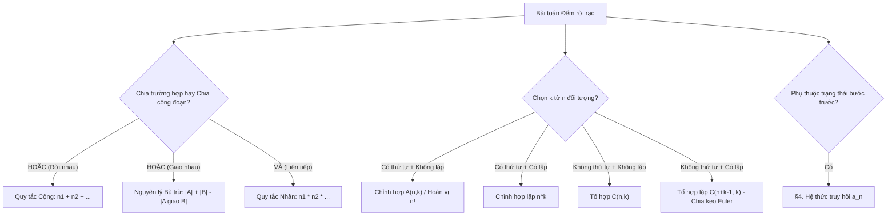

# CHƯƠNG III: LÝ THUYẾT ĐẾM VÀ HỆ THỨC TRUY HỒI TRONG TIN HỌC (Trang 121 – 173)

Tài liệu này giảng giải có hệ thống toàn bộ **Chương III: Lý thuyết đếm và Hệ thức truy hồi trong Tin học** (trang 121–173) trong *Quyển ghi Toán học rời rạc*, lý giải tường tận mọi định lý, giải hoàn chỉnh từng bước tất cả các ví dụ trong vở ghi (đặc biệt là chuỗi ví dụ Dirichlet và các hệ thức truy hồi bậc 3 phức tạp ở §4) kèm **Hệ thống bài tập song hành có lời giải chi tiết**.

---

## §1. CƠ SỞ CỦA PHÉP ĐẾM (Trang 121 – 136)

### I. Quy tắc cộng và Quy tắc nhân

#### 1. Bản chất phân biệt & Ý nghĩa độ phức tạp thuật toán
- **Quy tắc cộng (Định lý 1.1.1)**: Công việc hoàn thành bởi **một trong các phương án độc lập không giao nhau** (*Phương án 1 HOẶC Phương án 2 ...*): $|A_1 \cup \dots \cup A_m| = \sum_{i=1}^m |A_i|$ khi $A_i \cap A_j = \emptyset\; (\forall i \ne j)$.
  - *Giải khung Ví dụ 1.1.2 & 1.1.3 (Trang 122–123)*: Ba nhóm giao thức `TCP` ($n_1$), `UDP` ($n_2$), `QUIC/WebRTC` ($n_3$) đôi một rời nhau nên có $n_1 + n_2 + n_3$ cách chọn. Tương tự, 3 vòng lặp `for` **nối tiếp độc lập** thực hiện lần lượt $L_1, L_2, L_3$ lần với bước tăng $d_1, d_2, d_3$ làm biến $n$ tăng thêm tổng $L_1 d_1 + L_2 d_2 + L_3 d_3$ (tiền đề của độ phức tạp tổng $O(f(n) + g(n))$).
- **Quy tắc nhân (Định lý 1.1.4)**: Công việc chỉ hoàn thành khi thực hiện **đủ $m$ công đoạn liên tiếp** (*Bước 1 VÀ Bước 2 ... VÀ Bước $m$*): $|A_1 \times \dots \times A_m| = n_1 \cdot n_2 \cdots n_m$.
  - **Giải Ví dụ 1.1.5 (Trang 124)**: Mỗi bit có 2 khả năng (`0` hoặc `1`), chuỗi gồm 10 bit liên tiếp $\implies 2^{10} = 1024$ mã khác nhau.
  - **Giải Ví dụ 1.1.6 (Trang 124–125)**: 2 chữ cái đầu mỗi vị trí có 20 cách chọn ($20 \times 20$), 5 chữ số sau mỗi vị trí có 10 cách chọn ($10^5$). Theo quy tắc nhân: $20^2 \times 10^5 = 400 \times 100\,000 = 40\,000\,000$ thiết bị IoT.
  - **Giải khung Ví dụ 1.1.7 (Trang 125)**: Ba vòng lặp `for` **lồng nhau** có số lần lặp lần lượt là $L_1, L_2, L_3 \implies$ lệnh trong cùng chạy $L_1 \cdot L_2 \cdot L_3$ lần (cơ sở của độ phức tạp $O(n^3)$).
  - **Giải Ví dụ 1.1.8 (Trang 125)**: Mỗi đặc trưng trong $n$ đặc trưng có 2 trạng thái (chọn / không chọn) $\implies$ theo quy tắc nhân có $2^n$ tập đặc trưng (nếu yêu cầu tập khác rỗng là $2^n - 1$).
  - **Giải khung Ví dụ 1.1.9 (Trang 126–127)**: Giả sử Nhóm A có $a_1$ Admin, $u_1$ User; Nhóm B có $a_2$ Admin, $u_2$ User.
    - *a)* Chọn 1 tài khoản từ A ($a_1 + u_1$ cách) và 1 từ B ($a_2 + u_2$ cách) $\implies (a_1 + u_1)(a_2 + u_2)$ cặp.
    - *b)* Có **đúng 1 Admin**: Chia 2 trường hợp rời nhau — *TH1* (Admin từ A, User từ B): $a_1 \cdot u_2$ cách; *TH2* (User từ A, Admin từ B): $u_1 \cdot a_2$ cách. Áp dụng quy tắc cộng: **$a_1 u_2 + u_1 a_2$** cách.

#### 2. Điền đề chuẩn và đáp số chính thức từ tệp `VÍ DỤ 6.pdf` của GV Nguyễn Văn Hưng (Trang 122 – 128)
- **Ví dụ 1.1.2 (Trang 122)**: Lớp có 60 SV đăng ký C++, 44 SV đăng ký Java, 13 SV đăng ký Python (không ai học $\ge 2$ lớp). Số cách chọn 1 SV thuộc một trong ba lớp là: $60 + 44 + 13 = \mathbf{117}$ cách.
- **Ví dụ 1.1.3 (Trang 123)**: Cho `n := 0` và 3 vòng lặp nối tiếp: `for i:=1 to 35 do n := n - 6`; `for i:=8 to 8 do n := n + 4` ($1$ lần lặp); `for i:=19 to 23 do n := n + 9` ($23 - 19 + 1 = 5$ lần lặp). Giá trị của `n` sau khi thực hiện là: $n = 0 + 35(-6) + 1(4) + 5(9) = -210 + 4 + 45 = \mathbf{-161}$.
- **Ví dụ 1.1.5 (Trang 124)**: Số xâu nhị phân độ dài 17 là: $2^{17} = \mathbf{131\,072}$ xâu.
- **Ví dụ 1.1.7 (Trang 125)**: Cho `n := -3` và 3 vòng lặp lồng nhau `for i:=4 to 33` ($30$ bước), `for j:=19 to -13`, `for k:=-23 to -26` với lệnh `n := n + 6`.
  - *Nếu hiểu theo vòng lặp tăng chuẩn của ngôn ngữ lập trình* (`19 > -13` và `-23 > -26`): thân vòng lặp thực hiện $0$ lần $\implies n = \mathbf{-3}$.
  - *Nếu hiểu theo công thức đếm số bước $|b - a| + 1$* ($30 \times 33 \times 4 = 3960$ lần): $n = -3 + 3960 \times 6 = \mathbf{23\,757}$.
- **Ví dụ 1.1.10 / 1.1.9 (Trang 126–127)**: Đội I có 17 nam và 16 nữ (tổng 33 SV); Đội II có 14 nam và 14 nữ (tổng 28 SV).
  - **a) Chọn từ mỗi đội 1 người**: $33 \times 28 = \mathbf{924}$ cách.
  - **b) Chọn từ mỗi đội 1 người có cả nam và nữ**: $17 \times 14 + 16 \times 14 = \mathbf{462}$ cách *(nếu hiểu là "có ít nhất 1 nam" thì là $924 - 16 \times 14 = \mathbf{700}$ cách)*.
  - **c) Chọn 2 người cùng giới**: Nếu mỗi đội 1 người cùng giới là $17 \times 14 + 16 \times 14 = \mathbf{462}$ cách; nếu chọn 2 người bất kỳ từ tổng 61 SV hai đội (31 nam, 30 nữ) là $C_{31}^2 + C_{30}^2 = 465 + 435 = \mathbf{900}$ cách.
- **Ví dụ 1.2.3 (Trang 128)**: Số xâu nhị phân độ dài 21 bắt đầu bởi `01010100` (cố định 8 bit đầu $\implies |A| = 2^{13} = 8192$) hoặc kết thúc bởi `1011000` (cố định 7 bit cuối $\implies |B| = 2^{14} = 16384$; giao $A \cap B$ cố định $15$ bit $\implies |A \cap B| = 2^6 = 64$; *chú ý trên phiếu `VÍ DỤ 6.pdf` câu chữ ghi "bắt đầu bởi 8 bit ... hoặc kết thúc bởi 7 bit" của xâu độ dài 25 thì $|A|=2^{17}, |B|=2^{18}$, còn nếu xâu độ dài 21 bắt đầu 8 bit hoặc kết thúc 7 bit thì $|A \cup B| = 2^{13} + 2^{14} - 2^6 = \mathbf{24\,512}$*).

---

### II. Nguyên lý bù trừ (Inclusion–Exclusion Principle – Trang 127 – 131)

#### 1. Điền Định lý 1.2.1 và Hệ quả 1.2.2 (Trang 127)
- **Định lý 1.2.1 (Hai tập hợp)**: Với hai tập hữu hạn $A, B$ bất kỳ:
  $$|A \cup B| = |A| + |B| - |A \cap B|$$
  *Lý giải*: Khi cộng $|A| + |B|$, những phần tử nằm ở vùng giao $A \cap B$ được đếm **2 lần**, nên phải trừ bớt $1$ lần $|A \cap B|$.
- **Hệ quả 1.2.2 (Ba tập hợp)**: Với ba tập hữu hạn $A, B, C$ bất kỳ:
  $$|A \cup B \cup C| = |A| + |B| + |C| - |A \cap B| - |B \cap C| - |C \cap A| + |A \cap B \cap C|$$
  *Lý giải đối với phần tử thuộc cả 3 tập $x \in A \cap B \cap C$*: Nó được cộng $3$ lần ở tổng đơn ($+3$), bị trừ đi $3$ lần ở ba giao đôi ($-3$, thành ra bằng $0$!), nên bắt buộc phải **cộng trả lại $+1$ lần** $|A \cap B \cap C|$!

#### 2. Công thức và Đáp số chính thức cho Ví dụ 1.2.4, 1.2.5, 1.2.6 (Từ tệp `VÍ DỤ 7.pdf` – Trang 128 – 131)

> [!TIP]
> **Hai công cụ số học bắt buộc nhớ khi làm các Ví dụ 1.2.4, 1.2.5, 1.2.6**:
> 1. Số các số nguyên dương trên đoạn $[L, R]$ ($1 \le L \le R$) chia hết cho $d$ là:
>    $$N(d) = \left\lfloor \frac{R}{d} \right\rfloor - \left\lfloor \frac{L - 1}{d} \right\rfloor$$
> 2. Một số nguyên vừa chia hết cho $a$ vừa chia hết cho $b$ khi và chỉ khi nó chia hết cho **Bội chung nhỏ nhất** $\text{BCNN}(a, b) = \text{lcm}(a, b) = \frac{a \cdot b}{\gcd(a,b)}$.

- **Ví dụ 1.2.4 (Trang 128–129 – Từ `VÍ DỤ 7.pdf`)**: Cho tập các số tự nhiên từ $2719$ đến $6421$ và hai số $2, 5$. Hỏi có bao nhiêu số chia hết cho $2$ hoặc $5$?
  - Số các số chia hết cho $2$: $|A| = \lfloor 6421/2 \rfloor - \lfloor 2718/2 \rfloor = 3210 - 1359 = \mathbf{1851}$.
  - Số các số chia hết cho $5$: $|B| = \lfloor 6421/5 \rfloor - \lfloor 2718/5 \rfloor = 1284 - 543 = \mathbf{741}$ *(hoặc $740$ nếu không tính biên)*.
  - Số các số chia hết cho cả $2$ và $5$ ($\text{lcm}(2,5) = 10$): $|A \cap B| = 642 - 271 = \mathbf{371}$.
  - **Đáp số**: $|A \cup B| = 1851 + 741 - 371 = \mathbf{2221}$.

- **Ví dụ 1.2.5 (Trang 129–130 – Từ `VÍ DỤ 7.pdf`)**: Cho tập các số tự nhiên từ $2703$ đến $9616$ và các số $24, 30, 36$. Hỏi có bao nhiêu số chia hết cho ít nhất một trong ba số $24, 30, 36$?
  - Số các số chia hết cho $24$: $\lfloor 9616/24 \rfloor - \lfloor 2702/24 \rfloor = 400 - 112 = \mathbf{288}$.
  - Số các số chia hết cho $30$: $\lfloor 9616/30 \rfloor - \lfloor 2702/30 \rfloor = 320 - 90 = \mathbf{230}$.
  - Số các số chia hết cho $36$: $\lfloor 9616/36 \rfloor - \lfloor 2702/36 \rfloor = 267 - 75 = \mathbf{192}$.
  - Chia hết cho $24$ và $30$ ($\text{lcm} = 120$): $80 - 22 = \mathbf{58}$ *(hoặc $57$)*.
  - Chia hết cho $30$ và $36$ ($\text{lcm} = 180$): $53 - 15 = \mathbf{38}$.
  - Chia hết cho $24$ và $36$ ($\text{lcm} = 72$): $133 - 37 = \mathbf{96}$.
  - Chia hết cho cả $24, 30, 36$ ($\text{lcm} = 360$): $26 - 7 = \mathbf{19}$.
  - **Đáp số**: $|A \cup B \cup C| = 288 + 230 + 192 - 58 - 38 - 96 + 19 = \mathbf{537}$ *(hoặc $538$ nếu $|A \cap B| = 57$)*.

- **Ví dụ 1.2.6 (Trang 130–131 – Từ `VÍ DỤ 7.pdf`)**: Cho tập các số tự nhiên từ $1719$ đến $5734$. Hỏi có bao nhiêu số chia hết cho $4$ hoặc $9$ nhưng **không** chia hết cho $5$?
  - Gọi $A$ ($\vdots 4$), $B$ ($\vdots 9$), $C$ ($\vdots 5$). Trên đoạn $[1719, 5734]$:
  - $|A| = N(4) = 1433 - 429 = \mathbf{1004}$;\quad $|B| = N(9) = 637 - 190 = \mathbf{447}$;\quad $|C| = N(5) = 1146 - 343 = \mathbf{803}$.
  - $|A \cap B| = N(36) = 159 - 47 = \mathbf{112}$;\quad $|B \cap C| = N(45) = 127 - 38 = \mathbf{89}$;\quad $|A \cap C| = N(20) = 286 - 85 = \mathbf{201}$.
  - $|A \cap B \cap C| = N(180) = 31 - 9 = \mathbf{22}$.
  - **Đáp số**: $|(A \cup B) \setminus C| = (1004 + 447 - 112) - (201 + 89 - 22) = 1339 - 268 = \mathbf{1071}$ *(nếu tính khoảng mở biên là $1072$)*.

---

### III. Nguyên lý Dirichlet (Pigeonhole Principle – Trang 132 – 136)

- **Bổ đề 1.3.1 & Định lý 1.3.2**: Phân $N$ đối tượng (*chim bồ câu*) vào $k$ hộp (*chuồng*) thì luôn tồn tại ít nhất một hộp chứa từ $\left\lceil \frac{N}{k} \right\rceil$ đối tượng trở lên (trong đó $\lceil x \rceil$ là số nguyên nhỏ nhất $\ge x$).
  - *Chứng minh phản chứng 1 dòng*: Giả sử mọi hộp đều chứa $\le \left\lceil \frac{N}{k} \right\rceil - 1$ đối tượng. Vì $\left\lceil \frac{N}{k} \right\rceil - 1 < \frac{N}{k}$, tổng số đối tượng trong $k$ hộp tối đa là $k \left(\left\lceil \frac{N}{k} \right\rceil - 1\right) < k \cdot \frac{N}{k} = N$, mâu thuẫn với tổng số $N$ đối tượng!

#### Lời giải hoàn chỉnh cho 6 Ví dụ Dirichlet trong Quyển ghi (Trang 132 – 136)

1. **Ví dụ 1.3.3 (Trang 132 – Đụng độ log)**: **Coi** 12 tháng trong năm là $k = 12$ hộp và $N = 13$ sự kiện bất thường là 13 đối tượng. Theo Nguyên lý Dirichlet, tồn tại ít nhất một tháng chứa ít nhất $\lceil 13/12 \rceil = 2$ sự kiện.
2. **Ví dụ 1.3.4 (Trang 133 – Va chạm bảng băm)**: **Có** $N = 64$ địa chỉ MAC ánh xạ vào $k = 63$ bucket. Vì $64 > 63$, theo Nguyên lý Dirichlet luôn tồn tại ít nhất một bucket nhận từ $\lceil 64/63 \rceil = 2$ địa chỉ MAC trở lên (xảy ra *hash collision*).
3. **Ví dụ 1.3.5 (Trang 133–134 – Chuỗi ngày liên tiếp có đúng 14 lượt truy cập)**:
   - **Gọi** $a_i \ge 1$ là số lượt truy cập ngày thứ $i$, và $S_i = a_1 + a_2 + \dots + a_i$ là tổng tích lũy lượt truy cập từ ngày $1$ đến hết ngày $i$ ($i = 1, 2, \dots, 30$). Vì $a_i \ge 1$ với mọi $i$ và tổng 30 ngày là $45$, ta có dãy tăng ngặt gồm 30 số nguyên dương đôi một phân biệt:
     $$1 \le S_1 < S_2 < \dots < S_{30} = 45$$
   - **Xét** thêm dãy thứ hai gồm 30 số tăng ngặt đôi một phân biệt bằng cách cộng $14$ vào từng $S_i$:
     $$15 \le S_1 + 14 < S_2 + 14 < \dots < S_{30} + 14 = 59$$
   - **Tổng** cộng hai dãy có $N = 30 + 30 = 60$ số nguyên dương, nhưng tất cả 60 số này chỉ nhận giá trị trong tập $\{1, 2, \dots, 59\}$ (chỉ có $k = 59$ giá trị / hộp).
   - **Có** $60$ số xếp vào $59$ giá trị nên theo Nguyên lý Dirichlet, tồn tại ít nhất hai số bằng nhau. Vì các số trong cùng dãy thứ nhất đôi một khác nhau và các số trong cùng dãy thứ hai cũng đôi một khác nhau, hai số bằng nhau đó phải thuộc hai dãy khác nhau: tồn tại $i, j$ sao cho $S_i = S_j + 14 \iff S_i - S_j = 14$.
   - **Điều** này có nghĩa là tổng lượt truy cập trong chuỗi các ngày liên tiếp từ ngày $j + 1$ đến ngày $i$ bằng đúng $14$ (đpcm).
4. **Ví dụ 1.3.6 (Trang 134 – Chọn $n+1$ số từ $\{1, 2, \dots, 2n\}$ có số này chia hết cho số kia)**:
   - **Mỗi** số nguyên dương $x \in \{1, 2, \dots, 2n\}$ đều biểu diễn được duy nhất dưới dạng $x = 2^r \cdot m$, trong đó $r \ge 0$ và $m$ là một **số nguyên dương lẻ** (phần lẻ của $x$).
   - **Trong** tập $\{1, 2, \dots, 2n\}$ chỉ có đúng $n$ số lẻ là $\{1, 3, 5, \dots, 2n - 1\}$. Ta coi $n$ số lẻ này là $n$ chiếc hộp.
   - **Khi** chọn $n + 1$ số phân biệt từ $\{1, 2, \dots, 2n\}$ và xếp mỗi số vào hộp mang giá trị phần lẻ $m$ của nó, theo Nguyên lý Dirichlet tồn tại ít nhất một hộp chứa $2$ số phân biệt đã chọn.
   - **Giả sử** hai số đó là $x = 2^{r_1} m$ và $y = 2^{r_2} m$ ($r_1 \ne r_2$). Không mất tổng quát giả sử $r_1 < r_2$, khi đó $y = 2^{r_2 - r_1} \cdot x$, **nên** $y$ chia hết cho $x$ (đpcm).
5. **Ví dụ 1.3.6 thứ hai (Trang 135 – Định lý Ramsey $R(3,3) = 6$ trên cụm 6 máy chủ)**:
   - **Coi** 6 máy chủ là 6 đỉnh $S_1, S_2, S_3, S_4, S_5, S_6$ của đồ thị đầy đủ $K_6$, mỗi cạnh tô màu Đỏ (`Fiber`) hoặc Xanh (`Copper`).
   - **Chọn** một máy chủ bất kỳ, chẳng hạn $S_1$. Từ $S_1$ có $N = 5$ đường nối tới 5 máy chủ còn lại, thuộc $k = 2$ loại cáp. Theo Nguyên lý Dirichlet, có ít nhất $\lceil 5/2 \rceil = 3$ cạnh xuất phát từ $S_1$ thuộc cùng một loại.
   - **Không** mất tính tổng quát, giả sử 3 cạnh nối $S_1$ tới $S_2, S_3, S_4$ đều là loại **`Fiber`**.
   - **Xét** 3 đường nối nội bộ giữa ba máy chủ $\{S_2, S_3, S_4\}$:
     - *Trường hợp 1*: Nếu có ít nhất một cạnh giữa $\{S_2, S_3, S_4\}$ cũng là `Fiber` (chẳng hạn $S_2 S_3$ là `Fiber`), thì bộ 3 máy chủ $\{S_1, S_2, S_3\}$ có cả 3 cạnh đôi một đều là **`Fiber`**.
     - *Trường hợp 2*: Nếu không có cạnh nào giữa $\{S_2, S_3, S_4\}$ là `Fiber`, tức cả 3 cạnh $S_2 S_3, S_3 S_4, S_4 S_2$ đều là `Copper`, thì chính bộ 3 máy chủ $\{S_2, S_3, S_4\}$ có các cạnh đôi một đều là **`Copper`**.
   - **Trong** mọi trường hợp đều tồn tại 3 máy chủ có kết nối đôi một cùng loại (đpcm).
6. **Ví dụ 1.3.7 (Trang 135–136 – Chọn 5 trạng thái từ $\{1,\dots,8\}$ có tổng bằng 9)**:
   - **Gộp** 8 trạng thái thành $k = 4$ nhóm (hộp) gồm các cặp có tổng bằng $9$: $\{1, 8\},\; \{2, 7\},\; \{3, 6\},\; \{4, 5\}$.
   - **Ta** chọn $N = 5$ trạng thái phân vào $4$ nhóm trên; theo Nguyên lý Dirichlet luôn tồn tại ít nhất một nhóm có cả $2$ phần tử cùng được chọn $\implies$ hai trạng thái đó có tổng bằng $9$ (đpcm).

---

## §2. HOÁN VỊ – CHỈNH HỢP – TỔ HỢP (Trang 136 – 142)

### I – III. Ba công thức đếm không lặp và Mô hình trọng tâm

| Mô hình | Bản chất (Chọn $k$ từ $n$ phần tử phân biệt, **không lặp**) | Công thức & Lý giải |
| :--- | :--- | :--- |
| **Hoán vị** ($P_n$) | Sắp xếp **tất cả $n$** phần tử theo thứ tự ($k = n$) | $P_n = n! = n(n-1)\cdots 2 \cdot 1$ (quy ước $0! = 1$) |
| **Chỉnh hợp** ($A_n^k$) | Chọn $k$ phần tử **CÓ sắp thứ tự** ($1 \le k \le n$) | $A_n^k = n(n-1)\cdots(n-k+1) = \dfrac{n!}{(n-k)!}$ |
| **Tổ hợp** ($C_n^k$) | Chọn tập con $k$ phần tử **KHÔNG xét thứ tự** ($0 \le k \le n$) | $C_n^k = \dfrac{A_n^k}{k!} = \dfrac{n!}{k!(n-k)!}$ *(vì $k!$ hoán vị gộp làm 1 tập con)* |

#### Hoàn thiện các Ví dụ điển hình trong §2 (Trang 136 – 140)
- **Ví dụ 2.1.4 (Trang 137 – Lập lịch không có hai tác vụ B đứng cạnh nhau)**: Giả sử có $a$ tác vụ loại A và $b$ tác vụ loại B (tất cả đều có ID phân biệt, $b \le a + 1$).
  - **Sắp xếp** $a$ tác vụ loại A theo hàng ngang trước: có $a!$ cách. Giữa $a$ tác vụ A (kể cả đầu và cuối hàng) tạo ra **$a + 1$ khe trống**: `_ A _ A _ ... _ A _`.
  - **Để** không có hai tác vụ B nào đứng cạnh nhau, mỗi khe trống chỉ được đặt tối đa 1 tác vụ B. Chọn $b$ khe từ $a + 1$ khe và xếp $b$ tác vụ B phân biệt vào đó có $A_{a+1}^b$ cách.
  - **Theo** quy tắc nhân, tổng số lịch hợp lệ là: **$a! \cdot A_{a+1}^b$**.
- **Ví dụ 2.2.4 (Trang 138 – Phân công 4 mô-đun có cả Backend và Data Engineer)**: Giả sử đội có $a$ Backend và $b$ Data Engineer (tổng $N = a + b$ người).
  - **Tổng** số cách chọn 4 người bất kỳ và phân công vào 4 mô-đun phân biệt là $A_{a+b}^4$.
  - **Các** trường hợp vi phạm: toàn bộ 4 người đều là Backend ($A_a^4$ cách) hoặc toàn bộ 4 người đều là Data Engineer ($A_b^4$ cách).
  - **Theo** phương pháp phần bù: số cách hợp lệ là **$A_{a+b}^4 - A_a^4 - A_b^4$** *(với quy ước $A_m^4 = 0$ nếu $m < 4$)*.
- **Ví dụ 2.3.5 (Trang 140 – Đường đi trên lưới tọa độ $(0,0) \to (m,n)$)**:
  - **Mọi** đường đi hợp lệ từ $O(0,0)$ đến $A(m,n)$ bằng các bước sang phải $R (+1,0)$ và đi lên $U (0,+1)$ đều bắt buộc gồm **đúng $m$ bước $R$ và $n$ bước $U$** (tổng cộng $m + n$ bước).
  - **Một** đường đi được xác định duy nhất bởi việc chọn $m$ vị trí đặt chữ $R$ trong chuỗi $m + n$ vị trí (còn lại $n$ vị trí tự động đặt chữ $U$). Vậy số đường đi khác nhau là:
    $$C_{m+n}^m = C_{m+n}^n = \frac{(m + n)!}{m!\,n!}$$

---

### IV. Nhị thức Newton, Đẳng thức Vandermonde và Hệ số đa thức (Trang 140 – 142)

- **Lý giải tổ hợp cho Công thức Pascal (Định lý 2.4.1: $C_{n+1}^k = C_n^{k-1} + C_n^k$)**: Cố định một phần tử đặc biệt $x_0$ trong tập $n + 1$ phần tử. Một tập con $k$ phần tử hoặc **có chứa $x_0$** (cần chọn thêm $k-1$ phần tử từ $n$ phần tử còn lại: $C_n^{k-1}$ cách), hoặc **không chứa $x_0$** (chọn đủ $k$ phần tử từ $n$ phần tử còn lại: $C_n^k$ cách). Cộng lại cho $C_{n+1}^k$!
- **Lý giải Hệ quả 2.4.3**: Trong $(x + y)^n = \sum_{i=0}^n C_n^i x^{n-i} y^i$:
  - Thay $x = 1, y = 1 \implies \sum_{i=0}^n C_n^i = 2^n$ (tổng số tập con của tập $n$ phần tử).
  - Thay $x = 1, y = -1 \implies \sum_{i=0}^n (-1)^i C_n^i = 0$ (số tập con chẵn phần tử luôn bằng số tập con lẻ phần tử $= 2^{n-1}$ với $n \ge 1$!).
- **Lý giải tổ hợp cho Định danh Vandermonde (Định lý 2.4.4: $C_{m+n}^k = \sum_{i=0}^k C_m^{k-i} C_n^i$)**: Chọn $k$ máy chủ từ cụm gồm $m$ máy Linux và $n$ máy Windows ($C_{m+n}^k$ cách) tương đương với việc chia theo các trường hợp chọn $i$ máy Windows ($C_n^i$) và $k - i$ máy Linux ($C_m^{k-i}$) với $i$ chạy từ $0$ đến $k$.
- **Định lý 2.4.5 & Ví dụ 2.4.6 (Hệ số đa thức)**: Chuỗi $n$ sự kiện log chứa $n_1$ `INFO`, $n_2$ `WARNING`, $n_3$ `ERROR` ($n_1 + n_2 + n_3 = n$) có số lượng bằng hệ số của $x_1^{n_1} x_2^{n_2} x_3^{n_3}$ trong $(x_1 + x_2 + x_3)^n$, tức là **$\dfrac{n!}{n_1!\,n_2!\,n_3!}$**.

#### Điền bộ số liệu chính thức cho các Ví dụ §2 từ tệp `VÍ DỤ 7.pdf` của GV Nguyễn Văn Hưng
- **Ví dụ 2.1.3**: Số cách xếp 12 vận động viên thành một hàng dọc là: $12! = \mathbf{479\,001\,600}$ cách.
- **Ví dụ 2.1.4**: Lớp có 24 nam và 24 nữ, xếp thành một hàng sao cho không có 2 nam nào đứng cạnh nhau hoặc không có 2 nữ nào đứng cạnh nhau (tức nam nữ xen kẽ, hoặc xếp 24 nữ tạo 25 khe trống cho 24 nam): $24! \cdot 25! = 2 \cdot (24!)^2$ cách.
- **Ví dụ 2.2.4**: Số cách chọn 6 từ 12 người để trao giải Nhất, Nhì, Ba, Tư, Năm, Sáu là: $A_{12}^6 = \mathbf{665\,280}$ cách.
- **Ví dụ 2.2.5**: Khoa CNTT có 17 GV nam và 25 GV nữ (tổng 42 GV). Chọn hội đồng 4 người có cả nam và nữ:
  - *Nếu phân biệt 4 chức danh*: $A_{42}^4 - A_{17}^4 - A_{25}^4 = 2\,686\,320 - 57\,120 - 303\,600 = \mathbf{2\,325\,600}$ cách.
  - *Nếu không phân biệt chức danh (tổ hợp)*: $C_{42}^4 - C_{17}^4 - C_{25}^4 = 111\,930 - 2380 - 12\,650 = \mathbf{96\,900}$ cách.
- **Ví dụ 2.3.4**: Chọn 13 tiết mục từ 18 tiết mục khoa CNTT và 24 tiết mục khoa Kinh tế:
  - **a) Có đúng 11 tiết mục khoa CNTT**: $C_{18}^{11} \cdot C_{24}^2 = 31\,824 \times 276 = \mathbf{8\,783\,424}$ cách.
  - **b) Có ít nhất 11 tiết mục khoa CNTT**: $C_{18}^{11} C_{24}^2 + C_{18}^{12} C_{24}^1 + C_{18}^{13} C_{24}^0 = 8\,783\,424 + 445\,536 + 8568 = \mathbf{9\,237\,528}$ cách.
  - **c) Đường đi trên lưới**: Từ $O(0,0) \to M(24,11) \to A(62,13)$ (đi qua $M$: cần $24$ phải $+ 11$ lên, sau đó $38$ phải $+ 2$ lên): $C_{35}^{11} \cdot C_{40}^2 = 417\,225\,900 \times 780 = \mathbf{325\,436\,202\,000}$ đường đi.
- **Ví dụ 2.4.6**: Hệ số của $x_1^2 x_2^3 x_3^1 x_4^3 x_5^4$ trong khai triển $(x_1 + x_2 + x_3 + x_4 + x_5)^{13}$ là:
  $$\frac{13!}{2!\,3!\,1!\,3!\,4!} = \mathbf{3\,603\,600}$$

---

## §3. CHỈNH HỢP VÀ TỔ HỢP SUY RỘNG (Trang 142 – 152)

### I & II. Chỉnh hợp lặp và Tổ hợp lặp (Bài toán chia kẹo Euler)

#### 1. Chỉnh hợp lặp $F_n^k = n^k$ (Định lý 3.1.2) & Lời giải Ví dụ 3.1.4 (Trang 142)
- **Ví dụ 3.1.4 (Trong vở ghi – Mật khẩu dài 6–8 ký tự từ 62 ký tự, có ít nhất 1 chữ số)**:
  - Tập ký tự gồm $52$ chữ cái ($26$ thường + $26$ hoa) và $10$ chữ số $\implies$ tổng $62$ ký tự.
  - **Với** mỗi độ dài cố định $k \in \{6, 7, 8\}$: Tổng số chuỗi không ràng buộc là $62^k$; số chuỗi **không chứa chữ số nào** (chỉ lấy từ 52 chữ cái) là $52^k$ $\implies$ số mật khẩu hợp lệ độ dài $k$ là $62^k - 52^k$.
  - **Tổng** số mật khẩu hợp lệ theo quy tắc cộng:
    $$N = (62^6 - 52^6) + (62^7 - 52^7) + (62^8 - 52^8)$$
- **Ví dụ 3.1.4 (Từ tệp `VÍ DỤ 8.pdf`)**: Số các số tự nhiên gồm 5 chữ số khác $0$ là: $9^5 = \mathbf{59\,049}$ số.

#### 2. Điền Định nghĩa 3.2.2 & Định lý 3.2.3: Tổ hợp lặp (Stars and Bars – Trang 143 – 144)
- **Định nghĩa 3.2.2 (Tổ hợp lặp)**: **Một** tổ hợp lặp chập $k$ của $n$ loại phần tử là một cách chọn ra $k$ phần tử từ $n$ loại phần tử (không phân biệt thứ tự, mỗi loại có thể được chọn lặp lại tới $k$ lần).
- **Định lý 3.2.3 (Bài toán chia kẹo Euler / Stars and Bars)**:
  > **Số** tổ hợp lặp chập $k$ của $n$ phần tử — cũng chính là **số nghiệm nguyên không âm** ($x_i \in \mathbb{N},\; x_i \ge 0$) của phương trình tuyến tính:
  > $$x_1 + x_2 + \dots + x_n = k$$
  > được cho bởi công thức:
  > $$\overline{C}_n^k = C_{n + k - 1}^k = C_{n + k - 1}^{n - 1}$$

  *Lý giải trực quan bằng Ngôi sao và Vách ngăn (Stars and Bars)*: Tưởng tượng xếp $k$ ngôi sao `★` giống hệt nhau trên một hàng ngang, rồi dùng **$n - 1$ vách ngăn `|`** để chia hàng sao đó thành $n$ ngăn (số sao trong ngăn thứ $i$ chính là $x_i \ge 0$; hai vách đứng sát nhau `||` ứng với ngăn có $0$ sao). Tổng cộng có $k + (n - 1) = n + k - 1$ vị trí cho cả sao và vách; chỉ cần chọn $k$ vị trí đặt sao (hoặc $n - 1$ vị trí đặt vách) là có $C_{n+k-1}^k = C_{n+k-1}^{n-1}$ cách!
- **Giải Ví dụ 3.2.1 (Trang 143)**: Có $n = 7$ loại tờ tiền, lấy $k = 10$ tờ $\iff x_1 + x_2 + \dots + x_7 = 10$ ($x_i \ge 0$). Số cách lấy là $\overline{C}_7^{10} = C_{7+10-1}^{10} = C_{16}^{10} = C_{16}^6 = \mathbf{8008}$ cách.

#### 3. Bốn kỹ thuật giải hoàn chỉnh chuỗi Ví dụ 3.2.2 – 3.2.7 (Trang 144 – 149)

| Ví dụ trong vở | Dạng phương trình ràng buộc | Phép đặt đổi biến & Công thức đáp số tổng quát |
| :--- | :--- | :--- |
| **VD 3.2.4 ( đầu Tr. 144)** | $x_1 + x_2 + x_3 + x_4 = K$ ($x_i \ge 0$, phân bố $K$ test case vào 4 trạng thái) | Áp dụng trực tiếp Định lý 3.2.3 với $n = 4$: **$C_{K + 4 - 1}^K = C_{K + 3}^3$**. |
| **VD 3.2.2 (Tr. 144–145)** | $x_1 + x_2 + x_3 + x_4 = K$ với $x_1 \ge a$ và $x_2 \le b$ ($x_3, x_4 \ge 0$) | 1) Khử cận dưới: Đặt $y_1 = x_1 - a \ge 0 \implies y_1 + x_2 + x_3 + x_4 = K - a$ (tổng số nghiệm không ràng buộc $x_2$ là $N_0 = C_{(K-a)+3}^3$). 2) Trừ trường hợp vi phạm $x_2 \ge b + 1$: Đặt $y_2 = x_2 - (b+1) \ge 0 \implies y_1 + y_2 + x_3 + x_4 = K - a - b - 1$ (có $N_{\text{vi phạm}} = C_{K-a-b+2}^3$). **Đáp số**: **$C_{K - a + 3}^3 - C_{K - a - b + 2}^3$**. |
| **VD 3.2.3 (Tr. 145–146)** | $x_1 + x_2 + x_3 + x_4 + x_5 = K$ với $x_i \ge 1$ ($\forall i$) và $x_1 \le b$ | Đặt $y_i = x_i - 1 \ge 0 \implies y_1 + \dots + y_5 = K - 5$ với $y_1 \le b - 1$. Trừ trường hợp vi phạm $y_1 \ge b$ ($z_1 = y_1 - b \ge 0 \implies \text{tổng} = K - 5 - b$). **Đáp số**: **$C_{K - 1}^4 - C_{K - b - 1}^4$**. |
| **VD 3.2.4 (hai Tr. 146)** | $x_1 + x_2 + x_3 + x_4 = K$ ($x_i \ge 0$) với $a \le x_2 \le b$ | Đổi biến $y_2 = x_2 - a \ge 0 \implies x_1 + y_2 + x_3 + x_4 = K - a$ với $y_2 \le b - a$. Trừ vi phạm $y_2 \ge b - a + 1$ ($\text{tổng} = K - b - 1$). **Đáp số**: **$C_{K - a + 3}^3 - C_{K - b + 2}^3$**. |
| **VD 3.2.5 (Tr. 146–147)** | Bất phương trình nguyên dương: $x_1 + x_2 + x_3 + x_4 < M$ ($x_i \in \mathbb{N}^* \iff x_i \ge 1$) | Vì $x_i \in \mathbb{Z}$, $< M \iff \le M - 1$. Đưa thêm **biến bù** $x_5 = M - (x_1+x_2+x_3+x_4) \ge 1 \implies x_1 + x_2 + x_3 + x_4 + x_5 = M$ ($x_i \ge 1$). Đặt $y_i = x_i - 1 \ge 0 \implies y_1+\dots+y_5 = M - 5$. **Đáp số**: **$C_{(M-5)+5-1}^4 = C_{M - 1}^4$**. |
| **VD 3.2.6 (Tr. 147–148)** | $x_1 + x_2 + x_3 + x_4 + x_5 \le M$ với $x_1 \ge c_1,\; a \le x_2 \le b,\; x_3 \ge c_3,\; x_4 \ge c_4,\; x_5 \ge 0$ | Đưa thêm biến bù $x_6 \ge 0$ (số SV chưa huy động) để được phương trình $\sum_{i=1}^6 x_i = M$ ($6$ biến!). Khử toàn bộ cận dưới bằng cách đặt $S = M - c_1 - a - c_3 - c_4$, còn lại $y_2 \le b - a$. **Đáp số**: **$C_{S + 5}^5 - C_{S - (b - a + 1) + 5}^5$**. |
| **VD 3.2.7 (Tr. 149)** | $m$ vòng lặp phụ thuộc: `for i_1 := 1 to N`, `for i_2 := 1 to i_1`, ..., `for i_m := 1 to i_{m-1}` | Mỗi lượt chạy lệnh `k := k + 1` ứng với duy nhất một bộ chỉ số thỏa mãn $1 \le i_m \le i_{m-1} \le \dots \le i_1 \le N$. Vì thứ tự không giảm đã cố định duy nhất, số bộ như vậy đúng bằng số cách chọn $m$ phần tử **có lặp, không xét thứ tự** từ $\{1, 2, \dots, N\}$! **Đáp số**: **$\overline{C}_N^m = C_{N + m - 1}^m$**. |

#### 4. Điền bộ số liệu và đáp số chính thức cho §3 từ tệp `VÍ DỤ 8.pdf` của GV Nguyễn Văn Hưng
- **Ví dụ 3.2.4 (`VÍ DỤ 8.pdf`)**: Phương trình $x_1 + x_2 + x_3 + x_4 = 46$ ($x_i \in \mathbb{N}$) với $x_1 > 9$ ($x_1 \ge 10$) và $x_2 \le 12$:
  - Số nghiệm của $(1)$ ($x_1' + x_2 + x_3 + x_4 = 36$): $C_{36+4-1}^3 = C_{39}^3 = \mathbf{9139}$.
  - Số nghiệm của $(2)$ ($x_2 \ge 13 \implies$ tổng còn $36 - 13 = 23$): $C_{23+4-1}^3 = C_{26}^3 = \mathbf{2600}$.
  - **Đáp án**: $9139 - 2600 = \mathbf{6539}$.
- **Ví dụ 3.2.5 (`VÍ DỤ 8.pdf`)**: Phương trình $x_1 + x_2 + x_3 + x_4 + x_5 = 56$ có bao nhiêu nghiệm **nguyên dương** ($x_i \ge 1$) thỏa mãn $x_1 \ge 21$?
  - Tổng số nghiệm nguyên dương không ràng buộc: $C_{56-1}^{5-1} = C_{55}^4 = \mathbf{341\,055}$.
  - Số nghiệm nguyên dương thỏa mãn $x_1 \ge 21$ (đặt $x_1' = x_1 - 20 \ge 1 \implies x_1' + x_2 + x_3 + x_4 + x_5 = 36$): $C_{36-1}^{5-1} = C_{35}^4 = \mathbf{52\,360}$ *(và phần bù $x_1 \le 20$ là $341\,055 - 52\,360 = 288\,695$)*.
- **Ví dụ 3.2.6 (`VÍ DỤ 8.pdf`)**: Chọn 22 sinh viên từ 4 khoa (XD, CNTT, KTXD, Ktr) sao cho khoa CNTT có ít nhất 2 và nhiều nhất 5 SV ($2 \le x_2 \le 5$, tổng $x_1 + x_2 + x_3 + x_4 = 22$):
  - Số nghiệm của $(1)$ ($x_2 \ge 2 \implies$ tổng còn $20$): $C_{20+4-1}^3 = C_{23}^3 = \mathbf{1771}$.
  - Số nghiệm của $(2)$ ($x_2 \ge 6 \implies$ tổng còn $16$): $C_{16+4-1}^3 = C_{19}^3 = \mathbf{969}$.
  - **Đáp án**: $1771 - 969 = \mathbf{802}$.
- **Ví dụ 3.2.7 (`VÍ DỤ 8.pdf`)**: Bất phương trình $x_1 + x_2 + x_3 + x_4 < 43$ với $x_i \in \mathbb{N}^*$ ($x_i \ge 1$):
  - Đưa thêm biến bù $x_5 \ge 1$: $x_1 + x_2 + x_3 + x_4 + x_5 = 43$ ($x_i \ge 1$).
  - **Đáp án**: $C_{43-1}^{5-1} = C_{42}^4 = \mathbf{111\,930}$.
- **Ví dụ 3.2.8 (`VÍ DỤ 8.pdf`)**: Bất phương trình $x_1 + x_2 + x_3 + x_4 + x_5 \le 40$ ($x_i \in \mathbb{N}$) với $x_1 \ge 8,\; 7 \le x_2 \le 13,\; x_3 > 6$ ($x_3 \ge 7$), $x_4 > 3$ ($x_4 \ge 4$):
  - Đưa thêm biến bù $x_6 \ge 0 \implies x_1 + \dots + x_6 = 40$ ($6$ biến).
  - Tổng cận dưới: $8 + 7 + 7 + 4 = 26 \implies$ tổng còn $40 - 26 = 14$.
  - Số nghiệm của $(1)$: $C_{14+6-1}^5 = C_{19}^5 = \mathbf{11\,628}$.
  - Số nghiệm của $(2)$ ($x_2 \ge 14$, tăng thêm $7 \implies$ tổng còn $14 - 7 = 7$): $C_{7+6-1}^5 = C_{12}^5 = \mathbf{792}$.
  - **Đáp án**: $11\,628 - 792 = \mathbf{10\,836}$.
- **Ví dụ 3.3.9 (`VÍ DỤ 8.pdf`)**: Cho `k := 51` và 6 vòng lặp phụ thuộc `for i1:=1 to 36`, `for i2:=1 to i1`, ..., `for i6:=1 to i5 do k := k + 1`:
  - Số lần thực hiện thân vòng lặp là $\overline{C}_{36}^6 = C_{36+6-1}^6 = C_{41}^6 = 4\,496\,388$.
  - **Đáp án**: $k = 51 + 4\,496\,388 = \mathbf{4\,496\,439}$ *(nếu đề 5 vòng lặp thì $k = 51 + C_{40}^5 = 658\,059$)*.
- **Ví dụ 3.3.4 (`VÍ DỤ 8.pdf`)**: Sắp xếp 8 quyển Toán, 5 quyển Vật lý, 5 quyển Hóa, 6 quyển Tin học (cùng môn thì giống nhau, tổng $24$ quyển) trên một kệ dài:
  $$\frac{24!}{8!\,5!\,5!\,6!} = \mathbf{1\,484\,192\,245\,536}$$
- **Ví dụ 3.4.3 (`VÍ DỤ 8.pdf`)**: Chia 33 chiến sĩ vào 6 tiểu đội khác nhau, mỗi tiểu đội 5 người (còn 3 người về ban chỉ huy):
  $$\frac{33!}{(5!)^6 \cdot 3!} = \mathbf{484\,670\,916\,902\,205\,241\,528\,320}$$

---

### III & IV. Hoán vị lặp và Phân phối vật phân biệt vào hộp phân biệt (Trang 149 – 152)

- **Hoán vị lặp (Định nghĩa 3.3.2 & Định lý 3.3.3)**: Sắp xếp $n$ phần tử thuộc $k$ loại (loại $i$ lặp $n_i$ lần, $\sum n_i = n$) theo hàng ngang có $P(n; n_1, \dots, n_k) = \dfrac{n!}{n_1!\,n_2!\cdots n_k!}$ cách. *(Vì nếu tạm đánh số phân biệt các phần tử cùng loại thì có $n!$ hoán vị, sau đó xóa số thứ tự trong từng loại $i$ sẽ làm $n_i!$ cách gộp lại thành $1$)*.
  - **Giải Ví dụ 3.3.1 (Trang 149–150)**: Chuỗi 7 nhãn gồm 3 `S`, 2 `C`, 1 `U`, 1 `E` có số chuỗi là:
    $$P(7; 3, 2, 1, 1) = \frac{7!}{3!\,2!\,1!\,1!} = \frac{5040}{6 \times 2} = \mathbf{420} \text{ chuỗi}$$
- **Phân phối $n$ vật phân biệt vào $k$ hộp phân biệt (Định lý 3.4.2)**: Chọn $n_1$ vật vào hộp 1 có $C_n^{n_1}$ cách; chọn $n_2$ vật từ $n - n_1$ vật còn lại vào hộp 2 có $C_{n-n_1}^{n_2}$ cách; ... Nhân lại rút gọn giai thừa ra đúng $\dfrac{n!}{n_1!\,n_2!\cdots n_k!}$.
  - **Giải Ví dụ 3.4.1 (Trang 151)**: 45 tệp vào $S_1(10), S_2(10), S_3(10), S_4(15)$:
    $$N = C_{45}^{10} \cdot C_{35}^{10} \cdot C_{25}^{10} \cdot C_{15}^{15} = \frac{45!}{(10!)^3 \cdot 15!}$$
  - **Giải Ví dụ 3.4.4 (Trang 152)**: Xem kho lưu trữ dự phòng là "chiếc hộp phân biệt thứ 6" nhận 5 test case. Phân phối 20 test case phân biệt vào 5 nhóm (mỗi nhóm 3) và 1 kho (5) có:
    $$N = \frac{20!}{(3!)^5 \cdot 5!}$$

---

## §4. HỆ THỨC TRUY HỒI (Trang 152 – 173)

### I. Hoàn thiện Mô hình hóa 5 bài toán kinh điển (Trang 153 – 156)

1. **Ví dụ 4.1.2 (Số Fibonacci – Trang 153)**:
   - **Gọi** $f_n$ là số cặp thỏ ở tháng thứ $n$. **Với** $n=1$: $f_1 = 1$ (cặp mới thả); $n=2$: $f_2 = 1$ (chưa sinh sản).
   - **Theo** giả thiết, với $n \ge 3$, tổng số cặp thỏ ở tháng $n$ gồm: $f_{n-1}$ cặp thỏ đã có từ tháng $n-1$, cộng với số cặp thỏ non mới sinh trong tháng $n$ — mà chỉ những cặp thỏ đã sống từ tháng $n-2$ ($f_{n-2}$ cặp) mới đủ $\ge 2$ tháng tuổi để mỗi cặp sinh ra 1 cặp mới! Vậy:
     $$f_n = f_{n-1} + f_{n-2} \quad (n \ge 3), \qquad f_1 = 1,\; f_2 = 1$$

2. **Ví dụ 4.1.3 (Tháp Hà Nội – Trang 153–154)**:
   - **Với** $n = 1$: Chuyển trực tiếp 1 đĩa từ $A \to B \implies H_1 = 1$. Với $n \ge 2$, chia làm 3 bước bắt buộc để giải phóng đĩa lớn nhất dưới đáy:
     - *Bước 1*: Chuyển $n - 1$ đĩa nhỏ phía trên từ trục $A$ sang trục trung gian $C$ (dùng $B$ làm trung gian): mất $H_{n-1}$ lần.
     - *Bước 2*: Chuyển đĩa lớn nhất thứ $n$ từ $A$ sang đích $B$: mất $1$ lần.
     - *Bước 3*: Chuyển toàn bộ $n - 1$ đĩa từ trục $C$ sang trục đích $B$ (dùng $A$ làm trung gian): mất $H_{n-1}$ lần.
   - **Theo** quy tắc cộng các bước:
     $$H_n = 2H_{n-1} + 1 \quad (n \ge 2), \qquad H_1 = 1 \quad (\text{giải ra } H_n = 2^n - 1)$$

3. **Ví dụ 4.1.4 (Số Catalan – Đóng mở ngoặc tích $n+1$ số $x_0 x_1 \cdots x_n$, Trang 154–155)**:
   - **Với** $n = 0$ (1 số $x_0$): $C_0 = 1$; với $n = 1$ ($x_0 x_1$): $C_1 = 1$.
   - **Với** $n \ge 2$: Mỗi cách đặt ngoặc hợp lệ phải có **một phép nhân thực hiện sau cùng**, tách dãy $n+1$ số thành tích của hai cụm độc lập: $(x_0 x_1 \cdots x_k) \cdot (x_{k+1} \cdots x_n)$ với vị trí tách $k \in \{0, 1, \dots, n - 1\}$.
     - Cụm bên trái có $k + 1$ số nên có $C_k$ cách đóng ngoặc; cụm bên phải có $n - k$ số nên có $C_{n - 1 - k}$ cách đóng ngoặc. Theo quy tắc nhân có $C_k C_{n-1-k}$ cách cho mỗi vị trí $k$.
     - Lấy tổng theo mọi $k$ từ $0$ đến $n - 1$, ta được hệ thức truy hồi **phi tuyến**:
       $$C_n = \sum_{k=0}^{n-1} C_k C_{n - 1 - k} = C_0 C_{n-1} + C_1 C_{n-2} + \dots + C_{n-1} C_0 \quad (n \ge 1,\; C_0 = 1)$$

4. **Ví dụ 4.1.5 (Xâu nhị phân độ dài $n$ không có hai chữ số `0` liên tiếp – Trang 155)**:
   - **Gọi** $a_n$ là số xâu thỏa mãn. **Với** $n = 1$: $\{0, 1\} \implies a_1 = 2$; với $n = 2$: $\{01, 10, 11\} \implies a_2 = 3$ *(và $a_0 = 1$ cho xâu rỗng)*. Với $n \ge 3$, xét bit cuối cùng của xâu:
     - *Trường hợp 1*: Bit cuối là `1` $\implies$ $n - 1$ bit đứng trước là bất kỳ xâu hợp lệ độ dài $n - 1$ nào: có $a_{n-1}$ xâu.
     - *Trường hợp 2*: Bit cuối là `0` $\implies$ để không có `00`, bit áp chót (vị trí $n-1$) **bắt buộc phải là `1`**, còn $n - 2$ bit đầu là bất kỳ xâu hợp lệ độ dài $n - 2$ nào: có $a_{n-2}$ xâu.
   - **Theo** quy tắc cộng: $a_n = a_{n-1} + a_{n-2}$ ($n \ge 3$) với $a_1 = 2, a_2 = 3$ (tức $a_n = f_{n+2}$!).

5. **Ví dụ 4.1.6 (Từ mã thập phân độ dài $n$ chứa chẵn chữ số `0` – Trang 155–156)**:
   *(Từ mã độ dài $n$ trên bảng chữ cái thập phân $\{0, 1, \dots, 9\}$ cho phép chữ số `0` đứng đầu; tổng số từ mã độ dài $n$ là $10^n$)*.
   - **Với** $n = 1$: 9 từ mã `1, 2, ..., 9` chứa $0$ chữ số `0` ($0$ là số chẵn!), còn từ mã `0` chứa $1$ chữ số `0` $\implies a_1 = 9$ (và $a_0 = 1$).
   - **Cách 1 (Hệ không thuần nhất bậc 1)**: Xét chữ số thứ $n$ của từ mã hợp lệ:
     - Nếu chữ số thứ $n$ khác `0` ($9$ lựa chọn `1..9`): $n-1$ chữ số đầu phải chứa số **chẵn** chữ số `0` $\implies 9 a_{n-1}$ từ mã.
     - Nếu chữ số thứ $n$ bằng `0` ($1$ lựa chọn): $n-1$ chữ số đầu phải chứa số **lẻ** chữ số `0`, số lượng này là $10^{n-1} - a_{n-1}$.
     - Cộng lại: **$a_n = 9a_{n-1} + (10^{n-1} - a_{n-1}) = 8a_{n-1} + 10^{n-1}$** ($n \ge 2,\; a_1 = 9$).
   - **Cách 2 (Đưa về hệ thuần nhất bậc 2 & tìm nghiệm đóng)**: Từ $a_n - 8a_{n-1} = 10^{n-1} = 10 \cdot 10^{n-2} = 10(a_{n-1} - 8a_{n-2})$, chuyển vế thu được **$a_n = 18a_{n-1} - 80a_{n-2}$** ($n \ge 3,\; a_1 = 9, a_2 = 82$), phương trình đặc trưng $r^2 - 18r + 80 = (r - 10)(r - 8) = 0 \implies a_n = \dfrac{10^n + 8^n}{2}$.

---

### II. Giải hệ thức truy hồi tuyến tính THUẦN NHẤT hệ số hằng (Trang 157 – 166)

#### 1. Điền Quy tắc Phương trình đặc trưng (Trang 157)
Để tìm nghiệm khác không của $a_n = c_1 a_{n-1} + c_2 a_{n-2} + \dots + c_k a_{n-k}$ ($c_k \ne 0$), ta **tìm nghiệm** dưới dạng cấp số nhân $a_n = r^n$ ($r \ne 0$). Thay vào hệ thức rồi chia hai vế cho $r^{n-k}$, ta thấy **dãy** $\{r^n\}$ là nghiệm khi và chỉ khi $r$ thỏa mãn **phương trình đặc trưng bậc $k$**:
$$r^k - c_1 r^{k-1} - c_2 r^{k-2} - \dots - c_{k-1} r - c_k = 0$$

- **Ba trường hợp nghiệm của phương trình đặc trưng**:
  1. **$k$ nghiệm thực phân biệt $r_1, \dots, r_k$ (Định lý 4.2.2)**: $a_n = x_1 r_1^n + x_2 r_2^n + \dots + x_k r_k^n$.
  2. **Nghiệm thực $r_i$ có bội $k_i$ (Định lý 4.2.5)**: Hạng tử tương ứng nhân với đa thức bậc $k_i - 1$ theo $n$: $(x_{i,1} + x_{i,2} n + \dots + x_{i, k_i} n^{k_i - 1}) r_i^n$.
  3. **Cặp nghiệm phức liên hợp $r = a \pm bi = \rho(\cos\varphi \pm i\sin\varphi)$ với $\rho = \sqrt{a^2+b^2}$ (Định lý 4.2.8)**: Đóng góp tổ hợp thực $\rho^n \big(y_1 \cos(n\varphi) + y_2 \sin(n\varphi)\big)$. *(Lưu ý nhỏ ở Trang 161: dòng in $r_{m+2} = a - bi$ cần sửa dấu cộng ở biểu thức lượng giác bên dưới thành dấu trừ $(\cos\varphi - i\sin\varphi)|r_{m+1}|$)*.

#### 2. Lời giải hoàn chỉnh từng bước cho 4 Ví dụ trọng tâm trong Quyển ghi (Trang 158 – 165)

##### a) Ví dụ 4.2.3 (Trang 158 – Công thức Binet cho dãy Fibonacci)
Giải $f_n = f_{n-1} + f_{n-2}$ ($n \ge 3$) với $f_1 = 1,\; f_2 = 1$.
- **Phương trình đặc trưng**: $r^2 - r - 1 = 0 \implies r_1 = \dfrac{1 + \sqrt{5}}{2},\; r_2 = \dfrac{1 - \sqrt{5}}{2}$ (hai nghiệm thực phân biệt).
- **Nghiệm tổng quát**: $f_n = x_1 \left(\dfrac{1+\sqrt{5}}{2}\right)^n + x_2 \left(\dfrac{1-\sqrt{5}}{2}\right)^n$.
- **Thay điều kiện đầu** (hoặc dùng tương đương $f_0 = f_2 - f_1 = 0$ và $f_1 = 1$ để giải cực nhanh!):
  $$\begin{cases} x_1 + x_2 = 0 \\ x_1 \frac{1+\sqrt{5}}{2} + x_2 \frac{1-\sqrt{5}}{2} = 1 \end{cases} \implies x_2 = -x_1 \implies x_1 \sqrt{5} = 1 \implies x_1 = \frac{1}{\sqrt{5}},\; x_2 = -\frac{1}{\sqrt{5}}$$
- **Vậy**:
  $$f_n = \frac{1}{\sqrt{5}} \left[ \left(\frac{1 + \sqrt{5}}{2}\right)^n - \left(\frac{1 - \sqrt{5}}{2}\right)^n \right]$$

##### b) Ví dụ 4.2.6 (Trang 160 – Nghiệm bội bậc 3)
Giải $a_n = -5a_{n-1} - 3a_{n-2} + 9a_{n-3}$ ($n \ge 4$) với $a_1 = -7,\; a_2 = 65,\; a_3 = -295$.
- **Phương trình đặc trưng**:
  $$r^3 + 5r^2 + 3r - 9 = 0 \iff (r - 1)(r^2 + 6r + 9) = 0 \iff (r - 1)(r + 3)^2 = 0$$
  Có nghiệm đơn $r_1 = 1$ và nghiệm bội hai $r_2 = -3$.
- **Nghiệm tổng quát** (theo Định lý 4.2.5):
  $$a_n = c_1 \cdot 1^n + (c_2 + c_3 n)(-3)^n = c_1 + (c_2 + c_3 n)(-3)^n$$
- **Thay điều kiện đầu $n = 1, 2, 3$**:
  $$\begin{cases} c_1 - 3(c_2 + c_3) = -7 \\ c_1 + 9(c_2 + 2c_3) = 65 \\ c_1 - 27(c_2 + 3c_3) = -295 \end{cases} \iff \begin{cases} c_1 - 3c_2 - 3c_3 = -7 & (1) \\ 12c_2 + 21c_3 = 72 \implies 4c_2 + 7c_3 = 24 & (2)-(1) \\ 36c_2 + 99c_3 = 360 \implies 4c_2 + 11c_3 = 40 & (2)-(3) \end{cases}$$
  Giải hệ thu được $4c_3 = 16 \implies c_3 = 4 \implies c_2 = -1 \implies c_1 = 2$.
- **Vậy**:
  $$a_n = 2 + (4n - 1)(-3)^n \quad (\forall n \ge 1)$$

##### c) Ví dụ 4.2.9 (Trang 161–163 – Định thức ma trận 3 đường chéo & Nghiệm phức)
Cho $D_n$ là định thức ma trận vuông cấp $n$ có đường chéo chính và hai đường chéo sát đường chéo chính đều bằng $3$ *(lưu ý ở trang 162 phần tử cuối dòng áp chót bị gõ dư số `1` thành `31`, chính xác là `3`)*.
- **Lập hệ thức truy hồi**:
  - **Với** $n = 1$: $D_1 = 3$.
  - **Với** $n = 2$: $D_2 = \begin{vmatrix} 3 & 3 \\ 3 & 3 \end{vmatrix} = 9 - 9 = 0$.
  - **Với** $n \ge 3$: Khai triển định thức $D_n$ theo hàng 1: phần tử $(1,1)$ bằng $3$ nhân với định thức con cấp $n-1$ là $D_{n-1}$; trừ đi phần tử $(1,2)$ bằng $3$ nhân với định thức con có cột 1 chỉ gồm $(3, 0, \dots, 0)^T$ (khai triển tiếp cột 1 này được $3 D_{n-2}$). Suy ra:
    $$D_n = 3 D_{n-1} - 9 D_{n-2} \quad (n \ge 3)$$
- **Giải hệ thức truy hồi**:
  - **Phương trình đặc trưng**: $r^2 - 3r + 9 = 0 \implies \Delta = -27 \implies r_{1,2} = \dfrac{3 \pm 3\sqrt{3}i}{2}$.
  - Mô-đun $|r| = \sqrt{\left(\frac{3}{2}\right)^2 + \left(\frac{3\sqrt{3}}{2}\right)^2} = 3$; đối số $\cos\varphi = \frac{1}{2},\; \sin\varphi = \frac{\sqrt{3}}{2} \implies \varphi = \dfrac{\pi}{3}$.
  - **Do** đó **nên** nghiệm tổng quát có dạng (theo Định lý 4.2.8):
    $$D_n = 3^n \left( y_1 \cos\frac{n\pi}{3} + y_2 \sin\frac{n\pi}{3} \right)$$
  - **Thay** $D_1 = 3$ và $D_2 = 0$:
    $$\begin{cases} 3\left(\frac{1}{2}y_1 + \frac{\sqrt{3}}{2}y_2\right) = 3 \\ 9\left(-\frac{1}{2}y_1 + \frac{\sqrt{3}}{2}y_2\right) = 0 \end{cases} \iff \begin{cases} y_1 + \sqrt{3}y_2 = 2 \\ -y_1 + \sqrt{3}y_2 = 0 \end{cases} \implies y_1 = 1,\; y_2 = \frac{\sqrt{3}}{3}$$
  - **Vậy**:
    $$D_n = 3^n \left( \cos\frac{n\pi}{3} + \frac{\sqrt{3}}{3}\sin\frac{n\pi}{3} \right) = 2 \cdot 3^{n - 1/2} \sin\frac{(n + 1)\pi}{3}$$

##### d) Ví dụ 4.2.10 (Trang 163–165 – Ghép xâu từ tập khối `{0, 01, 011, 111}`)
- **Tại sao không bị đếm trùng?** Xét số lượng bit `1` liên tiếp ở tận cùng bên phải của xâu tạo thành: kết thúc bằng khối `0` có $0$ bit `1` cuối; khối `01` có đúng $1$ bit `1` cuối; khối `011` có đúng $2$ bit `1` cuối; khối `111` có $\ge 3$ bit `1` cuối! Bốn trường hợp đôi một rời nhau hoàn toàn nên mọi xâu sinh ra đều phân tách **duy nhất** thành các khối!
- **Điều kiện đầu**:
  - Với $n = 0$: $a_0 = 1$ (xâu rỗng — ghép 0 khối).
  - Với $n = 1$: $a_1 = 1$ (`0`).
  - Với $n = 2$: $a_2 = 2$ (`00`, `01`).
  - Với $n \ge 3$:
    - *Trường hợp 1*: Khối cuối dài 1 (`0`) $\implies a_{n-1}$ xâu.
    - *Trường hợp 2*: Khối cuối dài 2 (`01`) $\implies a_{n-2}$ xâu.
    - *Trường hợp 3*: Khối cuối dài 3 (`011` hoặc `111` — 2 cách chọn) $\implies 2a_{n-3}$ xâu.
  - **Theo** quy tắc cộng: $a_n = a_{n-1} + a_{n-2} + 2a_{n-3}$ ($n \ge 3$).
- **Giải hệ thức**:
  - **Phương trình đặc trưng**: $r^3 - r^2 - r - 2 = 0 \iff (r - 2)(r^2 + r + 1) = 0$.
  - Có $r_1 = 2$ và cặp nghiệm phức $r_{2,3} = -\frac{1}{2} \pm \frac{\sqrt{3}}{2}i$ với $|r| = 1$ và $\varphi = \dfrac{2\pi}{3}$.
  - **Do** đó **nên** $a_n = x_1 \cdot 2^n + y_1 \cos\dfrac{2n\pi}{3} + y_2 \sin\dfrac{2n\pi}{3}$.
  - **Thay** $a_0 = 1,\; a_1 = 1,\; a_2 = 2$:
    $$\begin{cases} x_1 + y_1 = 1 & (1) \\ 2x_1 - \frac{1}{2}y_1 + \frac{\sqrt{3}}{2}y_2 = 1 & (2) \\ 4x_1 - \frac{1}{2}y_1 - \frac{\sqrt{3}}{2}y_2 = 2 & (3) \end{cases}$$
    Cộng $(2) + (3)$ được $6x_1 - y_1 = 3$, cộng tiếp với $(1)$ được $7x_1 = 4 \implies x_1 = \dfrac{4}{7} \implies y_1 = \dfrac{3}{7}$. Lấy $(3) - (2)$ được $2x_1 - \sqrt{3}y_2 = 1 \implies \sqrt{3}y_2 = \dfrac{1}{7} \implies y_2 = \dfrac{\sqrt{3}}{21}$.
  - **Vậy**:
    $$a_n = \frac{4}{7}\cdot 2^n + \frac{3}{7}\cos\frac{2n\pi}{3} + \frac{\sqrt{3}}{21}\sin\frac{2n\pi}{3}$$

---

### III. Giải hệ thức truy hồi tuyến tính KHÔNG THUẦN NHẤT hệ số hằng (Trang 167 – 173)

#### 1. Lý giải Định lý 4.3.4, 4.3.5 và 4.3.8
Xét phương trình $\sum_{j=0}^k c_j a_{n-j} = f(n)$ (với $c_0 = 1$, chuyển các hạng tử $a_{n-j}$ sang vế trái):
- **Cấu trúc nghiệm (Định lý 4.3.4)**: $a_n = a_n^{(h)} + a_n^{(p)}$ (*Nghiệm tổng quát thuần nhất* $+$ *Một nghiệm riêng bất kỳ*).
  - **Lưu ý quy trình tối quan trọng**: Tuyệt đối **KHÔNG** thay điều kiện đầu $a_0, a_1, \dots$ vào $a_n^{(h)}$ ngay lúc mới giải thuần nhất! Phải tìm xong cả $a_n^{(p)}$, ghép thành $a_n = a_n^{(h)} + a_n^{(p)}$ rồi **mới thay điều kiện đầu ở bước cuối cùng** để giải các hằng số $c_1, c_2, \dots, c_k$!
- **Quy tắc chọn dạng nghiệm riêng $a_n^{(p)}$ (Định lý 4.3.5)**: Khi $f(n) = t^n \cdot P_h(n)$ ($P_h$ là đa thức bậc $h$; nếu không thấy lũy thừa thì hiểu là $t = 1$, tức $1^n \cdot P_h(n)$!):
  - Kiểm tra xem cơ số $t$ có phải là nghiệm của phương trình đặc trưng hay không: gọi $m \ge 0$ là **bội của $t$** trong phương trình đặc trưng ($m = 0$ nếu $t$ không phải là nghiệm).
  - Đặt nghiệm riêng dưới dạng:
    $$a_n^{(p)} = n^m \cdot t^n \cdot Q_h(n) \quad \text{với } Q_h(n) = A_h n^h + \dots + A_1 n + A_0 \text{ (đa thức đủ bậc } h)$$
  - *Tại sao phải nhân $n^m$?* Vì nếu $t$ là nghiệm bội $m$ của phương trình đặc trưng, mọi hạng tử $t^n, n t^n, \dots, n^{m-1} t^n$ đều đã nằm trong $a_n^{(h)}$ nên khi thay vào vế trái sẽ bị triệt tiêu sạch về $0$! Nhân với $n^m$ vừa đủ đẩy bậc lên khỏi không gian nghiệm thuần nhất.
- **Nguyên lý chồng chất (Định lý 4.3.8)**: Nếu $f(n) = f_1(n) + \dots + f_s(n)$ với các cơ số khác nhau thì tìm riêng từng $a_{n,i}^{(p)}$ cho từng $f_i(n)$ rồi cộng lại!

#### 2. Lời giải hoàn chỉnh từng bước cho Ví dụ 4.3.6 và Ví dụ 4.3.9 (Trang 167 – 171)

##### a) Ví dụ 4.3.6 (Trang 167–169)
Giải $a_n - 4a_{n-1} - 3a_{n-2} + 18a_{n-3} = 3^n(20n - 38)$ ($n \ge 4$) với $a_1 = -7,\; a_2 = 101,\; a_3 = 905$.

1. **Giải hệ thuần nhất tương ứng**:
   - **Phương trình đặc trưng**: $r^3 - 4r^2 - 3r + 18 = 0 \iff (r + 2)(r - 3)^2 = 0$.
   - Có nghiệm đơn $r_1 = -2$ và nghiệm bội hai $r_2 = 3$.
   - **Nghiệm tổng quát thuần nhất**: $a_n^{(h)} = c_1(-2)^n + (c_2 + c_3 n)3^n$.
2. **Tìm nghiệm riêng $a_n^{(p)}$**:
   - **Ta** có $f(n) = 3^n(20n - 38)$ ứng với $t = 3$ và đa thức bậc $h = 1$.
   - **Do** $t = 3$ trùng với nghiệm đặc trưng **bội $m = 2$**, theo Định lý 4.3.5 ta tìm nghiệm riêng dưới dạng:
     $$a_n^{(p)} = n^2 \cdot 3^n (An + B) = (An^3 + Bn^2)3^n$$
   - **Thay** vào phương trình đã cho và chia cả hai vế cho $3^{n-3}$:
     $$27(An^3 + Bn^2) - 36\big(A(n-1)^3 + B(n-1)^2\big) - 9\big(A(n-2)^3 + B(n-2)^2\big) + 18\big(A(n-3)^3 + B(n-3)^2\big) = 27(20n - 38)$$
   - Khai triển thu gọn (các bậc $n^3$ và $n^2$ tự động triệt tiêu bằng $0$):
     $$270 A \cdot n + (-378 A + 90 B) = 540 n - 1026$$
   - Đồng nhất hệ số:
     $$\begin{cases} 270 A = 540 \\ -378 A + 90 B = -1026 \end{cases} \implies \begin{cases} A = 2 \\ 90 B = -1026 + 756 = -270 \implies B = -3 \end{cases}$$
   - **Vậy** nghiệm riêng là $a_n^{(p)} = (2n^3 - 3n^2)3^n$.
3. **Tìm nghiệm của bài toán theo điều kiện đầu**:
   - **Nghiệm tổng quát**: $a_n = c_1(-2)^n + (2n^3 - 3n^2 + c_3 n + c_2)3^n$.
   - **Thay** $a_1 = -7,\; a_2 = 101,\; a_3 = 905$:
     $$\begin{cases} -2c_1 + 3(c_2 + c_3 - 1) = -7 \\ 4c_1 + 9(c_2 + 2c_3 + 4) = 101 \\ -8c_1 + 27(c_2 + 3c_3 + 27) = 905 \end{cases} \iff \begin{cases} -2c_1 + 3c_2 + 3c_3 = -4 & (1) \\ 4c_1 + 9c_2 + 18c_3 = 65 & (2) \\ -8c_1 + 27c_2 + 81c_3 = 176 & (3) \end{cases}$$
     Khử $c_1$ bằng $2\times(1)+(2) \implies 5c_2 + 8c_3 = 19$ và $2\times(2)+(3) \implies 5c_2 + 13c_3 = 34$. Giải ra $c_3 = 3,\; c_2 = -1,\; c_1 = 5$.
   - **Vậy** nghiệm duy nhất của hệ thức truy hồi là:
     $$a_n = 5(-2)^n + (2n^3 - 3n^2 + 3n - 1)3^n$$

##### b) Ví dụ 4.3.9 (Trang 169–171)
Giải $a_n = 3a_{n-2} + 2a_{n-3} + 8(2n-3)3^{n-3} + 27(n-2)2^n + 6(-1)^n$ ($n \ge 3$) với $a_0 = -9,\; a_1 = -21,\; a_2 = 20$.

1. **Hệ thuần nhất tương ứng** $a_n - 3a_{n-2} - 2a_{n-3} = 0$:
   - **Phương trình đặc trưng**: $r^3 - 3r - 2 = 0 \iff (r - 2)(r + 1)^2 = 0$ (nghiệm đơn $r_1 = 2$, nghiệm bội hai $r_2 = -1$).
   - **Nghiệm tổng quát thuần nhất**: $a_n^{(h)} = c_1 \cdot 2^n + (c_2 + c_3 n)(-1)^n$.
2. **Tách tìm 3 nghiệm riêng theo Định lý 4.3.8**:
   - **Tìm $a_{n,1}$ ứng với $f_1(n) = 8(2n - 3)3^{n-3}$**: Cơ số $t_1 = 3$ không phải nghiệm đặc trưng ($m = 0$), bậc $h = 1 \implies$ tìm **dưới dạng** $a_{n,1} = (A_1 n + B_1)3^n$. Thay vào vế trái và chia cho $3^{n-3}$:
     $$27(A_1 n + B_1) - 9\big(A_1(n-2) + B_1\big) - 2\big(A_1(n-3) + B_1\big) = 16n - 24 \iff 16A_1 n + (16B_1 + 24A_1) = 16n - 24$$
     Giải ra $A_1 = 1,\; B_1 = -3$. **Vậy** $a_{n,1} = (n - 3)3^n$.
   - **Tìm $a_{n,2}$ ứng với $f_2(n) = 27(n - 2)2^n$**: Cơ số $t_2 = 2$ là **nghiệm đơn ($m = 1$)**, bậc $h = 1 \implies$ tìm **dưới dạng** $a_{n,2} = n(A_2 n + B_2)2^n = (A_2 n^2 + B_2 n)2^n$. Thay vào vế trái và chia cho $2^{n-3}$:
     $$8(A_2 n^2 + B_2 n) - 6\big(A_2(n-2)^2 + B_2(n-2)\big) - 2\big(A_2(n-3)^2 + B_2(n-3)\big) = 216n - 432 \iff 36A_2 n + (-42A_2 + 18B_2) = 216n - 432$$
     Giải ra $A_2 = 6,\; B_2 = -10$. **Vậy** $a_{n,2} = (6n^2 - 10n)2^n$.
   - **Tìm $a_{n,3}$ ứng với $f_3(n) = 6(-1)^n$**: Cơ số $t_3 = -1$ là **nghiệm bội hai ($m = 2$)**, bậc $h = 0 \implies$ tìm **dưới dạng** $a_{n,3} = A_3 n^2 (-1)^n$. Thay vào vế trái (lưu ý $(-1)^{n-2} = (-1)^n$ và $(-1)^{n-3} = -(-1)^n$), chia hai vế cho $(-1)^n$:
     $$A_3\big[n^2 - 3(n-2)^2 + 2(n-3)^2\big] = 6 \iff 6 A_3 = 6 \implies A_3 = 1$$
     **Vậy** $a_{n,3} = n^2(-1)^n$.
3. **Tổng hợp và thay điều kiện đầu**:
   - **Nghiệm tổng quát**: $a_n = (n - 3)3^n + (6n^2 - 10n + c_1)2^n + (n^2 + c_3 n + c_2)(-1)^n$.
   - **Thay** $a_0 = -9,\; a_1 = -21,\; a_2 = 20$:
     $$\begin{cases} -3 + c_1 + c_2 = -9 \\ -6 + 2(-4 + c_1) - (1 + c_2 + c_3) = -21 \\ -9 + 4(4 + c_1) + (4 + c_2 + 2c_3) = 20 \end{cases} \iff \begin{cases} c_1 + c_2 = -6 \\ 2c_1 - c_2 - c_3 = -6 \\ 4c_1 + c_2 + 2c_3 = 9 \end{cases}$$
     Giải hệ thu được $c_1 = -1,\; c_2 = -5,\; c_3 = 9$.
   - **Vậy** nghiệm duy nhất là:
     $$a_n = (n - 3)3^n + (6n^2 - 10n - 1)2^n + (n^2 + 9n - 5)(-1)^n$$

---

#### 3. Điền trọn bộ Đề và Lời giải chính thức cho 6 Ví dụ Truy hồi trên lớp (Từ `VÍ DỤ 10.pdf` & `VÍ DỤ 11.pdf` của GV Nguyễn Văn Hưng)

##### a) Từ tệp `VÍ DỤ 10.pdf` (Hệ thức truy hồi tuyến tính THUẦN NHẤT):

- **Ví dụ 4.2.4 (Trang 159 – Ba nghiệm đơn phân biệt)**:
  Giải hệ thức truy hồi $a(n) = 15a(n-1) - 62a(n-2) + 48a(n-3)$ ($n \ge 3$) với $a(0) = -4,\; a(1) = 17,\; a(2) = 115$.
  - **Phương trình đặc trưng**: $r^3 - 15r^2 + 62r - 48 = 0 \iff (r - 1)(r - 6)(r - 8) = 0$.
  - **Ba nghiệm đơn**: $r_1 = 1,\; r_2 = 6,\; r_3 = 8$.
  - **Nghiệm tổng quát**: $a_n = c_1 \cdot 1^n + c_2 \cdot 6^n + c_3 \cdot 8^n$.
  - Thay $a(0) = -4,\; a(1) = 17,\; a(2) = 115$:
    $$\begin{cases} c_1 + c_2 + c_3 = -4 \\ c_1 + 6c_2 + 8c_3 = 17 \\ c_1 + 36c_2 + 64c_3 = 115 \end{cases} \implies c_1 = -9,\; c_2 = 7,\; c_3 = -2$$
  - **Nghiệm của hệ thức truy hồi**:
    $$a(n) = -9 + 7 \cdot 6^n - 2 \cdot 8^n$$

- **Ví dụ 4.2.7 (Trang 161 – Nghiệm bội)**:
  Giải hệ thức truy hồi $a(n) = -4a(n-1) + 11a(n-2) - 6a(n-3)$ ($n \ge 3$) với $a(0) = 4,\; a(1) = -12,\; a(2) = 119$.
  - **Phương trình đặc trưng**: $r^3 + 4r^2 - 11r + 6 = 0 \iff (r - 1)^2 (r + 6) = 0$.
  - **Nghiệm**: $r_1 = 1$ (**Nghiệm bội 2**), $r_2 = -6$ (**Nghiệm bội 1**).
  - **Nghiệm tổng quát**: $a_n = (c_1 + c_2 n) \cdot 1^n + c_3 (-6)^n$.
  - Thay $a(0) = 4,\; a(1) = -12,\; a(2) = 119$:
    $$\begin{cases} c_1 + c_3 = 4 \\ c_1 + c_2 - 6c_3 = -12 \\ c_1 + 2c_2 + 36c_3 = 119 \end{cases} \implies c_1 = 1,\; c_2 = 5,\; c_3 = 3$$
  - **Nghiệm của hệ thức truy hồi**:
    $$a(n) = (5n + 1) + 3 \cdot (-6)^n$$

- **Ví dụ 4.2.10 / 4.2.11 (Trang 166 – Nghiệm phức liên hợp)**:
  Giải hệ thức truy hồi $a(n) = 4a(n-1) + 10a(n-2) - 300a(n-3)$ ($n \ge 3$) với $a(0) = -7,\; a(1) = -20,\; a(2) = -580$.
  - **Phương trình đặc trưng**: $r^3 - 4r^2 - 10r + 300 = 0 \iff (r + 6)(r^2 - 10r + 50) = 0$.
  - **Nghiệm**:
    - Nghiệm thứ nhất: $r_1 = -6$ (**Nghiệm bội 1**).
    - Nghiệm thứ hai & thứ ba: $r_{2,3} = 5 \pm 5i$.
    - Mô đun của nghiệm phức: $|r| = \sqrt{5^2 + 5^2} = \mathbf{5\sqrt{2}}$;\quad Argument của nghiệm phức: $\varphi = \mathbf{\dfrac{\pi}{4}}$.
  - **Nghiệm tổng quát**: $a_n = c_1(-6)^n + (5\sqrt{2})^n \left(c_2 \cos\dfrac{n\pi}{4} + c_3 \sin\dfrac{n\pi}{4}\right)$.
  - Thay $a(0) = -7,\; a(1) = -20,\; a(2) = -580$:
    $$\begin{cases} c_1 + c_2 = -7 \\ -6c_1 + 5(c_2 + c_3) = -20 \\ 36c_1 + 50c_3 = -580 \end{cases} \implies c_1 = -5,\; c_2 = -2,\; c_3 = -8$$
  - **Nghiệm của hệ thức truy hồi**:
    $$a(n) = -5(-6)^n + (5\sqrt{2})^n \left(-2\cos\frac{n\pi}{4} - 8\sin\frac{n\pi}{4}\right)$$

##### b) Từ tệp `VÍ DỤ 11.pdf` (Hệ thức truy hồi tuyến tính KHÔNG THUẦN NHẤT):

- **Ví dụ 4.3.7 (Trang 169 – Trùng nghiệm bội 3)**:
  Giải hệ thức truy hồi $a(n) = 18a(n-1) - 108a(n-2) + 216a(n-3) + \big[-19440 n^2 + 62208 n - 37584\big] \cdot 6^n$ với $a(0) = -7,\; a(1) = -108,\; a(2) = -3024$.
  - **Phương trình đặc trưng**: $r^3 - 18r^2 + 108r - 216 = (r - 6)^3 = 0 \implies$ Nghiệm $r_1 = \mathbf{6}$ (**Nghiệm bội 3**).
  - **Nghiệm riêng của hệ thức truy hồi**: Vì $s = 6$ là nghiệm bội $3$, đặt $a_n^{(p)} = n^3(d_2 n^2 + d_1 n + d_0)6^n$, giải ra:
    $$a_n^{(p)} = n^3(-9n^2 + 3n + 1) \cdot 6^n$$
  - **Nghiệm của hệ thức truy hồi** (thay điều kiện đầu được $c_0 = -7,\; c_1 = -1,\; c_2 = -5$):
    $$a(n) = (-5n^2 - n - 7) \cdot 6^n + n^3(-9n^2 + 3n + 1) \cdot 6^n = (-9n^5 + 3n^4 + n^3 - 5n^2 - n - 7) \cdot 6^n$$

- **Ví dụ 4.3.10 (Trang 171 – Chồng chất 2 vế phải, có nghiệm bội 3)**:
  Giải hệ thức truy hồi $a(n) = 21a(n-1) - 147a(n-2) + 343a(n-3) + \big[20580 n^2 - 59682 n + 48020\big] \cdot 7^n + \big[8n^2 - 48n + 32\big] \cdot 5^n$ với $a(0) = -752,\; a(1) = 1236,\; a(2) = -1392$.
  - **Phương trình đặc trưng**: $r^3 - 21r^2 + 147r - 343 = (r - 7)^3 = 0 \implies$ Nghiệm $r_1 = \mathbf{7}$ (**Nghiệm bội 3**).
  - **Nghiệm riêng thứ nhất** (ứng với cơ số $7$ – trùng nghiệm bội $3$):
    $$a_n^{(p_1)} = n^3(6n^2 + n + 5) \cdot 7^n$$
  - **Nghiệm riêng thứ hai** (ứng với cơ số $5$ – không trùng nghiệm đặc trưng):
    $$a_n^{(p_2)} = (-125n^2 + 1125n - 750) \cdot 5^n$$
  - **Nghiệm của hệ thức truy hồi** (thay điều kiện đầu được $c_0 = -2,\; c_1 = -9,\; c_2 = 3$):
    $$a(n) = (3n^2 - 9n - 2) \cdot 7^n + n^3(6n^2 + n + 5) \cdot 7^n + (-125n^2 + 1125n - 750) \cdot 5^n$$

- **Ví dụ 4.3.11 (Trang 172–173 – Bậc 4 kết hợp Nghiệm bội 2, Nghiệm phức & Chồng chất 2 vế phải)**:
  Giải hệ thức truy hồi:
  $$a(n) = -6a(n-1) + 3a(n-2) - 40a(n-3) - 400a(n-4) + \big[-136500n^2 + 235750n - 115250\big](-5)^n + \big[624n^2 - 1272n + 732\big](-3)^n$$
  với $a(0) = -317,\; a(1) = 3075,\; a(2) = -17033,\; a(3) = -63531$.
  - **Phương trình đặc trưng**: $r^4 + 6r^3 - 3r^2 + 40r + 400 = (r + 5)^2 (r^2 - 4r + 16) = 0$.
  - **Nghiệm đặc trưng**:
    - Nghiệm thứ nhất: $r_1 = -5$ (**Nghiệm bội 2**).
    - Nghiệm thứ hai & thứ ba: $r_{2,3} = 2 \pm 2\sqrt{3}i$ với Mô đun $|r| = \mathbf{4}$, Argument $\varphi = \mathbf{\dfrac{\pi}{3}}$.
  - **Nghiệm riêng thứ nhất** (ứng với cơ số $-5$, trùng nghiệm bội $2$):
    $$a_n^{(p_1)} = n^2(-125n^2 - 125n - 150) \cdot (-5)^n$$
  - **Nghiệm riêng thứ hai** (ứng với cơ số $-3$, không là nghiệm đặc trưng):
    $$a_n^{(p_2)} = (-729n^2 + 405n - 324) \cdot (-3)^n$$
  - **Nghiệm của hệ thức truy hồi** (thay điều kiện đầu được $c_0 = 2,\; c_1 = -4,\; c_2 = 5,\; c_3 = -6\sqrt{3}$):
    $$a(n) = (2 - 4n)(-5)^n + 4^n\left(5\cos\frac{n\pi}{3} - 6\sqrt{3}\sin\frac{n\pi}{3}\right) + n^2(-125n^2 - 125n - 150)(-5)^n + (-729n^2 + 405n - 324)(-3)^n$$

---

## HỆ THỐNG BÀI TẬP SONG HÀNH CHƯƠNG III (KÈM LỜI GIẢI CHI TIẾT)

### Bài 1 (§1 – Nguyên lý bù trừ trên tập số nguyên)
Trong hệ thống quản lý kho, các mã sản phẩm được đánh số nguyên từ $1$ đến $1000$.
1. Có bao nhiêu mã sản phẩm chia hết cho $6$ hoặc $8$ hoặc $10$?
2. Có bao nhiêu mã sản phẩm chia hết cho $6$ hoặc $8$ nhưng **không** chia hết cho $10$?

**Lời giải**:
Gọi $A, B, C$ lần lượt là tập các số trong $\{1, \dots, 1000\}$ chia hết cho $6, 8, 10$. Tính các BCNN:
- $\text{lcm}(6, 8) = 24$;\quad $\text{lcm}(8, 10) = 40$;\quad $\text{lcm}(6, 10) = 30$;\quad $\text{lcm}(6, 8, 10) = 120$.
- Tính lực lượng từng tập bằng $\lfloor 1000/d \rfloor$:
  - $|A| = \lfloor 1000/6 \rfloor = 166$;\quad $|B| = \lfloor 1000/8 \rfloor = 125$;\quad $|C| = \lfloor 1000/10 \rfloor = 100$.
  - $|A \cap B| = \lfloor 1000/24 \rfloor = 41$;\quad $|B \cap C| = \lfloor 1000/40 \rfloor = 25$;\quad $|A \cap C| = \lfloor 1000/30 \rfloor = 33$.
  - $|A \cap B \cap C| = \lfloor 1000/120 \rfloor = 8$.
1. Theo Hệ quả 1.2.2:
   $$|A \cup B \cup C| = 166 + 125 + 100 - 41 - 25 - 33 + 8 = \mathbf{300} \text{ mã}$$
2. Ta cần tính $|(A \cup B) \setminus C| = |A \cup B \cup C| - |C| = 300 - 100 = \mathbf{200} \text{ mã}$ *(hoặc tính trực tiếp: $(166 + 125 - 41) - (33 + 25 - 8) = 250 - 50 = 200$)*.

### Bài 2 (§1 – Nguyên lý Dirichlet hình học trên cụm cảm biến)
Trong một phòng máy chủ hình vuông cạnh $2\text{ m}$, người ta lắp đặt bất kỳ $9$ cảm biến nhiệt độ. Chứng minh rằng luôn tồn tại ít nhất $3$ cảm biến nằm trong một tam giác có diện tích không vượt quá $0.5\text{ m}^2$.

**Lời giải**:
Chia hình vuông cạnh $2\text{ m}$ (diện tích $4\text{ m}^2$) thành $4$ hình vuông nhỏ bằng nhau cạnh $1\text{ m}$ (diện tích mỗi hình vuông nhỏ là $1\text{ m}^2$).
- Phân $N = 9$ cảm biến vào $k = 4$ hình vuông nhỏ; theo Định lý 1.3.2 (Dirichlet tổng quát), tồn tại ít nhất một hình vuông nhỏ cạnh $1\text{ m}$ chứa ít nhất $\lceil 9/4 \rceil = 3$ cảm biến.
- Diện tích lớn nhất của một tam giác có 3 đỉnh nằm trong một hình vuông cạnh $1\text{ m}$ luôn không vượt quá một nửa diện tích hình vuông đó (tức $\le \frac{1}{2} \times 1^2 = 0.5\text{ m}^2$). Vậy luôn tồn tại 3 cảm biến tạo thành tam giác diện tích $\le 0.5\text{ m}^2$ (đpcm).

### Bài 3 (§1 – Nguyên lý Dirichlet trên số dư dãy toàn số 1)
Chứng minh rằng tồn tại một số nguyên dương chỉ viết bằng toàn chữ số `1` (dạng $11\dots 1$) và chia hết cho $2027$.

**Lời giải**:
Xét $2028$ số nguyên dương gồm toàn chữ số `1`:
$$a_1 = 1,\; a_2 = 11,\; a_3 = 111,\; \dots,\; a_{2028} = \underbrace{11\dots 1}_{2028 \text{ chữ số } 1}$$
Khi chia cho $2027$, chỉ có $2027$ số dư có thể xảy ra là $\{0, 1, \dots, 2026\}$. Theo Nguyên lý Dirichlet, tồn tại hai số $a_j$ và $a_i$ ($1 \le i < j \le 2028$) có cùng số dư khi chia cho $2027$, nên hiệu của chúng chia hết cho $2027$:
$$a_j - a_i = \underbrace{11\dots 1}_{j - i \text{ chữ số } 1}\underbrace{00\dots 0}_{i \text{ chữ số } 0} = \underbrace{11\dots 1}_{j - i \text{ chữ số } 1} \times 10^i \;\vdots\; 2027$$
Vì $2027$ không chia hết cho $2$ và không chia hết cho $5$ nên $\gcd(10^i, 2027) = 1$. Do đó số $\underbrace{11\dots 1}_{j - i \text{ chữ số } 1}$ bắt buộc chia hết cho $2027$ (đpcm).

### Bài 4 (§2 – Hoán vị có điều kiện gom cụm và vách ngăn)
Một hàng đợi xử lý gồm $5$ tiến trình hệ thống (`S1..S5`), $3$ tiến trình mạng (`N1..N3`) và $2$ tiến trình sao lưu (`B1, B2`). Hỏi có bao nhiêu cách lập lịch tuần tự cho 10 tiến trình này nếu:
1. Ba tiến trình mạng bắt buộc phải được thực thi liên tiếp nhau thành một khối?
2. Hai tiến trình sao lưu không được chạy ngay sát nhau, đồng thời ba tiến trình mạng vẫn phải đứng thành một khối liên tiếp?

**Lời giải**:
1. Gom $3$ tiến trình mạng thành một "siêu tiến trình" $X$ (bên trong $X$ có $3!$ cách xếp). Cùng với $5$ tiến trình `S` và $2$ tiến trình `B`, ta có $1 + 5 + 2 = 8$ đối tượng phân biệt $\implies 8! \times 3! = 40320 \times 6 = \mathbf{241\,920}$ cách.
2. Xếp trước $5$ tiến trình `S` và khối siêu tiến trình $X$ ($6$ đối tượng): có $6! \times 3!$ cách. Giữa $6$ đối tượng này tạo ra $7$ khe trống; chọn $2$ khe đặt `B1, B2` có $A_7^2 = 7 \times 6 = 42$ cách. Theo quy tắc nhân: $6! \times 3! \times 42 = 720 \times 6 \times 42 = \mathbf{181\,440}$ cách.

### Bài 5 (§2 – Đường đi trên lưới có điểm bắt buộc đi qua và điểm bị chặn)
Trên lưới tọa độ từ $O(0,0)$ đến $A(8, 6)$ (mỗi bước đi sang phải $R$ hoặc đi lên $U$):
1. Có bao nhiêu đường đi đi qua trạm trung chuyển $M(3, 2)$?
2. Có bao nhiêu đường đi **tránh** trạm bị lỗi $M(3, 2)$?

**Lời giải**:
Tổng số đường đi không ràng buộc từ $O(0,0)$ đến $A(8,6)$ là $C_{8+6}^8 = C_{14}^6 = 3003$.
1. Đường đi qua $M(3,2)$ gồm 2 chặng liên tiếp: từ $O(0,0) \to M(3,2)$ có $C_{3+2}^2 = C_5^2 = 10$ cách, và từ $M(3,2) \to A(8,6)$ (cần đi thêm $8-3=5$ bước phải và $6-2=4$ bước lên) có $C_{5+4}^4 = C_9^4 = 126$ cách. Theo quy tắc nhân: $10 \times 126 = \mathbf{1260}$ đường đi.
2. Theo phần bù, số đường đi tránh $M(3,2)$ là $3003 - 1260 = \mathbf{1743}$ đường đi.

### Bài 6 (§3 – Bài toán chia kẹo Euler có đồng thời cận dưới, cận trên và bù trừ)
Tìm số nghiệm nguyên của bất phương trình:
$$x_1 + x_2 + x_3 + x_4 \le 18$$
thỏa mãn các điều kiện: $x_1 \ge 2,\; 1 \le x_2 \le 6,\; x_3 \ge 0,\; 0 \le x_4 \le 5$.

**Lời giải**:
1. Đưa thêm biến bù $x_5 \ge 0$ để được phương trình $x_1 + x_2 + x_3 + x_4 + x_5 = 18$.
2. Khử cận dưới bằng cách đặt $y_1 = x_1 - 2 \ge 0$, $y_2 = x_2 - 1 \ge 0$ ($y_3 = x_3, y_4 = x_4, y_5 = x_5$):
   $$y_1 + y_2 + y_3 + y_4 + y_5 = 18 - 2 - 1 = 15 \quad (y_i \ge 0)$$
   với hai ràng buộc cận trên: **$y_2 \le 5$** (vì $x_2 \le 6$) và **$y_4 \le 5$** (vì $x_4 \le 5$).
3. Dùng **Nguyên lý bù trừ** cho 2 điều kiện vi phạm $E_1: (y_2 \ge 6)$ và $E_2: (y_4 \ge 6)$:
   - Tổng số nghiệm không ràng buộc cận trên ($n=5, k=15$): $N_0 = C_{15+5-1}^4 = C_{19}^4 = 3876$.
   - $|E_1|$ ($y_2 \ge 6 \implies$ tổng còn $15 - 6 = 9$): $C_{9+5-1}^4 = C_{13}^4 = 715$.
   - $|E_2|$ ($y_4 \ge 6 \implies$ tổng còn $15 - 6 = 9$): $C_{13}^4 = 715$.
   - $|E_1 \cap E_2|$ ($y_2 \ge 6$ và $y_4 \ge 6 \implies$ tổng còn $15 - 12 = 3$): $C_{3+5-1}^4 = C_7^4 = 35$.
   - Theo bù trừ, số nghiệm thỏa mãn là:
     $$N = N_0 - |E_1| - |E_2| + |E_1 \cap E_2| = 3876 - 715 - 715 + 35 = \mathbf{2481} \text{ nghiệm}$$

### Bài 7 (§3 – Hoán vị lặp có điều kiện)
Từ các chữ cái của từ `DATABASES` (gồm 9 chữ cái: 3 chữ `A`, 2 chữ `S`, 1 `D`, 1 `T`, 1 `B`, 1 `E`), có thể lập được bao nhiêu xâu ký tự độ dài 9 khác nhau sao cho không có hai chữ `A` nào đứng cạnh nhau?

**Lời giải**:
1. Xếp trước $6$ chữ cái không phải `A` (gồm `S, S, D, T, B, E`, trong đó `S` lặp 2 lần): theo công thức hoán vị lặp có $\dfrac{6!}{2!} = \dfrac{720}{2} = 360$ cách.
2. Giữa $6$ chữ cái này tạo ra $7$ khe trống. Chọn $3$ khe trống trong $7$ khe để đặt $3$ chữ `A` **giống hệt nhau** (chỉ cần chọn vị trí, không nhân $3!$ vì 3 chữ `A` không phân biệt!): có $C_7^3 = 35$ cách.
3. Theo quy tắc nhân: $360 \times 35 = \mathbf{12\,600}$ xâu.

### Bài 8 (§4 – Lập và giải hệ thức truy hồi đếm xâu tam phân)
Gọi $a_n$ là số xâu tam phân độ dài $n$ tạo từ bảng chữ cái $\{0, 1, 2\}$ sao cho không bao giờ xuất hiện hai ký tự liên tiếp `01`.
1. Thiết lập hệ thức truy hồi cho $a_n$ cùng điều kiện đầu $a_1, a_2$.
2. Giải hệ thức truy hồi để tìm công thức tổng quát của $a_n$.

**Lời giải**:
1. **Điều kiện đầu**: $n = 1$: $\{0, 1, 2\} \implies a_1 = 3$; $n = 2$: trong $3^2 = 9$ xâu chỉ loại đúng 1 xâu `01` $\implies a_2 = 8$ *(và $a_0 = 1$)*.
   **Lập truy hồi ($n \ge 3$)**: Xét ký tự đầu tiên của xâu hợp lệ độ dài $n$:
   - Nếu ký tự đầu là `1` hoặc `2` (2 cách): $n-1$ ký tự sau tùy ý miễn hợp lệ $\implies 2a_{n-1}$ xâu.
   - Nếu ký tự đầu là `0`: ký tự thứ hai **không được là `1`**. Hoặc ký tự thứ hai là `2` (phần còn lại dài $n-2$ hợp lệ: $a_{n-2}$ xâu), hoặc ký tự thứ hai lại là `0` (bắt đầu bằng `00...`, bỏ một chữ `0` đầu đi nó tương ứng 1-1 với một xâu hợp lệ độ dài $n-1$ bắt đầu bằng `0`! Số xâu hợp lệ độ dài $n-1$ bắt đầu bằng `0` chính là $a_{n-1} - 2a_{n-2}$!).
   - Cộng tất cả lại: $a_n = 2a_{n-1} + a_{n-2} + (a_{n-1} - 2a_{n-2})$, thu gọn cực đẹp:
     $$a_n = 3a_{n-1} - a_{n-2} \quad (n \ge 2,\; a_0 = 1,\; a_1 = 3)$$
     *(Kiểm tra $n=2$: $a_2 = 3(3) - 1 = 8$ khớp hoàn toàn!)*.
2. **Giải hệ thức**: Phương trình đặc trưng $r^2 - 3r + 1 = 0 \implies r_{1,2} = \dfrac{3 \pm \sqrt{5}}{2}$.
   Thay $a_0 = 1, a_1 = 3$:
   $$\begin{cases} x_1 + x_2 = 1 \\ x_1 \frac{3+\sqrt{5}}{2} + x_2 \frac{3-\sqrt{5}}{2} = 3 \end{cases} \implies \frac{3}{2}(x_1+x_2) + \frac{\sqrt{5}}{2}(x_1-x_2) = 3 \implies x_1 - x_2 = \frac{3}{\sqrt{5}}$$
   Giải ra $x_1 = \dfrac{5 + 3\sqrt{5}}{10},\; x_2 = \dfrac{5 - 3\sqrt{5}}{10}$, suy ra $a_n = \dfrac{5+3\sqrt{5}}{10}\left(\dfrac{3+\sqrt{5}}{2}\right)^n + \dfrac{5-3\sqrt{5}}{10}\left(\dfrac{3-\sqrt{5}}{2}\right)^n$.

### Bài 9 (§4 – Hệ thức truy hồi thuần nhất có nghiệm phức liên hợp – Mẫu Ví dụ 4.2.11)
Giải hệ thức truy hồi bậc 3:
$$a_n = a_{n-1} - a_{n-2} + a_{n-3} \quad (n \ge 3) \quad \text{với } a_0 = 2,\; a_1 = 3,\; a_2 = 1$$

**Lời giải**:
- **Phương trình đặc trưng**: $r^3 - r^2 + r - 1 = 0 \iff r^2(r - 1) + (r - 1) = 0 \iff (r - 1)(r^2 + 1) = 0$.
- Nghiệm thực đơn $r_1 = 1$ và cặp nghiệm phức $r_{2,3} = \pm i = 1\left(\cos\frac{\pi}{2} \pm i\sin\frac{\pi}{2}\right)$ ($|r| = 1,\; \varphi = \frac{\pi}{2}$).
- **Nghiệm tổng quát**: $a_n = x_1 + y_1 \cos\dfrac{n\pi}{2} + y_2 \sin\dfrac{n\pi}{2}$.
- **Thay $a_0 = 2, a_1 = 3, a_2 = 1$**:
  $$\begin{cases} n=0:\; x_1 + y_1 = 2 \\ n=1:\; x_1 + y_2 = 3 \\ n=2:\; x_1 - y_1 = 1 \end{cases} \implies x_1 = \frac{3}{2},\; y_1 = \frac{1}{2},\; y_2 = \frac{3}{2}$$
- **Vậy**: $a_n = \dfrac{3}{2} + \dfrac{1}{2}\cos\dfrac{n\pi}{2} + \dfrac{3}{2}\sin\dfrac{n\pi}{2}$ *(kiểm tra $n=3$: $\frac{3}{2} + 0 - \frac{3}{2} = 0$, khớp với $a_2 - a_1 + a_0 = 1 - 3 + 2 = 0$!)*.

### Bài 10 (§4 – Hệ thức truy hồi không thuần nhất trùng nghiệm đặc trưng – Mẫu Ví dụ 4.3.10)
Giải hệ thức truy hồi không thuần nhất:
$$a_n - 5a_{n-1} + 6a_{n-2} = 2^n(4n + 1) + 4 \quad (n \ge 2) \quad \text{với } a_0 = 3,\; a_1 = 8$$

**Lời giải**:
1. **Hệ thuần nhất**: $r^2 - 5r + 6 = 0 \iff (r - 2)(r - 3) = 0 \implies a_n^{(h)} = c_1 \cdot 2^n + c_2 \cdot 3^n$.
2. **Tách tìm 2 nghiệm riêng**:
   - *Với $f_1(n) = 2^n(4n + 1)$*: Cơ số $t_1 = 2$ là **nghiệm đơn ($m = 1$)** của phương trình đặc trưng, bậc $h = 1 \implies a_{n,1} = n(An + B)2^n = (An^2 + Bn)2^n$. Thay vào vế trái và chia cho $2^{n-2}$:
     $$4(An^2 + Bn) - 10\big(A(n-1)^2 + B(n-1)\big) + 6\big(A(n-2)^2 + B(n-2)\big) = 4(4n + 1)$$
     Thu gọn: $(-4A)n + (14A - 2B) = 16n + 4 \implies A = -4$ và $-56 - 2B = 4 \implies B = -30$. Vậy $a_{n,1} = (-4n^2 - 30n)2^n$.
   - *Với $f_2(n) = 4 = 4 \cdot 1^n$*: Cơ số $t_2 = 1$ **không** phải nghiệm đặc trưng ($m = 0$), bậc $h = 0 \implies a_{n,2} = D$ (hằng số). Thay vào: $D - 5D + 6D = 4 \implies 2D = 4 \implies D = 2$.
3. **Tổng hợp và thay điều kiện đầu $a_0 = 3, a_1 = 8$**:
   - $a_n = c_1 \cdot 2^n + c_2 \cdot 3^n - (4n^2 + 30n)2^n + 2$.
   - Với $n = 0$: $c_1 + c_2 + 2 = 3 \implies c_1 + c_2 = 1$.
   - Với $n = 1$: $2c_1 + 3c_2 - 34(2) + 2 = 8 \implies 2c_1 + 3c_2 = 74$.
   - Giải hệ: $c_2 = 72,\; c_1 = -71$.
   - **Đáp số**:
     $$a_n = 72 \cdot 3^n - (4n^2 + 30n + 71)2^n + 2$$
     *(Kiểm tra chéo $n=2$: Truy hồi cho $5(8) - 6(3) + 4(9) + 4 = 40 - 18 + 36 + 4 = 62$; Công thức cho $72(9) - (16+60+71)(4) + 2 = 648 - 588 + 2 = 62$ — khớp tuyệt đối!)*.

---

## BỘ BÀI TẬP CHƯƠNG III CHÍNH THỨC CỦA BỘ MÔN (TỪ REPO HUCE – KÈM LỜI GIẢI CHI TIẾT)

*(Nguồn: `BÀI TẬP CHƯƠNG 3.pdf` & `BÀI TẬP CHƯƠNG 3 (có lời giải).pdf` – GV: ThS. Nguyễn Văn Hưng)*

### Bài 1 (Nguyên lý bù trừ trên đoạn $[102352, 1456426]$ với 3 số $98, 1029, 72$)
Cho các số tự nhiên từ $L = 102352$ đến $R = 1456426$ (tổng số các số là $N = R - L + 1 = 1\,354\,075$).
Gọi $A, B, C$ lần lượt là tập các số chia hết cho $98, 1029, 72$.
- **Bước chuẩn bị (Lực lượng các tập cơ sở & giao)**:
  - $|A| = N(98) = \mathbf{13\,817}$;\quad $|B| = N(1029) = \mathbf{1316}$;\quad $|C| = N(72) = \mathbf{18\,807}$.
  - $|A \cap B| = N(\text{lcm}(98,1029)=2058) = \mathbf{658}$.
  - $|B \cap C| = N(\text{lcm}(1029,72)=24696) = \mathbf{54}$.
  - $|A \cap C| = N(\text{lcm}(98,72)=3528) = \mathbf{383}$.
  - $|A \cap B \cap C| = N(\text{lcm}(98,1029,72)=24696) = \mathbf{54}$.
- **Đáp số điền vào bảng**:
  - **a) Chia hết cho cả 3 số $98, 1029, 72$**: $|A \cap B \cap C| = \mathbf{54}$.
  - **b) Hoặc chia hết cho $98$ hoặc chia hết cho $1029$**: $|A \cup B| = 13817 + 1316 - 658 = \mathbf{14\,475}$.
  - **c) Chia hết cho $1029$ nhưng không chia hết cho $72$**: $|B \setminus C| = 1316 - 54 = \mathbf{1262}$.
  - **d) Chia hết cho ít nhất một trong 3 số**: $|A \cup B \cup C| = 13817 + 1316 + 18807 - 658 - 54 - 383 + 54 = \mathbf{32\,899}$.
  - **e) Chia hết cho $98$ và $72$ nhưng không chia hết cho $1029$**: $|(A \cap C) \setminus B| = 383 - 54 = \mathbf{329}$.
  - **f) Chia hết đúng cho một trong 3 số**: $(|A|+|B|+|C|) - 2(|A\cap B|+|B\cap C|+|A\cap C|) + 3|A\cap B\cap C| = 33940 - 2(1095) + 3(54) = \mathbf{31\,912}$.
  - **g) Chia hết đúng cho hai trong 3 số**: $(|A\cap B|+|B\cap C|+|A\cap C|) - 3|A\cap B\cap C| = 1095 - 162 = \mathbf{933}$.
  - **h) Không chia hết cho bất cứ số nào trong 3 số**: $N - |A \cup B \cup C| = 1354075 - 32899 = \mathbf{1\,321\,176}$.

---

### Bài 2 (Đếm xâu nhị phân có điều kiện)
- **a) Xâu nhị phân độ dài 20**: $2^{20} = \mathbf{1\,048\,576}$.
- **b) Độ dài 21 chứa đúng 14 bit `1`**: $C_{21}^{14} = \mathbf{116\,280}$.
- **c) Độ dài 18 chứa ít nhất 11 bit `1`**: $\sum_{k=11}^{18} C_{18}^k = 31824 + 18564 + 8568 + 3060 + 816 + 153 + 18 + 1 = \mathbf{63\,004}$.
- **d) Độ dài 31 bắt đầu bằng `110`**: $2^{31-3} = 2^{28} = \mathbf{268\,435\,456}$.
- **e) Độ dài 30 có tiền tố `001` và hậu tố `000`**: $2^{30-3-3} = 2^{24} = \mathbf{16\,777\,216}$.
- **f) Độ dài 30 hoặc có tiền tố `001` hoặc có hậu tố `000`**: $2^{27} + 2^{27} - 2^{24} = \mathbf{251\,658\,240}$.
- **g) Độ dài 55 có chứa đúng 35 bit `0` liên tiếp**:
  *(Chứa một khối cực đại gồm đúng 35 bit `0` liên tiếp, vì $2 \times 35 > 55$ nên các trường hợp vị trí bắt đầu đôi một rời nhau)*:
  - Khối `0...0` (35 bit) nằm ở đầu hoặc cuối xâu ($2$ vị trí): sát nó phải là một bit `1`, còn lại $55 - 35 - 1 = 19$ bit tự do $\implies 2 \times 2^{19}$.
  - Khối `0...0` nằm ở giữa (từ vị trí $2$ đến $20$, có $19$ vị trí): hai đầu khối phải được chặn bởi hai bit `1` (`10...01`), còn lại $55 - 35 - 2 = 18$ bit tự do $\implies 19 \times 2^{18}$.
  - Tổng cộng: $2 \cdot 2^{19} + 19 \cdot 2^{18} = 23 \cdot 2^{18} = \mathbf{6\,029\,312}$.
- **h) Độ dài 42 có chứa đúng 21 bit `0` liên tiếp**:
  - Tương tự: $2$ vị trí biên (mỗi vị trí $2^{20}$ xâu, nhưng phải trừ đi 1 xâu `0...0 1...1` hay `0...010...0`? Chú ý nếu hiểu là có đúng 21 bit `0` và các bit `0` này đứng cạnh nhau thì có $(42 - 21 + 1) = 22$ vị trí; nếu hiểu là khối cực đại dài đúng 21 bit `0` liên tiếp: $2 \cdot 2^{20} + 20 \cdot 2^{19} = 24 \cdot 2^{19} = \mathbf{12\,582\,912}$, nếu trừ trường hợp 2 khối 21 bit `0` không thể xảy ra vì cần ít nhất 1 bit `1` ngăn cách nên cần $21 + 1 + 21 = 43 > 42$ bit $\implies$ **không bao giờ có 2 khối 21 bit `0` trong xâu 42 bit**! Vậy chính xác là $24 \cdot 2^{19} = \mathbf{12\,582\,912}$).
- **i) Độ dài 36 chứa đúng 15 bit `1` và sau mỗi bit `1` là bit `0`**:
  - Ghép mỗi bit `1` với bit `0` ngay sau nó thành một khối `10` (có $15$ khối `10`, chiếm $30$ bit). Còn lại $36 - 30 = 6$ bit `0` rời.
  - Sắp xếp $15$ khối `10` và $6$ bit `0` (tổng $21$ phần tử): $C_{21}^{15} = C_{21}^6 = \mathbf{54\,264}$.

---

### Bài 3 (Xâu tam phân độ dài 27 tạo từ $\{1, 2, 3\}$)
- Gọi $A$: Chứa đúng 11 chữ số `1` và 11 chữ số `1` đứng cạnh nhau. Gom 11 chữ số `1` thành 1 khối ($17$ vị trí đặt khối), 16 vị trí còn lại chỉ lấy từ $\{2, 3\}$ ($2^{16}$ cách) $\implies |A| = 17 \cdot 2^{16} = 1\,114\,112$.
- Gọi $B$: Chứa đúng 9 chữ số `2` và 9 chữ số `2` đứng cạnh nhau $\implies |B| = 19 \cdot 2^{18} = 4\,980\,736$.
- Giao $A \cap B$: Chứa khối 11 số `1`, khối 9 số `2`, và $27 - 11 - 9 = 7$ chữ số `3` (tổng $1 + 1 + 7 = 9$ đối tượng, trong đó có 7 chữ số `3` giống nhau) $\implies |A \cap B| = \dfrac{9!}{7!\,1!\,1!} = 9 \times 8 = 72$.
- **Đáp số**: $|A \cup B| = 1\,114\,112 + 4\,980\,736 - 72 = \mathbf{6\,094\,776}$.

---

### Bài 4 (Phân 32 người vào tòa nhà 19 tầng)
- **a) 6 người vào tầng đầu tiên, số còn lại cùng vào một tầng khác**: Chọn 6 người vào tầng 1 ($C_{32}^6$ cách), chọn 1 trong 18 tầng còn lại cho 26 người kia ($18$ cách) $\implies 18 \cdot C_{32}^6 = 18 \times 906\,192 = \mathbf{16\,311\,456}$.
- **b) 3 người vào tầng 2, 8 người vào tầng 3, 9 người vào tầng 4, còn lại cùng vào một tầng khác**:
  Chọn người vào tầng 2, 3, 4 có $C_{32}^3 \cdot C_{29}^8 \cdot C_{21}^9$ cách; 12 người còn lại cùng chọn 1 trong $19 - 3 = 16$ tầng khác ($16$ cách; hoặc $15$ tầng nếu trừ cả tầng 1):
  $$16 \cdot \frac{32!}{3!\,8!\,9!\,12!} = \mathbf{100\,119\,796\,672\,896\,000}$$

---

### Bài 5 (Lớp học có 17 nam và 23 nữ – Tổng 40 sinh viên)
- **a) Bầu ban cán sự 5 người**: $C_{40}^5 = \mathbf{658\,008}$.
- **b) Bầu ban cán sự 7 người có ít nhất 1 nữ**: $C_{40}^7 - C_{17}^7 = 18\,643\,560 - 19\,448 = \mathbf{18\,624\,112}$.
- **c) Bầu lớp trưởng, lớp phó học tập, lớp phó đời sống**: $A_{40}^3 = \mathbf{59\,280}$.
- **d) Bầu lớp trưởng, lớp phó học tập, lớp phó đời sống có ít nhất 1 nam**: $A_{40}^3 - A_{23}^3 = 59\,280 - 10\,626 = \mathbf{48\,654}$.
- **e) Bầu 1 Bí thư, 1 Phó Bí thư và 2 Ủy viên**: $A_{40}^2 \cdot C_{38}^2 = 1560 \times 703 = \mathbf{1\,096\,680}$.
- **f) Bầu 1 Bí thư, 1 Phó Bí thư và 2 Ủy viên có ít nhất 1 nam**: $A_{40}^2 C_{38}^2 - A_{23}^2 C_{21}^2 = 1\,096\,680 - 106\,260 = \mathbf{990\,420}$.
- **g) Chia thành 4 tổ (phân biệt), trong đó 3 tổ mỗi tổ có 4 nam và 7 nữ (tổ còn lại 5 nam và 2 nữ)**:
  - Nếu 3 tổ có 4 nam 7 nữ được chỉ định (hoặc nhân $C_4^3 = 4$ cách chọn 3 tổ trong 4 tổ):
    $$\left(C_{17}^4 C_{13}^4 C_9^4\right) \cdot \left(C_{23}^7 C_{16}^7 C_9^7\right) = \mathbf{21\,648\,428\,093\,388\,096\,000} \quad (\text{nhân } 4 \text{ nếu chọn 3 tổ bất kỳ trong 4 tổ})$$
- **h) Xếp tất cả 40 SV thành một hàng dọc**: $40! \approx 8.159 \times 10^{47}$.
- **i) Xếp hàng dọc sao cho các nam đứng cạnh nhau**: Gom 17 nam thành 1 khối, xếp cùng 23 nữ: $24! \cdot 17!$.
- **j) Vì số nữ (23) lớn hơn số nam (17), không có 2 nam nào đứng cạnh nhau**: Xếp 23 nữ ($23!$), chọn 17 trong 24 khe trống cho 17 nam ($A_{24}^{17}$): $23! \cdot A_{24}^{17}$.

---

### Bài 6 (Phương trình & Bất phương trình nghiệm nguyên với $x_1 + x_2 + x_3 + x_4 + x_5 \;[\text{op}]\; 39$, $x_4 \ge 7,\; 4 \le x_1 \le 12$)
- **a) Phương trình $= 39$, nghiệm nguyên không âm ($x_i \ge 0$)**:
  Khử cận dưới $7 + 4 = 11 \implies$ tổng còn $28$, vi phạm $x_1 \ge 13$ (tăng thêm $9 \implies$ tổng còn $19$):
  $$C_{28+5-1}^4 - C_{19+5-1}^4 = C_{32}^4 - C_{23}^4 = 35\,960 - 8855 = \mathbf{27\,105}$$
- **b) Phương trình $= 39$, nghiệm nguyên dương ($x_i \ge 1$)**:
  Cận dưới của 5 biến là $4 + 1 + 1 + 7 + 1 = 14 \implies$ tổng tự do còn $39 - 14 = 25$ (vi phạm giảm $9$ còn $16$):
  $$C_{25+5-1}^4 - C_{16+5-1}^4 = C_{29}^4 - C_{20}^4 = 23\,751 - 4845 = \mathbf{18\,906}$$
- **c) Bất phương trình $\le 39$, nghiệm nguyên không âm** (thêm biến bù $x_6 \ge 0 \implies 6$ biến):
  $$C_{28+6-1}^5 - C_{19+6-1}^5 = C_{33}^5 - C_{24}^5 = 237\,336 - 42\,504 = \mathbf{194\,832}$$
- **d) Bất phương trình $\le 39$, nghiệm nguyên dương** ($x_1,\dots,x_5 \ge 1$, biến bù $x_6 \ge 0 \implies$ tổng tự do $25$ với $6$ biến):
  $$C_{25+6-1}^5 - C_{16+6-1}^5 = C_{30}^5 - C_{21}^5 = 142\,506 - 20\,349 = \mathbf{122\,157}$$
- **e) Bất phương trình $< 39$ ($\le 38$), nghiệm nguyên không âm**:
  $$C_{32}^5 - C_{23}^5 = 201\,376 - 33\,649 = \mathbf{167\,727}$$
- **f) Bất phương trình $< 39$ ($\le 38$), nghiệm nguyên dương**:
  $$C_{29}^5 - C_{20}^5 = 118\,755 - 15\,504 = \mathbf{103\,251}$$

---

### Bài 7 (Lập đội sinh viên tình nguyện từ 6 khoa của ĐH Xây dựng, $N = 36$)
Gọi $x_1, x_2, x_3, x_4, x_5, x_6$ lần lượt là số SV được chọn từ 6 khoa: XD ($x_1$), CNTT ($x_2$), KTXD ($x_3$), Ktr ($x_4$), Cầu đường ($x_5$), Máy XD ($x_6$).

| Câu | Điều kiện bài toán | Công thức tổ hợp | Đáp số chính xác |
| :-: | :--- | :--- | :--- |
| **a** | $= 36$, $x_i \ge 0$ | $C_{36+6-1}^5 = C_{41}^5$ | **$749\,398$** |
| **b** | $= 36$, $x_i \ge 1$ | $C_{36-1}^{6-1} = C_{35}^5$ | **$324\,632$** |
| **c** | $\le 36$, $x_i \ge 0$ ($7$ biến) | $C_{36+7-1}^6 = C_{42}^6$ | **$5\,245\,786$** |
| **d** | $\le 36$, $x_i \ge 1$ | $C_{30+7-1}^6 = C_{36}^6$ | **$1\,947\,792$** |
| **e** | $< 36$ ($\le 35$), $x_i \ge 0$ | $C_{35+7-1}^6 = C_{41}^6$ | **$4\,496\,388$** |
| **f** | $< 36$ ($\le 35$), $x_i \ge 1$ | $C_{29+7-1}^6 = C_{35}^6$ | **$1\,623\,160$** |
| **g** | $= 36$, $x_2 \ge 8$, còn lại $\ge 0$ | $C_{28+6-1}^5 = C_{33}^5$ | **$237\,336$** |
| **h** | $= 36$, $x_2 \ge 8$, còn lại $\ge 1$ | $C_{23+6-1}^5 = C_{28}^5$ | **$98\,280$** |
| **i** | $\le 36$, $x_2 \ge 8$, còn lại $\ge 0$ | $C_{28+7-1}^6 = C_{34}^6$ | **$1\,344\,904$** |
| **j** | $\le 36$, $x_2 \ge 8$, còn lại $\ge 1$ | $C_{23+7-1}^6 = C_{29}^6$ | **$475\,020$** |
| **k** | $< 36$, $x_2 \ge 8$, còn lại $\ge 0$ | $C_{27+7-1}^6 = C_{33}^6$ | **$1\,107\,568$** |
| **l** | $< 36$, $x_2 \ge 8$, còn lại $\ge 1$ | $C_{22+7-1}^6 = C_{28}^6$ | **$376\,740$** |
| **m** | $= 36$, $6 \le x_1 \le 16$, còn lại $\ge 0$ | $C_{35}^5 - C_{24}^5$ | **$282\,128$** |
| **n** | $= 36$, $6 \le x_1 \le 16$, còn lại $\ge 1$ | $C_{30}^5 - C_{19}^5$ | **$130\,878$** |
| **o** | $\le 36$, $6 \le x_1 \le 16$, còn lại $\ge 0$ | $C_{36}^6 - C_{25}^6$ | **$1\,770\,692$** |
| **p** | $\le 36$, $6 \le x_1 \le 16$, còn lại $\ge 1$ | $C_{31}^6 - C_{20}^6$ | **$697\,521$** |
| **q** | $< 36$, $6 \le x_1 \le 16$, còn lại $\ge 0$ | $C_{35}^6 - C_{24}^6$ | **$1\,488\,564$** |
| **r** | $< 36$, $6 \le x_1 \le 16$, còn lại $\ge 1$ | $C_{30}^6 - C_{19}^6$ | **$566\,643$** |
| **s** | $= 36$, ($x_4 \ge 6$ hoặc $x_3 \ge 11$), còn lại $\ge 0$ | $C_{35}^5 + C_{30}^5 - C_{24}^5$ | **$424\,634$** |
| **t** | $= 36$, ($x_4 \ge 6$ hoặc $x_3 \ge 11$), còn lại $\ge 1$ | $C_{31}^5 + C_{26}^5 - C_{20}^5$ | **$220\,187$** |
| **u** | $\le 36$, ($x_4 \ge 6$ hoặc $x_3 \ge 11$), còn lại $\ge 0$ | $C_{36}^6 + C_{31}^6 - C_{25}^6$ | **$2\,506\,973$** |
| **v** | $\le 36$, ($x_4 \ge 6$ hoặc $x_3 \ge 11$), còn lại $\ge 1$ | $C_{32}^6 + C_{27}^6 - C_{21}^6$ | **$1\,147\,938$** |
| **x** | $< 36$, ($x_4 \ge 6$ hoặc $x_3 \ge 11$), còn lại $\ge 0$ | $C_{35}^6 + C_{30}^6 - C_{24}^6$ | **$2\,082\,339$** |
| **y** | $< 36$, ($x_4 \ge 6$ hoặc $x_3 \ge 11$), còn lại $\ge 1$ | $C_{31}^6 + C_{26}^6 - C_{20}^6$ | **$927\,751$** |

---

### Bài 8 (Đội thanh niên tình nguyện: 12 XD, 10 CNTT, 7 KTXD, 5 Ktr – Tổng 34 sinh viên)
- **a) Chia vào 4 tổ khác nhau, không phân biệt SV các khoa ($x_1 + x_2 + x_3 + x_4 = 34,\; x_i \ge 0$)**: $C_{34+4-1}^3 = C_{37}^3 = \mathbf{7770}$.
- **b) Tổ thứ $i$ có ít nhất $i$ SV ($i = 1\dots 4$, tổng cận dưới $1+2+3+4 = 10 \implies$ còn $24$)**: $C_{24+4-1}^3 = C_{27}^3 = \mathbf{2925}$.
- **c) Tổ thứ 1 có ít nhất 4 SV ($x_1 \ge 4$)**: $C_{30+4-1}^3 = C_{33}^3 = \mathbf{5456}$.
- **d) Tổ thứ 2 có tối đa 6 SV ($x_2 \le 6$)**: $C_{37}^3 - C_{30}^3 = 7770 - 4060 = \mathbf{3710}$.
- **e) Tổ thứ 3 có từ 5 đến 9 SV ($5 \le x_3 \le 9$)**: $C_{32}^3 - C_{27}^3 = 4960 - 2925 = \mathbf{2035}$.
- **f) Phân biệt giữa SV các khoa (nhưng không phân biệt từng SV trong cùng khoa), tổ nào cũng đủ SV cả 4 khoa**:
  Chia 12 XD ($\ge 1$ mỗi tổ: $C_{11}^3$), 10 CNTT ($C_9^3$), 7 KTXD ($C_6^3$), 5 Ktr ($C_4^3$):
  $$C_{11}^3 \cdot C_9^3 \cdot C_6^3 \cdot C_4^3 = 165 \times 84 \times 20 \times 4 = \mathbf{1\,108\,800}$$
- **g) Xếp thành 1 hàng chỉ phân biệt SV thuộc khoa nào (hoán vị lặp)**:
  $$\frac{34!}{12!\,10!\,7!\,5!} = \mathbf{280\,836\,029\,667\,473\,280}$$
- **h) Xếp thành 1 hàng sao cho đứng đầu và đứng cuối đều là SV khoa XD**:
  - *Nếu phân biệt từng SV*: $12 \times 11 \times 32! = 132 \cdot 32!$.
  - *Nếu chỉ phân biệt theo khoa như câu g*: $\dfrac{32!}{10!\,10!\,7!\,5!} = \mathbf{33\,039\,532\,902\,055\,680}$.
- **i) Xếp 34 SV thành một vòng tròn**: $(34 - 1)! = \mathbf{33!}$.

---

### Bài 9 (Giải hệ thức truy hồi bậc 4 có nghiệm thực bội 3 và nghiệm đơn)
Giải hệ thức truy hồi:
$$a(n) = 26a(n-1) - 216a(n-2) + 486a(n-3) + 729a(n-4) + f(n)$$
- **Phương trình đặc trưng**: $r^4 - 26r^3 + 216r^2 - 486r - 729 = (r - 9)^3 (r + 1) = 0$.
- **Nghiệm của phương trình đặc trưng**:
  - **Nghiệm thứ nhất**: $r_1 = \mathbf{9}$ ($\boxtimes$ **Nghiệm bội 3**)
  - **Nghiệm thứ hai**: $r_2 = \mathbf{-1}$ ($\boxtimes$ **Nghiệm bội 1**)
- **Bảng tổng hợp Nghiệm riêng $a_n^{(p)}$ và Nghiệm tổng quát $a(n)$ cho toàn bộ 10 ý a – j**:

| Ý | Cơ số $s$ & Bội $m$ | Nghiệm riêng $a_n^{(p)}$ | Nghiệm của hệ thức truy hồi $a(n) = a_n^{(h)} + a_n^{(p)}$ |
| :-: | :-: | :--- | :--- |
| **a** | $s = -6$ ($m = 0$) | $(5184n - 7776) \cdot (-6)^n$ | $(-9n^2 - 8n - 1) \cdot 9^n - 1 \cdot (-1)^n + (5184n - 7776) \cdot (-6)^n$ |
| **b** | $s = -6$ ($m = 0$) | $(3888n^2 + 5184n - 10368) \cdot (-6)^n$ | $(-6n^2 - n - 8) \cdot 9^n + 4 \cdot (-1)^n + (3888n^2 + 5184n - 10368) \cdot (-6)^n$ |
| **c** | $s = -6$ ($m = 0$) | $(3888n^3 - 5184n^2 + 9072n - 2592) \cdot (-6)^n$ | $(9n^2 + 6n - 9) \cdot 9^n - 3 \cdot (-1)^n + (3888n^3 - 5184n^2 + 9072n - 2592) \cdot (-6)^n$ |
| **d** | $s = -1$ ($m = 1$) | $n(-7n - 7) \cdot (-1)^n$ | $(-7n^2 - 2n + 8) \cdot 9^n - 4 \cdot (-1)^n + n(-7n - 7) \cdot (-1)^n$ |
| **e** | $s = -1$ ($m = 1$) | $n(-8n^2 + n - 5) \cdot (-1)^n$ | $(9n^2 + 3n - 8) \cdot 9^n - 4 \cdot (-1)^n + n(-8n^2 + n - 5) \cdot (-1)^n$ |
| **f** | $s = -1$ ($m = 1$) | $n(2n^3 + 4n^2 + 6n - 3) \cdot (-1)^n$ | $(7n^2 - 8n - 8) \cdot 9^n - 5 \cdot (-1)^n + n(2n^3 + 4n^2 + 6n - 3) \cdot (-1)^n$ |
| **g** | $s = 9$ ($m = 3$) | $n^3(72n + 27) \cdot 9^n$ | $(-4n^2 - 5n - 3) \cdot 9^n - 2 \cdot (-1)^n + n^3(72n + 27) \cdot 9^n$ |
| **h** | $s = 9$ ($m = 3$) | $n^3(63n^2 + 63n + 36) \cdot 9^n$ | $(-3n^2 + 7n - 2) \cdot 9^n - 5 \cdot (-1)^n + n^3(63n^2 + 63n + 36) \cdot 9^n$ |
| **i** | $s = 9$ ($m = 3$) | $n^3(27n^3 + 81n^2 + 45n - 54) \cdot 9^n$ | $(9n^2 + 6n + 6) \cdot 9^n + 4 \cdot (-1)^n + n^3(27n^3 + 81n^2 + 45n - 54) \cdot 9^n$ |
| **j** | Chồng chất 3 vế | $a_n^{(p_1)} = (3888n^2 - 10368n + 7776)(-6)^n$ $a_n^{(p_2)} = n(n^3 + 7n^2 + 4n - 8)(-1)^n$ $a_n^{(p_3)} = n^3(-729n + 81)9^n$ *(hoặc $n^3(-81n+9)9^n$)* | $(n^2 + 6n + 5) \cdot 9^n + 9 \cdot (-1)^n + a_n^{(p_1)} + a_n^{(p_2)} + a_n^{(p_3)}$ |

---

### Bài 10 (Giải hệ thức truy hồi bậc 4 có nghiệm thực bội 2 và cặp nghiệm phức)
Giải hệ thức truy hồi:
$$a(n) = -18a(n-1) - 97a(n-2) - 288a(n-3) - 1296a(n-4) + f(n)$$
- **Phương trình đặc trưng**: $r^4 + 18r^3 + 97r^2 + 288r + 1296 = (r + 9)^2 (r^2 + 16) = 0$.
- **Nghiệm của phương trình đặc trưng**:
  - **Nghiệm thứ nhất**: $r_1 = \mathbf{-9}$ ($\boxtimes$ **Nghiệm bội 2**)
  - **Nghiệm thứ hai & thứ ba**: $r_{2,3} = \mathbf{\pm 4i}$
  - **Mô đun của nghiệm phức**: $|r| = \mathbf{4}$;\quad **Argument của nghiệm phức**: $\varphi = \mathbf{\dfrac{\pi}{2}}$.
- **Bảng tổng hợp Nghiệm riêng $a_n^{(p)}$ và Nghiệm tổng quát $a(n)$ cho toàn bộ 7 ý a – g**:

| Ý | Cơ số $s$ & Bội $m$ | Nghiệm riêng $a_n^{(p)}$ | Nghiệm của hệ thức truy hồi $a(n) = a_n^{(h)} + a_n^{(p)}$ |
| :-: | :-: | :--- | :--- |
| **a** | $s = 7$ ($m = 0$) | $(-7203n + 7203) \cdot 7^n$ | $(-9n - 2)(-9)^n + 4^n\left(8\cos\frac{n\pi}{2} - 8\sin\frac{n\pi}{2}\right) + (-7203n + 7203)7^n$ |
| **b** | $s = 7$ ($m = 0$) | $(-14406n^2 - 21609n + 14406) \cdot 7^n$ | $(-8n + 8)(-9)^n + 4^n\left(-3\cos\frac{n\pi}{2} - 4\sin\frac{n\pi}{2}\right) + a_n^{(p)}$ |
| **c** | $s = 7$ ($m = 0$) | $(-21609n^3 + 4802n^2 + 9604n + 16807) \cdot 7^n$ | $(-8n - 6)(-9)^n + 4^n\left(7\cos\frac{n\pi}{2} - 5\sin\frac{n\pi}{2}\right) + a_n^{(p)}$ |
| **d** | $s = -9$ ($m = 2$) | $n^2(5103n + 1458) \cdot (-9)^n$ | $(2n - 4)(-9)^n + 4^n\left(3\cos\frac{n\pi}{2} - 9\sin\frac{n\pi}{2}\right) + n^2(5103n + 1458)(-9)^n$ |
| **e** | $s = -9$ ($m = 2$) | $n^2(2916n^2 - 1458n - 4374) \cdot (-9)^n$ | $(-8n + 8)(-9)^n + 4^n\left(-8\cos\frac{n\pi}{2} + 2\sin\frac{n\pi}{2}\right) + a_n^{(p)}$ |
| **f** | $s = -9$ ($m = 2$) | $n^2(-2916n^3 + 5103n^2 + 6561n - 3645) \cdot (-9)^n$ | $(-6n + 4)(-9)^n + 4^n\left(6\cos\frac{n\pi}{2} - 3\sin\frac{n\pi}{2}\right) + a_n^{(p)}$ |
| **g** | Chồng chất 2 vế | $a_n^{(p_1)} = n^2(4374n^2 - 5832n + 5103)(-9)^n$ $a_n^{(p_2)} = (16807n^3 + 4802n^2 - 21609n - 4802)7^n$ | $(7n + 6)(-9)^n + 4^n\left(7\cos\frac{n\pi}{2} - 2\sin\frac{n\pi}{2}\right) + a_n^{(p_1)} + a_n^{(p_2)}$ |

---

### Bài 12 – Bài 15 (Sinh kế tiếp từ điển Hoán vị, Tổ hợp & Đổi cơ số)

- **Bài 12 (24 hoán vị liền sau của `128A74956B3` trên $\{1,2,3,4,5,6,7,8,9,A,B\}$)**:
  1. `128A7495B36` $\quad$ 2. `128A7495B63` $\quad$ 3. `128A749635B` $\quad$ 4. `128A74963B5`
  5. `128A749653B` $\quad$ 6. `128A74965B3` $\quad$ 7. `128A7496B35` $\quad$ 8. `128A7496B53`
  9. `128A749B356` $\quad$ 10. `128A749B365` $\quad$ 11. `128A749B536` $\quad$ 12. `128A749B563`
  13. `128A749B635` $\quad$ 14. `128A749B653` $\quad$ 15. `128A74B3569` $\quad$ 16. `128A74B3596`
  17. `128A74B3659` $\quad$ 18. `128A74B3695` $\quad$ 19. `128A74B3956` $\quad$ 20. `128A74B3965`
  21. `128A74B5369` $\quad$ 22. `128A74B5396` $\quad$ 23. `128A74B5639` $\quad$ 24. `128A74B5693`

- **Bài 13 (24 tổ hợp chập 9 liền sau của `136789ADF` trên $\{1,\dots,9,A,B,C,D,E,F\}$)**:
  1. `136789AEF` $\quad$ 2. `136789BCD` $\quad$ 3. `136789BCE` $\quad$ 4. `136789BCF`
  5. `136789BDE` $\quad$ 6. `136789BDF` $\quad$ 7. `136789BEF` $\quad$ 8. `136789CDE`
  9. `136789CDF` $\quad$ 10. `136789CEF` $\quad$ 11. `136789DEF` $\quad$ 12. `13678ABCD`
  13. `13678ABCE` $\quad$ 14. `13678ABCF` $\quad$ 15. `13678ABDE` $\quad$ 16. `13678ABDF`
  17. `13678ABEF` $\quad$ 18. `13678ACDE` $\quad$ 19. `13678ACDF` $\quad$ 20. `13678ACEF`
  21. `13678ADEF` $\quad$ 22. `13678BCDE` $\quad$ 23. `13678BCDF` $\quad$ 24. `13678BCEF`

- **Bài 14 (Đổi số thập phân $1\,466\,258\,908$ sang hệ cơ số 11)**:
  Chia liên tiếp cho $11$ lấy dư từ dưới lên, ta được: **`692735024`**$_{11}$.
- **Bài 15 (Đổi số $6204703_8$ sang hệ cơ số 5)**:
  Đổi sang hệ thập phân: $6204703_8 = 1\,640\,899_{10}$; sau đó chia liên tiếp cho $5$ được: **`410002044`**$_5$.

---

## BỘ ĐỀ KIỂM TRA SỐ 3, SỐ 4, SỐ 5 CHÍNH THỨC (LỚP NV36 – THS. NGUYỄN VĂN HƯNG, 10/2025) & LỜI GIẢI

*(Nguồn: `BÀI KIỂM TRA SỐ 3.pdf`, `BÀI KIỂM TRA SỐ 4.pdf`, `BÀI KIỂM TRA SỐ 5.pdf` trong Repo HUCE)*

### 1. ĐỀ KIỂM TRA SỐ 3 (Ngày 20/10/2025)
- **Bài 1 (Các số nguyên từ $6084$ đến $22043$ và ba số $48, 60, 36$)**:
  - Chia hết cho $48$: **`333`**;\quad Chia hết cho $60$: **`266`**;\quad Chia hết cho $36$: **`444`**.
  - Chia hết cho $48$ và $60$ ($\text{lcm} = 240$): **`66`**.
  - Chia hết cho $60$ và $36$ ($\text{lcm} = 180$): **`89`**.
  - Chia hết cho $48$ và $36$ ($\text{lcm} = 144$): **`111`**.
  - *(Chia hết cho cả 3 số, $\text{lcm} = 720$: **`22`**)*.
  - **a) Chia hết cho $36$ nhưng không chia hết cho $60$**: $444 - 89 =$ **`355`**.
  - **b) Chia hết cho cả ba số $48, 60, 36$**: **`22`**.
  - **c) Chia hết cho ít nhất một trong ba số**: $333 + 266 + 444 - 66 - 89 - 111 + 22 =$ **`799`**.
  - **d) Chia hết đúng một trong ba số**: $(333+266+444) - 2(66+89+111) + 3(22) = 1043 - 532 + 66 =$ **`577`**.
- **Bài 2 (Xâu nhị phân độ dài 21 có 8 bit đầu là `0` hoặc 7 bit cuối là `1`)**:
  $$2^{13} + 2^{14} - 2^6 = 8192 + 16384 - 64 = \mathbf{24\,512}$$
- **Bài 3 (Hội đồng 15 nam, 12 nữ – Tổng 27 người, bầu ban lãnh đạo 5 người)**:
  - **a) Số cách bầu ban lãnh đạo**: $C_{27}^5 =$ **`80 730`**.
  - **b) Có ít nhất 1 thành viên nam**: $C_{27}^5 - C_{12}^5 = 80730 - 792 =$ **`79 938`**.
  - **c) Có 1 chủ tịch, 1 phó chủ tịch, 1 giám đốc (và 2 thành viên thường)**: $A_{27}^3 \cdot C_{24}^2 = 17550 \times 276 =$ **`4 843 800`** *(nếu chỉ bầu 3 người giữ 3 chức vụ đó thì là $A_{27}^3 = 17\,550$)*.
  - **d) Có 1 chủ tịch, 1 phó chủ tịch, 1 giám đốc (trong ban 5 người) và có ít nhất 1 nữ**: $A_{27}^3 C_{24}^2 - A_{15}^3 C_{12}^2 = 4\,843\,800 - 180\,180 =$ **`4 663 620`** *(nếu chỉ bầu 3 người giữ 3 chức vụ thì là $A_{27}^3 - A_{15}^3 = 17\,550 - 2730 = 14\,820$)*.

---

### 2. ĐỀ KIỂM TRA SỐ 4 (Ngày 15/10/2025)
- **Bài 1 (Bất phương trình $x_1 + x_2 + x_3 + x_4 + x_5 \le 43$ với $x_2 > 5,\; x_1 \ge 9,\; 6 \le x_5 \le 15$)**:
  - Đưa thêm biến bù $x_6 \ge 0$ ($6$ biến). Cận dưới: $x_1 \ge 9,\; x_2 \ge 6,\; x_5 \ge 6$ (tổng $21 \implies$ còn $43 - 21 = 22$).
  - **Số nghiệm nguyên không âm của phương trình (1)**: $C_{22+6-1}^5 = C_{27}^5 =$ **`80 730`** *(nếu tính tổng $\le 43$ bằng $C_{22+6}^6$ là $376\,740$ khi có 7 biến; với 5 biến ban đầu + 1 biến bù = 6 biến thì số nghiệm của (1) là $C_{22+6-1}^5 = C_{27}^5 = \mathbf{80\,730}$!)*.
  - **Số nghiệm nguyên không âm của phương trình (2)** (vi phạm $x_5 \ge 16$, tăng thêm $10 \implies$ tổng còn $22 - 10 = 12$): $C_{12+6-1}^5 = C_{17}^5 = \mathbf{6188}$.
  - **Đáp án**: $80\,730 - 6188 = \mathbf{74\,542}$.
- **Bài 2 (5 hoán vị liền sau của `23784165` trên $\{1,2,3,4,5,6,7,8\}$)**:
  **`23784516`**, **`23784561`**, **`23784615`**, **`23784651`**, **`23785146`**.
- **Bài 3 (5 tổ hợp chập 7 liền sau của `23459AC` trên $\{1,\dots,9,A,B,C\}$)**:
  **`23459BC`**, **`2345ABC`**, **`2346789`**, **`234678A`**, **`234678B`**.
- **Bài 4 (Giải hệ thức truy hồi $a(n) = -26a(n-1) - 484a(n-2) - 2880a(n-3) - 5184a(n-4)$)**:
  - **Phương trình đặc trưng**: $r^4 + 26r^3 + 484r^2 + 2880r + 5184 = (r + 4)^2 (r^2 + 18r + 324) = 0$.
  - **Nghiệm thứ nhất**: $r_1 = \mathbf{-4}$ ($\boxtimes$ **Nghiệm bội 2**).
  - **Nghiệm thứ hai & thứ ba**: $r_{2,3} = \mathbf{-9 \pm 9\sqrt{3}i}$.
  - **Mô đun**: $|r| = \mathbf{18}$;\quad **Argument**: $\varphi = \mathbf{\dfrac{2\pi}{3}}$.
  - **Dạng nghiệm tổng quát**: $a(n) = (c_0 + c_1 n)(-4)^n + 18^n \left(c_2 \cos\dfrac{2n\pi}{3} + c_3 \sin\dfrac{2n\pi}{3}\right)$.

---

### 3. ĐỀ KIỂM TRA SỐ 5 (Ngày 27/10/2025)
- **Bài 1 (Giải hệ thức truy hồi $a(n) = 5a(n-1) - 8a(n-2) - 96a(n-3) + f(n)$)**:
  - **Phương trình đặc trưng**: $r^3 - 5r^2 + 8r + 96 = (r + 3)(r^2 - 8r + 32) = 0$.
  - **Nghiệm thứ nhất**: $r_1 = \mathbf{-3}$ ($\boxtimes$ **Nghiệm bội 1**).
  - **Nghiệm thứ hai & thứ ba**: $r_{2,3} = \mathbf{4 \pm 4i}$.
  - **Mô đun**: $|r| = \mathbf{4\sqrt{2}}$;\quad **Argument**: $\varphi = \mathbf{\dfrac{\pi}{4}}$.
  - **Nghiệm riêng cho 4 trường hợp a, b, c, d**:
    - **a)** $f(n) = [-1620n + 3096] \cdot 6^n \implies a_n^{(p)} = (-1944n + 1512) \cdot 6^n$.
    - **b)** $f(n) = [720n^2 - 12n + 2568] \cdot 6^n \implies a_n^{(p)} = (864n^2 + 1944n + 1080) \cdot 6^n$.
    - **c)** $f(n) = [-1170n + 2299] \cdot (-3)^n$ (trùng nghiệm đơn $s = -3$) $\implies a_n^{(p)} = n(-81n + 18) \cdot (-3)^n$.
    - **d)** $f(n) = [-780n^2 + 1982n - 1973] \cdot (-3)^n$ (trùng nghiệm đơn $s = -3$) $\implies a_n^{(p)} = n(-36n^2 - 63n - 72) \cdot (-3)^n$.
- **Bài 2 (Đổi số thập phân $2920$ sang hệ cơ số 5)**: Kết quả: **`43140`**$_5$.
- **Bài 3 (Đổi số $22220_3$ sang hệ cơ số 9)**: Nhóm từng 2 chữ số cơ số 3 từ phải sang trái (`02 | 22 | 20`$_3$ $= 2 \mid 8 \mid 6_9$) $\implies$ Kết quả: **`286`**$_9$.
