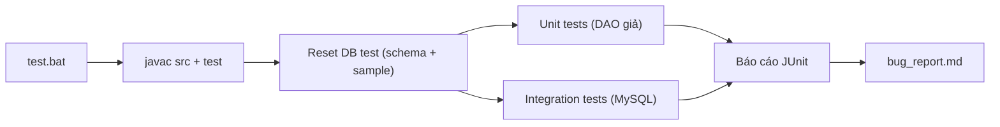

# Kế hoạch Kiểm thử & Tìm lỗi — Hệ thống Quản lý Kho Linh kiện Bán dẫn

## Mục tiêu
Hiện dự án **chưa có test tự động nào** (không có thư mục `test/`, không có JUnit). Kế hoạch này làm 3 việc:
1. Dựng **khung kiểm thử tự động** (unit test + integration test với MySQL) mà không phá cấu trúc Ant/NetBeans.
2. **Chứng minh bằng test** các lỗi nghi vấn mà mình đã tìm thấy khi đọc mã nguồn (mục bên dưới), và tìm thêm lỗi mới.
3. Lập **checklist kiểm thử thủ công cho giao diện** (những phần Swing khó tự động hóa).

Kết quả cuối cùng: báo cáo lỗi `bug_report.md` (mức độ, cách tái hiện, test chứng minh, đề xuất sửa).

---

## Lỗi nghi vấn tìm được khi rà mã nguồn (cần test xác nhận)

| # | Mức độ | Vị trí | Mô tả lỗi nghi vấn |
|---|---|---|---|
| B1 | 🔴 Nghiêm trọng | [ExportController.java](file:///C:/Users/groul/.gemini/antigravity/scratch/SemiconductorWarehouse/src/com/semiconductor/warehouse/controller/ExportController.java#L99-L103) | Khi thủ kho **chỉ định lô thủ công**, không kiểm tra lô đó có thuộc linh kiện đang xuất hay không → có thể trừ lô của linh kiện A nhưng trừ tồn của linh kiện B. |
| B2 | 🔴 Nghiêm trọng | [IdGenerator.java](file:///C:/Users/groul/.gemini/antigravity/scratch/SemiconductorWarehouse/src/com/semiconductor/warehouse/util/IdGenerator.java#L33-L37) + [ImportController.java](file:///C:/Users/groul/.gemini/antigravity/scratch/SemiconductorWarehouse/src/com/semiconductor/warehouse/controller/ImportController.java#L91-L110) | Mã lô gợi ý là `LOT-YYYYMMDD` → **mọi lần nhập trong cùng ngày trùng mã lô**. Nếu nhập linh kiện khác với cùng mã lô, hệ thống cộng số lượng vào lô của linh kiện cũ (không kiểm tra `componentId`). |
| B3 | 🔴 Nghiêm trọng | Import/Export/Audit controllers | **Không dùng transaction**: các bước (cập nhật hộp → lô → phiếu → tồn) chạy rời rạc, autocommit. Lỗi giữa chừng (ví dụ trùng mã phiếu) để lại dữ liệu lệch (hộp đã tăng nhưng phiếu không lưu). |
| B4 | 🟠 Cao | [IdGenerator.java](file:///C:/Users/groul/.gemini/antigravity/scratch/SemiconductorWarehouse/src/com/semiconductor/warehouse/util/IdGenerator.java#L15-L31) | Mã phiếu dùng số ngẫu nhiên 100–999 → chỉ 900 mã/ngày, xác suất trùng ~50% sau ~35 phiếu (birthday paradox) → lỗi khóa chính khi lưu. |
| B5 | 🟠 Cao | [AuditController.java](file:///C:/Users/groul/.gemini/antigravity/scratch/SemiconductorWarehouse/src/com/semiconductor/warehouse/controller/AuditController.java#L60-L62) | Điều chỉnh kiểm kê chỉ sửa `total_quantity`, **không sửa lô hàng** → tổng tồn ≠ tổng các lô; sau đó xuất kho có thể báo "đủ hàng" nhưng không lô nào đủ. |
| B6 | 🟠 Cao | Export/Import | Bỏ qua giá trị trả về của `deductLotQuantity` / `updateStock` (luôn coi là thành công) → khi 2 người xuất đồng thời, phiếu vẫn được lưu dù không trừ được lô. |
| B7 | 🟡 Trung bình | [ImportController.java](file:///C:/Users/groul/.gemini/antigravity/scratch/SemiconductorWarehouse/src/com/semiconductor/warehouse/controller/ImportController.java#L80-L88) | Mã hộp không tồn tại bị **bỏ qua im lặng** (box == null) thay vì báo lỗi; xuất kho từ lô cũng không kiểm tra hộp có bị âm. |
| B8 | 🟡 Trung bình | [AuthController.java](file:///C:/Users/groul/.gemini/antigravity/scratch/SemiconductorWarehouse/src/com/semiconductor/warehouse/controller/AuthController.java#L44-L51) | Thông báo lỗi khác nhau giữa "sai username" và "sai mật khẩu (x/5)" → lộ username tồn tại. Mật khẩu SHA-256 không salt. |
| B9 | 🟡 Trung bình | ComponentDAOImpl `softDeleteComponent` | Có thể xóa mềm linh kiện **còn tồn kho / còn lô ACTIVE** → hàng "biến mất" khỏi báo cáo. |
| B10 | 🟢 Thấp | ComponentDAOImpl search | Từ khóa chứa `%` hoặc `_` không được escape trong `LIKE` → kết quả tìm kiếm sai. |
| B11 | 🟢 Thấp | Validator | Không giới hạn trên số lượng/giá (ví dụ nhập 2.147.483.647 → tràn `int` khi cộng tồn). Ngày nhập `null` vượt qua validate nhưng cột DB `NOT NULL`. |

---

## Open Questions

> [!IMPORTANT]
> **1. Thư viện test:** Máy chưa có JUnit. Bạn chọn:
> - **(A — đề xuất)** Tải `junit-platform-console-standalone-1.11.x.jar` (~2.5 MB) từ Maven Central vào `lib/test/`, chuẩn công nghiệp, NetBeans nhận được.
> - **(B)** Tự viết một test runner nhỏ bằng Java thuần (không phụ thuộc mạng), đơn giản hơn nhưng không chuẩn.

> [!IMPORTANT]
> **2. Phạm vi:** Chỉ **tìm và báo cáo lỗi** (test sẽ "đỏ" ở các lỗi B1–B11), hay **tìm + sửa luôn** rồi chạy lại cho "xanh"? Mình đề xuất: báo cáo trước, bạn duyệt rồi mới sửa.

> [!WARNING]
> **3. Cơ sở dữ liệu test:** Integration test sẽ tạo/xóa dữ liệu. Mình sẽ dùng **database riêng `semiconductor_warehouse_test`** (không đụng DB thật). Cần thêm một thay đổi nhỏ vào `DatabaseConnection` để đọc tên DB từ system property `-Ddb.name=...`. Bạn đồng ý không?

---

## Proposed Changes

### 1. Hạ tầng test

#### [NEW] `lib/test/junit-platform-console-standalone.jar` (nếu chọn A)
#### [MODIFY] [DatabaseConnection.java](file:///C:/Users/groul/.gemini/antigravity/scratch/SemiconductorWarehouse/src/com/semiconductor/warehouse/util/DatabaseConnection.java#L48-L67)
Cho phép system property ghi đè cấu hình (không ảnh hưởng chạy bình thường):
```java
this.database = System.getProperty("db.name",
        props.getProperty("db.name", "semiconductor_warehouse"));
```
#### [NEW] `test/` (thư mục test chuẩn NetBeans — `nbproject/project.properties` đã có `test.src.dir=test`)
#### [NEW] `test.bat`
Biên dịch `src` + `test`, khởi tạo DB test từ `sql/schema.sql` + `sql/sample_data.sql`, chạy toàn bộ test, in báo cáo.

---

### 2. Unit test (không cần DB — dùng DAO giả lập in-memory qua constructor injection có sẵn)

| File test | Nội dung chính |
|---|---|
| `util/ValidatorTest` | Biên của số lượng (0, -1, 1, `Integer.MAX_VALUE`), giá, regex `SC-\d{5}` / `LOT-\d{8}`, ngày tương lai/null, quy tắc ESD (linh kiện nhạy ESD + hộp STANDARD → lỗi). |
| `util/IdGeneratorTest` | Sinh 200 mã phiếu liên tiếp → kiểm tra trùng (**B4**); 2 lần gọi `generateLotNumber` cùng ngày → trùng (**B2**). |
| `util/PasswordHasherTest` | Hash ổn định, verify đúng/sai, chuỗi rỗng, Unicode tiếng Việt. |
| `model/ComponentPolymorphismTest` | `validateSpecificFields()` của IC/Transistor/Diode/Memory, `Box.canAccommodate` biên đúng bằng sức chứa. |
| `controller/AuthControllerTest` | Đăng nhập đúng; sai 1–4 lần; lần 5 bị khóa; tài khoản bị khóa đúng mật khẩu vẫn từ chối; đăng nhập đúng reset bộ đếm; thông báo lộ username (**B8**). |
| `controller/ImportControllerTest` | Nhập hợp lệ; hộp đầy → `StorageFullException`; ESD sai hộp; hộp không tồn tại (**B7**); trùng mã lô khác linh kiện (**B2**). |
| `controller/ExportControllerTest` | FIFO chọn lô cũ nhất; thiếu hàng tổng; lô đủ tổng nhưng lô đầu không đủ; chỉ định lô của linh kiện khác (**B1**); `deduct` trả `false` (**B6**). |
| `controller/AuditControllerTest` | Chênh lệch âm/dương/0; auto-adjust làm lệch tổng lô (**B5**). |

---

### 3. Integration test (MySQL thật, DB `semiconductor_warehouse_test`, reset trước mỗi lớp test)

| File test | Nội dung chính |
|---|---|
| `dao/ComponentDAOIT` | CRUD đủ 4 loại linh kiện (kiểm tra cột đặc thù lưu/đọc đúng), xóa mềm, tìm kiếm có `%`/`_` (**B10**), xóa mềm khi còn tồn (**B9**). |
| `dao/UserDAOIT` | Trùng username, khóa tự động ở lần 5 bằng SQL, unlock. |
| `flow/WarehouseFlowIT` | Kịch bản đầu-cuối: nhập 2 lô → xuất FIFO → kiểm kê → **bất biến**: `components.total_quantity == SUM(lot_batches.current_quantity)` và `boxes.current_count` khớp. |
| `flow/TransactionIT` | Ép lỗi giữa chừng (trùng mã phiếu) → kiểm tra dữ liệu có bị lệch không (**B3**). |
| `flow/ConcurrencyIT` | 2 luồng cùng xuất toàn bộ một lô → kiểm tra tồn âm / phiếu ma (**B6**). |
| `db/SchemaSanityIT` | Script SQL chạy sạch; dữ liệu mẫu thỏa bất biến tồn kho; tiếng Việt UTF-8 lưu/đọc đúng. |



---

### 4. Checklist kiểm thử thủ công giao diện (đưa vào báo cáo để bạn tự chạy)
- **Đăng nhập:** để trống, sai 5 lần → khóa, admin mở khóa; đăng xuất rồi đăng nhập tài khoản khác → menu phân quyền đúng (thủ kho không thấy "Quản lý tài khoản").
- **Danh mục:** thêm 4 loại linh kiện, sửa, xóa; phân trang (trang cuối, đổi page size khi đang ở trang 5); tìm kiếm tiếng Việt có dấu.
- **Nhập/Xuất:** `SearchableComboBox` gõ lọc rồi chọn bằng bàn phím; nhập chữ vào ô số lượng; bấm "Xác nhận" 2 lần liên tục (double-submit); Toast hiện đúng loại.
- **Kiểm kê:** tô đỏ/vàng đúng khi thiếu/thừa; chọn dòng → chữ trắng dễ đọc.
- **Báo cáo:** biểu đồ khi dữ liệu rỗng / 1 danh mục / giá trị 0.
- **Lỗi kết nối:** tắt dịch vụ MySQL khi đang chạy → app báo lỗi thân thiện, không treo.
- **Hiển thị:** thu nhỏ cửa sổ 1024×768, màn hình scale 125%/150%.

---

## Verification Plan

### Automated Tests
```bat
cd C:\Users\groul\.gemini\antigravity\scratch\SemiconductorWarehouse
test.bat
```
- Kỳ vọng giai đoạn "tìm lỗi": test của các tính năng đúng → **PASS**; test chứng minh B1–B11 → **FAIL** có thông điệp rõ ràng (đó chính là bằng chứng lỗi).
- `build.bat` và `run.bat` vẫn hoạt động như cũ (test không lẫn vào JAR).

### Manual Verification
- Bạn chạy checklist mục 4 trên giao diện và đánh dấu kết quả trong `bug_report.md`.
