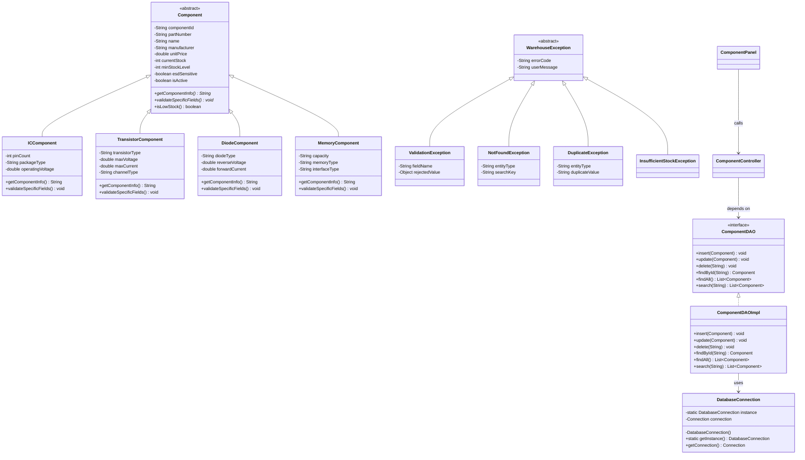

# 📋 TỔNG HỢP QUYẾT ĐỊNH THIẾT KẾ
## Hệ thống Quản lý Kho Linh kiện Bán dẫn

> Kết quả phỏng vấn thiết kế — sẵn sàng triển khai

---

## 1. Công nghệ & Môi trường

| Hạng mục | Quyết định |
|----------|-----------|
| **Ngôn ngữ** | Java |
| **IDE** | NetBeans (Ant-based project) |
| **Giao diện (UI)** | Java Swing |
| **Cơ sở dữ liệu** | MySQL (JDBC) |
| **Build tool** | NetBeans built-in (Ant), import JAR thủ công |
| **Ngôn ngữ giao diện** | Song ngữ — UI tiếng Việt, code/biến/class tiếng Anh |

---

## 2. Kiến trúc & Design Pattern

| Hạng mục | Quyết định |
|----------|-----------|
| **Architecture** | MVC (Model – View – Controller) |
| **Data Access** | DAO Pattern với Interface (`ComponentDAO` → `ComponentDAOImpl`) |
| **Database Connection** | Singleton Pattern (`DatabaseConnection.getInstance()`) |
| **Bố cục Swing** | JTabbedPane — mỗi tab là 1 phân hệ chức năng |
| **Package structure** | Theo tầng MVC: `model/`, `view/`, `controller/`, `dao/`, `exception/`, `util/` |

---

## 3. Thiết kế OOP — Class Hierarchy

### 3.1. Phân cấp lớp Linh kiện (Component)

```
Component (abstract class)
├── ICComponent          — số chân, kiểu đóng gói, điện áp hoạt động
├── TransistorComponent  — loại (MOSFET/BJT), điện áp chịu, dòng cực đại, kênh (N/P)
├── DiodeComponent       — loại (Zener/Schottky/LED/Rectifier), điện áp ngược, dòng thuận
└── MemoryComponent      — dung lượng, loại bộ nhớ (Flash/EEPROM/SRAM), giao tiếp (SPI/I2C)
```

**Các phương thức override (Polymorphism):**
- `getComponentInfo()` — mỗi lớp con trả về chuỗi thông tin đặc thù
- `validateSpecificFields()` — mỗi lớp con kiểm tra riêng các trường đặc thù
- `toString()` — hiển thị tùy theo loại linh kiện

### 3.2. Phân cấp Exception Handling

```
Exception (Java built-in)
└── WarehouseException (abstract — lớp cha chung)
    ├── ValidationException
    │   ├── InvalidQuantityException      — số lượng ≤ 0
    │   ├── InvalidComponentIdException   — mã LK sai định dạng SC-XXXXX
    │   ├── InvalidLotNumberException     — mã lô sai định dạng LOT-XXXXXXXX
    │   ├── InvalidPriceException         — đơn giá ≤ 0
    │   ├── InvalidDateException          — ngày trong tương lai
    │   ├── InvalidStorageException       — LK nhạy ESD gán hộp thường
    │   ├── InvalidCategoryException      — loại LK không hợp lệ
    │   └── BlankFieldException           — trường bắt buộc để trống
    ├── NotFoundException
    │   ├── ComponentNotFoundException    — mã LK không tồn tại
    │   ├── LotNotFoundException          — mã lô không tồn tại
    │   └── RackNotFoundException         — mã Rack không tồn tại
    ├── DuplicateException
    │   ├── DuplicateComponentException   — mã LK đã tồn tại
    │   ├── DuplicateLotException         — mã lô trùng cho cùng LK
    │   └── DuplicateUsernameException    — tên đăng nhập trùng
    ├── InsufficientStockException        — tồn kho không đủ xuất
    ├── StorageFullException              — vị trí lưu trữ đã đầy
    ├── AuthenticationException           — sai mật khẩu
    └── AccountLockedException            — tài khoản bị khóa
```

---

## 4. Quyết định nghiệp vụ

| Hạng mục | Quyết định |
|----------|-----------|
| **Xuất kho theo lô** | Mặc định FIFO (lô cũ nhất xuất trước), Thủ kho có thể ghi đè chọn lô khác |
| **Xóa linh kiện** | Xóa mềm (Soft Delete) — đặt `isActive = false` |
| **Mật khẩu** | Hash bằng SHA-256 hoặc BCrypt trước khi lưu DB |
| **Cảnh báo tồn kho** | Hiển thị trực tiếp trên Dashboard (tab đầu tiên), JTable highlight đỏ/vàng |
| **Dữ liệu mẫu** | Có — 10–20 linh kiện, vài phiếu nhập/xuất, 2 tài khoản (admin + thủ kho) |
| **Khóa tài khoản** | Tự động khóa sau 5 lần đăng nhập sai liên tiếp |

---

## 5. Cấu trúc thư mục Project

```
SemiconductorWarehouse/
├── src/
│   └── com/
│       └── semiconductor/
│           └── warehouse/
│               ├── model/
│               │   ├── Component.java              (abstract)
│               │   ├── ICComponent.java
│               │   ├── TransistorComponent.java
│               │   ├── DiodeComponent.java
│               │   ├── MemoryComponent.java
│               │   ├── ImportReceipt.java
│               │   ├── ExportReceipt.java
│               │   ├── LotBatch.java
│               │   ├── StorageLocation.java
│               │   ├── Rack.java
│               │   ├── Shelf.java
│               │   ├── Box.java
│               │   ├── User.java
│               │   ├── InventoryAudit.java
│               │   └── enums/
│               │       ├── ComponentCategory.java   (Enum)
│               │       ├── BoxType.java             (Enum)
│               │       ├── ExportReason.java         (Enum)
│               │       └── UserRole.java             (Enum)
│               │
│               ├── view/
│               │   ├── LoginFrame.java
│               │   ├── MainFrame.java               (JTabbedPane chính)
│               │   ├── DashboardPanel.java           (Tab tổng quan + cảnh báo)
│               │   ├── ComponentPanel.java           (Tab quản lý danh mục LK)
│               │   ├── ImportPanel.java              (Tab nhập kho)
│               │   ├── ExportPanel.java              (Tab xuất kho)
│               │   ├── StoragePanel.java             (Tab quản lý vị trí kho)
│               │   ├── ReportPanel.java              (Tab báo cáo thống kê)
│               │   ├── UserManagementPanel.java      (Tab quản lý tài khoản — chỉ Admin)
│               │   └── InventoryAuditPanel.java      (Tab kiểm kê)
│               │
│               ├── controller/
│               │   ├── AuthController.java
│               │   ├── ComponentController.java
│               │   ├── ImportController.java
│               │   ├── ExportController.java
│               │   ├── StorageController.java
│               │   ├── ReportController.java
│               │   ├── UserController.java
│               │   └── AuditController.java
│               │
│               ├── dao/
│               │   ├── ComponentDAO.java             (Interface)
│               │   ├── ComponentDAOImpl.java
│               │   ├── ImportReceiptDAO.java          (Interface)
│               │   ├── ImportReceiptDAOImpl.java
│               │   ├── ExportReceiptDAO.java          (Interface)
│               │   ├── ExportReceiptDAOImpl.java
│               │   ├── StorageDAO.java                (Interface)
│               │   ├── StorageDAOImpl.java
│               │   ├── UserDAO.java                   (Interface)
│               │   ├── UserDAOImpl.java
│               │   ├── LotBatchDAO.java               (Interface)
│               │   ├── LotBatchDAOImpl.java
│               │   ├── AuditDAO.java                  (Interface)
│               │   └── AuditDAOImpl.java
│               │
│               ├── exception/
│               │   ├── WarehouseException.java        (abstract — lớp cha)
│               │   ├── ValidationException.java
│               │   ├── InvalidQuantityException.java
│               │   ├── InvalidComponentIdException.java
│               │   ├── InvalidLotNumberException.java
│               │   ├── InvalidPriceException.java
│               │   ├── InvalidDateException.java
│               │   ├── InvalidStorageException.java
│               │   ├── BlankFieldException.java
│               │   ├── NotFoundException.java
│               │   ├── ComponentNotFoundException.java
│               │   ├── LotNotFoundException.java
│               │   ├── DuplicateException.java
│               │   ├── DuplicateComponentException.java
│               │   ├── DuplicateLotException.java
│               │   ├── DuplicateUsernameException.java
│               │   ├── InsufficientStockException.java
│               │   ├── StorageFullException.java
│               │   ├── AuthenticationException.java
│               │   └── AccountLockedException.java
│               │
│               ├── util/
│               │   ├── DatabaseConnection.java        (Singleton)
│               │   ├── PasswordHasher.java            (SHA-256/BCrypt)
│               │   ├── Validator.java                 (Regex, format check)
│               │   ├── IdGenerator.java               (Auto-generate IM-xxx, EX-xxx)
│               │   └── Constants.java                 (Hằng số hệ thống)
│               │
│               └── Main.java                          (Entry point)
│
├── sql/
│   ├── schema.sql                                     (Tạo bảng)
│   └── sample_data.sql                                (Dữ liệu mẫu)
│
├── lib/
│   └── mysql-connector-java-8.x.x.jar
│
└── README.md
```

---

## 6. Sơ đồ Class tổng quan (Class Diagram)



---

## 7. Các tính chất OOP được thể hiện

| Tính chất OOP | Nơi thể hiện |
|---------------|-------------|
| **Encapsulation** | Tất cả thuộc tính `private`, truy cập qua getter/setter. `DatabaseConnection` ẩn chi tiết kết nối. |
| **Inheritance** | `Component` (abstract) → `ICComponent`, `TransistorComponent`, `DiodeComponent`, `MemoryComponent`. `WarehouseException` → `ValidationException` → `InvalidQuantityException`... |
| **Polymorphism** | Override `getComponentInfo()`, `validateSpecificFields()` ở mỗi lớp con. DAO Interface — `ComponentDAO` có thể swap implementation. |
| **Abstraction** | Abstract class `Component`, `WarehouseException`. Interface `ComponentDAO`, `ImportReceiptDAO`... |

---

> [!IMPORTANT]
> Nếu đồng ý với bản thiết kế này, mình sẽ bắt đầu triển khai code theo thứ tự:
> 1. Schema MySQL + sample data
> 2. Model classes (Component hierarchy + Exception hierarchy)
> 3. DAO layer (Interface + Implementation)
> 4. Controller layer
> 5. View layer (Swing UI)
> 6. Tích hợp và test
