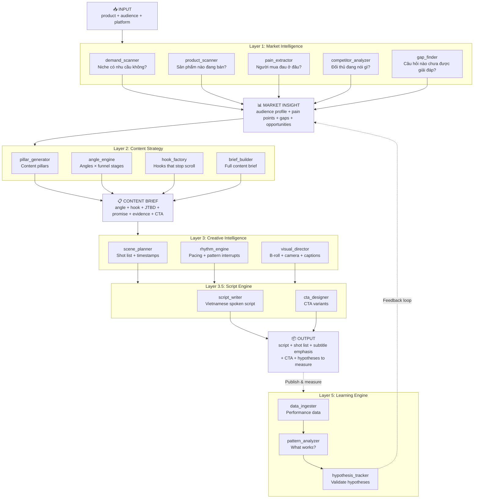

# Content Brain — Hệ thống trí tuệ nội dung cho affiliate video

> Biến `product + audience + platform` thành `insight → angle → hook → script → shot list → subtitle emphasis → CTA → hypotheses`

## Bối cảnh

Hiện tại workspace đã có:
- ✅ **Voice actor** — Azure / ElevenLabs TTS
- ✅ **Video editor** — CapCut pipeline
- ✅ **Affiliate Researcher** — CLI Python scrape YouTube/Instagram/Facebook/Threads + Gemini phân tích đối thủ ([main.py](file:///C:/Users/groul/.gemini/antigravity/scratch/affiliate-researcher/main.py))
- ✅ **Copywriting Course** — 12-module framework với formulas (AIDA, PAS, BAB, PASTOR...), market research VN/US, KPI framework ([SYLLABUS.md](file:///C:/Users/groul/.gemini/antigravity/scratch/copywriting-course/SYLLABUS.md))

Còn thiếu 4 "nhân sự" quan trọng:

| Vai trò | Trạng thái | Giá trị |
|---|---|---|
| Market Researcher | ⚠️ Có một phần (affiliate-researcher) nhưng thiếu TikTok, Shopee, pain point extraction | Biết nên đánh vào đâu |
| Strategist | ❌ Chưa có | Quyết định phải nói gì |
| Copywriter | ❌ Chưa có | Viết script đúng giọng, đúng nhịp |
| Analyst | ❌ Chưa có | Hệ thống học từ data |

## User Review Required

> [!IMPORTANT]
> **Tech stack choice**: Plan xây Content Brain bằng **Python** (nhất quán với `affiliate-researcher` hiện có), dùng **Gemini 2.0 Flash** làm LLM backbone, output ra **JSON + Markdown**. Sau này sẽ tích hợp vào Next.js web UI qua API routes. Bạn có muốn dùng stack khác không?

> [!IMPORTANT]
> **Data sources cho Market Intelligence**: MVP sẽ dùng web scraping cho TikTok Creative Center (trending products/hashtags) và Shopee (reviews, bestsellers). Cần xác nhận bạn có muốn dùng API chính thức nào không (TikTok Business API, Shopee Open Platform, v.v.)?

> [!WARNING]
> **LLM prompt templates**: Hệ thống sẽ dùng các copywriting framework từ `copywriting-course/` làm nền tảng cho prompt engineering. Các prompt sẽ viết bằng **tiếng Việt** để output tự nhiên hơn. Xác nhận đây là hướng đúng?

## Open Questions

> [!IMPORTANT]
> 1. **Nguồn performance data**: Ở layer 5 (Learning Engine), data TikTok analytics sẽ lấy từ đâu? Export CSV thủ công từ TikTok Creator Center, hay có API access?
> 2. **Số lượng video per product**: Bạn muốn hệ thống default sinh bao nhiêu content briefs cho mỗi product? (VD: 5 briefs cho 5 funnel stages như ví dụ máy hút bụi?)
> 3. **Voice/tone profile**: Bạn có persona cụ thể cho channel không? (VD: "anh trai 25 tuổi, nói chuyện thẳng thắn, hơi hài hước") hay để hệ thống tự suggest?

---

## Proposed Changes

### Kiến trúc tổng thể

```
content-brain/
├── core/                          # Shared infrastructure
│   ├── __init__.py
│   ├── config.py                  # Environment, API keys, defaults
│   ├── models.py                  # Pydantic data models
│   └── llm.py                     # Gemini wrapper + structured output
│
├── market_intelligence/           # Layer 1: Biết nên đánh vào đâu
│   ├── __init__.py
│   ├── demand_scanner.py          # Niche demand analysis
│   ├── product_scanner.py         # Trending products from Shopee/TikTok
│   ├── pain_extractor.py          # Pain points from reviews/comments
│   ├── competitor_analyzer.py     # Wraps existing affiliate-researcher
│   └── gap_finder.py              # Unanswered questions & content gaps
│
├── content_strategy/              # Layer 2: Quyết định phải nói gì
│   ├── __init__.py
│   ├── brain.py                   # Main orchestrator
│   ├── pillar_generator.py        # Content pillars from insights
│   ├── angle_engine.py            # Angles per funnel stage
│   ├── hook_factory.py            # Hook templates + customization
│   └── brief_builder.py           # Assembles full content brief
│
├── creative_intelligence/         # Layer 3: Biến ý tưởng thành thứ người ta muốn xem
│   ├── __init__.py
│   ├── scene_planner.py           # Shot list + scene breakdown with timestamps
│   ├── rhythm_engine.py           # Pacing, pattern interrupts, tension/payoff
│   └── visual_director.py         # B-roll, zoom, transition, caption cues
│
├── script_engine/                 # Layer 3.5: Script + shot list
│   ├── __init__.py
│   ├── script_writer.py           # Vietnamese spoken script
│   └── cta_designer.py            # CTA variants per funnel stage
│
├── learning_engine/               # Layer 5: Hệ thống học
│   ├── __init__.py
│   ├── data_ingester.py           # Import performance CSV/JSON
│   ├── pattern_analyzer.py        # What's working, what's not
│   └── hypothesis_tracker.py      # Track & validate content hypotheses
│
├── templates/
│   └── prompts/                   # LLM prompt templates (Vietnamese)
│       ├── market_intelligence.py
│       ├── content_strategy.py
│       ├── creative_intelligence.py
│       ├── script_engine.py
│       └── learning_engine.py
│
├── output/                        # Generated content briefs
├── main.py                        # CLI entry point
└── requirements.txt
```

### Data Flow



---

### Component 1: Core Infrastructure

#### [NEW] `content-brain/core/config.py`
- Environment management: `GEMINI_API_KEY`, `YOUTUBE_API_KEY`
- Default parameters: target platforms, funnel stages, max results
- User-Agent rotation (inherit from affiliate-researcher)
- Output directory management

#### [NEW] `content-brain/core/models.py`
Pydantic models cho toàn bộ pipeline:

```python
# Input
class ContentRequest:
    product: str              # "máy hút bụi mini"
    audience: str             # "phụ nữ 20-30 tuổi, phòng trọ nhỏ"
    platform: str             # "tiktok" | "youtube_shorts" | "reels"
    price_range: str          # "300k-800k"
    affiliate_link: str       # optional

# Layer 1 Output
class MarketInsight:
    demand_level: str         # "high" | "medium" | "low"
    demand_signals: list[str] # search volume indicators
    top_pain_points: list[PainPoint]
    competitor_angles: list[CompetitorAngle]
    content_gaps: list[str]   # unanswered questions
    buyer_objections: list[str]
    high_intent_formats: list[str]  # "so sánh trước/sau", "review thực tế"
    summary: str              # Natural language insight paragraph

# Layer 2 Output
class ContentBrief:
    pillar: str               # "giải pháp vệ sinh phòng trọ"
    funnel_stage: str         # "awareness" | "problem" | "comparison" | "demo" | "conversion"
    angle: str                # "bụi trên nệm gây dị ứng"
    hook: str                 # "3 thứ khiến phòng trọ lúc nào cũng đầy bụi"
    jtbd: str                 # "giữ phòng trọ sạch mà không tốn thời gian"
    pain_point: str
    promise: str
    evidence: str             # "test thực tế hút nệm 7 ngày"
    cta: str
    product_position: str     # how product enters the narrative

# Layer 3 Output
class CreativeBlueprint:
    scenes: list[Scene]       # timestamped scene list
    pattern_interrupts: list[PatternInterrupt]
    tension_payoff: TensionPayoff
    pacing: str               # "fast-cut" | "documentary" | "storytelling"
    
class Scene:
    start_sec: int
    end_sec: int
    visual: str               # "close-up bụi vừa hút ra"
    audio: str                # spoken text for this scene
    camera: str               # "zoom-in" | "wide" | "overhead" | "handheld"
    caption: str | None       # subtitle emphasis text
    broll: str | None         # "footage phòng trọ bừa bộn"

# Layer 3.5 Output  
class ContentPackage:
    script: str               # Full Vietnamese spoken script
    shot_list: list[Scene]
    subtitle_emphases: list[SubtitleEmphasis]
    cta_variants: list[str]
    hypotheses: list[Hypothesis]  # things to measure after publishing

class Hypothesis:
    statement: str            # "Video so sánh trước/sau sẽ có watch time > 15s"
    metric: str               # "average_watch_time"
    target: str               # "> 15s"
    reasoning: str
```

#### [NEW] `content-brain/core/llm.py`
- Gemini 2.0 Flash wrapper với structured JSON output
- Retry logic cho rate limits (inherit pattern từ `affiliate-researcher`)
- Prompt template injection system
- Response parsing + validation against Pydantic models

---

### Component 2: Market Intelligence (Layer 1)

#### [NEW] `content-brain/market_intelligence/demand_scanner.py`
- **Input**: product keyword + audience
- **Process**: 
  - Scrape Google Trends / Google Search suggestions cho keyword
  - Scrape TikTok Creative Center trending hashtags/products (nếu có)
  - Analyze search autocomplete patterns
- **Output**: Demand signals, trending keywords, seasonal patterns

#### [NEW] `content-brain/market_intelligence/product_scanner.py`
- **Input**: product category
- **Process**:
  - Scrape Shopee search results: bestseller products, ratings, review counts, price ranges
  - Extract product feature comparisons từ top listings
  - Identify which features buyers care about most (từ review text)
- **Output**: Top products, price brackets, key differentiators

#### [NEW] `content-brain/market_intelligence/pain_extractor.py`
- **Input**: product keyword + Shopee product URLs (optional)
- **Process**:
  - Scrape Shopee product reviews (1-3 star reviews = pain points)
  - Scrape TikTok/YouTube comments on competitor videos
  - Pass to Gemini: extract & cluster pain points, objections, desires
- **Output**: Ranked pain points, buyer objections, unfulfilled desires

#### [NEW] `content-brain/market_intelligence/competitor_analyzer.py`
- **Input**: product keyword + platform
- **Process**:
  - Integrate with existing `affiliate-researcher` scrapers
  - Search for top creators making content about this product
  - Analyze their content angles, hooks, view counts, engagement
  - Identify which content types convert (comments mention buying) vs. only entertain
- **Output**: Competitor content map, proven angles, engagement benchmarks

#### [NEW] `content-brain/market_intelligence/gap_finder.py`
- **Input**: All Layer 1 data combined
- **Process**:
  - Gemini analyzes: questions in comments that nobody answered
  - Comparison angles nobody has done
  - Pain points no competitor addresses
  - Content formats missing in the niche
- **Output**: Content gap opportunities ranked by potential

---

### Component 3: Content Strategy (Layer 2)

#### [NEW] `content-brain/content_strategy/brain.py`
Main orchestrator — nhận `MarketInsight`, xuất ra danh sách `ContentBrief` cho mỗi funnel stage.

Logic:
1. Từ pain points + gaps → xác định content pillars
2. Mỗi pillar → map vào funnel stages (Awareness → Problem → Comparison → Demo → Conversion)
3. Mỗi stage → generate angle + hook + JTBD
4. Assemble thành content briefs

#### [NEW] `content-brain/content_strategy/pillar_generator.py`
- Gemini analyzes market insight → suggests 3-5 content pillars
- Mỗi pillar có: theme, target emotion, content volume estimate
- VD: "vệ sinh phòng trọ", "so sánh thiết bị mini", "mẹo tiết kiệm cho sinh viên"

#### [NEW] `content-brain/content_strategy/angle_engine.py`
- Per pillar × per funnel stage → generate unique angles
- Uses copywriting frameworks từ `copywriting-course/`:
  - AIDA for awareness
  - PAS for problem
  - BAB for comparison
  - Star-Story-Solution for demo
  - PASTOR for conversion
- Output includes: angle statement, emotional trigger, evidence type needed

#### [NEW] `content-brain/content_strategy/hook_factory.py`
- Per angle → generate 3-5 hook variants
- Hooks optimized per platform:
  - TikTok: 1-2 giây, visual-first, pattern interrupt
  - YouTube Shorts: question-based, curiosity gap
  - Reels: trending audio + text overlay
- Scoring: curiosity score, controversy score, relatability score

#### [NEW] `content-brain/content_strategy/brief_builder.py`
- Assembles everything into structured `ContentBrief`
- Adds: promise, evidence requirements, CTA type, product insertion point
- Validates completeness (no brief without evidence plan)

---

### Component 4: Creative Intelligence (Layer 3)

#### [NEW] `content-brain/creative_intelligence/scene_planner.py`
- **Input**: ContentBrief
- **Process**: 
  - Break video into scenes with exact timestamps
  - Each scene: what viewer sees, hears, reads
  - Duration calibrated per platform (TikTok 30-60s, Shorts 30-58s, Reels 30-90s)
- **Output**: Timestamped scene list (like the user's example: 0-2s, 2-7s, 7-15s...)

#### [NEW] `content-brain/creative_intelligence/rhythm_engine.py`
- Determines pacing rules:
  - When to speed up / slow down
  - Where to place pattern interrupts (every 5-8s for TikTok)
  - Tension → payoff arcs
  - "Dead zone" warnings (>3s same shot = viewer drops)
- Uses retention data patterns from Learning Engine (when available)

#### [NEW] `content-brain/creative_intelligence/visual_director.py`
- Per scene → suggest:
  - Camera angle (close-up, wide, overhead, POV)
  - B-roll type ("footage phòng trọ bừa bộn", "hands unboxing")
  - Transition type (hard cut, zoom, swipe)
  - Caption emphasis (which words to highlight, font size, position)
  - When to show product vs. problem vs. result
- Output structured for CapCut integration

---

### Component 5: Script Engine (Layer 3.5)

#### [NEW] `content-brain/script_engine/script_writer.py`
- **Input**: ContentBrief + CreativeBlueprint
- **Process**:
  - Gemini generates Vietnamese spoken script
  - Calibrated for:
    - Natural Vietnamese speech patterns (not written Vietnamese)
    - Word count per scene matched to timing (avg 3 words/sec Vietnamese)
    - Tone matching audience (casual/authoritative/funny)
  - Integrates copywriting frameworks
- **Output**: Scene-by-scene script with spoken text, visual notes, caption text

#### [NEW] `content-brain/script_engine/cta_designer.py`
- Generate 3-5 CTA variants per brief:
  - Soft CTA: "Link ở bio nếu bạn cần"
  - Direct CTA: "Bấm giỏ hàng ngay, đang giảm 30%"
  - Social proof CTA: "2000 người đã mua tuần này"
  - Urgency CTA: "Chỉ còn hôm nay"
- Matched to funnel stage (awareness = no hard sell, conversion = direct)

---

### Component 6: Learning Engine (Layer 5)

#### [NEW] `content-brain/learning_engine/data_ingester.py`
- Import performance data from CSV/JSON (TikTok Creator Center export)
- Fields: impressions, 2s retention, 5s retention, avg watch time, completion rate, saves, comments, shares, product clicks, add-to-cart, orders, commission
- Map each data point back to original ContentBrief + script

#### [NEW] `content-brain/learning_engine/pattern_analyzer.py`
- Gemini analyzes performance patterns:
  - Which hooks get best 2s retention?
  - Which angles drive most product clicks?
  - Which CTAs convert?
  - What video length performs best?
  - Content with high views but no orders → why?
  - Content with low views but high conversion → amplify?
- Output: Ranked insights for next content cycle

#### [NEW] `content-brain/learning_engine/hypothesis_tracker.py`
- Track hypotheses generated by Content Brain:
  - VD: "Video so sánh trước/sau sẽ có watch time > 15s"
  - After performance data: CONFIRMED / REJECTED
- Feed confirmed patterns back into Content Brain as "proven templates"
- Feed rejected patterns as "avoid" signals

---

### Component 7: Prompt Templates

#### [NEW] `content-brain/templates/prompts/market_intelligence.py`
Prompt templates cho Layer 1, viết bằng tiếng Việt, inject copywriting frameworks:

```python
PAIN_EXTRACTION_PROMPT = """
Bạn là một market researcher chuyên nghiệp cho thị trường affiliate Việt Nam.

Phân tích các review sản phẩm sau và trích xuất:
1. Pain points: Người mua phàn nàn điều gì? (xếp theo tần suất)
2. Objections: Điều gì khiến người ta do dự không mua?
3. Desires: Người mua thực sự muốn gì mà sản phẩm chưa đáp ứng?
4. Triggers: Điều gì khiến người ta quyết định mua?
5. Language: Người mua dùng chính xác từ ngữ gì khi mô tả vấn đề?

Sản phẩm: {product}
Đối tượng: {audience}

Reviews:
{reviews}

Trả lời bằng JSON theo schema sau:
{schema}
"""
```

#### [NEW] Prompt templates tương tự cho `content_strategy.py`, `creative_intelligence.py`, `script_engine.py`, `learning_engine.py`

---

### Component 8: CLI Entry Point

#### [NEW] `content-brain/main.py`
```
Usage:
  python main.py research <product> --audience <audience> --platform <platform>
  python main.py strategize --from-insight <insight.json>
  python main.py create --from-brief <brief.json>
  python main.py full <product> --audience <audience> --platform <platform>
  python main.py learn --data <performance.csv>
  python main.py report --product <product>

Commands:
  research     Run Market Intelligence only → output insight.json
  strategize   Run Content Strategy only → output briefs.json  
  create       Run Creative + Script only → output package.json
  full         Run entire pipeline end-to-end → output everything
  learn        Ingest performance data → update patterns
  report       Generate content performance report
```

---

### Component 9: Output Format

Mỗi lần chạy `full`, hệ thống tạo một folder output:

```
output/
└── 20260907_may-hut-bui-mini/
    ├── 00_market_insight.json        # Raw insight data
    ├── 00_market_insight.md          # Human-readable insight report
    ├── 01_awareness_brief.json       # Content brief
    ├── 01_awareness_script.md        # "3 thứ khiến phòng trọ đầy bụi"
    ├── 02_problem_brief.json
    ├── 02_problem_script.md          # "Tại sao chổi không xử lý được bụi trên giường?"
    ├── 03_comparison_brief.json
    ├── 03_comparison_script.md       # "Máy 300k và 800k khác nhau ở đâu?"
    ├── 04_demo_brief.json
    ├── 04_demo_script.md             # "Thử hút chiếc nệm này sau 7 ngày"
    ├── 05_conversion_brief.json
    ├── 05_conversion_script.md       # "Nếu phòng dưới 20m², tôi sẽ chọn chiếc nào?"
    └── hypotheses.json               # What to measure after publishing
```

Mỗi `*_script.md` có format:

```markdown
# [Funnel Stage]: [Hook]

**Product**: máy hút bụi mini
**Audience**: phụ nữ 20-30 tuổi, phòng trọ nhỏ
**Platform**: TikTok
**Duration**: 52 giây
**Angle**: bụi ẩn trên nệm gây dị ứng
**JTBD**: giữ phòng trọ sạch không tốn thời gian

## Script

| Thời gian | Hình ảnh | Lời nói | Camera | Caption | Ghi chú |
|-----------|----------|---------|--------|---------|---------|
| 0–2s | Bụi vừa hút ra từ nệm | "Cái này nằm trong chiếc nệm tôi ngủ mỗi ngày." | Close-up, zoom chậm | **CÁI NÀY** nằm trong nệm bạn | Pattern interrupt: shock visual |
| 2–7s | Tay cầm máy, reveal sản phẩm | "Tôi thử chiếc máy hút bụi 400 nghìn này." | Medium shot | 400K | Product reveal |
| 7–15s | Hút nệm, thấy bụi vào máy | — (chỉ tiếng máy) | Overhead → close-up bụi | — | Demonstration, let visual speak |
| ... | ... | ... | ... | ... | ... |

## CTA Variants
1. (Soft) "Link ở bio nếu bạn cần."
2. (Direct) "Bấm giỏ hàng, đang giảm 30% hôm nay."
3. (Social) "2000 người mua tuần trước."

## Hypotheses to Measure
- [ ] Hook "bụi từ nệm" → 2s retention > 70%?
- [ ] Demo không lời 7-15s → watch time không drop?
- [ ] Soft CTA vs Direct CTA → cái nào nhiều click hơn?
```

---

## Verification Plan

### Automated Tests

```bash
# Unit tests cho mỗi module
python -m pytest tests/ -v

# Test full pipeline with mock data (không cần API)
python -m pytest tests/test_pipeline.py -v --mock

# Integration test với Gemini API
python main.py full "máy hút bụi mini" \
  --audience "phụ nữ 20-30 tuổi, phòng trọ nhỏ" \
  --platform tiktok
```

### Manual Verification

1. **Pipeline test**: Chạy `full` command với 3 sản phẩm khác nhau, kiểm tra:
   - Insight có match với thực tế thị trường?
   - Angles có khác nhau giữa funnel stages?
   - Script có tự nhiên khi đọc thành tiếng?
   - Shot list có khả thi khi quay?
   - Hypotheses có đo được?

2. **Comparison test**: So sánh output của Content Brain với script do người viết — xem AI có miss insight nào không

3. **End-to-end**: Lấy 1 script output → quay video thật → đăng → đo performance → feed back vào Learning Engine → xem insight mới có hợp lý không

---

## Implementation Phases

### Phase 1: Core + Content Strategy (Tuần 1)
> Ưu tiên cao nhất — đây là "bộ não" chính

- `core/` — config, models, LLM wrapper
- `content_strategy/` — brain, pillar generator, angle engine, hook factory, brief builder
- `templates/prompts/content_strategy.py`
- CLI: `strategize` command
- **Deliverable**: Nhập product + audience → ra 5 content briefs cho 5 funnel stages

### Phase 2: Creative Intelligence + Script Engine (Tuần 2)
> Biến brief thành script quay được

- `creative_intelligence/` — scene planner, rhythm engine, visual director
- `script_engine/` — script writer, CTA designer
- `templates/prompts/creative_intelligence.py`, `script_engine.py`
- CLI: `create` command
- **Deliverable**: Từ brief → ra full script + shot list + subtitle emphasis

### Phase 3: Market Intelligence (Tuần 3)
> Tự động hóa nghiên cứu thị trường

- `market_intelligence/` — demand scanner, product scanner, pain extractor, competitor analyzer, gap finder
- Tích hợp với `affiliate-researcher/` hiện có
- Thêm scrapers: Shopee reviews, TikTok Creative Center
- `templates/prompts/market_intelligence.py`
- CLI: `research` command
- **Deliverable**: Nhập product → ra market insight tự động

### Phase 4: Learning Engine (Tuần 4)
> Đóng vòng feedback loop

- `learning_engine/` — data ingester, pattern analyzer, hypothesis tracker
- `templates/prompts/learning_engine.py`
- CLI: `learn` command
- **Deliverable**: Import performance data → ra insight cho content cycle tiếp theo

### Phase 5: Full Pipeline + Web UI (Tuần 5+)
> Nối tất cả + giao diện

- CLI: `full` command (end-to-end)
- Next.js integration: API routes cho Content Brain
- Dashboard: visual pipeline, content calendar, performance tracking
- **Deliverable**: Hệ thống hoàn chỉnh
