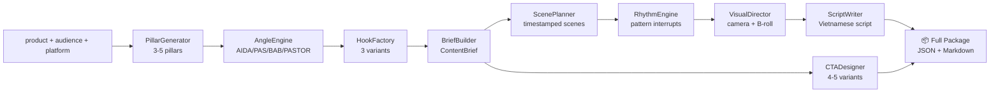

# Content Brain — Walkthrough

## Tóm tắt

Đã xây dựng hoàn chỉnh **Content Brain v1** — hệ thống trí tuệ nội dung cho affiliate video, bao gồm Phase 1 (Core + Content Strategy) và Phase 2 (Creative Intelligence + Script Engine).

**Input**: `product + audience + platform`  
**Output**: `insight → angle → hook → script → shot list → subtitle emphasis → CTA → hypotheses`

## Kiến trúc

```
content-brain/
├── core/                              # Hạ tầng chung
│   ├── config.py                      # API keys, defaults, platform durations
│   ├── models.py                      # 20+ Pydantic models — central contract
│   └── llm.py                         # Gemini wrapper: generate_text/json/structured/list
│
├── templates/prompts/                 # Vietnamese prompt templates
│   ├── content_strategy.py            # 5 prompts: pillars, angles, hooks, briefs
│   ├── creative_intelligence.py       # 3 prompts: scenes, rhythm, visual
│   └── script_engine.py              # 5 prompts: script, CTA, subtitles, hypotheses
│
├── content_strategy/                  # Layer 2: Quyết định phải nói gì
│   ├── brain.py                       # Orchestrator — runs full pipeline
│   ├── pillar_generator.py            # 3-5 content pillars
│   ├── angle_engine.py                # Angle per funnel stage (AIDA/PAS/BAB/PASTOR)
│   ├── hook_factory.py                # 3 hook variants per angle
│   └── brief_builder.py              # Full ContentBrief assembly
│
├── creative_intelligence/             # Layer 3: Biến ý tưởng thành video
│   ├── scene_planner.py               # Timestamped scene list
│   ├── rhythm_engine.py               # Pattern interrupts, tension/payoff
│   └── visual_director.py            # Camera, B-roll, transitions
│
├── script_engine/                     # Layer 3.5: Script + CTA
│   ├── script_writer.py               # Vietnamese spoken script + subtitles + hypotheses
│   └── cta_designer.py               # 4-5 CTA variants per funnel stage
│
├── main.py                            # CLI entry point (3 commands)
├── requirements.txt                   # google-genai, pydantic, python-dotenv, rich
└── .env.example                       # Template for API keys
```

## Data Flow



## Files Created (24 total)

| # | File | Lines | Purpose |
|---|------|-------|---------|
| 1 | [config.py](file:///C:/Users/groul/.gemini/antigravity/scratch/content-brain/core/config.py) | 58 | Environment, API keys, platform durations |
| 2 | [models.py](file:///C:/Users/groul/.gemini/antigravity/scratch/content-brain/core/models.py) | 280 | 20+ Pydantic models — central data contract |
| 3 | [llm.py](file:///C:/Users/groul/.gemini/antigravity/scratch/content-brain/core/llm.py) | 167 | Gemini wrapper with retry, JSON parsing, validation |
| 4 | [content_strategy.py](file:///C:/Users/groul/.gemini/antigravity/scratch/content-brain/templates/prompts/content_strategy.py) | 76 | Vietnamese prompts for Layer 2 |
| 5 | [creative_intelligence.py](file:///C:/Users/groul/.gemini/antigravity/scratch/content-brain/templates/prompts/creative_intelligence.py) | — | Vietnamese prompts for Layer 3 |
| 6 | [script_engine.py](file:///C:/Users/groul/.gemini/antigravity/scratch/content-brain/templates/prompts/script_engine.py) | — | Vietnamese prompts for Layer 3.5 |
| 7 | [brain.py](file:///C:/Users/groul/.gemini/antigravity/scratch/content-brain/content_strategy/brain.py) | 82 | Main orchestrator |
| 8 | [pillar_generator.py](file:///C:/Users/groul/.gemini/antigravity/scratch/content-brain/content_strategy/pillar_generator.py) | 30 | Content pillar generation |
| 9 | [angle_engine.py](file:///C:/Users/groul/.gemini/antigravity/scratch/content-brain/content_strategy/angle_engine.py) | 42 | Angle per funnel stage |
| 10 | [hook_factory.py](file:///C:/Users/groul/.gemini/antigravity/scratch/content-brain/content_strategy/hook_factory.py) | 60 | 3 hook variants per angle |
| 11 | [brief_builder.py](file:///C:/Users/groul/.gemini/antigravity/scratch/content-brain/content_strategy/brief_builder.py) | 38 | Full brief assembly |
| 12 | [scene_planner.py](file:///C:/Users/groul/.gemini/antigravity/scratch/content-brain/creative_intelligence/scene_planner.py) | 22 | Timestamped scene planning |
| 13 | [rhythm_engine.py](file:///C:/Users/groul/.gemini/antigravity/scratch/content-brain/creative_intelligence/rhythm_engine.py) | 18 | Pacing + pattern interrupts |
| 14 | [visual_director.py](file:///C:/Users/groul/.gemini/antigravity/scratch/content-brain/creative_intelligence/visual_director.py) | 16 | Camera + B-roll + transitions |
| 15 | [script_writer.py](file:///C:/Users/groul/.gemini/antigravity/scratch/content-brain/script_engine/script_writer.py) | 36 | Vietnamese spoken script |
| 16 | [cta_designer.py](file:///C:/Users/groul/.gemini/antigravity/scratch/content-brain/script_engine/cta_designer.py) | 14 | CTA variants per funnel stage |
| 17 | [main.py](file:///C:/Users/groul/.gemini/antigravity/scratch/content-brain/main.py) | 290 | CLI with 3 commands |

Plus 7 `__init__.py` files = **24 total files**.

## Verification

| Test | Result |
|------|--------|
| Python syntax (all .py files) | ✅ Pass |
| `core.models` import | ✅ Pass |
| `core.config` import | ✅ Pass |
| `core.llm` import | ✅ Pass |
| `templates.prompts.*` import | ✅ Pass |
| `content_strategy.*` import | ✅ Pass |
| `creative_intelligence.*` import | ✅ Pass |
| `script_engine.*` import | ✅ Pass |
| CLI `--help` | ✅ Pass |
| Full import chain test | ✅ Pass |

## Cách sử dụng

### 1. Setup
```bash
cd content-brain
cp .env.example .env
# Edit .env → add GEMINI_API_KEY
```

### 2. Chạy Strategy only (tạo 5 briefs)
```bash
python main.py strategize "máy hút bụi mini" --audience "phụ nữ 20-30 tuổi, phòng trọ nhỏ" --platform tiktok
```

### 3. Chạy Full pipeline (strategy → creative → script)
```bash
python main.py full "máy hút bụi mini" --audience "phụ nữ 20-30 tuổi, phòng trọ nhỏ" --platform tiktok
```

### 4. Tạo script từ brief có sẵn
```bash
python main.py create --brief output/brief_0_awareness.json --product "máy hút bụi mini" --audience "phụ nữ 20-30 tuổi"
```

## Next Steps

- **End-to-end test**: Chạy `full` command với Gemini API key thật
- **Phase 3**: Market Intelligence modules (Shopee scraper, TikTok trends, pain point extraction)
- **Phase 4**: Learning Engine (performance data import, pattern analysis, hypothesis tracking)
- **Phase 5**: Web UI integration (Next.js dashboard)
