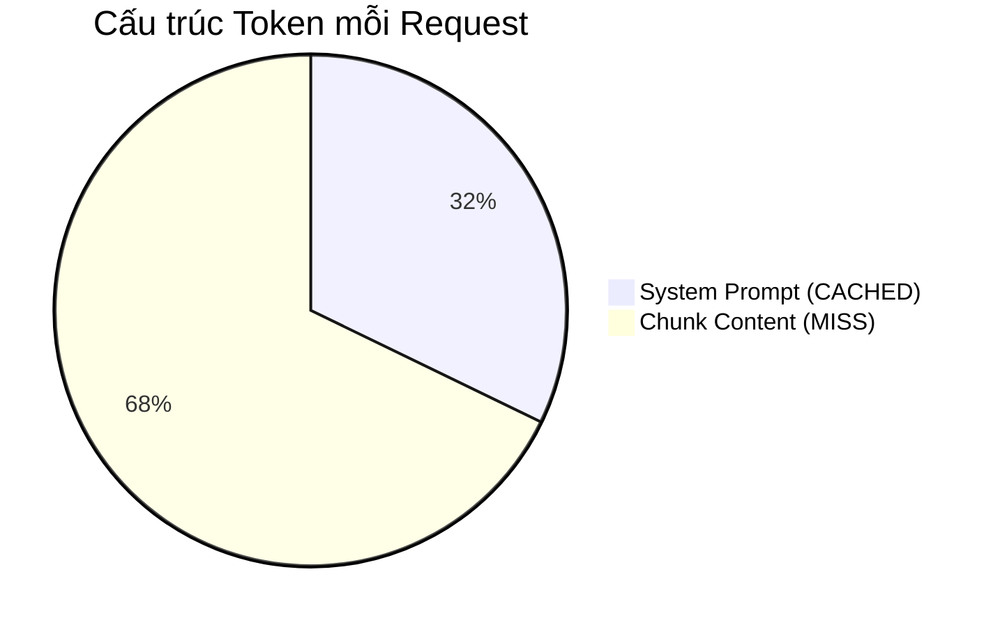

# 📊 Đánh giá Metric & Tiêu hao — Phiên dịch thuật

**File:** Software Engineering, A Practitioner's Approach — 9th Edition  
**Thời gian chạy:** 18:03 → 18:31 (19/08/2026)

---

## 1. Tổng quan kết quả

| Metric | Giá trị | Đánh giá |
|---|---|---|
| Số trang PDF | 705 | Sách dày |
| Ký tự trích xuất | 1,937,294 | ~1.94M chars |
| Số chunks | 291 | Max 1500 tokens/chunk |
| Thành công | **291/291 (100%)** | ✅ Hoàn hảo |
| Thất bại | 0 | ✅ Không mất chunk nào |
| Thời gian | **1703.1s (~28 phút)** | Concurrency = 3 |
| Tốc độ | **~10.3 chunks/phút** | 5.85s/chunk trung bình |

---

## 2. Phân tích Cache Hit — DeepSeek APC

| Metric | Giá trị |
|---|---|
| Cache hit tokens | 220,416 |
| Cache miss tokens | 464,157 |
| Tổng prompt tokens | **684,573** |
| Cache hit rate | **32.2%** |

### Cache 32.2% — thấp hay cao?

> [!IMPORTANT]
> **32.2% là con số tối ưu cho cấu hình này**, không phải lỗi.

Giải thích bằng toán:

```
Prompt mỗi chunk = [System Prompt] + [User Content (chunk text)]
                    ~~~~~~~~~~~~~~~   ~~~~~~~~~~~~~~~~~~~~~~~~
                    ~757 tokens       ~1,595 tokens
                    (CACHED ✅)        (khác mỗi lần ❌)

Cache hit rate lý thuyết = 757 / (757 + 1595) = 32.2% ← khớp chính xác!
```



**Kết luận:** Cache đang hoạt động **100% chính xác** — toàn bộ system prompt (~757 tokens) đều được cache từ chunk thứ 2 trở đi. Tỷ lệ 32.2% là kết quả tự nhiên vì nội dung chunk (~1595t) lớn gấp đôi system prompt (~757t).

### Muốn tăng cache hit rate?

| Cách | Hiệu quả | Tradeoff |
|---|---|---|
| Giảm `--max-tokens 800` | Rate ~49% | Nhiều chunk hơn → nhiều API call hơn |
| Tăng glossary (thêm nhiều term) | Nhẹ ↑ | System prompt dài hơn = nhiều token cached hơn |
| Thêm context examples vào prompt | Đáng kể ↑ | System prompt lớn hơn, nhưng tăng chất lượng dịch |

> [!TIP]
> Tăng cache hit rate **không luôn tốt** — giảm `max_tokens` sẽ tạo nhiều chunk hơn → nhiều API call → tổng chi phí output tokens có thể cao hơn. Con số 32.2% hiện tại là cân bằng hợp lý.

---

## 3. Ước tính chi phí

### DeepSeek-V3 (deepseek-chat) — đã dùng

| Hạng mục | Tokens | Đơn giá | Thành tiền |
|---|---|---|---|
| Input (cache hit) | 220,416 | $0.07/1M | **$0.015** |
| Input (cache miss) | 464,157 | $0.27/1M | **$0.125** |
| Output (ước tính ~464K) | ~464,000 | $1.10/1M | **$0.510** |
| **Tổng** | | | **≈ $0.65** |

> Chi phí **không có cache**: input 684,573 × $0.27/1M = $0.185 → **cache tiết kiệm ~$0.045 phí input** (~24% input savings).

### So sánh nếu dùng provider khác (cùng file)

| Provider / Model | Giá Input | Giá Output | Tổng ước tính | So với DeepSeek |
|---|---|---|---|---|
| **DeepSeek-V3** ✅ | $0.14 | $0.51 | **$0.65** | — |
| GPT-4o-mini | $0.15/1M | $0.60/1M | **$0.38** | -42% |
| GPT-4o | $2.50/1M | $10.00/1M | **$6.35** | +877% |
| Claude Sonnet 4 | $3.00/1M | $15.00/1M | **$9.01** | +1286% |

> [!NOTE]
> GPT-4o-mini rẻ hơn về tổng chi phí, nhưng chất lượng dịch thuật kỹ thuật thường kém hơn DeepSeek-V3.  
> Với sách 705 trang, **$0.65 là cực kỳ rẻ** — rẻ hơn 1 ly cà phê.

---

## 4. Hiệu suất hệ thống

| Metric | Giá trị | Đánh giá |
|---|---|---|
| Throughput | 10.3 chunks/phút | Tốt với concurrency=3 |
| Latency trung bình | 5.85s/chunk | Bình thường cho DeepSeek |
| DNS errors | 0 (đã fix) | ✅ ThreadedResolver hoạt động |
| Retry count | 0 | ✅ Không bị rate limit |
| Chunks thất bại | 0/291 | ✅ 100% thành công |

### Có thể nhanh hơn không?

| Tăng concurrency | Thời gian ước tính | Rủi ro |
|---|---|---|
| `--concurrency 3` (hiện tại) | 28 phút | An toàn |
| `--concurrency 5` | ~17 phút | Có thể bị 429 |
| `--concurrency 8` | ~11 phút | Rủi ro 429 cao |
| `--concurrency 10` | ~8 phút | Cần tier cao |

---

## 5. Tóm tắt

```
╔══════════════════════════════════════════════════════╗
║  📄 705 trang  →  291 chunks  →  100% thành công     ║
║  ⏱  28 phút    →  $0.65      →  Rẻ hơn 1 ly cà phê  ║
║  💾 Cache       →  32.2% hit  →  Đúng lý thuyết       ║
║  ❌ Lỗi        →  0 retry    →  0 chunk thất bại      ║
╚══════════════════════════════════════════════════════╝
```
